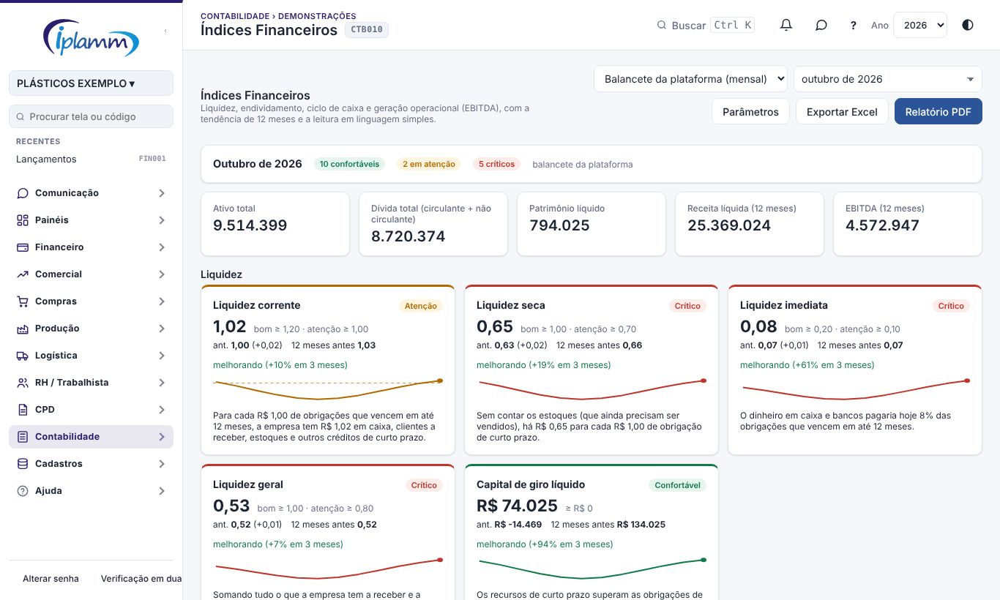
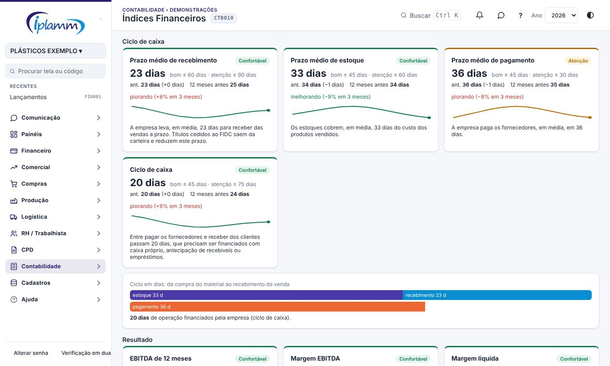
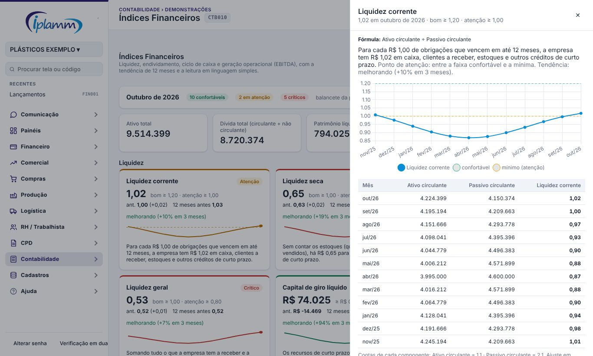
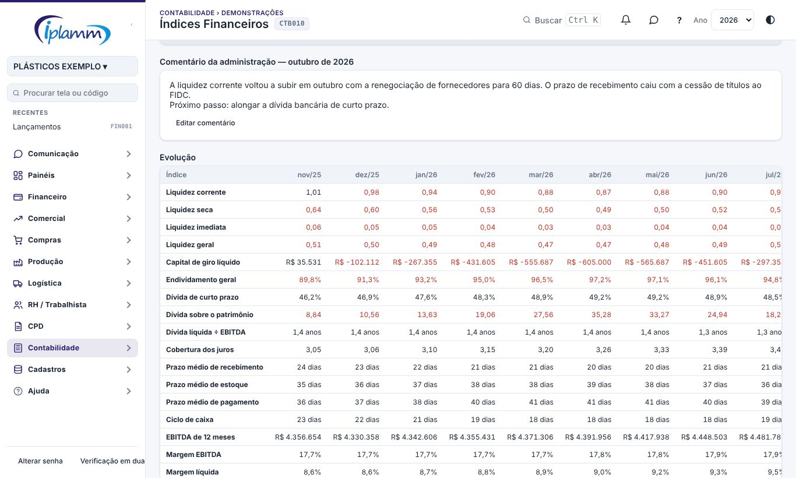
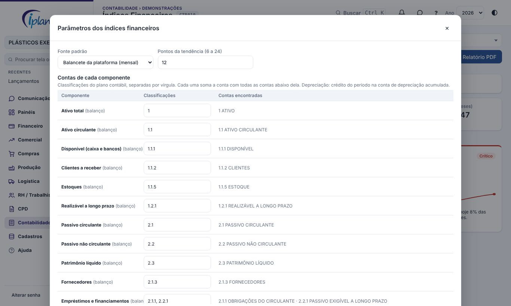

## 1. Para que serve

Mostra a saúde financeira da empresa em quatro grupos de índices, com a tendência de 12 meses e uma leitura em linguagem simples:

- **liquidez**: se a empresa consegue pagar o que vence em até 12 meses;
- **endividamento**: quanto da empresa é financiado por terceiros e quanto da dívida é de curto prazo;
- **ciclo de caixa**: em quantos dias a empresa recebe, gira o estoque e paga, e quantos dias de operação ela financia;
- **resultado**: a geração operacional de caixa (EBITDA) e as margens.

Cada índice é comparado com a **faixa da própria empresa** (confortável, atenção ou crítico). O botão **Relatório PDF** gera o documento no padrão oficial de relatório, em duas versões:

- para a **Diretoria**, com a deliberação para assinatura;
- para o **Administrador Judicial**, com o número do processo e a assinatura dos responsáveis pelas informações.

Os números vêm do **balancete**:

- o da plataforma, feito mês a mês a partir do saldo de abertura e dos lançamentos contábeis gerados;
- ou os balancetes importados da contabilidade.

## 2. Quem tem acesso

| Perfil | O que faz |
|---|---|
| Administrador e financeiro | Veem os índices, geram o relatório, escrevem o comentário do mês e alteram os parâmetros. |
| Diretor e leitura | Veem os índices e geram o relatório. |
| Compras, vendas e produção | Não veem a tela (área Contabilidade). |

## 3. A tela

No alto, escolha:

- a **fonte**: *Balancete da plataforma (mensal)* ou *Balancetes da contabilidade*. A fonte padrão fica nos Parâmetros;
- o **mês de referência**. O padrão é o último mês completo. O mês atual aparece como "parcial".

A faixa de resumo conta quantos índices estão confortáveis, em atenção e críticos. Logo abaixo ficam os números de base: ativo total, dívida total, patrimônio líquido, receita líquida e EBITDA dos últimos 12 meses.

### 3.1 O cartão do índice

Cada cartão mostra:

- o **nome** e a **situação** no canto;
- o **resultado** em destaque e a **faixa da empresa** ao lado;
- **ant.**: o valor do ponto anterior e a diferença;
- **12 meses antes**: o valor do mesmo mês do ano anterior;
- a **tendência**: a média dos 3 últimos pontos contra a dos 3 anteriores. Fica verde quando melhora e vermelha quando piora, conforme o sentido do índice (no endividamento e nos prazos de recebimento e de estoque, cair é bom);
- o **gráfico de 12 pontos**, com as linhas tracejadas das faixas quando elas cabem no gráfico;
- a **leitura**: o que o número quer dizer, em português simples.

Clique no cartão para abrir o detalhe (seção 4).

### 3.2 Os índices

| Grupo | Índice | Como é calculado | Melhor quando |
|---|---|---|---|
| Liquidez | Liquidez corrente | Ativo circulante ÷ Passivo circulante | Maior |
| Liquidez | Liquidez seca | (Ativo circulante − Estoques) ÷ Passivo circulante | Maior |
| Liquidez | Liquidez imediata | Disponível ÷ Passivo circulante | Maior |
| Liquidez | Liquidez geral | (Ativo circulante + Realizável a longo prazo) ÷ (Passivo circulante + não circulante) | Maior |
| Liquidez | Capital de giro líquido | Ativo circulante − Passivo circulante (R$) | Maior |
| Endividamento | Endividamento geral | Dívida total ÷ Ativo total | Menor |
| Endividamento | Dívida de curto prazo | Passivo circulante ÷ Dívida total | Menor |
| Endividamento | Dívida sobre o patrimônio | Dívida total ÷ Patrimônio líquido | Menor |
| Endividamento | Dívida líquida ÷ EBITDA | (Empréstimos e financiamentos − Disponível) ÷ EBITDA de 12 meses, em anos | Menor |
| Endividamento | Cobertura dos juros | EBITDA de 12 meses ÷ Despesas financeiras de 12 meses | Maior |
| Ciclo de caixa | Prazo médio de recebimento | Clientes ÷ Receita bruta de 12 meses × 360 dias | Menor |
| Ciclo de caixa | Prazo médio de estoque | Estoques ÷ Custo dos produtos vendidos de 12 meses × 360 dias | Menor |
| Ciclo de caixa | Prazo médio de pagamento | Fornecedores ÷ Custo dos produtos vendidos de 12 meses × 360 dias | Maior |
| Ciclo de caixa | Ciclo de caixa | Recebimento + Estoque − Pagamento, em dias | Menor |
| Resultado | EBITDA de 12 meses | Resultado + Despesas financeiras − Receitas financeiras + Resultado não operacional + IR e CSLL + Depreciação | Maior |
| Resultado | Margem EBITDA | EBITDA ÷ Receita líquida, 12 meses | Maior |
| Resultado | Margem líquida | Resultado ÷ Receita líquida, 12 meses | Maior |

Regras gerais:

- **Saldos de balanço**: a posição no fim do mês (ou do balancete importado). O resultado do ano ainda não encerrado entra no patrimônio líquido, como no Balanço Patrimonial.
- **Resultado de 12 meses**:
  - na plataforma, soma dos 12 últimos meses. Com menos meses (logo depois do saldo de abertura), o valor é **anualizado** e a faixa de resumo avisa;
  - no balancete da contabilidade, o período do próprio balancete, anualizado.
- **Depreciação**: o crédito do período na conta de depreciação acumulada. Assim ela é somada uma vez só, mesmo quando passa pelo custo de produção e pelo estoque.
- Quando um índice **não se aplica**, o cartão explica o motivo:
  - patrimônio líquido negativo (passivo a descoberto);
  - EBITDA negativo;
  - nenhuma despesa financeira no período.

### 3.3 Ciclo de caixa e EBITDA

Abaixo dos prazos médios, duas barras mostram o ciclo em dias:

- na primeira, o estoque mais o recebimento;
- na segunda, o pagamento dos fornecedores.

A diferença entre as duas é o número de dias de operação que a empresa financia com caixa próprio, antecipação de recebíveis (FIDC) ou empréstimos.

No grupo Resultado, a tabela **Do resultado ao EBITDA** mostra cada ajuste dos 12 meses: resultado, despesas e receitas financeiras, resultado não operacional, IR e CSLL e depreciação.

## 4. Detalhe do índice

O detalhe abre ao lado e mostra:

- a **fórmula** e a leitura com a situação e a tendência;
- o **gráfico** dos 12 pontos com as linhas da faixa confortável e da mínima;
- a **tabela mês a mês** com os componentes do índice. Por exemplo, na liquidez corrente: ativo circulante, passivo circulante e o índice;
- as **contas** de cada componente, para conferir com o balanço.

## 5. Evolução e comentário da administração

A tabela **Evolução** mostra todos os índices nos 12 pontos. Os valores críticos aparecem em vermelho e, na última coluna, a faixa da empresa.

O **comentário da administração** é um texto por mês: o que explica os números e o que está sendo feito. Administrador e financeiro escrevem em **Escrever comentário**. O texto vai para o relatório, na seção "Comentário da administração".

**Exportar Excel** baixa a evolução dos índices, as fórmulas e os componentes em R$ de cada ponto.

## 6. Relatório em PDF

Clique em **Relatório PDF** e escolha o **destinatário**.

**Diretoria**:

- a lista de itens para a deliberação já vem com um plano de ação para cada índice crítico. Ajuste o texto, um item por linha;
- o documento termina com a deliberação e as assinaturas.

**Administrador Judicial**:

- informe o nome do Administrador Judicial (pessoa ou escritório);
- informe o número do processo. Ele vem dos parâmetros do Painel da Diretoria, quando preenchido;
- o documento sai sem deliberação, com a assinatura dos responsáveis pelas informações e o rodapé "Documento informativo – Administrador Judicial".

O relatório segue o padrão oficial: cabeçalho e rodapé corridos, seções e parágrafos numerados e tabelas numeradas. As seções são:

1. objeto e resumo;
2. posição patrimonial e resultado;
3. quadro de índices, com a faixa, a situação, o ponto anterior, 12 meses antes e a tendência;
4. leitura por grupo (liquidez, endividamento, ciclo de caixa e resultado);
5. evolução dos últimos 6 pontos;
6. comentário da administração;
7. metodologia, com todas as fórmulas;
8. fontes;
9. deliberação, na versão da Diretoria, ou responsáveis, na do Administrador Judicial.

Na janela que abre, use **Imprimir / salvar PDF**.

## 7. Parâmetros

Administrador e financeiro ajustam, em **Parâmetros**:

- **Fonte padrão** e **pontos da tendência** (de 6 a 24).
- **Contas de cada componente**: as classificações do plano contábil, separadas por vírgula. Cada uma soma a conta e todas as contas abaixo dela. Ao digitar, a coluna "Contas encontradas" mostra o nome de cada conta, ou "não encontrada". O padrão segue o plano da empresa:
  - 1.1 ativo circulante;
  - 1.1.1 disponível;
  - 1.1.2 clientes;
  - 1.1.5 estoques;
  - 2.1 passivo circulante;
  - 2.1.3 fornecedores;
  - 2.1.1 e 2.2.1 empréstimos e financiamentos;
  - 4.1.1 receita bruta;
  - 3.2.20.5 despesas financeiras;
  - 1.2.30.7 depreciação acumulada.
- **Faixas de cada índice**: o valor confortável e o mínimo (atenção). Além do mínimo, o índice fica crítico. O limite de atenção deve ficar do lado pior do confortável. Por exemplo, na liquidez corrente: confortável a partir de 1,20 e atenção a partir de 1,00.
- **Mostrar**: desmarque um índice para tirá-lo da tela e do relatório.

**Voltar ao padrão** restaura as contas, as faixas e os índices visíveis. Só o que difere do padrão é gravado. Cada alteração fica registrada na Auditoria.

## 8. Dúvidas frequentes

**Os índices do primeiro ano parecem diferentes dos da contabilidade.** Logo depois do saldo de abertura há menos de 12 meses de resultado, e o valor é anualizado. Confira a observação na faixa de resumo.

**O prazo médio de recebimento ficou baixo.** Títulos cedidos ao FIDC saem da carteira de clientes. O prazo mostra o que ainda está a receber, não o prazo de venda.

**A dívida líquida ÷ EBITDA está alta por causa da recuperação judicial.** O componente "Empréstimos e financiamentos" usa, por padrão, as contas 2.1.1 e 2.2.1. Elas podem incluir os credores do plano. Para medir só a dívida bancária, informe nos Parâmetros as contas analíticas dos empréstimos.

**A dívida sobre o patrimônio aparece como "não se aplica".** O patrimônio líquido está negativo, ou seja, há passivo a descoberto. A leitura do cartão mostra o valor.

**A fonte da contabilidade mostra poucos pontos.** Cada balancete importado é um ponto. Importe os balancetes mensais em Contabilidade › Balancete.

**Os números mudaram depois que eu já tinha gerado o relatório.** Lançamentos contábeis gerados depois, com data de um mês já mostrado, mudam o balancete daquele mês. Gere o relatório depois da geração contábil do mês.

## 9. Histórico de alterações

| Versão | Data | O que mudou |
|---|---|---|
| 1.0 | 08/11/2026 | Primeira versão: 17 índices em quatro grupos, faixas da empresa, tendência de 12 pontos, leitura em linguagem simples, detalhe com os componentes, ciclo em dias, do resultado ao EBITDA, comentário da administração, Excel e relatório PDF para a Diretoria ou o Administrador Judicial. |
