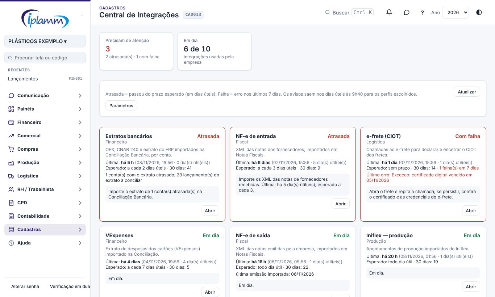
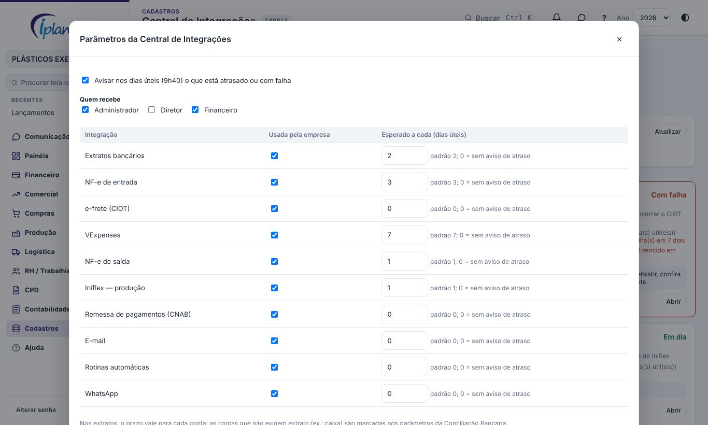

## 1. Para que serve

Mostra **numa tela** tudo o que entra e sai da plataforma por arquivo ou por serviço externo, e avisa quando algo **não chegou no prazo** ou **falhou**:

| Integração | O que acompanha |
|---|---|
| Extratos bancários | OFX, CNAB 240 e extrato do ERP, por conta |
| VExpenses | extrato de despesas dos cartões |
| NF-e de saída e de entrada | XML importados em Notas Fiscais |
| Iniflex — produção | apontamentos importados do Iniflex |
| e-frete (CIOT) | chamadas para declarar e encerrar o CIOT |
| Remessa de pagamentos (CNAB) | arquivos gerados para o banco |
| E-mail e WhatsApp | envios e erros das filas |
| Rotinas automáticas | os agendamentos do banco (avisos, cobranças, relatórios) |

Veem a tela o administrador, o diretor e o financeiro.

## 2. A tela

No topo aparecem quantas integrações **precisam de atenção** e quantas estão **em dia**. Cada cartão mostra:

- a **situação**:

  | Situação | Quando aparece |
  |---|---|
  | Atrasada | passou do prazo esperado, em dias úteis |
  | Com falha | erro nos últimos 7 dias |
  | Sem importação | nunca foi feita |
  | Em dia | dentro do prazo |
  | Sem uso | ainda não usada |
  | Não usada | desligada nos parâmetros |

- a **última** importação ou envio, há quanto tempo e quantos dias úteis;
- o **esperado** e quantas houve nos últimos 30 dias;
- o detalhe:
  - nos extratos: quantas contas estão atrasadas e quantos lançamentos do extrato faltam conciliar;
  - no e-mail e no WhatsApp: as mensagens paradas na fila;
- o **último erro**;
- o **próximo passo**, em uma frase, e o botão **Abrir** para a tela da integração.

Os cartões vêm por ordem de gravidade: atrasadas e com falha primeiro.

## 3. Aviso diário

Nos **dias úteis às 9h40**, quem estiver nos perfis escolhidos recebe **um aviso** (sino, celular e, se marcado em Meus avisos, e-mail ou WhatsApp) com as integrações atrasadas ou com falha. Se está tudo em dia, não há aviso.

## 4. Parâmetros (administrador)

Em **Parâmetros**:

- ligue ou desligue o aviso diário e escolha **quem recebe**: administrador, diretor e/ou financeiro;
- marque as integrações que a empresa **usa**. As não usadas saem dos avisos;
- informe o prazo **esperado a cada N dias úteis** de cada integração. Os padrões:

  | Integração | Prazo padrão |
  |---|---|
  | Extratos | 2 |
  | VExpenses | 7 |
  | NF-e de saída | 1 |
  | NF-e de entrada | 3 |
  | Iniflex | 1 |
  | As demais | 0 (só falhas) |

Nos **extratos**, o prazo vale para **cada conta**. As contas que não exigem extrato (ex.: caixa) são marcadas nos parâmetros da **Conciliação Bancária**.

## 5. Problemas comuns

**Extrato atrasado de uma conta que não movimenta.** Marque a conta como dispensada nos parâmetros da Conciliação Bancária.

**E-mail "com falha" ou mensagens paradas na fila.** O envio de e-mail precisa estar ligado, com o domínio validado e a chave do Resend cadastrada (E-mails da Plataforma). No WhatsApp: o token, o número e os modelos aprovados na Meta.

**e-frete com falha.** Abra o frete e repita. Se continuar, confira o certificado digital e as credenciais do e-frete.

**Os dias úteis não batem.** O cálculo usa os feriados nacionais (os mesmos do checklist do fechamento). Feriados locais não entram.

## 6. Histórico de alterações

| Versão | Data | O que mudou |
|---|---|---|
| 1.0 | 08/11/2026 | Primeira versão: 10 integrações com situação, última importação, falhas, próximo passo, prazo esperado e aviso diário (melhoria 1.6). |
