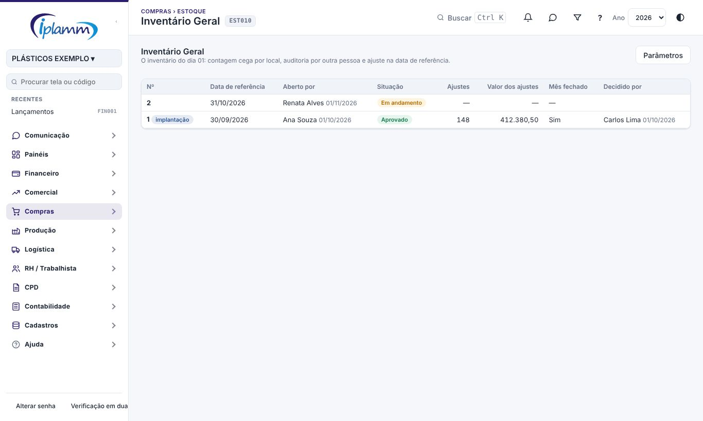
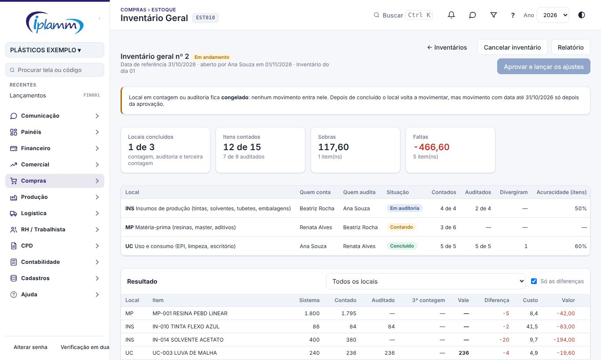
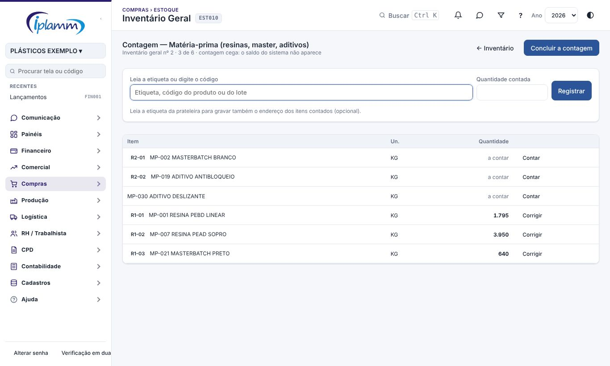
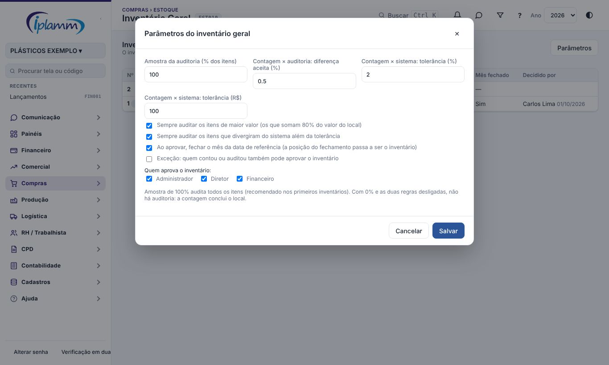

## 1. Para que serve

É o inventário completo do estoque, feito no dia 01 de cada mês. A tela organiza o trabalho do início ao fim:

- **abre o inventário** com a data de referência e os locais, cada um com quem conta e quem audita;
- **congela os locais** enquanto são contados;
- entrega a **guia cega** de contagem, no celular, no leitor de código de barras ou impressa;
- manda a **auditoria cega** para outra pessoa;
- pede a **terceira contagem** quando contagem e auditoria não batem;
- deixa quem gerencia **pedir recontagem** de itens sem cancelar o inventário;
- lança os **ajustes na data de referência** e **fecha o mês** na aprovação;
- mostra a **acuracidade** de cada local;
- permite ao administrador **desfazer** um inventário aprovado.

> Exemplo: no dia 01/12 abre-se o inventário com data de referência 30/11. Cada responsável conta o seu setor; outro responsável audita. Aprovado o inventário, o Kardex de 30/11 passa a ser exatamente o que foi contado.

O **Inventário Cíclico** (EST009) continua existindo para as contagens pequenas do dia a dia. O Inventário Geral é a contagem de tudo.

## 2. Quem tem acesso

| O que | Quem |
|---|---|
| Abrir, cancelar, trocar pessoas, informar custo, pedir recontagem | Administrador, Financeiro e Diretor |
| Desfazer um inventário aprovado | Administrador |
| Contar | A pessoa escolhida para o local |
| Auditar | O auditor do local (nunca quem contou) |
| Terceira contagem | Quem contou e quem auditou o local |
| Ver o resultado, com o saldo do sistema | Quem gerencia ou aprova, desde que não esteja contando nem auditando um local ainda em andamento |
| Aprovar | Os perfis marcados em **Parâmetros** |
| Alterar os parâmetros | Administrador |

Quem conta ou audita precisa ter um perfil de estoque: Administrador, Financeiro, Diretor, Compras ou Produção.

## 3. A tela

O menu é **Compras › Estoque › Inventário Geral**. A primeira tela lista os inventários já feitos e o que está em andamento.

Só pode haver **um inventário geral aberto** por vez.

### 3.1 Abrir o inventário

1. Clique em **Abrir inventário**.
2. Confira a **data de referência**. A tela sugere o último dia do mês anterior.
3. Marque os **locais** que serão contados.
4. Escolha **quem conta** cada local.
5. Em **quem audita**, deixe **Rodízio (automático)** ou escolha a pessoa.
6. Clique em **Abrir e congelar os locais**.

No rodízio, cada local é auditado por quem conta o local seguinte da lista. A plataforma nunca deixa a mesma pessoa contar e auditar o mesmo local.

Os responsáveis recebem um aviso com o local que vão contar.

### 3.2 O que entra na lista de cada local

- tudo que tem **saldo** no local no momento da abertura;
- tudo que **se movimentou** no local nos últimos 12 meses, mesmo com saldo zero;
- os produtos que têm o local como **local padrão** no cadastro.

O que for encontrado e não estiver na lista é incluído na hora da contagem (seção 5.2).

### 3.3 Controle de corte

A contagem é comparada com o **saldo do local no momento em que ele foi congelado**. Esse saldo inclui o que já tinha sido lançado depois da data de referência, por exemplo uma nota lançada na manhã do dia 01 antes da abertura. A diferença encontrada é lançada na **data de referência**.

> Exemplo: referência 30/11. No dia 01/12, antes de abrir o inventário, entrou uma nota de 500 kg. O sistema mostra 2.500 kg no congelamento. A contagem deu 2.480 kg. A falta de 20 kg é lançada em 30/11.

A abertura espera terminar qualquer lançamento que esteja em andamento naquele instante.

## 4. O painel do inventário

Ao abrir um inventário aparece o painel, com uma linha por local.

| Situação do local | Significa |
|---|---|
| Contando | O responsável está contando. O local está congelado. |
| Em auditoria | A contagem terminou. O auditor está conferindo. O local continua congelado. |
| Terceira contagem | Contagem e auditoria deram quantidades diferentes em algum item. |
| Concluído | O local terminou e voltou a movimentar. |

Cada pessoa vê o botão da sua vez: **Contar**, **Auditar** ou **Terceira contagem**.

Quem gerencia ou aprova vê também o **Resultado**: sistema, contado, auditado, terceira contagem, a quantidade que vale, a diferença e o valor. Quem conta e quem audita **não veem** essa parte.

Isso vale também para o gerente que foi escalado para contar ou auditar: ele só vê o resultado depois que o **seu** local terminar.

### 4.1 Trocar pessoas

Para falta ou férias, use **Trocar pessoas** na linha do local. Quem já contou itens de um local não pode passar a auditá-lo. Local que tem auditoria não pode ficar sem auditor.

## 5. Contagem cega

A lista de contagem **não traz o saldo do sistema**. Quem conta registra o que vê.

A contagem é cega em toda a plataforma: enquanto o local não termina, quem conta e quem audita **não veem o saldo, o Kardex, a posição do estoque nem o custo** dos itens daquele local, em nenhuma tela. Os outros locais continuam visíveis. Terminado o local, tudo volta a aparecer. O parâmetro **Contagem cega** (seção 10) liga e desliga essa regra.

### 5.1 Contar um item

1. Leia a **etiqueta** com o leitor de código de barras, ou digite o código do produto ou do lote. No celular, use **Ler pela câmera**.
2. O item aparece logo abaixo do campo.
3. Digite a **quantidade contada** e confirme.

O leitor envia Enter depois do código. A plataforma entende esse Enter como a escolha do item, e não como registro da quantidade.

Depois de registrar, o campo do código volta a ficar pronto para a próxima leitura, e a câmera continua ligada. Só a lista é atualizada.

Para corrigir, clique em **Corrigir** na linha, enquanto a contagem do local não foi concluída.

**Sem internet no local.** Se a conexão cair durante a contagem, a quantidade fica **guardada no aparelho**, com a marca **a enviar** na linha. Quando a internet volta, a plataforma envia sozinha. A contagem só pode ser concluída depois que tudo foi enviado. Não feche o navegador nem limpe os dados do aparelho enquanto houver itens a enviar.

### 5.2 Item encontrado fora da lista

Leia a etiqueta ou digite o código. A plataforma avisa que o item não está na lista do local e pergunta se deve incluir.

Produto que controla lote:

- com etiqueta de lote: leia a etiqueta;
- sem etiqueta (comum na implantação): leia o código do produto e digite o **código do lote** escrito na embalagem. A plataforma cria o lote ali mesmo, com origem "inventário". Digitar de novo o mesmo código não duplica o lote.

### 5.3 Concluir a contagem

Clique em **Concluir a contagem**. Se houver item sem quantidade, a plataforma pergunta se eles não foram encontrados. Confirmando, ficam com **zero**.

Depois de concluída, a contagem não pode mais ser alterada por quem contou.

### 5.4 Guia cega impressa

No painel, **Guia cega** imprime a lista do local sem quantidades, com espaço para anotar, hora de início e fim e assinatura. Serve para o local sem sinal de celular. As quantidades anotadas são digitadas depois, na mesma tela de contagem.

## 6. Auditoria cega e terceira contagem

### 6.1 Auditoria

Concluída a contagem, o auditor é avisado. Ele recebe a lista **sem o saldo do sistema e sem a contagem** já feita, e conta de novo.

Quais itens o auditor confere depende dos parâmetros (seção 10):

- um **percentual** dos itens, por sorteio (100% audita tudo);
- sempre os itens de **maior valor** do local;
- sempre os itens que **divergiram do sistema** além da tolerância.

Ao **Concluir a auditoria**:

- item em que auditoria e contagem batem: vale a contagem;
- item com quantidades diferentes: vai para a terceira contagem.

### 6.2 Terceira contagem

Quem contou e quem auditou contam **juntos** o item divergente. Agora os dois veem as duas quantidades.

1. Um dos dois registra a quantidade que vale, com a **justificativa** da diferença (obrigatória).
2. O outro abre a mesma tela e clica em **Confirmar**. Se não concordar, registra outra quantidade, e é a vez do primeiro confirmar.

O item só fica resolvido com a confirmação dos dois. Resolvido o último item, o local fica **Concluído**.

### 6.3 Recontagem pedida por quem gerencia

Ao conferir o resultado, quem gerencia ou aprova pode desconfiar de um item de um local já concluído.

1. No **Resultado**, marque a caixa dos itens na última coluna (um local por vez).
2. Clique em **Pedir recontagem dos marcados** e informe o motivo.
3. Os itens voltam para a **terceira contagem**, feita e confirmada por quem contou e quem auditou. Local sem auditor volta para a contagem.

O local fica congelado de novo até a recontagem terminar. O inventário não precisa ser cancelado. Quem conta ou audita o local não pede a recontagem dele.

## 7. Congelamento dos locais

| Momento | O que a plataforma faz |
|---|---|
| Local contando, em auditoria ou em terceira contagem | Não aceita nenhum movimento no local: nota, requisição, transferência, produção ou lançamento à mão. |
| Local concluído, inventário ainda não aprovado | Aceita movimento com data **depois** da data de referência. Movimento com data até a referência fica barrado. |
| Inventário aprovado | O mês da referência é fechado. Mesmo que o mês seja reaberto, o local inventariado não aceita movimento com data até a referência. |
| Inventário cancelado | Os locais são liberados e nada é ajustado. |
| Contagem cíclica | Não pode ser criada em local que está no inventário geral em andamento. |

> O que for produzido ou recebido durante a contagem fica separado fisicamente e é lançado depois que o local for concluído.

Enquanto houver inventário geral aberto com referência no mês, o fechamento do estoque daquele mês também fica barrado.

## 8. Aprovação, ajustes e fechamento do mês

Com todos os locais concluídos, o botão **Aprovar e lançar os ajustes** é liberado.

Na aprovação a plataforma:

1. lança um movimento para cada item com diferença, **na data de referência**, com o documento **IG** e o número do inventário;
2. usa **Ajuste de inventário (sobra)** ou **Ajuste de inventário (falta)**;
3. **fecha o mês** da data de referência, quando esse parâmetro está ligado.

Assim, a posição guardada no fechamento é o próprio inventário.

**Custo dos ajustes.** O ajuste sai pelo custo médio do produto **na data de referência**, e não pelo custo de hoje: a plataforma recalcula o produto antes de fechar o mês. A sobra entra pelo custo médio do produto. Produto que ainda não tem custo médio entra como saldo inicial, pelo custo do inventário. Se o item estiver sem custo, o resultado mostra o botão **Custo**; sem informar, a plataforma pede confirmação para entrar a custo zero.

**Quem aprova.** Quem contou ou auditou não aprova o mesmo inventário, a não ser que a exceção esteja ligada nos parâmetros.

O botão **Relatório** emite o resultado no padrão da plataforma: acuracidade por local e a lista das diferenças.

### 8.1 Desfazer um inventário aprovado

Se o inventário foi aprovado com erro, o **administrador** usa **Desfazer inventário** no painel, com o motivo.

- Todos os ajustes são estornados na **data de referência**.
- O mês que o inventário fechou é **reaberto**.
- No inventário de implantação, o estoque volta a constar como não implantado.
- O inventário fica na lista como **Desfeito**.

Só o último inventário aprovado pode ser desfeito, e só se não houver outro aberto. Se uma saída lançada depois não deixar saldo para devolver uma sobra, a mensagem diz o item e o local.

## 9. O primeiro inventário serve de implantação

Enquanto o estoque não foi implantado, o inventário geral aparece marcado como **implantação**:

- a lista de cada local vem dos produtos que têm aquele **local padrão** no cadastro, mais o que for incluído na contagem;
- o que for contado e auditado vira o **saldo inicial** do local, na data de referência;
- o custo de cada item vem da última compra; se não houver, é informado no resultado;
- ao aprovar, o estoque fica **implantado** na data de referência.

## 10. Parâmetros

| Parâmetro | Padrão | Para que serve |
|---|---|---|
| Amostra da auditoria (% dos itens) | 100 | Quanto da lista o auditor confere. 100 audita tudo. |
| Sempre auditar os itens de maior valor | Ligado | Os itens que somam 80% do valor do local entram sempre. |
| Sempre auditar os divergentes | Ligado | O item que divergiu do sistema além da tolerância entra sempre. |
| Contagem × auditoria: diferença aceita (%) | 0,5 | Acima disso o item vai para a terceira contagem. |
| Contagem × sistema: tolerância (% e R$) | 2 e 100 | Define o item "dentro da tolerância" na acuracidade e o divergente da amostra. |
| Contagem cega | Ligado | Quem conta ou audita não vê saldo, Kardex nem custo do local enquanto ele não termina. |
| Fechar o mês ao aprovar | Ligado | Fecha o mês da data de referência. |
| Quem contou ou auditou pode aprovar | Desligado | Exceção para equipe pequena. |
| Quem aprova | Administrador, Diretor, Financeiro | Perfis que aprovam o inventário. |

Com amostra 0% e as duas regras desligadas não há auditoria: a contagem conclui o local.

## 11. Acuracidade

| Indicador | Como é calculado |
|---|---|
| Acuracidade (itens) | Itens dentro da tolerância ÷ itens do local. |
| Acuracidade (valor) | 100% menos o valor das diferenças (sobras e faltas somadas, sem compensar) ÷ valor do local. |
| Divergiram na auditoria | Itens que foram para a terceira contagem. Mede a qualidade da contagem. |
| Tempo de contagem | Do primeiro item contado até a conclusão da contagem. |

## 12. Roteiro do dia 01

1. **Antes**: confira se todo produto tem cadastro e, de preferência, etiqueta. Separe fisicamente o que chegar ou for produzido durante a contagem.
2. **Abrir** o inventário com a data de referência do último dia do mês anterior.
3. **Contar**: cada responsável conta o seu local e conclui.
4. **Auditar**: cada auditor confere o local que recebeu.
5. **Terceira contagem** dos itens divergentes, pelos dois.
6. **Conferir o resultado**, informar custo onde faltar e emitir o relatório.
7. **Aprovar**: os ajustes entram e o mês é fechado.
8. **Lançar** o que ficou separado durante a contagem.

## 13. Dúvidas comuns

**Quem conta consegue ver o saldo do sistema em outra tela?** Não. Com o parâmetro **Contagem cega** ligado (padrão), o saldo, o Kardex e o custo do local somem para quem conta e para quem audita até o local terminar. Quem gerencia e não está escalado no local continua vendo tudo.

**Posso abrir o inventário no meio do mês?** Pode. A data de referência é livre, desde que não seja futura nem de mês fechado. O mês só é fechado quando a referência é o último dia de um mês já terminado.

**A aprovação deu erro em um item.** A mensagem diz o item e o local. O caso mais comum é uma saída lançada depois de o local ser concluído, que não deixa saldo para a falta apontada. Estorne essa saída, aprove o inventário e lance a saída de novo.

**E se a nota chegar durante a contagem?** A entrada no local congelado é barrada. Lance depois que o local for concluído.

**Errei a contagem depois de concluir.** A auditoria existe para isso: o item vai para a terceira contagem. Para um item, quem gerencia pede recontagem (seção 6.3). Se o erro for geral, quem gerencia cancela o inventário e abre outro. Depois de aprovado, só o administrador desfaz (seção 8.1).

## 14. Histórico de versões

| Versão | Data | O que mudou |
|---|---|---|
| 1.0 | 22/11/2026 | Primeira versão: inventário geral com data de referência, congelamento dos locais, contagem cega, auditoria cega por rodízio, terceira contagem, ajustes na data de referência, fechamento do mês, acuracidade por local e implantação pelo primeiro inventário. |
| 1.1 | 22/11/2026 | Controle de corte: a contagem é comparada com o saldo do congelamento. Ajuste pelo custo da data de referência. Terceira contagem com justificativa obrigatória e confirmação da outra pessoa. Quem conta ou audita só vê o resultado depois que o seu local termina. Local com auditoria não fica sem auditor. Contagem cíclica barrada em local do inventário geral. Erro da aprovação aponta o item. |
| 1.2 | 22/11/2026 | Contagem cega em toda a plataforma (saldo, Kardex e custo escondidos de quem conta ou audita, por parâmetro). Recontagem pedida por quem gerencia, sem cancelar o inventário. Desfazer inventário aprovado (administrador). Lote criado na própria contagem. Local inventariado não aceita movimento com data até a referência, mesmo com o mês reaberto. |
| 1.3 | 22/11/2026 | Contagem mais rápida no celular: registrar não recarrega a tela. Sem internet, a quantidade fica guardada no aparelho e é enviada quando a conexão volta. |
