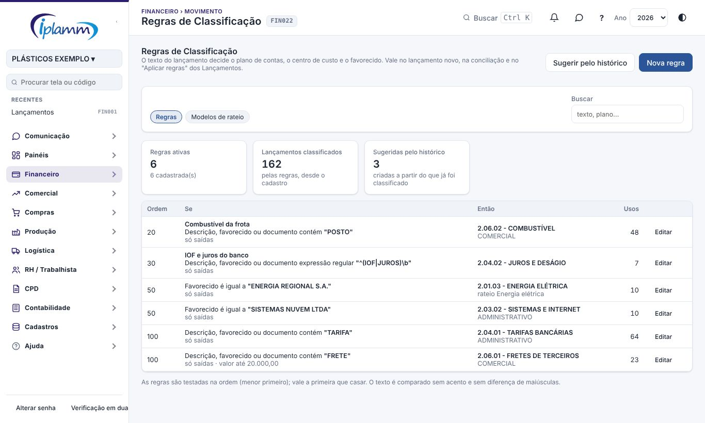
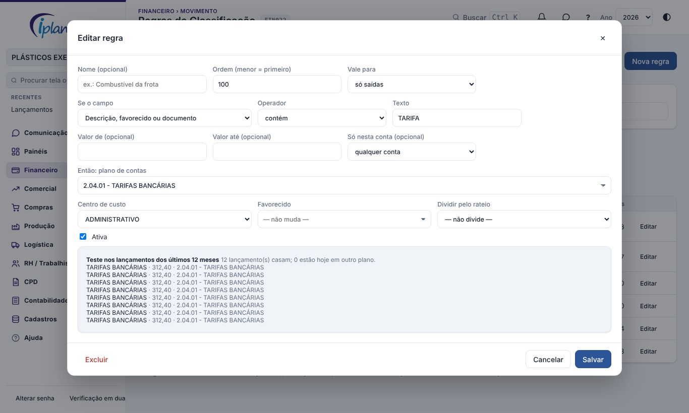
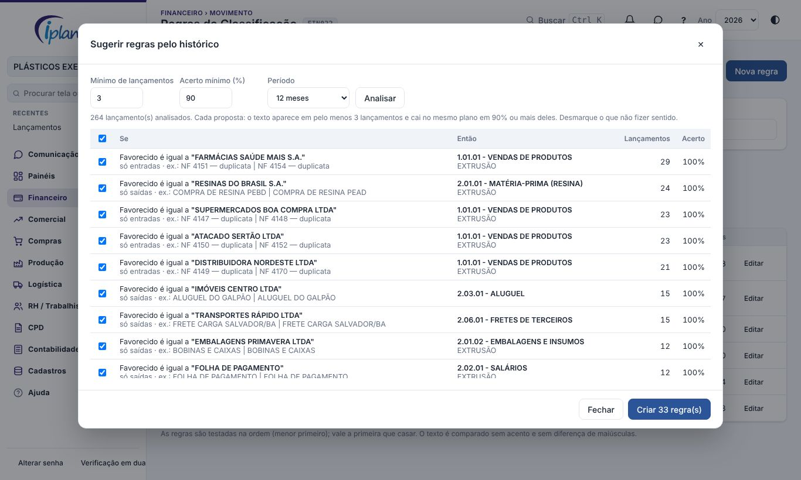
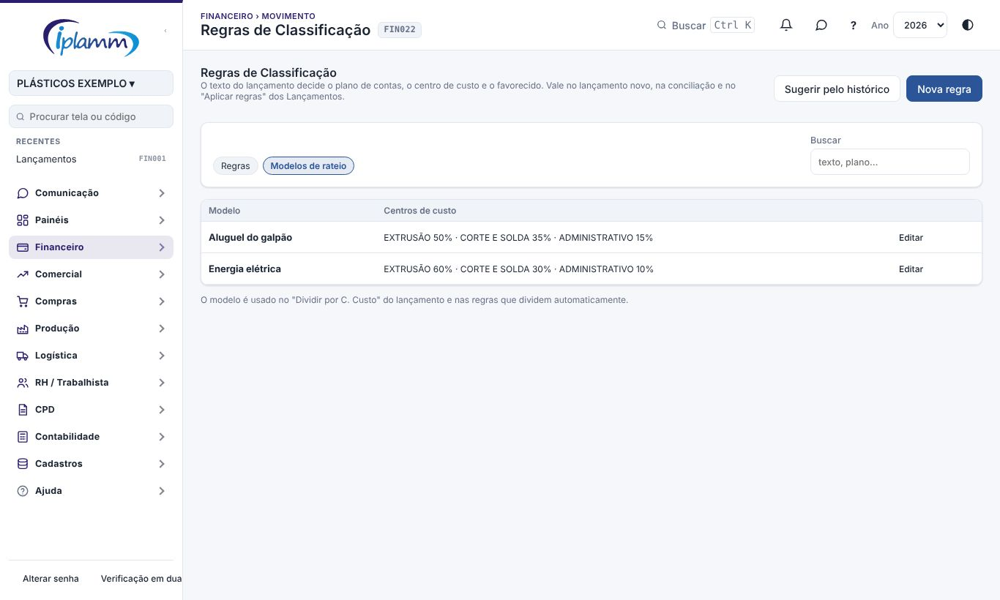
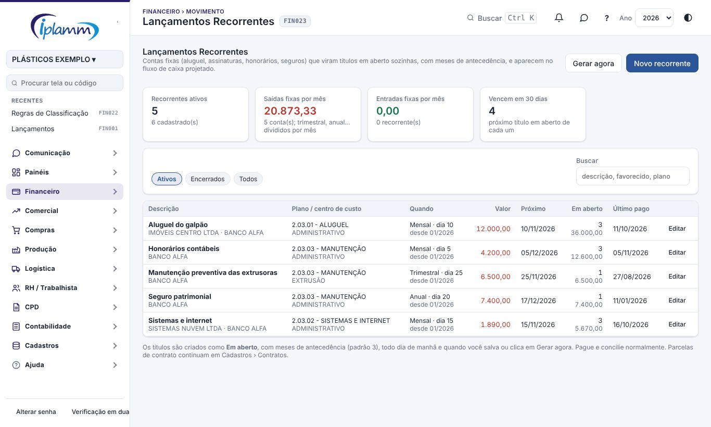
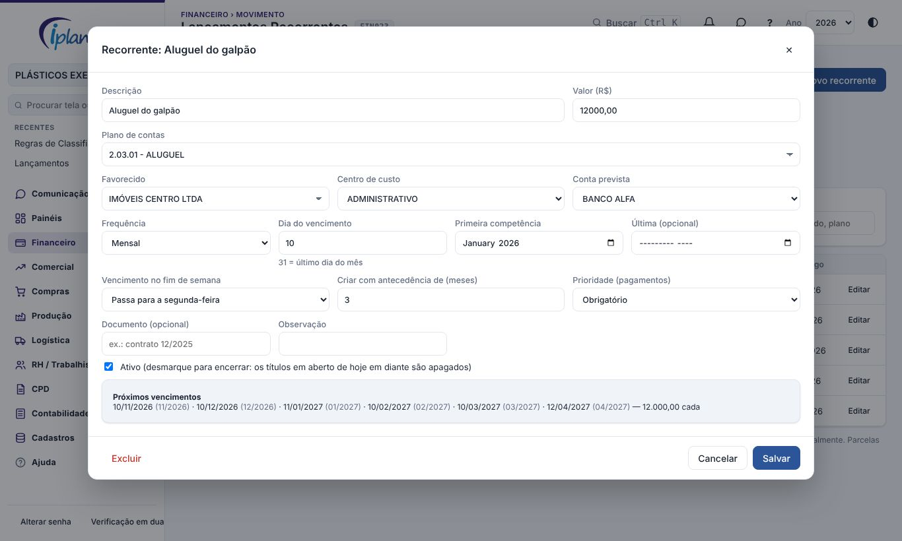

## 1. Para que serve

Três ferramentas para lançar menos à mão e classificar sempre igual.

- **Regras de classificação**: "se o histórico tem POSTO, então 2.06.02 COMBUSTÍVEL, centro de custo COMERCIAL". A regra preenche o plano de contas, o centro de custo e o favorecido:
  - no **lançamento novo**;
  - no **Criar lançamento** da Conciliação Bancária;
  - no **Aplicar regras** dos Lançamentos, em lote.

  **Sugerir pelo histórico** propõe as regras a partir do que você já classificou.
- **Modelos de rateio**: a divisão de uma despesa entre centros de custo (por exemplo, energia 60% Extrusão, 30% Corte e Solda, 10% Administrativo). O modelo é usado no **Dividir por C. Custo** do lançamento e nas regras que dividem sozinhas.
- **Lançamentos recorrentes**: as contas fixas (aluguel, assinaturas, honorários, seguros) viram **títulos em aberto** sozinhas, com meses de antecedência, e aparecem no fluxo de caixa projetado e nas Contas a Pagar.

## 2. Quem tem acesso

| Perfil | O que faz |
|---|---|
| Administrador e financeiro | Criam, editam e excluem regras, rateios e recorrentes; geram os títulos. |
| Demais perfis | Consultam. |

## 3. Regras de classificação

Cada regra tem duas partes.

**Se:**

- o **campo**: descrição, favorecido, documento, ou os três juntos;
- o **operador**: contém, começa com, é igual a, ou expressão regular;
- o **texto**;
- se quiser, **só entradas** ou **só saídas**, uma faixa de **valor** e **uma conta**.

**Então:**

- o **plano de contas**;
- e, se quiser, o **centro de custo**, o **favorecido** e o **rateio**.

As regras são testadas na **ordem**, da menor para a maior, e vale a primeira que casar. O texto é comparado sem acento e sem diferença de maiúsculas.

No **lançamento novo**, a regra age assim que você digita a descrição ou o favorecido:

- preenche o plano;
- preenche o centro de custo e o favorecido, se estiverem vazios;
- mostra o aviso **regra** com o nome dela.

Se você trocar o plano à mão, a regra não mexe mais naquele lançamento.

### 3.1 Criar e testar uma regra

Clique em **Nova regra** ou em **Editar**. Enquanto você preenche, o quadro **Teste** mostra quantos lançamentos dos últimos 12 meses casam com a regra e quantos estão hoje em outro plano. Marque **reclassificar também esses lançamentos** para corrigir o passado ao salvar; os conciliados ficam como estão.

### 3.2 Sugerir pelo histórico

A plataforma analisa os lançamentos do período (6, 12 ou 24 meses) e propõe uma regra para cada favorecido ou palavra do histórico que cumpre as duas condições:

- aparece em pelo menos **N lançamentos** (padrão 3);
- cai no mesmo plano em **X% ou mais** deles (padrão 90%).

Ficam de fora as regras que já existem e as palavras que só repetem o favorecido. Desmarque o que não fizer sentido e clique em **Criar as regras marcadas**.

## 4. Modelos de rateio

Na aba **Modelos de rateio**, cadastre o nome e os centros de custo com o percentual de cada um. A soma precisa dar **100%**.

O modelo aparece em dois lugares:

- no **Dividir por C. Custo** do lançamento: escolha o modelo e as partes vêm calculadas;
- na regra, em **Dividir pelo rateio**: o lançamento classificado pela regra é dividido sozinho no **Aplicar regras**.

## 5. Lançamentos recorrentes

Os indicadores mostram:

- as **saídas** e **entradas fixas por mês** (trimestral, anual e as demais frequências divididas por mês);
- quantos recorrentes vencem nos próximos 30 dias.

Para cada recorrente, a lista mostra o **próximo vencimento**, os títulos **em aberto** e o **último pago**.

### 5.1 Cadastrar

1. Clique em **Novo recorrente** e preencha:
   - a descrição, o valor e o plano de contas;
   - o favorecido, o centro de custo e a conta prevista.
2. Escolha a **frequência** (mensal, bimestral, trimestral, semestral ou anual) e o **dia do vencimento**. Use 31 para o último dia do mês.
3. Informe a **primeira competência** e, se houver, a **última**.
4. Escolha o que fazer com o vencimento no **fim de semana**: passar para a segunda-feira, antecipar para a sexta-feira ou manter.
5. Escolha com quantos **meses de antecedência** os títulos são criados (padrão 3).
6. Confira a **prévia dos próximos vencimentos** e clique em **Salvar**.

**Quando os títulos são criados:**

- ao salvar o recorrente;
- todo dia de manhã;
- no botão **Gerar agora**.

Cada competência vira **um** título em aberto, nunca dois. Pague e concilie esses títulos normalmente.

**Mudou o valor ou o plano?** Ao salvar, os títulos em aberto de hoje em diante são atualizados.

**Para encerrar**, informe a última competência ou desmarque **Ativo**. Os títulos em aberto depois do fim são apagados. Os pagos e os conciliados ficam.

> Parcelas de **contrato** continuam em **Cadastros › Contratos**. O recorrente é para as contas fixas sem contrato cadastrado.

## 6. Regras e travas

- A regra precisa de texto e plano de contas. Expressão regular inválida é recusada.
- O rateio precisa de pelo menos dois centros de custo, que somem 100%.
- O **Aplicar regras** e a **edição em lote** não mudam lançamentos conciliados nem transferências. Entrada continua entrada e saída continua saída.
- Recorrente: o valor tem de ser maior que zero e a última competência não pode ser antes da primeira. Títulos de mais de um mês atrás não são criados quando o início do recorrente é antigo.

## 7. Perguntas frequentes e erros comuns

**A regra não agiu no lançamento.** Verifique três coisas:

- se o plano foi escolhido à mão antes de digitar a descrição;
- se a regra está ativa;
- se outra regra de ordem menor casou antes. Use o **Teste** da regra para conferir.

**O título do recorrente não apareceu.** Ele é criado até o fim do mês de hoje mais os meses de antecedência. Clique em **Gerar agora** para criar na hora.

**Criei o recorrente com início em janeiro e não vieram os meses passados.** Para não duplicar o que já foi lançado, só são criados os títulos do último mês em diante.

## 8. Histórico de alterações

| Versão | Data | O que mudou |
|---|---|---|
| 1.0 | 07/11/2026 | Primeira versão: regras de classificação (com teste e sugestão pelo histórico), modelos de rateio e lançamentos recorrentes. |
