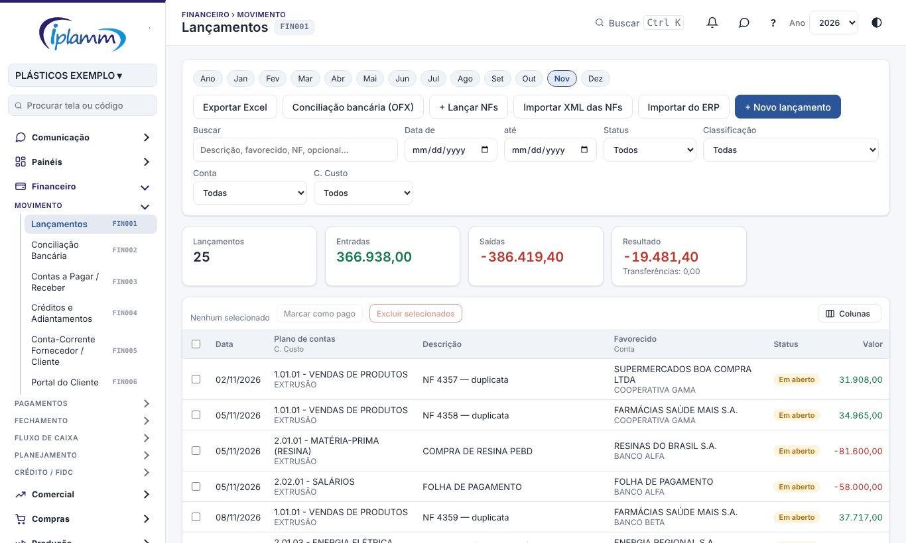
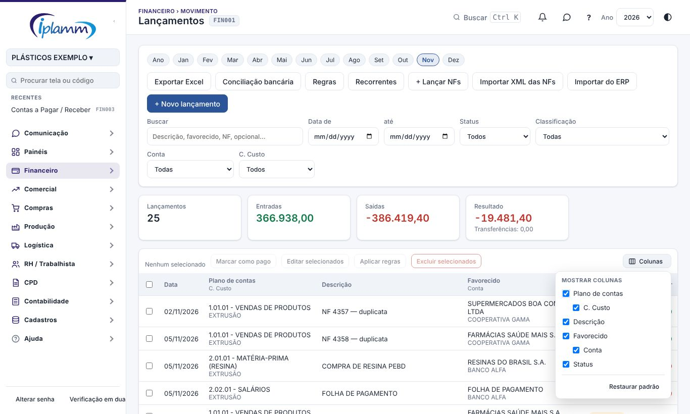
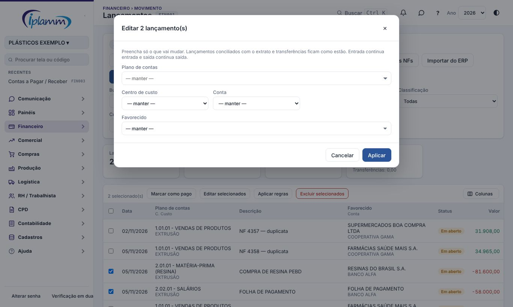
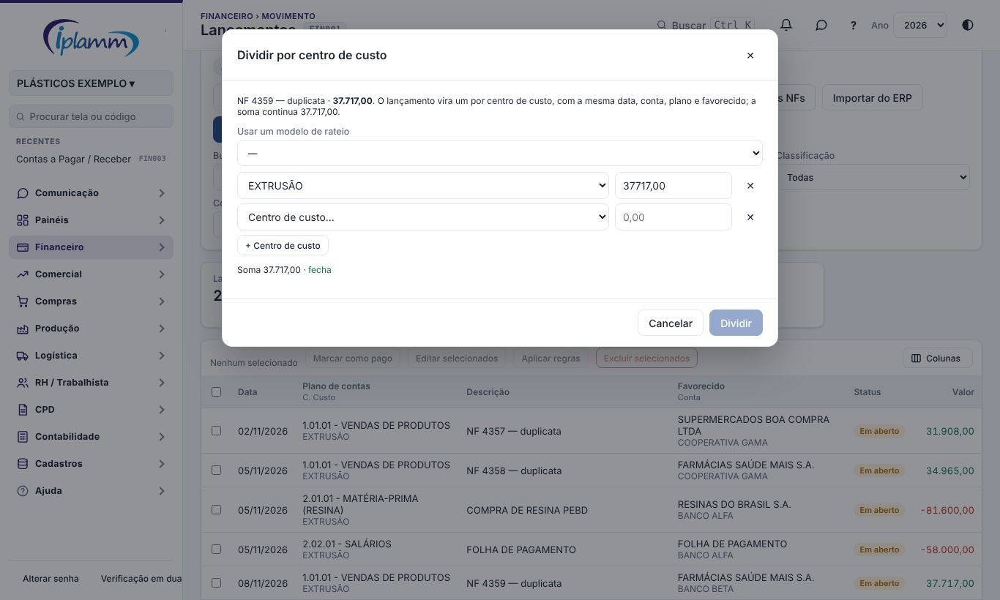
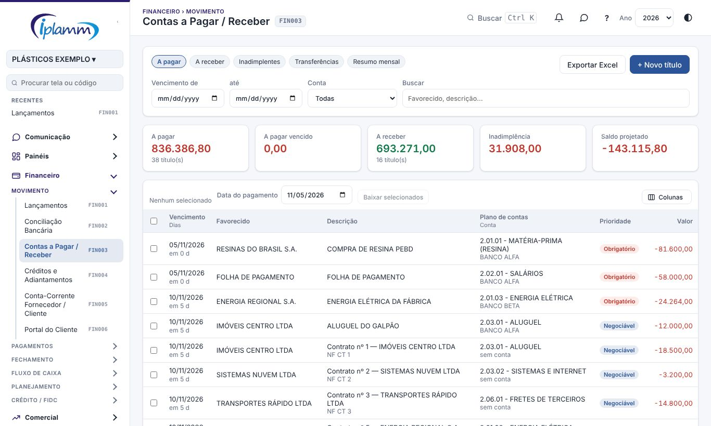

## 1. Para que serve

**Lançamentos** é o livro-caixa da plataforma: cada entrada, saída ou transferência entre contas é um lançamento. Cada um tem:

- data;
- valor (sempre positivo);
- plano de contas, que dá o sinal: as entradas somam e as saídas subtraem;
- conta bancária;
- favorecido;
- centro de custo;
- situação: **Pago** ou **Em aberto**.

**Contas a Pagar / Receber** mostra só o que está **Em aberto**: os títulos a pagar e a receber, os vencidos e o resumo por mês. É nessa tela que se dá a baixa em lote.

## 2. Quem tem acesso

| Perfil | O que faz |
|---|---|
| Administrador e financeiro | Lançam, editam, baixam, importam e excluem. |
| Diretor e leitura | Consultam e exportam, sem alterar. |

O botão **Histórico** dentro do lançamento, que mostra quem alterou o quê, aparece para o administrador e o diretor.

## 3. Lançamentos

### 3.1 Filtros e totais

- **Período**: os botões dos meses no topo (**Ano**, Jan, Fev…) filtram pelo ano escolhido no topo da plataforma. **Data de / até** troca o filtro por mês por um período livre; **Limpar datas** volta ao filtro por mês.
- **Outros filtros**: busca (descrição, favorecido, NF, opcional), status, classificação, conta (inclusive "(sem conta)") e centro de custo.
- **Totais**: os indicadores somam o que está filtrado: quantidade, entradas, saídas, resultado e transferências.
- **A lista**: Data, Plano de contas (com o **centro de custo** na 2ª linha), Descrição, Favorecido (com a **conta** na 2ª linha), Status e Valor. Assim a lista cabe inteira na tela do notebook, sem rolar para o lado.
- **Colunas**: o botão **Colunas**, à direita da barra da lista, abre a lista de caixas para mostrar ou ocultar Plano de contas, C. Custo, Descrição, Favorecido, Conta e Status. A escolha fica guardada para você nesta tela; **Restaurar padrão** volta a mostrar tudo. O **Exportar Excel** sai sempre com todas as colunas.
- **Selos na lista**:
  - **✓ conciliado**: o lançamento já foi conferido com o extrato do banco.
  - **NF ✓**: o lançamento está ligado a uma NF-e importada.
  - **⇄**: transferência (sai de uma conta e entra na outra).

### 3.2 Novo lançamento

1. Clique em **+ Novo lançamento**.
2. Preencha a **data / vencimento**, o **status**, o **valor**, o **plano de contas** e a **conta / banco**.
3. Preencha a descrição, o centro de custo e o **favorecido**. Digite para buscar no cadastro; se o nome não existir, ele é cadastrado sozinho.
4. Se quiser, informe a prioridade, o nº da **NF / documento**, a **emissão** e os opcionais 1 a 4.
5. Clique em **Salvar**.

> **Transferência entre contas:** escolha o plano de transferência. Aparecem os campos **De (conta de origem)** e **Para a conta (destino)**. A transferência é **um lançamento só**: sai de uma conta e entra na outra.

> **Pago com atraso:** em lançamento **Pago** aparece o quadro **Juros e multa**. Juros, multa e desconto viram lançamentos separados, na mesma data e conta, e o valor do título continua o original. Nos recebimentos, juros e multa recebidos (1.02.17) geram a **nota de débito** a emitir em **Fiscal › Notas de Débito**.

### 3.3 Editar, duplicar e excluir

Clique no lançamento para abrir. Os botões são **Salvar**, **Duplicar** (abre uma cópia para lançar outro parecido) e **Excluir**.

Para mudar vários de uma vez, marque as caixas na lista e use **Marcar como pago** ou **Excluir selecionados**.

### 3.5 Editar selecionados e aplicar regras

Marque os lançamentos na lista e use os botões da barra:

- **Editar selecionados**: muda o **plano de contas**, o **centro de custo**, a **conta** e o **favorecido** de todos de uma vez. Preencha só o que vai mudar.
- **Aplicar regras**: mostra o que cada **regra de classificação** muda nos selecionados (hoje e como fica) e aplica. Se a regra tiver rateio, o lançamento também é dividido. As regras ficam em **Financeiro › Regras de Classificação**.

Nos dois, os **conciliados** e as **transferências** ficam como estão, e entrada continua entrada e saída continua saída.

No **lançamento novo**, a regra age sozinha: ao digitar a descrição ou o favorecido, o plano, o centro de custo e o favorecido vêm preenchidos, com o aviso **regra**.

### 3.6 Dividir por centro de custo

Abra o lançamento e clique em **Dividir por C. Custo**. Informe as partes (centro de custo e valor) ou escolha um **modelo de rateio**. O lançamento vira um por centro de custo:

- com a mesma data, conta, plano e favorecido;
- com a descrição terminando em "(rateio 1/3)", "(rateio 2/3)"…;
- e a soma continua a mesma.

Lançamento conciliado não se divide: desfaça a conciliação, divida e concilie de novo, em grupo.

Contas fixas que se repetem todo mês (aluguel, assinaturas) ficam em **Financeiro › Lançamentos Recorrentes**: viram títulos em aberto sozinhas.

### 3.7 Importações

- **+ Lançar NFs**: lança títulos a receber por NF, à mão. Informe o cliente, a NF, a emissão e o valor, e clique em **Gerar parcelas** (por prazos em dias ou por nº de parcelas). Dá para juntar várias NFs antes de **Salvar títulos**.
- **Importar XML das NFs**: escolha os XML das NF-e de venda (vários de uma vez, ou um .zip). Cada duplicata da nota vira um título em aberto a receber, com o vencimento e o documento NF-parcela. São ignoradas: nota de entrada, nota de outro CNPJ, não autorizada, cancelada e parcela já lançada.
- **Importar do ERP**: use o relatório **RFLX036 — Extrato de Contas por Quebra por Conta Pagamento**, exportado em XLSX. Cada linha vira um lançamento **Pago** na conta do relatório, com o plano de contas pela "Conta Pagamento" do ERP e o favorecido pelo emitente. O que já existe (mesmo dia, valor e conta) é pulado, e o título em aberto da NF citada é baixado em vez de criar outro. Recebimento acima do título vira **Baixar + juros**: o título baixa pela face e a diferença vai para 1.02.17, gerando a nota de débito (desmarque se for pagamento a maior). Nada é gravado antes da sua revisão.
- **Exportar Excel**: baixa os lançamentos filtrados, com todas as colunas.

> O aging por faixa de atraso, a régua de cobrança e o PIX ficam em **Financeiro › Cobrança** (manual **Cobrança**).

## 4. Contas a Pagar / Receber

### 4.1 As abas

- **A pagar** e **A receber**: os títulos em aberto, com o vencimento e, na 2ª linha, os dias de atraso (ou quantos dias faltam). A **conta** aparece na 2ª linha do plano de contas, e a **Prioridade** (Obrigatório ou Negociável) só na aba A pagar.
- **Inadimplentes**: os títulos a receber já vencidos.
- **Transferências** programadas.
- **Resumo mensal**: quanto há a receber, a pagar e o saldo de cada mês.

Os indicadores mostram o total a pagar, o vencido, o total a receber, a inadimplência e o **saldo projetado**. Os filtros são vencimento de / até, conta e busca.

O botão **Colunas**, na barra da lista, mostra ou oculta Dias, Favorecido, Descrição, Plano de contas, Conta e Prioridade (a escolha fica guardada para você; **Restaurar padrão** volta tudo). O **Exportar Excel** baixa a aba aberta com todas as colunas: vencimento, dias de atraso (negativo = a vencer), favorecido, descrição, NF, plano de contas, conta, prioridade e valor.

### 4.2 Baixar títulos

1. Marque os títulos. O total marcado aparece no topo da lista.
2. Escolha a **Data do pagamento**.
3. Clique em **Baixar selecionados**. Os títulos passam para **Pago** nessa data.

### 4.3 Novo título

**+ Novo título** abre o formulário de lançamento já com o status **Em aberto**.

### 4.4 Montar borderô FIDC

Na aba **A receber**, marque os títulos e clique em **Montar borderô FIDC**. A plataforma abre **Propostas de Borderô** com eles para simular a operação.

Só entram títulos de receita (1.01) em aberto que não estejam em outra proposta; os demais ficam de fora, com aviso.

## 5. Regras e travas

- O valor tem que ser maior que zero. O sinal vem do plano de contas.
- Na transferência, a conta de destino precisa ser diferente da de origem.
- **Lançamento conciliado** com o extrato só aceita mudar a descrição e os opcionais. Para mudar valor, data, conta ou classificação, desfaça a conciliação antes. Conciliado também não pode ser excluído.
- **Conta fechada** no Fechamento do mês: os lançamentos pagos até a data da trava não podem mudar data, valor, conta ou situação, nem ser incluídos ou excluídos. A classificação, a descrição e o centro de custo continuam livres.
- **Caixa Carteira** (dinheiro em espécie) não pode terminar o dia negativa. A plataforma avisa ao salvar, para você lançar a entrada que falta (saque ou suprimento).
- Os relatórios de caixa só contam lançamentos **com conta bancária**.

## 6. Perguntas frequentes e erros comuns

**Não consigo mudar o valor de um lançamento.** Ele está conciliado ou a conta está travada. Veja o selo e o aviso no topo do formulário.

**O favorecido saiu duplicado.** Ao digitar um nome que não existe, a plataforma cadastra um novo. Escolha sempre da lista que aparece enquanto você digita.

**A transferência aparece com valor zero no total.** Sem filtro de conta, a transferência soma zero, porque sai de uma conta e entra na outra. Filtre pela conta para ver a entrada ou a saída.

**Importei o relatório do ERP duas vezes.** O que já existe (mesmo dia, valor e conta) é pulado. Mesmo assim, confira a revisão antes de gravar.

## 7. Conversa sobre o registro

No topo da janela do lançamento ficam dois botões das **Conversas**:

- **💬 Conversa** abre o bate-papo da equipe sobre este registro. Cada registro tem uma conversa só, e só entra quem consegue ver o registro.
- **↗ Enviar no chat** manda o registro como cartão numa conversa. Quem recebe clica no cartão e abre o registro.

Veja o manual **Conversas** para os detalhes.

## 8. Histórico de alterações

| Versão | Data | O que mudou |
|---|---|---|
| 1.0 | 28/10/2026 | Primeira versão do manual: lançamentos, transferência única, juros e multa, importações (NFs, XML e ERP) e contas a pagar / receber com baixa em lote e borderô. |
| 1.1 | 29/10/2026 | Botões **💬 Conversa** e **↗ Enviar no chat** do lançamento (Conversas, etapa 2). |
| 1.2 | 29/10/2026 | Imagens das telas, com dados fictícios. |
| 1.3 | 31/10/2026 | Juros e multa recebidos geram a nota de débito a emitir; Importar do ERP com a ação Baixar + juros. |
| 1.4 | 05/11/2026 | Nomes das telas iguais aos do menu, com o código. Listas de Lançamentos e de Contas a Pagar / Receber sem rolagem lateral (conta, centro de custo e dias na 2ª linha) e seletor **Colunas**; Excel com todas as colunas. Figuras refeitas. |
| 1.5 | 07/11/2026 | Editar selecionados (plano, centro de custo, conta e favorecido em lote), Aplicar regras, regra de classificação no lançamento novo e Dividir por centro de custo (com modelo de rateio). |
| 1.6 | 08/11/2026 | Indicação da tela Cobrança (aging, régua e PIX). |
