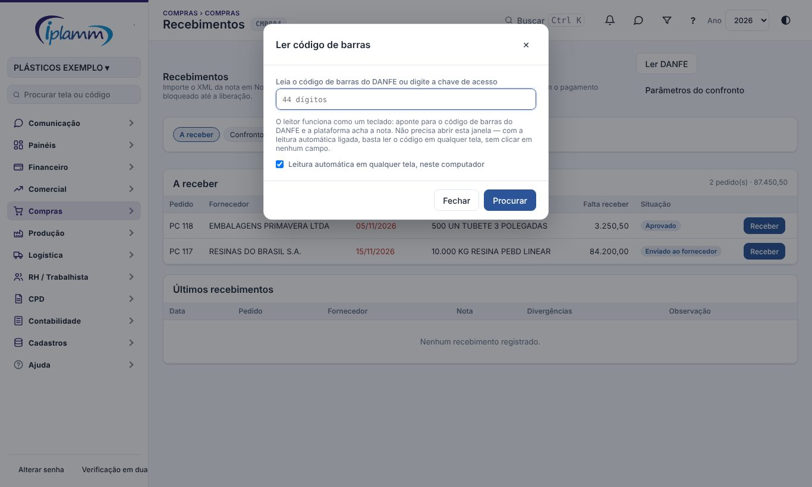
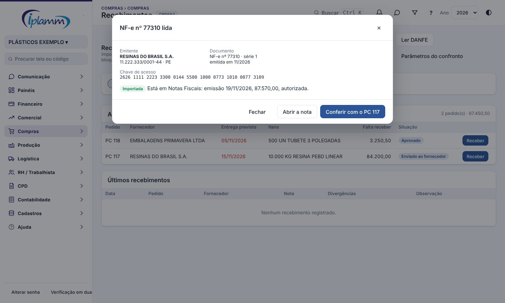

## 1. Para que serve

Com o leitor de código de barras, a nota fiscal é encontrada pela leitura do DANFE, sem digitar a chave e sem procurar na lista. A plataforma diz onde a nota está e leva direto à conferência com o pedido de compra.

Esta é a primeira etapa do uso do leitor. As etiquetas de mercadoria, a movimentação e o inventário por leitura vêm nas próximas.

## 2. O que é preciso

| Item | Detalhe |
|---|---|
| Leitor | Qualquer leitor USB ou Bluetooth. Ele funciona como um teclado: "digita" o código e dá Enter. Não precisa instalar nada |
| O que ele lê nesta etapa | O código de barras do DANFE (a chave de acesso de 44 dígitos) |
| Quem usa | Quem tem acesso a Notas Fiscais ou a Recebimentos |

## 3. Como ler

**Em qualquer tela.** Aponte o leitor para o código de barras do DANFE e leia. Não é preciso clicar em nenhum campo: a plataforma percebe que foi o leitor (os dígitos chegam todos de uma vez) e abre a janela da nota.

Se o cursor estiver dentro de um campo, o código é escrito nesse campo, como faria um teclado. Clique fora do campo e leia de novo.

**Pelo botão Ler DANFE.** Em Notas Fiscais e em Recebimentos, o botão abre uma janela com um campo para ler ou para digitar a chave.

**Pelo campo Buscar de Notas Fiscais.** Uma chave lida ou colada nesse campo abre a nota, em vez de filtrar a lista.

## 4. O que a plataforma responde

A janela mostra o emitente, o número, a série, o mês de emissão e a chave. Abaixo, a situação da nota:

| Situação | O que significa | O que fazer |
|---|---|---|
| **Importada** | A nota já está em Notas Fiscais | **Abrir a nota** ou **Conferir com o PC**, quando houver pedido de compra aprovado e em aberto do mesmo fornecedor |
| **Na SEFAZ** (com XML) | A nota chegou da SEFAZ e ainda não foi importada | **Importar agora**; em seguida a plataforma mostra a nota como importada |
| **Na SEFAZ** (só resumo) | A SEFAZ ainda não liberou o XML completo | Abrir NF-e da SEFAZ; o XML chega depois da ciência da operação |
| **Não está na plataforma** | Não foi importada nem chegou da SEFAZ | Importar o XML em Notas Fiscais, ou aguardar a próxima consulta à SEFAZ |

Se a nota já foi usada em um recebimento, a janela avisa a data e não oferece nova conferência.

## 5. Do DANFE à conferência do recebimento

1. Leia o DANFE na chegada da mercadoria.
2. Clique em **Conferir com o PC**.
3. A plataforma abre o recebimento daquele pedido com a nota lida já escolhida e a conferência pedido × nota pronta.
4. Confira as quantidades e clique em **Registrar recebimento**.

## 6. Parâmetro

| Parâmetro | Onde | Padrão | Efeito |
|---|---|---|---|
| Leitura automática em qualquer tela | Janela **Ler DANFE** | Ligada | Vale para o computador em que foi marcada. Desligada, a leitura só funciona pela janela Ler DANFE ou pelo campo Buscar de Notas Fiscais |

## 7. Dúvidas comuns

| Situação | O que fazer |
|---|---|
| Li o código e nada aconteceu | O cursor estava dentro de um campo, ou a leitura automática está desligada neste computador. Clique fora do campo e leia de novo, ou use o botão Ler DANFE |
| "O dígito verificador não confere" | A leitura saiu incompleta. Leia de novo, com o papel esticado |
| Li um boleto | A plataforma reconhece que é um boleto e avisa. O lançamento da conta a pagar pela leitura do boleto ainda não está disponível |
| "Código não reconhecido" | Nesta etapa a leitura vale para o código de barras do DANFE |
| Não aparece o botão Conferir com o PC | Não há pedido de compra aprovado e em aberto para o fornecedor da nota, ou você não tem acesso a Compras |

## 8. Histórico de versões

| Versão | Data | O que mudou |
|---|---|---|
| 1.0 | 21/11/2026 | Primeira versão: leitura da chave do DANFE em qualquer tela, janela Ler DANFE, situação da nota e atalho para a conferência do recebimento |
