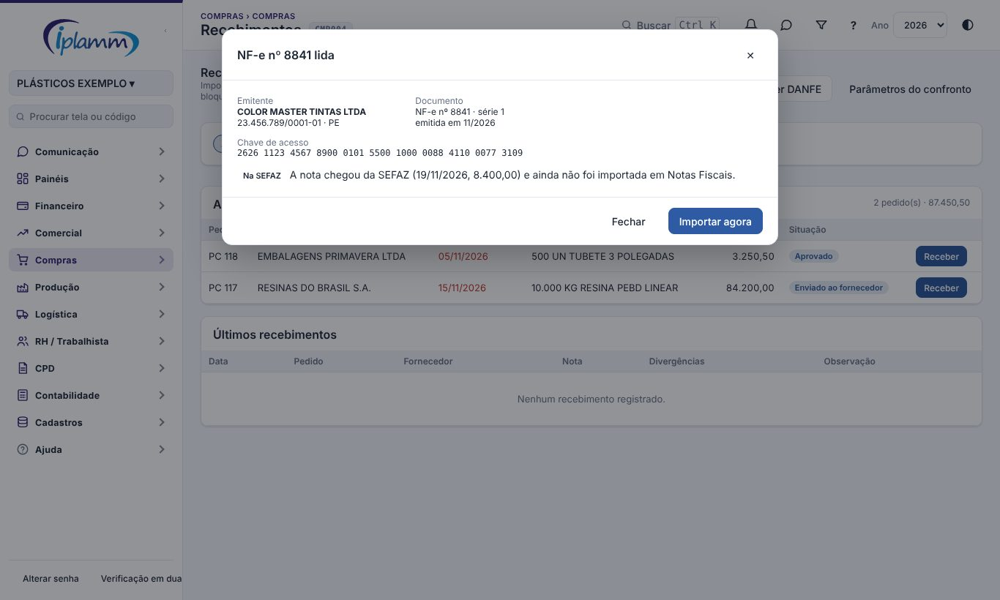
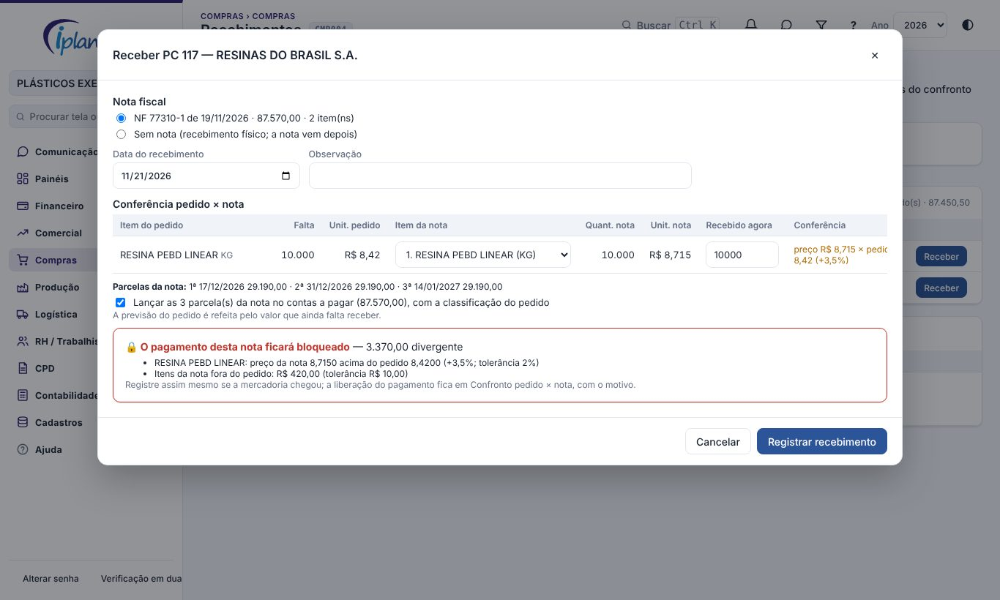
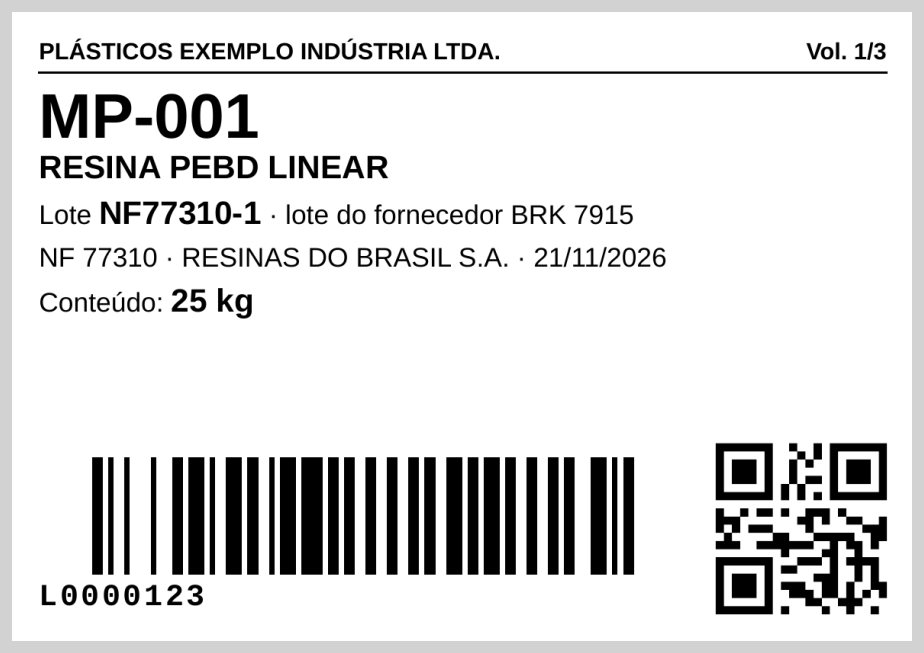
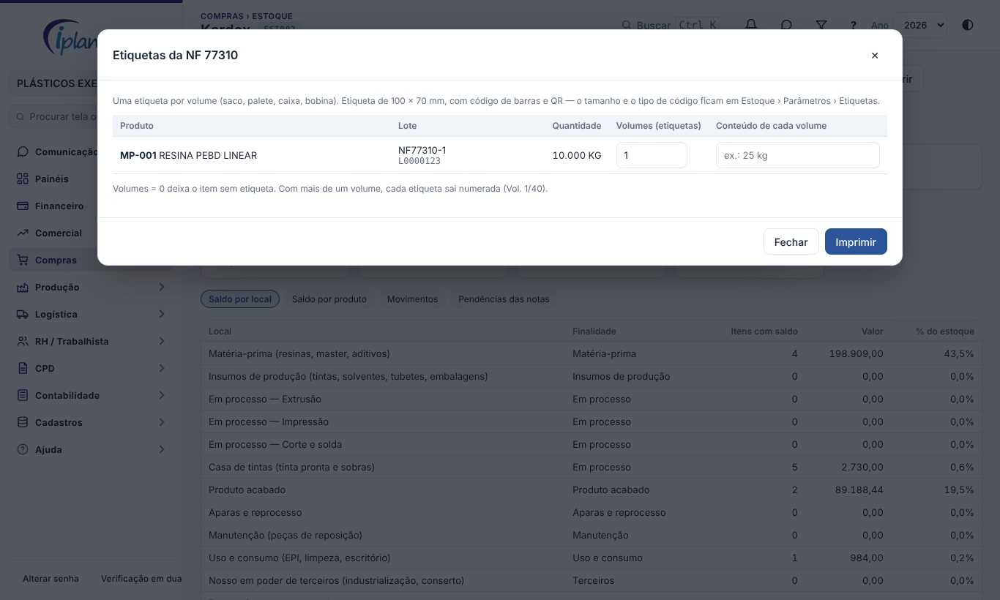
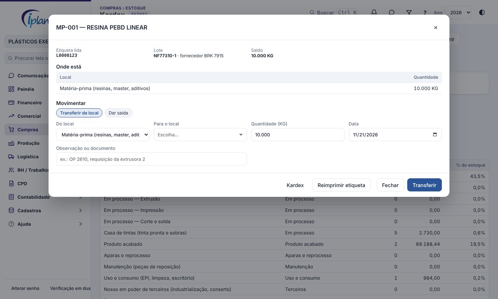
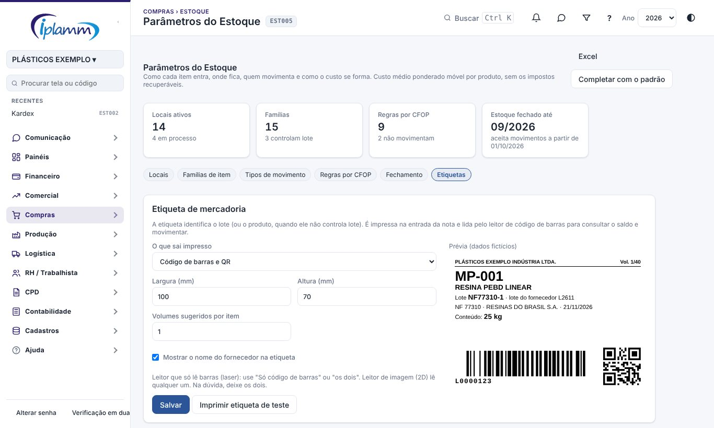

## 1. Para que serve

Com o leitor de código de barras, a nota fiscal é encontrada pela leitura do DANFE, sem digitar a chave e sem procurar na lista. A plataforma diz onde a nota está e leva direto à conferência com o pedido de compra.

Com a **etiqueta de mercadoria**, tudo o que entra no estoque ganha uma identificação da própria plataforma, já que a matéria-prima chega do fornecedor só com etiqueta de texto. Lendo a etiqueta, a plataforma mostra o saldo do lote em cada local e permite transferir ou dar saída sem escolher produto e lote na mão.

O inventário por leitura, a conferência da carga na expedição e o lançamento de boleto vêm nas próximas etapas.

## 2. O que é preciso

| Item | Detalhe |
|---|---|
| Leitor | Qualquer leitor USB ou Bluetooth. Ele funciona como um teclado: "digita" o código e dá Enter. Não precisa instalar nada |
| O que ele lê | O código de barras do DANFE (a chave de acesso de 44 dígitos) e a etiqueta de mercadoria da plataforma |
| Impressora de etiquetas | Qualquer impressora instalada no computador. O tamanho da etiqueta é um parâmetro (seção 8) |
| Quem usa | Quem tem acesso a Notas Fiscais, a Recebimentos ou ao Kardex. Movimentar é de quem movimenta o estoque (administrador, diretor, financeiro, compras e produção) |

## 3. Como ler

**Em qualquer tela.** Aponte o leitor para o código de barras do DANFE ou para a etiqueta da mercadoria e leia. Não é preciso clicar em nenhum campo: a plataforma percebe que foi o leitor (os dígitos chegam todos de uma vez) e abre a janela da nota.

Se o cursor estiver dentro de um campo, o código é escrito nesse campo, como faria um teclado. Clique fora do campo e leia de novo.

**Pelo botão Ler DANFE ou Ler código.** Em Notas Fiscais, em Recebimentos e no Kardex, o botão abre uma janela com um campo para ler ou para digitar o código.

**Pelo campo Buscar de Notas Fiscais.** Uma chave lida ou colada nesse campo abre a nota, em vez de filtrar a lista.

## 4. O que a plataforma responde ao ler um DANFE

A janela mostra o emitente, o número, a série, o mês de emissão e a chave. Abaixo, a situação da nota:

| Situação | O que significa | O que fazer |
|---|---|---|
| **Importada** | A nota já está em Notas Fiscais | **Abrir a nota** ou **Conferir com o PC**, quando houver pedido de compra aprovado e em aberto do mesmo fornecedor |
| **Na SEFAZ** (com XML) | A nota chegou da SEFAZ e ainda não foi importada | **Importar agora**; em seguida a plataforma mostra a nota como importada |
| **Na SEFAZ** (só resumo) | A SEFAZ ainda não liberou o XML completo | Abrir Notas Recebidas da SEFAZ; o XML chega depois da ciência da operação |
| **Não está na plataforma** | Não foi importada nem chegou da SEFAZ | Importar o XML em Notas Fiscais, ou aguardar a próxima consulta à SEFAZ |

Se a nota já foi usada em um recebimento, a janela avisa a data e não oferece nova conferência.

## 5. Do DANFE à conferência do recebimento

1. Leia o DANFE na chegada da mercadoria.
2. Clique em **Conferir com o PC**.
3. A plataforma abre o recebimento daquele pedido com a nota lida já escolhida e a conferência pedido × nota pronta.
4. Confira as quantidades e clique em **Registrar recebimento**.

## 6. Etiqueta de mercadoria

Cada **lote** tem um código de etiqueta próprio (por exemplo, L0000123), e cada **produto** também (P0000456). O código nasce junto com o lote ou o produto e não muda mais. O lote da matéria-prima é criado pela plataforma na entrada da nota (NF e item, por exemplo NF77310-1).

A etiqueta mostra a empresa, o código e a descrição do produto, o lote, o lote do fornecedor, a nota, o fornecedor, a data de entrada, o conteúdo do volume e o número do volume. O código sai em código de barras, em QR ou nos dois, conforme o parâmetro.

### 6.1 Imprimir as etiquetas de uma nota

1. Leia o DANFE (ou abra a janela Ler DANFE).
2. Na janela da nota, clique em **Etiquetas**. A plataforma lista os lotes que a nota pôs no estoque.
3. Informe quantos **volumes** chegaram de cada item (um saco, um palete, uma caixa = uma etiqueta) e, se quiser, o conteúdo de cada volume (por exemplo, 25 kg).
4. Clique em **Imprimir**. Com mais de um volume, as etiquetas saem numeradas (Vol. 1/40).

A nota precisa ter dado entrada no estoque. Se o estoque automático pela nota estiver desligado, lance a entrada no Kardex e imprima a etiqueta por lá.

### 6.2 Imprimir pelo Kardex

Na ficha do produto, em **Saldo por local e lote**, o botão **Etiqueta** de cada linha imprime a etiqueta daquele lote (ou do produto, quando ele não controla lote). Serve para reimprimir e para etiquetar o que já estava no estoque.

## 7. Ler a etiqueta e movimentar

Leia a etiqueta em qualquer tela. A janela mostra o produto, o lote, o saldo total e **onde está** (o saldo em cada local).

**Transferir de local** (por exemplo, do almoxarifado para a extrusão):

1. Confira o local de origem e escolha o local de destino.
2. Ajuste a quantidade. A plataforma sugere todo o saldo do local.
3. Informe a observação, se houver (a ordem de produção, por exemplo), e clique em **Transferir**.

**Dar saída:** escolha o tipo de saída (os tipos de movimento de saída cadastrados em Parâmetros do Estoque), a quantidade e clique em **Dar saída**.

A movimentação entra no Kardex como qualquer outra e segue as mesmas regras: mês fechado não aceita movimento e a correção é por estorno, no Kardex.

A etiqueta do **produto** (código P) mostra o saldo somado de todos os lotes. Quando o produto controla lote, a movimentação pede a etiqueta do lote.

## 8. Parâmetros

| Parâmetro | Onde | Padrão | Efeito |
|---|---|---|---|
| Leitura automática em qualquer tela | Janela **Ler DANFE** ou **Ler código** | Ligada | Vale para o computador em que foi marcada. Desligada, a leitura só funciona pela janela ou pelo campo Buscar de Notas Fiscais |
| O que sai impresso | Estoque › Parâmetros › **Etiquetas** | Código de barras e QR | Leitor que só lê barras (laser) precisa do código de barras; leitor de imagem (2D) lê qualquer um |
| Largura e altura da etiqueta (mm) | Estoque › Parâmetros › **Etiquetas** | 100 × 70 | A etiqueta se ajusta ao tamanho informado. Use o tamanho do rolo da impressora |
| Volumes sugeridos por item | Estoque › Parâmetros › **Etiquetas** | 1 | Quantidade que já vem preenchida na impressão |
| Nome do fornecedor na etiqueta | Estoque › Parâmetros › **Etiquetas** | Ligado | Desligado, a etiqueta mostra só a nota e a data |

A aba mostra a prévia da etiqueta e tem o botão **Imprimir etiqueta de teste**. Os parâmetros da etiqueta são do administrador e do diretor.

**Na impressora:** na janela de impressão do navegador, escolha a impressora de etiquetas, o papel do mesmo tamanho informado no parâmetro, margens "Nenhuma" e escala 100%.

## 9. Dúvidas comuns

| Situação | O que fazer |
|---|---|
| Li o código e nada aconteceu | O cursor estava dentro de um campo, ou a leitura automática está desligada neste computador. Clique fora do campo e leia de novo, ou use o botão Ler código |
| "O dígito verificador não confere" | A leitura do DANFE saiu incompleta. Leia de novo, com o papel esticado |
| O leitor não lê a etiqueta | Confira em Parâmetros se o tipo de código serve para o leitor (laser só lê barras) e se a etiqueta saiu inteira, sem cortar as barras nas laterais |
| A etiqueta sai cortada ou pequena | O tamanho do parâmetro é diferente do rolo, ou a impressão está com margem ou escala diferente de 100% |
| "Esta nota ainda não deu entrada no estoque" | A etiqueta nasce do lote. Lance a entrada no Kardex ou ligue o estoque automático pela nota |
| "Lote não encontrado nesta empresa" | A etiqueta é de outra empresa do grupo. Troque a empresa no alto da tela |
| Li um boleto | A plataforma reconhece que é um boleto e avisa. O lançamento da conta a pagar pela leitura do boleto ainda não está disponível |
| Não aparece o botão Conferir com o PC | Não há pedido de compra aprovado e em aberto para o fornecedor da nota, ou você não tem acesso a Compras |

## 10. Histórico de versões

| Versão | Data | O que mudou |
|---|---|---|
| 1.0 | 21/11/2026 | Primeira versão: leitura da chave do DANFE em qualquer tela, janela Ler DANFE, situação da nota e atalho para a conferência do recebimento |
| 1.1 | 21/11/2026 | Etiqueta de mercadoria por lote e por produto (código de barras e QR), impressão pelas notas e pelo Kardex, leitura da etiqueta com saldo por local, transferência e saída, parâmetros da etiqueta (SQL 175) |
| 1.2 | 23/11/2026 | Nome da tela FIS004 atualizado: Notas Recebidas da SEFAZ. |
