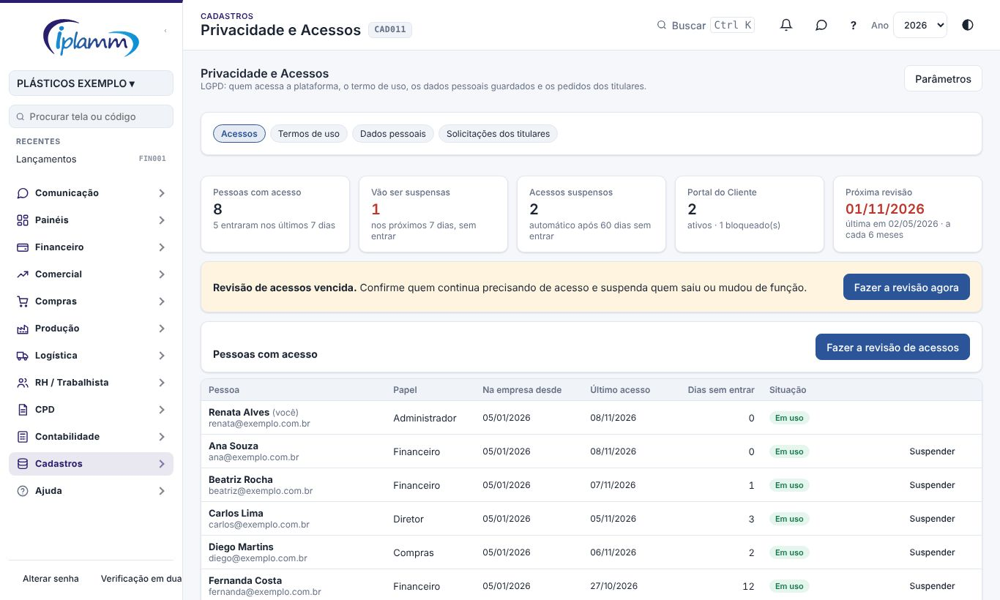
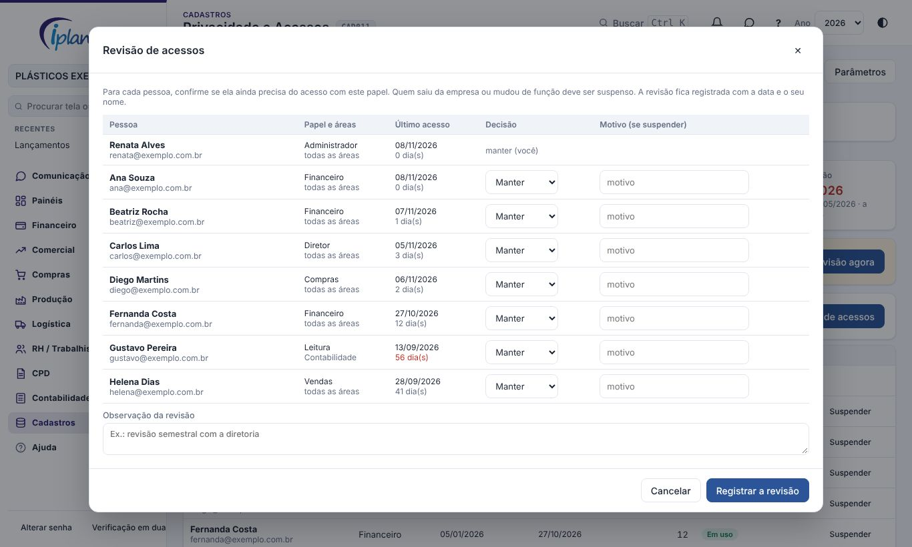
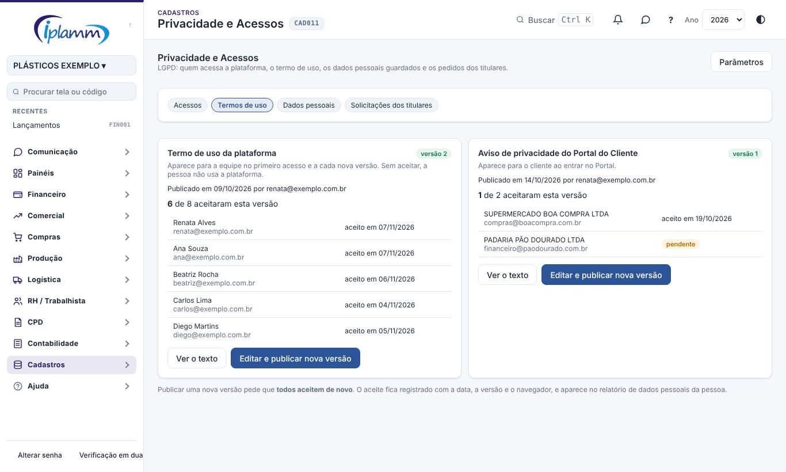
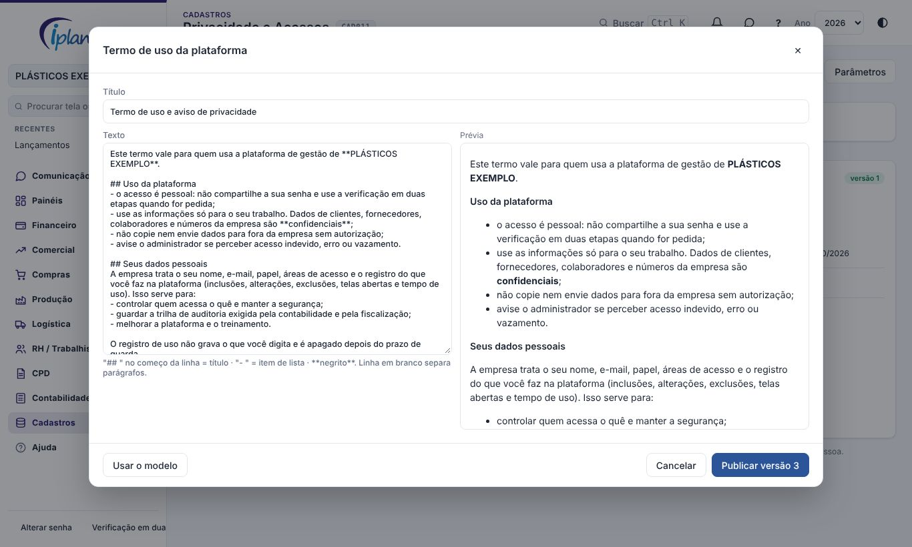
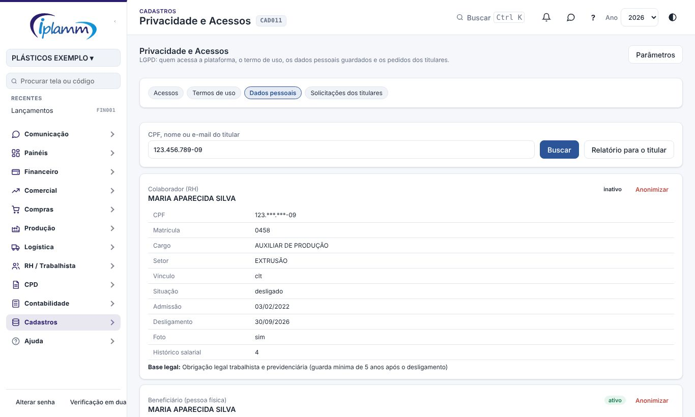
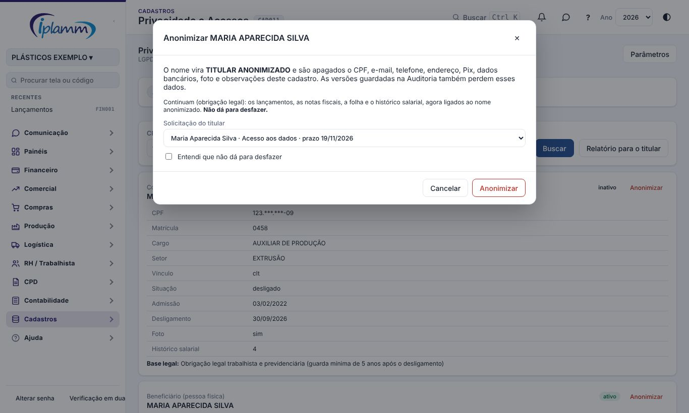
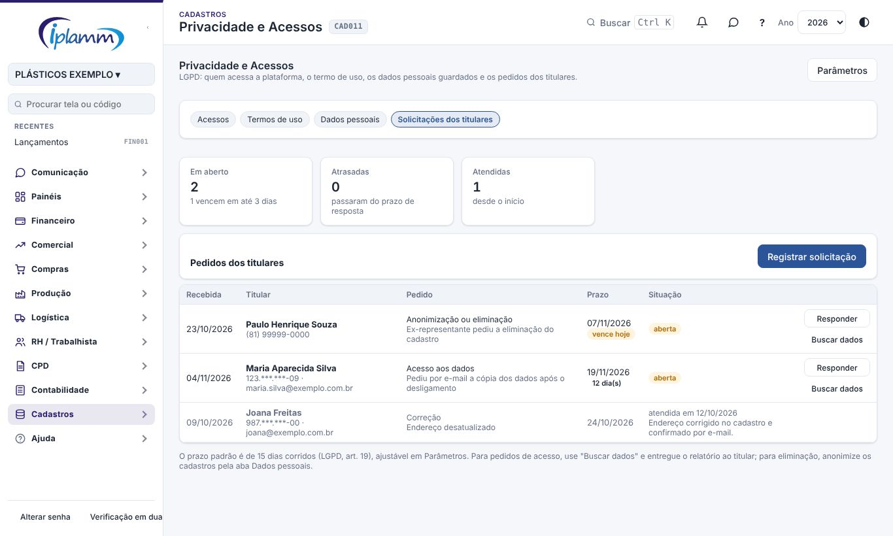
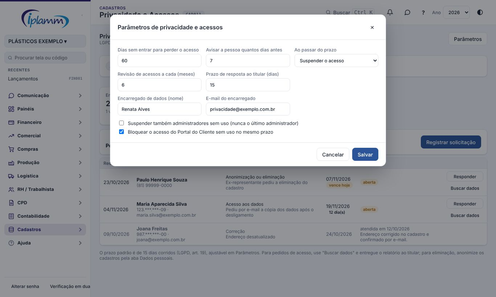

## 1. Para que serve

Reúne numa tela o que a Lei Geral de Proteção de Dados (Lei 13.709/2018) pede no dia a dia:

- **quem acessa** a plataforma e o Portal do Cliente, com a suspensão de quem não entra mais e a revisão periódica dos acessos;
- o **termo de uso** que a equipe aceita no primeiro acesso e o **aviso de privacidade** do Portal;
- **onde estão os dados pessoais** de uma pessoa (o titular), com o relatório para entregar a ela e a anonimização;
- as **solicitações dos titulares**, com o prazo de resposta.

## 2. Quem tem acesso

| Perfil | O que faz |
|---|---|
| Administrador | Usa toda a tela e altera os parâmetros. |
| Demais perfis | Não veem a tela. Aceitam o termo ao entrar e recebem o aviso antes de o acesso ser suspenso. |

## 3. Acessos

Os indicadores mostram:

- quantas pessoas têm acesso;
- quantas **vão ser suspensas** nos próximos dias;
- os acessos suspensos;
- o Portal do Cliente;
- a data da **próxima revisão**.

Na tabela **Pessoas com acesso**, cada pessoa aparece com:

- o papel;
- a data em que entrou na empresa e o **último acesso**;
- os **dias sem entrar**;
- a **situação**:

| Situação | Quando aparece |
|---|---|
| Em uso | Entrou dentro do prazo. |
| Suspensão em N dia(s) | Está a menos de 7 dias (ajustável) do prazo. A pessoa já recebeu o aviso. |
| Será suspenso hoje | Passou do prazo. A suspensão acontece no agendamento da manhã. |
| Sem acesso (administrador: não é suspenso) | Administrador sem uso. Por padrão, administradores não são suspensos. |

### 3.1 Suspensão automática

Todo dia de manhã, a plataforma confere quem não entra há **60 dias** (ajustável):

- **7 dias antes** do prazo, a pessoa recebe um aviso no sino (e por e-mail, se ela tiver pedido) para entrar e manter o acesso;
- no prazo, o acesso é **suspenso**. O papel e as áreas ficam guardados;
- o administrador recebe um resumo do que foi feito.

O último administrador da empresa nunca é suspenso. O acesso do **Portal do Cliente** sem uso no mesmo prazo é bloqueado. Para liberar de novo, use Financeiro › Portal do Cliente.

### 3.2 Suspender e reativar

- **Suspender**: na linha da pessoa, informe o motivo (por exemplo, "saiu da empresa"). Ela deixa de entrar na hora.
- **Reativar**: na tabela **Acessos suspensos**. Volta com o mesmo papel e as mesmas áreas, e o prazo recomeça a contar do dia da reativação.

### 3.3 Revisão periódica

A cada 6 meses (ajustável), confirme se cada pessoa ainda precisa do acesso com aquele papel. Clique em **Fazer a revisão de acessos**:

1. em cada linha, escolha **Manter** ou **Suspender** e, se for suspender, o motivo;
2. escreva uma observação, se quiser (por exemplo, "revisão semestral com a diretoria");
3. clique em **Registrar a revisão**.

A revisão fica guardada com a data, quem fez e as decisões. Quando ela vence, aparece uma faixa amarela na tela e um alerta na Central de Decisões.

## 4. Termos de uso

São dois textos:

- **Termo de uso da plataforma**: aparece para a equipe ao entrar. Sem aceitar, a pessoa não usa a plataforma (pode só sair);
- **Aviso de privacidade do Portal do Cliente**: aparece para o cliente ao entrar no Portal.

Cada quadro mostra a versão vigente, quando foi publicada, quantos aceitaram e quem ainda falta.

O aceite fica registrado com a data, a versão e o navegador. Ele aparece no relatório de dados pessoais da pessoa.

### 4.1 Escrever e publicar

1. Clique em **Escrever e publicar** (ou **Editar e publicar nova versão**).
2. O texto já vem com um **modelo** preenchido com o nome da empresa e o encarregado de dados dos Parâmetros. Revise com o jurídico.
3. Formate com:
   - `## ` no começo da linha para um título;
   - `- ` para um item de lista;
   - `**texto**` para negrito.
4. Confira a **Prévia** ao lado.
5. Clique em **Publicar**.

Publicar uma nova versão pede que **todos aceitem de novo**. Os campos entre colchetes, como [EMPRESA], precisam ser trocados antes de publicar.

## 5. Dados pessoais

Digite o **CPF, o nome ou o e-mail** da pessoa e clique em **Buscar**. A plataforma procura em:

- usuários da plataforma e do Portal do Cliente;
- beneficiários pessoa física;
- colaboradores (RH), motoristas e vendedores;
- transportadores autônomos;
- crachás de terceiros e visitantes.

Para cada cadastro aparecem os dados guardados e a **base legal**, que é o motivo pelo qual a empresa pode guardá-los. Por exemplo, obrigação trabalhista para o colaborador e obrigação fiscal para o fornecedor. Na tela, o CPF aparece mascarado.

### 5.1 Relatório para o titular

Clique em **Relatório para o titular**. Abre um documento no padrão da empresa, com todos os dados encontrados, a base legal e o contato do encarregado. Imprima ou salve em PDF e entregue **somente ao titular**.

### 5.2 Anonimizar

Quando o titular pede a eliminação e não há obrigação legal de manter os dados, clique em **Anonimizar** no cadastro:

- o nome vira **TITULAR ANONIMIZADO** e são apagados o CPF, o e-mail, o telefone, o endereço, o Pix, os dados bancários, a foto e as observações;
- as versões guardadas na **Auditoria** também perdem esses dados;
- os lançamentos, as notas fiscais, a folha e o histórico salarial **continuam**, ligados ao nome anonimizado, porque a lei obriga a guardá-los;
- ligue a anonimização à **solicitação do titular**, se houver. Ela fica registrada na solicitação.

**Não dá para desfazer.** Colaborador ativo ou afastado, motorista, vendedor e transportador ativos não podem ser anonimizados: desligue ou inative antes. Para usuários da plataforma, use **Suspender** na aba Acessos.

## 6. Solicitações dos titulares

Quando alguém pedir algo sobre os próprios dados (por e-mail, telefone ou carta), clique em **Registrar solicitação** e informe:

- o nome do titular, o CPF e o contato;
- o pedido: confirmação, acesso, correção, anonimização, portabilidade, com quem compartilhamos, revogação do consentimento ou oposição;
- a data em que o pedido chegou e os detalhes.

O **prazo** é calculado sozinho: 15 dias corridos (LGPD, art. 19), ajustável. A coluna mostra quantos dias faltam. Fica amarela a 3 dias e vermelha quando atrasa.

Em cada solicitação aberta:

- **Buscar dados** abre a aba Dados pessoais já com a busca do titular;
- **Responder** registra se foi atendida ou negada e a resposta dada. Negar exige a justificativa, por exemplo "dados guardados por obrigação fiscal".

Solicitações que vencem em até 3 dias ou atrasadas aparecem na Central de Decisões.

## 7. Parâmetros

| Parâmetro | Padrão | O que faz |
|---|---|---|
| Dias sem entrar para perder o acesso | 60 | De 15 a 365. |
| Avisar a pessoa quantos dias antes | 7 | De 0 a 30. |
| Ao passar do prazo | Suspender o acesso | Ou só avisar o administrador. |
| Revisão de acessos a cada | 6 meses | De 1 a 24. |
| Prazo de resposta ao titular | 15 dias | De 1 a 60. |
| Encarregado de dados | — | Nome e e-mail. Aparecem no modelo do termo e no relatório do titular. |
| Suspender também administradores | Não | Nunca o último administrador. |
| Bloquear o Portal sem uso | Sim | No mesmo prazo. |

## 8. Central de Decisões

A regra 25 mostra, só para o administrador:

- as solicitações de titular com o prazo em até 3 dias ou vencido. Fica alta quando atrasada;
- a revisão de acessos vencida;
- as pessoas sem entrar perto do prazo de suspensão.

## 9. Dúvidas frequentes

**Uma pessoa foi suspensa por engano.** Reative na tabela **Acessos suspensos**. Ela volta com o mesmo papel e as mesmas áreas, e o prazo recomeça.

**A pessoa está de férias ou afastada.** Antes da suspensão, ela recebe o aviso. Se preferir, aumente o prazo nos Parâmetros ou reative quando ela voltar.

**Posso apagar um fornecedor pessoa física?** Os lançamentos e as notas precisam ser guardados (obrigação fiscal). Use **Anonimizar**: o cadastro perde os dados pessoais e os lançamentos continuam.

**O termo não apareceu para ninguém.** Ele só aparece depois de publicado na aba **Termos de uso**.

## 10. Histórico de alterações

| Versão | Data | O que mudou |
|---|---|---|
| 1.0 | 07/11/2026 | Primeira versão: acessos com suspensão automática e revisão periódica, termos de uso da equipe e do Portal, dados pessoais por titular com relatório e anonimização, solicitações dos titulares e regra 25 da Central de Decisões. |
