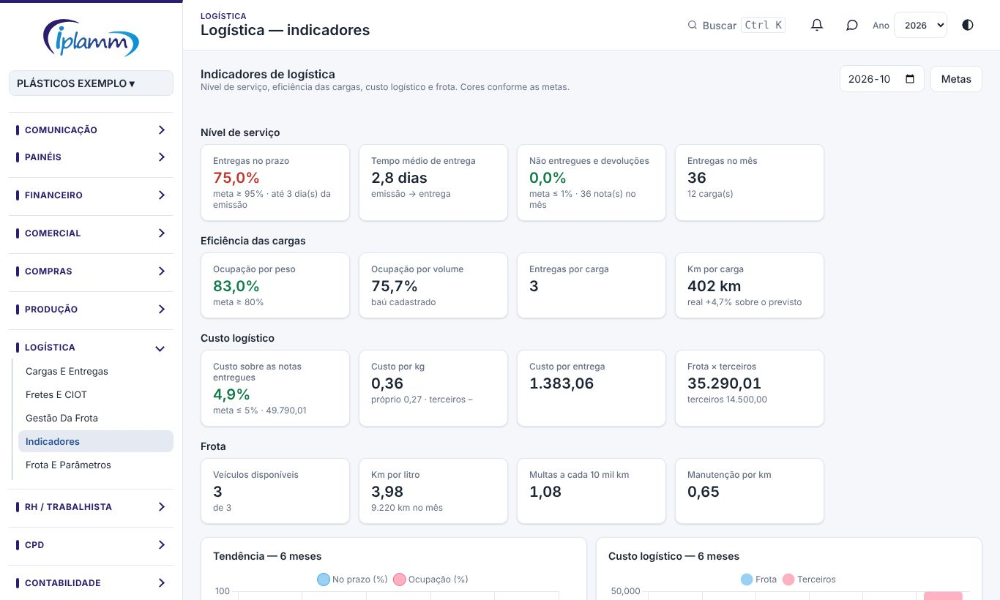

## 1. Para que serve

Acompanhar a operação de entregas e a frota em uma tela só, mês a mês, com a tendência dos últimos 6 meses e cores conforme as metas:

- **nível de serviço**: entregas no prazo, tempo médio de entrega, não entregues e devoluções;
- **eficiência das cargas**: ocupação por peso e por volume, entregas e km por carga;
- **custo logístico**: frota própria mais fretes de terceiros, sobre o valor das notas entregues, por kg e por entrega;
- **frota**: veículos disponíveis, km por litro, multas a cada 10 mil km e manutenção por km.

## 2. Quem tem acesso

Quem vê a logística vê os indicadores. As **metas** são ajustadas por quem edita a logística (administrador, financeiro e diretor).

## 3. A tela

1. Abra **Logística › Indicadores** e escolha o **mês**.
2. Cada quadro mostra o valor do mês e a meta. **Verde**: dentro da meta. **Amarelo**: até 10% fora. **Vermelho**: mais que isso.
3. Os gráficos mostram a tendência de entregas no prazo e de ocupação e o custo logístico (frota e terceiros) nos últimos 6 meses. A tabela traz os mesmos números mês a mês.
4. **Clientes com mais atraso no mês**: os destinatários com mais entregas fora do prazo e a média de dias.

## 4. Como cada indicador é calculado

| Indicador | Cálculo |
|---|---|
| Entregas no prazo | Entregas baixadas até o limite de dias depois da emissão da nota (o limite é o "dias de atraso" de Frota e parâmetros) ÷ entregas baixadas. |
| Tempo médio de entrega | Média de dias entre a emissão da nota e a baixa da entrega. |
| Não entregues e devoluções | Notas marcadas como não entregues ou devolvidas ÷ notas das cargas do mês. |
| Ocupação por peso / volume | Peso (ou volume) da carga ÷ capacidade do veículo, nas cargas que saíram. |
| Km por carga | Km real da carga (ou o previsto, se o real não foi informado). Ao lado, quanto o real passou do previsto. |
| Custo logístico | Custo da frota no mês (combustível, manutenção, multas e locação, da Gestão da frota) + fretes de terceiros (Fretes e CIOT). |
| Custo sobre as notas | Custo logístico ÷ valor das notas entregues no mês. |
| Custo por kg / por entrega | Custo logístico ÷ peso das cargas do mês / ÷ entregas baixadas. |
| Km por litro | Pelo método do tanque cheio, nos abastecimentos do mês. |

## 5. Ajustar as metas

1. Clique em **Metas**.
2. Informe: entregas no prazo (mínimo), ocupação por peso (mínimo), custo sobre as notas entregues (máximo) e não entregues e devoluções (máximo).
3. Clique em **Salvar**. As cores mudam na hora para todos os usuários.

Metas iniciais: entregas no prazo ≥ 95%, ocupação ≥ 80%, custo logístico ≤ 5% das notas entregues e devoluções ≤ 1%.

## 6. Para os números ficarem certos

- **Baixe as entregas** em Cargas e entregas no dia em que acontecem: a data da baixa é a data da entrega.
- Informe o **km real** da carga no retorno.
- Lance **abastecimentos, manutenções e multas** na Gestão da frota e os **fretes de terceiros** em Fretes e CIOT.
- Cadastre a **capacidade e o baú** de cada veículo em Frota e parâmetros.

## 7. Histórico de alterações

| Versão | Data | O que mudou |
|---|---|---|
| 1.0 | 30/10/2026 | Primeira versão: nível de serviço, eficiência das cargas, custo logístico e frota, com metas e tendência de 6 meses. |
