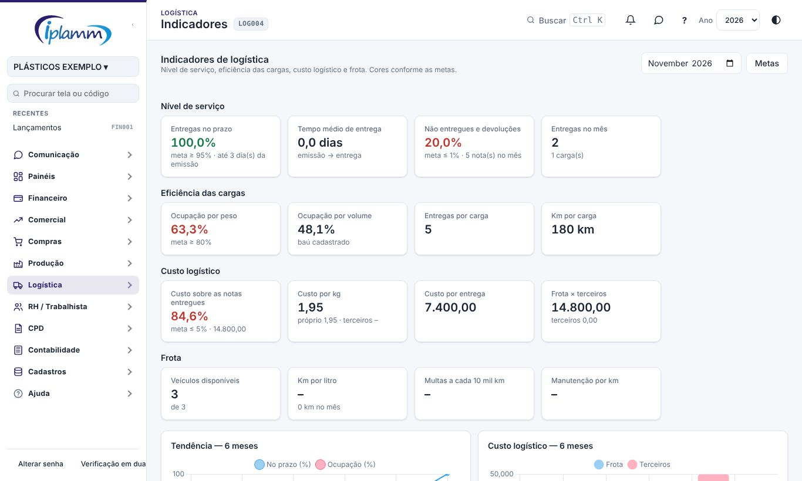
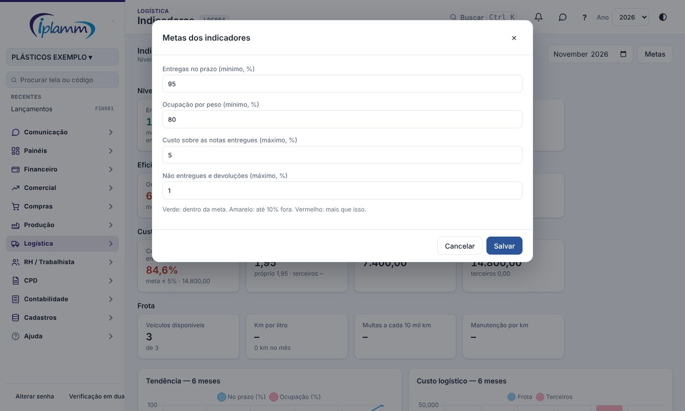
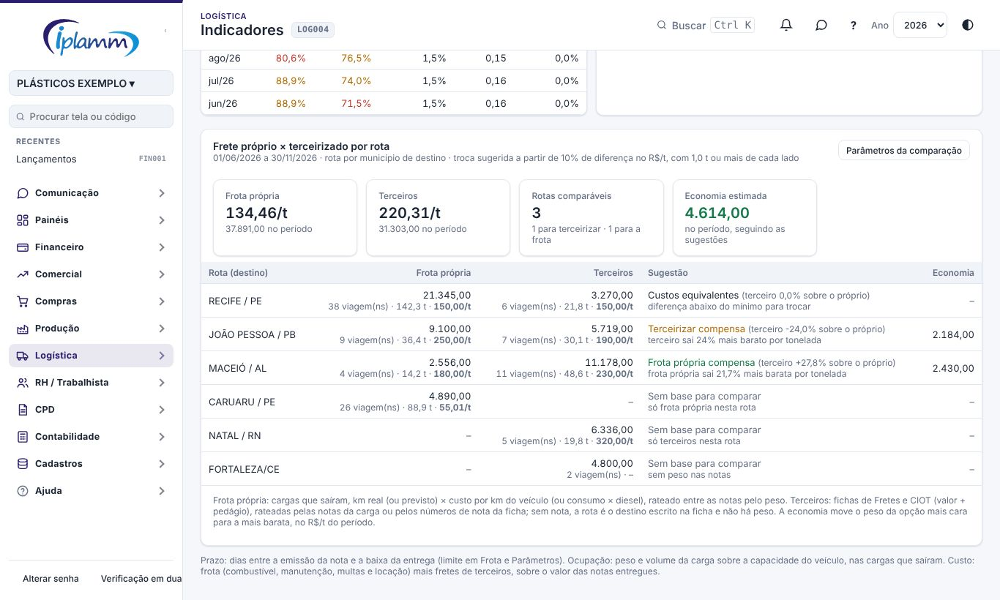
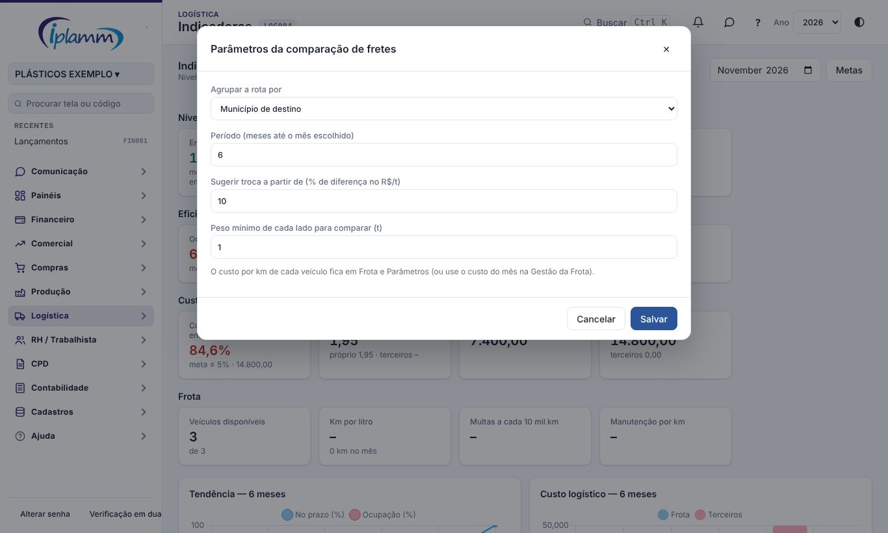

## 1. Para que serve

Acompanhar a operação de entregas e a frota em uma tela só, mês a mês, com a tendência dos últimos 6 meses e cores conforme as metas:

- **nível de serviço**: entregas no prazo, tempo médio de entrega, não entregues e devoluções;
- **eficiência das cargas**: ocupação por peso e por volume, entregas e km por carga;
- **custo logístico**: frota própria mais fretes de terceiros, sobre o valor das notas entregues, por kg e por entrega;
- **frota**: veículos disponíveis, km por litro, multas a cada 10 mil km e manutenção por km;
- **frete próprio × terceirizado por rota**: quanto custa a tonelada em cada destino com a frota e com terceiros, e onde compensa trocar.

## 2. Quem tem acesso

Quem vê a logística vê os indicadores. As **metas** são ajustadas por quem edita a logística (administrador, financeiro e diretor).

## 3. A tela

1. Abra **Logística › Indicadores** e escolha o **mês**.
2. Cada quadro mostra o valor do mês e a meta. **Verde**: dentro da meta. **Amarelo**: até 10% fora. **Vermelho**: mais que isso.
3. Os gráficos mostram a tendência de entregas no prazo e de ocupação e o custo logístico (frota e terceiros) nos últimos 6 meses. A tabela traz os mesmos números mês a mês.
4. **Clientes com mais atraso no mês**: os destinatários com mais entregas fora do prazo e a média de dias.

## 4. Como cada indicador é calculado

| Indicador | Cálculo |
|---|---|
| Entregas no prazo | Entregas baixadas até o limite de dias depois da emissão da nota (o limite é o "dias de atraso" de Frota e parâmetros) ÷ entregas baixadas. |
| Tempo médio de entrega | Média de dias entre a emissão da nota e a baixa da entrega. |
| Não entregues e devoluções | Notas marcadas como não entregues ou devolvidas ÷ notas das cargas do mês. |
| Ocupação por peso / volume | Peso (ou volume) da carga ÷ capacidade do veículo, nas cargas que saíram. |
| Km por carga | Km real da carga (ou o previsto, se o real não foi informado). Ao lado, quanto o real passou do previsto. |
| Custo logístico | Custo da frota no mês (combustível, manutenção, multas e locação, da Gestão da frota) + fretes de terceiros (Fretes e CIOT). |
| Custo sobre as notas | Custo logístico ÷ valor das notas entregues no mês. |
| Custo por kg / por entrega | Custo logístico ÷ peso das cargas do mês / ÷ entregas baixadas. |
| Km por litro | Pelo método do tanque cheio, nos abastecimentos do mês. |

## 5. Ajustar as metas

1. Clique em **Metas**.
2. Informe: entregas no prazo (mínimo), ocupação por peso (mínimo), custo sobre as notas entregues (máximo) e não entregues e devoluções (máximo).
3. Clique em **Salvar**. As cores mudam na hora para todos os usuários.

Metas iniciais: entregas no prazo ≥ 95%, ocupação ≥ 80%, custo logístico ≤ 5% das notas entregues e devoluções ≤ 1%.

## 6. Frete próprio × terceirizado por rota

No fim da tela, o quadro **Frete próprio × terceirizado por rota** compara, em cada destino, o custo por tonelada da frota própria com o dos fretes de terceiros. O período padrão são os 6 meses até o mês escolhido.

| Lado | De onde vem o custo |
|---|---|
| Frota própria | Cargas que saíram (em rota ou concluídas) e não têm frete de terceiro ligado. Custo = km real (ou o previsto) × custo por km do veículo. Sem custo por km, usa consumo × preço do diesel; sem os dois, o frete previsto da carga. |
| Terceiros | Fichas de **Fretes e CIOT** não canceladas: valor + pedágio. As notas são as da carga ligada à ficha ou os números de nota escritos na ficha. Sem nota, a rota é o destino escrito na ficha, sem peso. |

O custo de cada viagem é **rateado entre as notas pelo peso**, e cada nota cai na rota do seu **município de destino** (ou da UF, se escolhido nos parâmetros).

Para cada rota, a tela mostra:

- custo, viagens, toneladas e **R$/t** de cada lado;
- a **sugestão**:
  - **Terceirizar compensa**: o R$/t do terceiro é menor que o próprio além da diferença mínima;
  - **Frota própria compensa**: o contrário;
  - **Custos equivalentes**: a diferença fica abaixo do mínimo;
  - **Sem base para comparar**: um dos lados não tem viagens ou tem menos que o peso mínimo;
- a **economia estimada**: o peso da opção mais cara levado pelo R$/t da mais barata, no período.

Os quadros do topo trazem o R$/t geral de cada lado, as rotas comparáveis e a economia total se as sugestões fossem seguidas.

**Parâmetros da comparação** (administrador, financeiro e diretor):

- agrupar a rota por município ou por UF;
- o período em meses;
- a diferença mínima no R$/t para sugerir a troca (padrão 10%);
- o peso mínimo de cada lado (padrão 1 t).

> A **montagem de carga sugerida** (por peso, volume, região e jornada) fica em **Logística › Cargas e Entregas**. Veja o manual de Cargas e Entregas.

## 7. Para os números ficarem certos

- **Baixe as entregas** em Cargas e entregas no dia em que acontecem: a data da baixa é a data da entrega.
- Informe o **km real** da carga no retorno.
- Lance **abastecimentos, manutenções e multas** na Gestão da frota e os **fretes de terceiros** em Fretes e CIOT.
- Cadastre a **capacidade e o baú** de cada veículo em Frota e parâmetros.
- Cadastre o **custo por km** de cada veículo e, na ficha do frete de terceiro, os **números das notas** ou a carga, para a comparação por rota.

## 8. Histórico de alterações

| Versão | Data | O que mudou |
|---|---|---|
| 1.0 | 30/10/2026 | Primeira versão: nível de serviço, eficiência das cargas, custo logístico e frota, com metas e tendência de 6 meses. |
| 1.1 | 31/10/2026 | Nova figura: metas dos indicadores. |
| 1.2 | 05/11/2026 | Nomes das telas iguais aos do menu, com o código da tela no cabeçalho. |
| 1.3 | 29/10/2026 | Imagens das telas, com dados fictícios. |
| 1.4 | 08/11/2026 | Frete próprio × terceirizado por rota: R$/t de cada lado por município ou UF de destino, sugestão de troca com diferença e peso mínimos, economia estimada e parâmetros da comparação. |
