## 1. Para que serve

Organizar a manutenção das máquinas e dos equipamentos de apoio, do pedido do operador até o custo no fechamento do mês:

- **equipamentos**: as máquinas da produção, as utilidades (compressor, chiller, gerador), a parte predial e a movimentação (empilhadeira, ponte rolante). Cada um tem criticidade, centro de custo e bem do imobilizado;
- **ordens de serviço (OS)** corretivas, preventivas, de lubrificação, de inspeção, preditivas, de calibração e de melhoria, com checklist, falha, causa, solução, horas do técnico, peças, serviço de terceiro, fotos e impressão;
- **planos preventivos** por dias, por horas de máquina ou pelos dois. As horas saem dos apontamentos da produção, sem horímetro;
- **parada automática**: a OS que para a máquina registra a parada na produção, e a parada de manutenção apontada no Terminal do Setor abre a OS sozinha;
- **peças do estoque oficial**: a peça usada na OS sai do Kardex pelo custo médio, como requisição interna;
- **serviço de terceiro**: entra no contas a pagar do fluxo de caixa;
- **indicadores**: disponibilidade, MTBF, MTTR, aderência às preventivas, Pareto das falhas e custo por equipamento;
- **celular**: o operador pede manutenção em três toques e o técnico trabalha a fila pelo telefone.

## 2. Quem tem acesso

- **Ver as telas**: quem tem acesso à área Produção.
- **Pedir manutenção, abrir OS, iniciar, lançar horas, usar peças, anexar fotos e concluir**: administrador, financeiro, diretor e produção.
- **Cadastrar equipamentos, planos, falhas e parâmetros, gerar preventivas e cancelar OS**: administrador, financeiro e diretor.
- **Lançar o serviço de terceiro no contas a pagar**: administrador e financeiro (quem lança no fluxo de caixa).
- O papel **Produção** vê no menu a **Manutenção no Celular** e as **Ordens de Serviço**, junto com o Terminal do Setor.

## 3. Primeiros passos

Faça uma vez, nesta ordem:

1. Abra **Produção › Manutenção › Equipamentos e Planos** e clique em **Trazer máquinas da produção**. A plataforma faz duas coisas:
   - cada máquina cadastrada em Produção › Cadastros vira um equipamento de **criticidade A**;
   - o **catálogo de falhas** é criado com 18 falhas típicas de extrusão, impressão e corte e solda.
2. Cadastre em **Novo equipamento** o que não é máquina de produção: compressor, chiller, gerador, empilhadeira, subestação.
3. Na aba **Parâmetros**, informe o **custo da hora interna** do mecânico.
4. Crie os **planos preventivos** dos equipamentos críticos (seção 7).
5. No Painel, clique em **Gerar preventivas**.

## 4. Painel de Manutenção

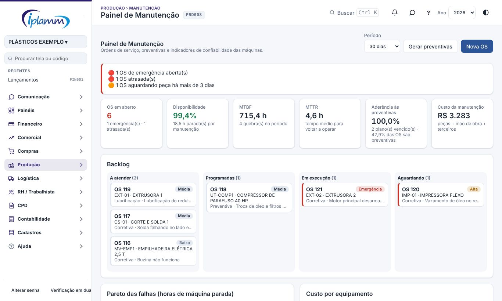

1. Abra **Produção › Manutenção › Painel de Manutenção**.
2. Escolha o **período**: 7 dias, 30 dias, 90 dias ou 12 meses.
3. A faixa de alertas no alto mostra:
   - as OS de emergência abertas;
   - as OS atrasadas;
   - as OS aguardando peça há mais de 3 dias;
   - os planos vencidos que ainda não têm OS.
4. Os indicadores mostram como está a manutenção (seção 9).
5. O **Backlog** separa as OS abertas em quatro colunas: a atender, programadas, em execução e aguardando. As colunas já vêm na ordem de atendimento. Clique numa OS para abrir a ficha.
6. Logo abaixo ficam:
   - o **Pareto das falhas**: as falhas que mais pararam máquina no período;
   - o **custo por equipamento**;
   - os cartões dos **equipamentos críticos**, cada um com a situação, a disponibilidade e as preventivas.

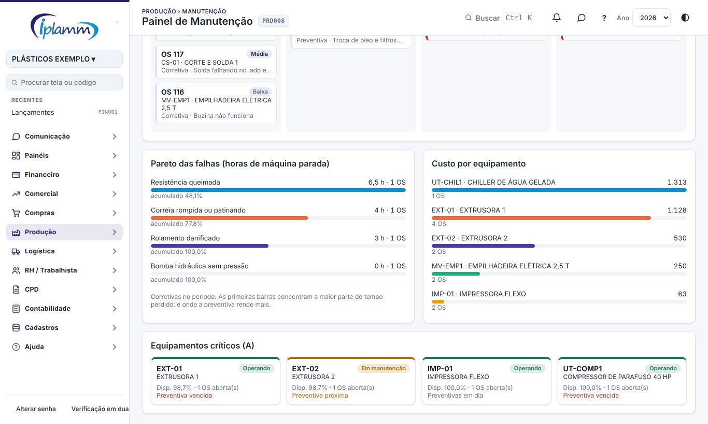

**Gerar preventivas** abre as OS dos planos que estão para vencer. Os detalhes estão na seção 7.2.

## 5. Ordens de Serviço

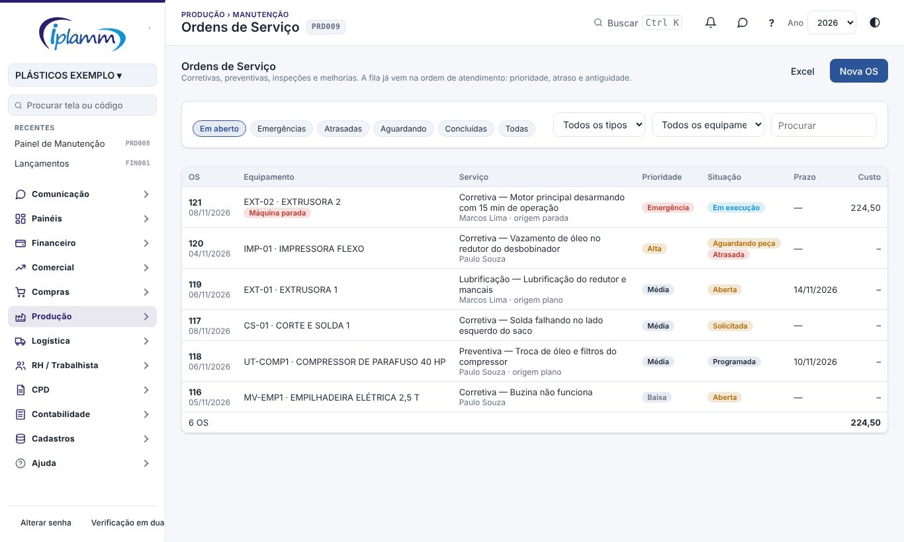

### 5.1 Lista

- **Filtros**:
  - Em aberto;
  - Emergências;
  - Atrasadas;
  - Aguardando (peça ou terceiro);
  - Concluídas;
  - Todas.
- Você também pode filtrar por **tipo**, por **equipamento** e pela **busca**.
- A fila em aberto vem na **ordem de atendimento**:
  1. pela prioridade, de emergência a baixa;
  2. as atrasadas primeiro;
  3. depois a mais antiga.
- O selo **Máquina parada** indica que a máquina está parada por causa desta OS.
- O botão **Excel** exporta a lista.

### 5.2 Nova OS

1. Clique em **Nova OS**.
2. Escolha o **equipamento**, o **tipo** e a **prioridade**.
3. Descreva o problema.
4. Se precisar, informe a data programada e o responsável.
5. Se a máquina parou, marque **A máquina está parada por causa disso**. A parada passa a contar na produção (seção 8).

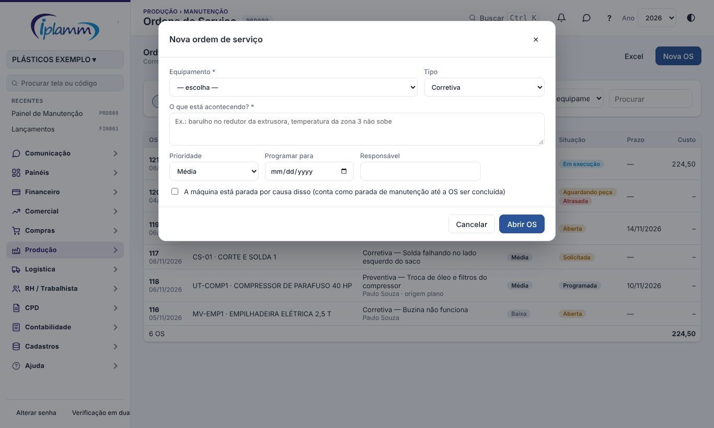

### 5.3 Ficha da OS

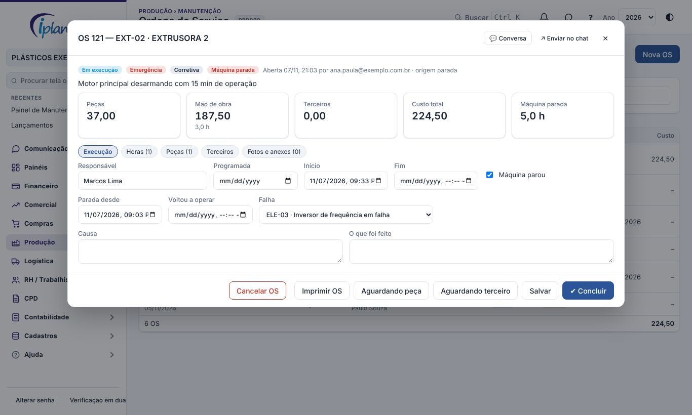

No alto da ficha ficam os selos (situação, prioridade, tipo, máquina parada, atrasada) e o custo:

- **peças**;
- **mão de obra**: horas × custo da hora;
- **terceiros**;
- **total**;
- **horas de máquina parada**.

Abas:

- **Execução**:
  - responsável, data programada, início e fim;
  - máquina parada e a hora em que voltou a operar;
  - **falha** do catálogo, **causa** e **o que foi feito**;
  - o **checklist** do plano, item por item: feito ou não feito, com observação.
- **Horas**: lance as horas de cada técnico, com a data. As horas são multiplicadas pelo custo da hora dos Parâmetros.
- **Peças**: escolha a peça ou o material, informe a quantidade e clique em **Usar na OS**:
  - a peça sai do estoque oficial pelo custo médio, como requisição interna e com o centro de custo do equipamento;
  - antes da implantação do estoque, a peça fica registrada pelo último custo de compra, sem movimentar o Kardex;
  - **Estornar** devolve a peça ao estoque.
- **Terceiros**: informe o prestador e o valor. Escolha a **conta do plano** e o vencimento para lançar a conta a pagar "Em aberto" no fluxo de caixa. O lançamento é feito uma vez só, ao salvar.
- **Fotos e anexos**: tire a foto pelo celular ou anexe PDF (laudo, orçamento, nota).

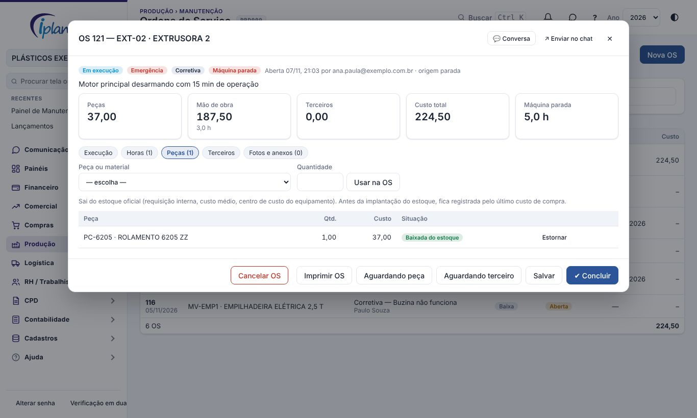

Botões:

- **Iniciar**: muda a OS para "Em execução" e grava o início.
- **Aguardando peça** e **Aguardando terceiro**: deixam claro por que a OS está parada.
- **Salvar** grava as alterações.
- **Concluir**:
  - na corretiva, só conclui com **o que foi feito** preenchido;
  - avisa se o checklist tem item sem resposta;
  - se a máquina estava parada, a parada é encerrada e a máquina volta a **Operando**;
  - se a OS veio de um plano, o plano recebe a data e as horas desta execução.
- **Imprimir OS** gera a OS em papel, com as assinaturas do executante e do responsável pela produção.
- **Cancelar OS**: pede o motivo. Só administrador, financeiro e diretor.

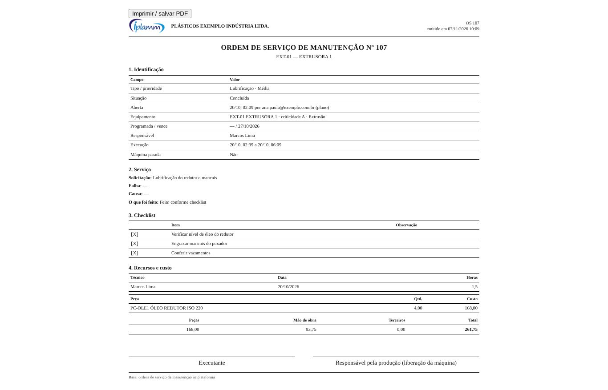

## 6. Equipamentos

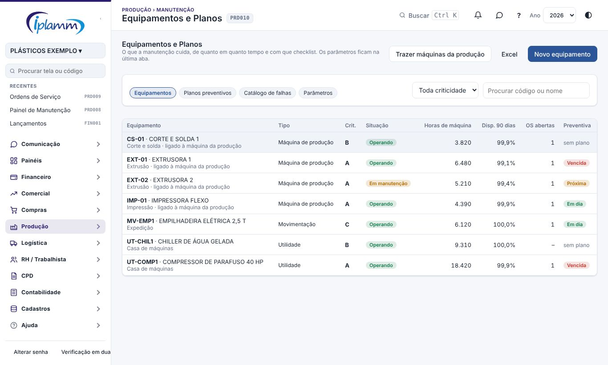

### 6.1 Cadastro

| Campo | Para que serve |
|---|---|
| Código e nome | Identificação. O código não se repete. |
| Tipo | Máquina de produção, utilidade, predial, movimentação, instrumento, ferramenta ou outro. |
| Criticidade | **A** para a fábrica, **B** atrapalha, **C** baixa. Com máquina de criticidade A parada, o pedido do operador entra como **emergência**. |
| Situação | Operando, em manutenção, parado ou inativo. A OS que para a máquina muda a situação sozinha. |
| Máquina da produção | Liga o equipamento à máquina do Terminal do Setor: as horas de máquina vêm dos apontamentos e a parada da OS entra no OEE. |
| Setor, centro de custo | O centro de custo vai para a saída das peças no estoque. |
| Bem do imobilizado | Liga o equipamento ao bem do Ativo Imobilizado. |
| Componente de | Monta a árvore: o redutor é componente da extrusora. |
| Fabricante, modelo, série, ano, garantia | Dados técnicos. A garantia aparece na ficha. |
| Horímetro | Para equipamento sem apontamento (compressor, empilhadeira). As leituras são registradas na ficha. |

Equipamento com OS não pode ser excluído. Nesse caso, marque como **Inativo**.

### 6.2 Ficha do equipamento

Clique no equipamento para ver:

- **disponibilidade** em 90 dias;
- **MTBF** e **MTTR** em 12 meses;
- **custo** em 12 meses, separado em peças, mão de obra e terceiros;
- **horas de máquina**;
- os planos com a próxima execução;
- as falhas que mais param este equipamento;
- o **histórico de OS**.

Na ficha também é possível registrar a **leitura do horímetro** e abrir uma OS para o equipamento.

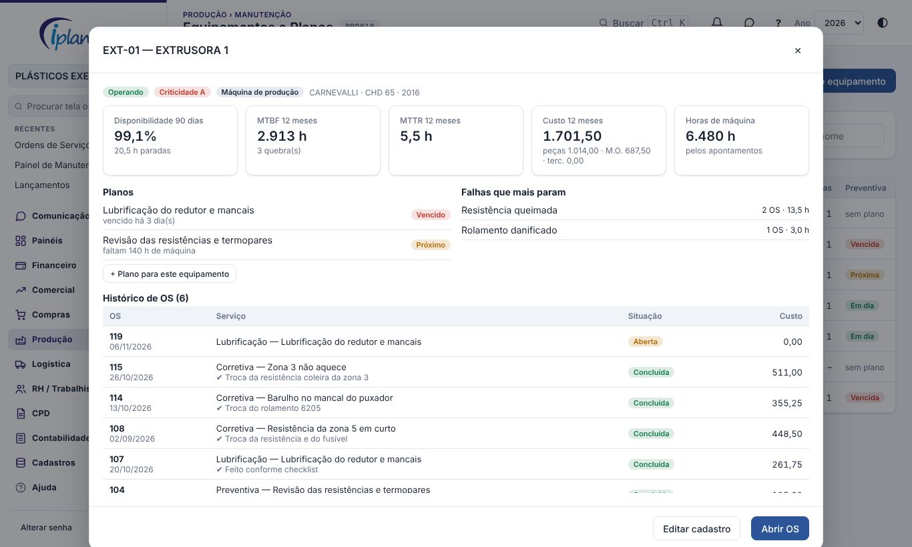

## 7. Planos preventivos

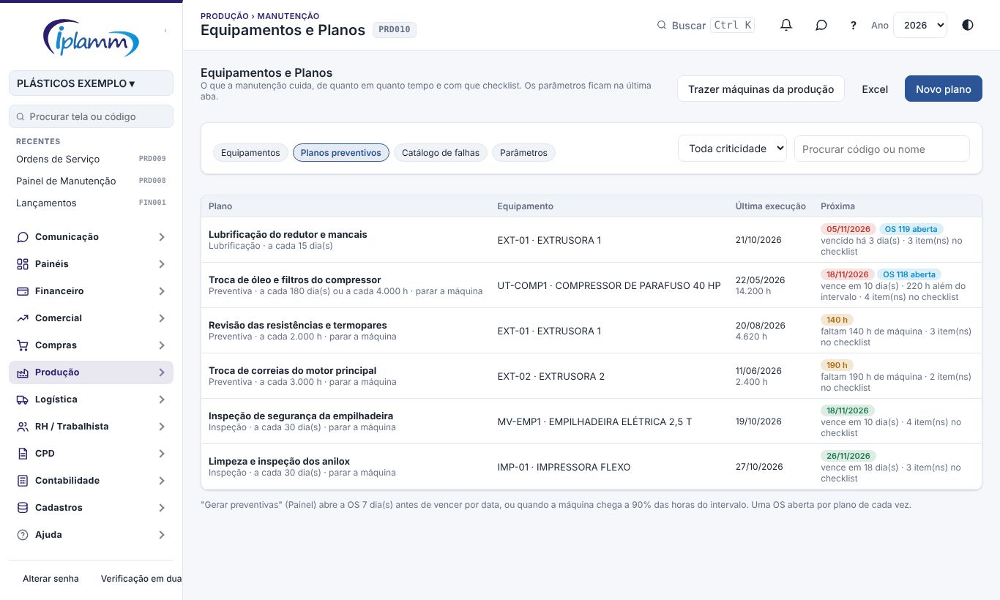

### 7.1 Cadastro do plano

1. Clique em **Novo plano** na aba Planos preventivos, ou em **+ Plano para este equipamento** na ficha do equipamento.
2. Informe:
   - o equipamento, o nome e o tipo: preventiva, lubrificação, inspeção, preditiva ou calibração;
   - o intervalo: **a cada X dias**, **a cada X horas de máquina** ou os dois (vence o que chegar primeiro);
   - a duração prevista e a especialidade;
   - se **exige parar a máquina**.
3. Escreva o **checklist**, um item por linha. Ele vai para cada OS gerada pelo plano.
4. Informe as **peças previstas**.
5. Na implantação, preencha a **última execução** (data e horas de máquina na época). Depois disso a plataforma atualiza esses campos sozinha a cada OS concluída.

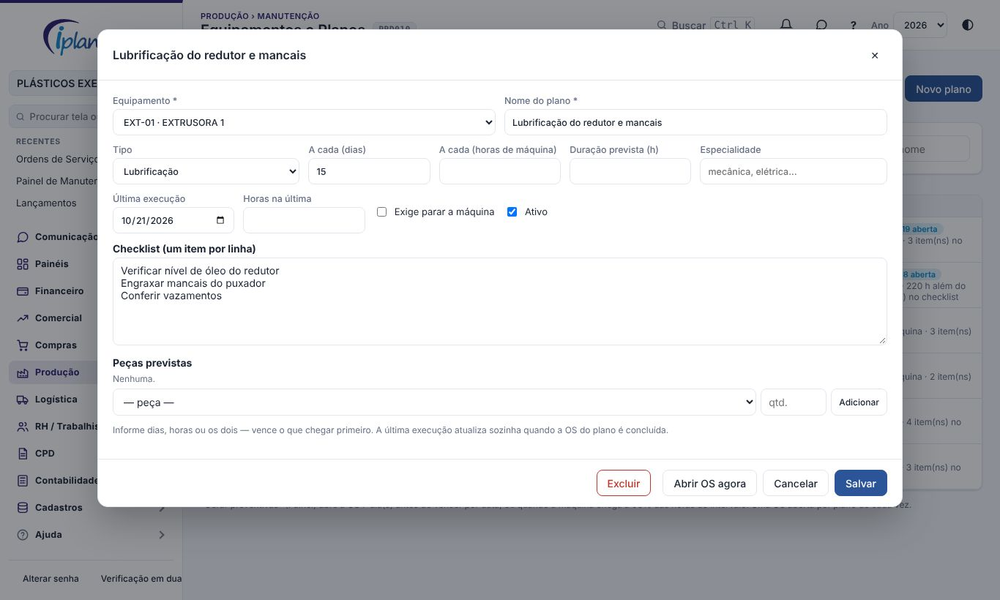

### 7.2 Como a preventiva é gerada

- Por **data**: a OS é aberta **X dias antes** do vencimento. O X é a antecedência definida nos Parâmetros (padrão: 7 dias).
- Por **horas**: a OS é aberta quando a máquina chega a **90% das horas** do intervalo (percentual ajustável em Preventivas e Peças › Parâmetros).
- Cada plano tem **uma OS aberta de cada vez**. Gerar de novo não duplica.
- A OS preventiva já nasce com a data de vencimento e o checklist.
- **Abrir OS agora**, na ficha do plano, antecipa a execução.

A coluna **Próxima** mostra a situação de cada plano:

- **vencido**, em vermelho;
- **próximo**, em amarelo;
- **em dia**, em verde.

Ao lado aparece a OS que já está aberta para o plano, se houver.

### 7.3 Preventivas e Peças Críticas

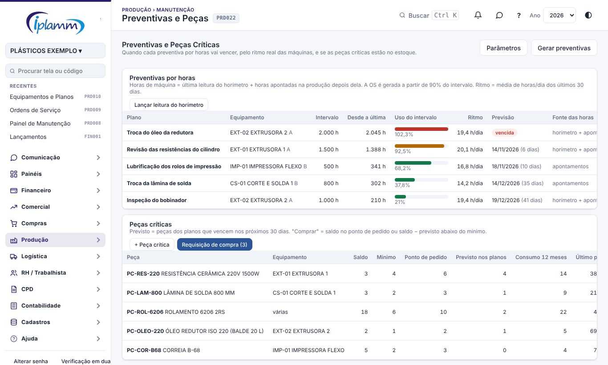

A tela **Preventivas e Peças** mostra quando cada preventiva por horas vai vencer, pelo ritmo real das máquinas.

As **horas de máquina** são a última leitura do horímetro mais as horas apontadas na produção depois da leitura. Sem leitura, valem só os apontamentos. Lance uma leitura em **Lançar leitura do horímetro** sempre que alguém conferir o horímetro na máquina.

Para cada plano por horas, a tabela mostra:

- o **intervalo** e as horas **desde a última** execução;
- o **uso do intervalo**: em verde, abaixo do percentual que gera a OS; em amarelo, a OS já é gerada; em vermelho, vencida;
- o **ritmo**: a média de horas por dia dos últimos 30 dias (ajustável);
- a **previsão**: a data em que o intervalo vai ser atingido nesse ritmo;
- a **fonte das horas** e se já há OS aberta.

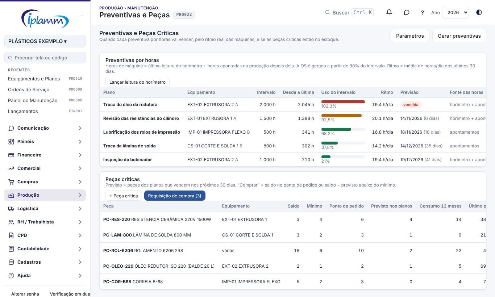

As **peças críticas** são as que não podem faltar (resistência, rolamento, correia, lâmina de solda). Para cada peça, cadastre em **+ Peça crítica**:

- o **mínimo** e o **ponto de pedido**;
- a máquina (ou deixe vazio, se a peça serve a várias).

A tabela mostra:

- o **saldo** do estoque oficial;
- o **previsto nos planos**: as peças dos planos que vencem nos próximos 30 dias (ajustável);
- o **consumo** dos últimos 12 meses nas OS e o último preço.

A **situação** é uma destas:

| Situação | Quando |
|---|---|
| Abaixo do mínimo | O saldo está menor que o mínimo. |
| Comprar | O saldo chegou ao ponto de pedido, ou o saldo menos o previsto fica abaixo do mínimo. |
| OK | Nenhuma das anteriores. |
| Estoque não implantado | O saldo inicial ainda não foi implantado no Kardex. |

**Requisição de compra** cria a requisição das peças "abaixo" e "comprar". A quantidade sugerida é o ponto de pedido mais o previsto, menos o saldo. A requisição é urgente quando há peça abaixo do mínimo.

Todo dia às 7h37, quem é administrador, diretor, compras ou produção recebe o aviso **Peça crítica abaixo do mínimo**. O aviso da mesma peça repete no máximo a cada 7 dias (ajustável).

Em **Parâmetros** desta tela:

- o percentual do intervalo que gera a OS (padrão 90%);
- os dias do ritmo (padrão 30);
- o horizonte das peças previstas (padrão 30 dias);
- o aviso diário e o intervalo entre avisos (padrão 7 dias).

## 8. Ligação com a produção

- **Parada pela OS**:
  - a OS com **máquina parada** cria a parada na máquina da produção, com o motivo de manutenção, e muda o equipamento para "Em manutenção";
  - ao concluir ou cancelar a OS, a parada é encerrada e o equipamento volta a "Operando";
  - o tempo parado entra no **OEE** do Painel de Produção.
- **OS pela parada**:
  - quando o operador aponta, no Terminal do Setor, uma parada de motivo do tipo manutenção, a plataforma abre uma OS **solicitada**;
  - a OS entra como **emergência** se o equipamento for de criticidade A;
  - a OS não é aberta em dobro: a parada criada pela própria OS não gera outra OS.
- **Horas de máquina**: para a máquina ligada à produção, as horas são a soma dos apontamentos (Terminal do Setor e importação do Iniflex). Não precisa de horímetro.

## 9. Indicadores

| Indicador | Como é calculado |
|---|---|
| Disponibilidade | 1 − horas de máquina parada por manutenção ÷ horas do período × número de máquinas |
| MTBF (tempo médio entre falhas) | Horas disponíveis ÷ número de quebras (corretivas que pararam a máquina) |
| MTTR (tempo médio de reparo) | Horas paradas nas quebras ÷ número de quebras |
| Aderência às preventivas | Preventivas que venciam no período e foram feitas no prazo, com a tolerância dos Parâmetros ÷ preventivas que venciam no período |
| Preventiva × total | Preventivas concluídas ÷ OS concluídas. Quanto maior, menos a fábrica vive de apagar incêndio |
| Custo da manutenção | Peças + horas × custo da hora + terceiros, das OS abertas no período |
| OS atrasada | Preventiva depois do vencimento; emergência aberta há mais de 24 h; alta aberta há mais de 72 h |

As OS atrasadas, as emergências, as peças aguardadas há mais de 3 dias e os planos vencidos sem OS também aparecem no **Decision Center**.

## 10. Manutenção no Celular

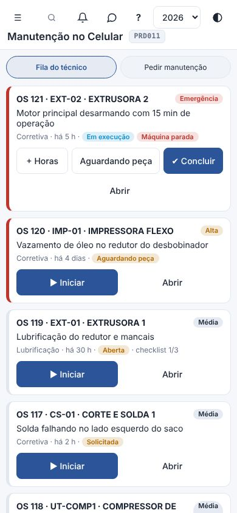

### 10.1 Pedir manutenção (operador)

1. Abra **Manutenção no Celular** e toque em **Pedir manutenção**.
2. Toque no equipamento.
3. Responda se a máquina parou.
4. Escreva o que está acontecendo. A foto é opcional.
5. Toque em **Enviar para a manutenção**.

A prioridade é definida sozinha:

- máquina parada de criticidade A: **emergência**;
- outra máquina parada: **alta**;
- máquina rodando: **média**.

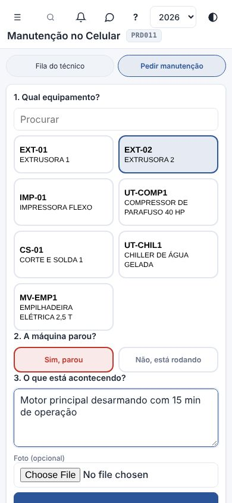

### 10.2 Fila do técnico

- A fila vem na ordem de atendimento.
- **Iniciar** grava o início e o técnico como responsável.
- **+ Horas** lança as horas trabalhadas.
- **Aguardando peça** muda a situação da OS.
- **Concluir** e **Abrir** levam à ficha completa: falha, causa, solução, checklist, peças e foto.

## 11. Parâmetros

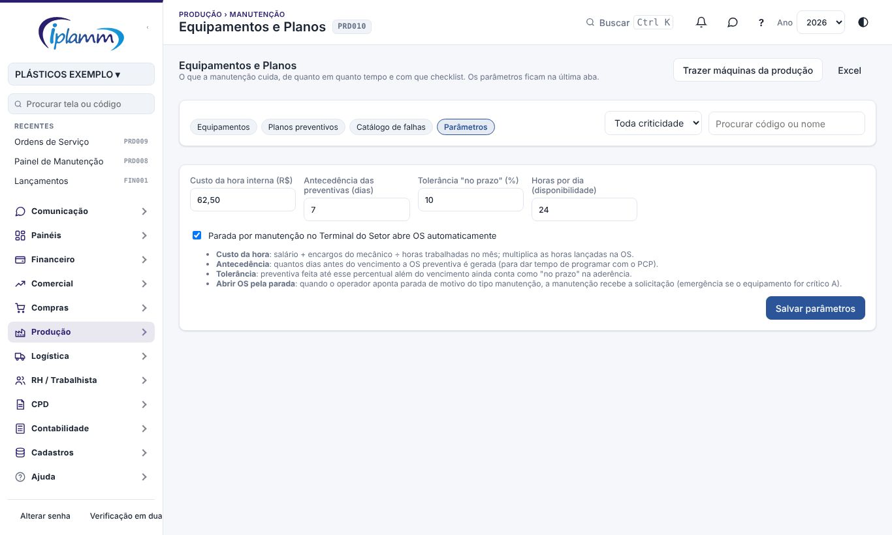

| Parâmetro | O que faz | Padrão |
|---|---|---|
| Custo da hora interna | Salário + encargos do mecânico ÷ horas trabalhadas no mês. Multiplica as horas lançadas na OS | R$ 0,00 |
| Antecedência das preventivas | Quantos dias antes do vencimento a OS preventiva é gerada | 7 dias |
| Tolerância "no prazo" | Quanto além do vencimento a preventiva ainda conta como no prazo | 10% |
| Horas por dia | Base da disponibilidade | 24 |
| Abrir OS pela parada | Parada de manutenção no Terminal do Setor abre a OS | Ligado |

O **catálogo de falhas** fica na aba de mesmo nome. Cada falha tem código, descrição, categoria e pode ser desativada. As categorias são:

- mecânica, elétrica, eletrônica;
- hidráulica, pneumática, lubrificação;
- operacional, instrumentação, outra.

## 12. Regras e travas

- O número da OS é sequencial por empresa e não se repete.
- A corretiva só é concluída com **o que foi feito** preenchido.
- Cada plano tem uma OS aberta de cada vez.
- A peça usada sai do estoque oficial. Para devolver, use **Estornar**: nunca apague.
- A conta a pagar do terceiro é lançada uma vez só. Para corrigir, use os Lançamentos.
- Só administrador, financeiro e diretor cancelam OS, sempre com motivo.
- Equipamento com OS não é excluído: ele fica inativo.
- Todas as alterações ficam na auditoria.

## 13. Perguntas frequentes

**A máquina parou de madrugada e ninguém abriu OS.** Se o operador apontou a parada como manutenção no Terminal do Setor, a OS já está na fila. Se não apontou, abra a OS e informe em **Parada desde** a hora real em que a máquina parou.

**Por que a disponibilidade não bate com o OEE da produção?** A disponibilidade da manutenção considera só as paradas por manutenção. O OEE considera todas as paradas não planejadas: setup, falta de material, falta de operador e as demais.

**A peça não aparece na lista.** A lista mostra os produtos ativos de tipo peça de manutenção, uso e consumo ou outro. Cadastre a peça em Estoque › Produtos ou pelo Cadastro pelas Notas de Entrada.

**Como faço a preventiva de um equipamento que não tem apontamento?** Use o plano por dias ou registre as leituras do horímetro na ficha do equipamento.

**O compressor é de uma empresa terceirizada.** Cadastre o compressor como equipamento e lance a visita na aba Terceiros da OS, com a conta do plano para gerar a conta a pagar.

## 14. Histórico de alterações

| Versão | Data | O que mudou |
|---|---|---|
| 1.0 | 07/11/2026 | Primeira versão. Inclui equipamentos ligados às máquinas, ao imobilizado e ao centro de custo; OS com checklist, horas, peças do estoque, terceiros no contas a pagar, fotos e impressão; planos por dias e horas de máquina; parada automática com a produção; indicadores; celular; parâmetros e Decision Center. |
| 1.1 | 08/11/2026 | Nova tela Preventivas e Peças (PRD022): horas de máquina pelo horímetro mais os apontamentos depois da leitura; uso do intervalo, ritmo e data prevista de cada plano por horas; percentual que gera a OS ajustável; peças críticas com mínimo, ponto de pedido, previsto nos planos, consumo, requisição de compra e aviso diário. |
