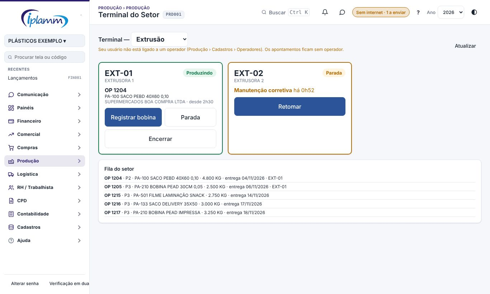
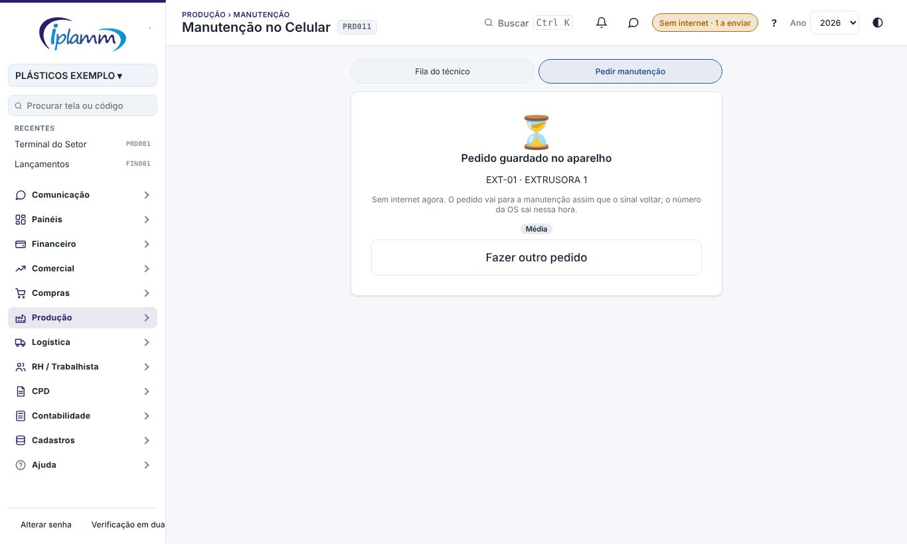
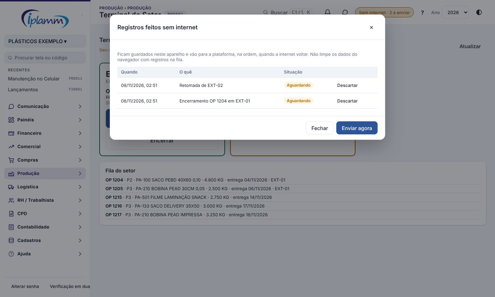

## 1. Para que serve

O chão de fábrica tem pontos sem Wi-Fi. Nas três telas usadas na produção, a plataforma continua funcionando sem internet:

- **Terminal do Setor**: iniciar a produção, registrar e encerrar parada, encerrar o apontamento;
- **Manutenção no Celular**: pedir manutenção (com foto), iniciar a OS, marcar aguardando peça e lançar horas;
- **Casa de Tintas**: pesar os itens da receita na ficha da ordem.

O que for registrado sem sinal fica guardado **no aparelho** e vai para a plataforma sozinho, na ordem, quando a internet voltar.

## 2. Quem tem acesso

Os mesmos perfis de cada tela: produção (operador), manutenção, tinteiro e quem gerencia a produção. O modo sem internet não dá acesso a nada novo: tudo o que sobe passa pelas mesmas regras e permissões de quando há sinal.

## 3. Como funciona

1. **Abra a tela uma vez com internet.** A plataforma guarda no aparelho os arquivos e os dados que a tela mostrou: máquinas, OPs da fila, OS, ordens de tinta.
2. **Sem sinal, use normalmente.** A tela abre com o último dado guardado e com o que você já registrou sem internet. A mensagem diz "sem internet: guardado no aparelho".
3. **O selo no topo** mostra **Sem internet** e quantos registros esperam o envio.
4. **A internet voltou?** Os registros sobem sozinhos, na ordem em que foram feitos (a plataforma tenta a cada 30 segundos). O selo some e aparece o aviso de quantos foram enviados.

A data e a hora gravadas são as do momento do registro no aparelho, não as do envio.

### 3.1 Instalar como app

No celular ou no tablet, abra a plataforma no navegador e escolha **Adicionar à tela inicial** (Android: menu ⋮; iPhone: botão Compartilhar). O ícone da IPLAMM abre a plataforma em tela cheia, como um aplicativo, e abre mesmo sem sinal.

Se o aparelho estiver sem internet ao abrir, a plataforma entra com a última empresa e o último perfil usados nele.

## 4. O que funciona sem internet

| Tela | Funciona sem internet | Precisa de internet |
|---|---|---|
| Terminal do Setor | Iniciar produção, parada, retomar, encerrar o apontamento | Registrar bobina (o número e a etiqueta vêm da plataforma) |
| Manutenção no Celular | Pedir manutenção com foto, iniciar, aguardando peça, lançar horas | Concluir e abrir a ficha completa da OS |
| Casa de Tintas | Pesar os itens da receita | Ajuste fora da receita, medição, aprovação, entrega e retorno |

O pedido de manutenção feito sem sinal recebe o **número da OS** quando chega à plataforma.

## 5. Pesagem sem internet

A pesagem feita sem sinal aparece na ficha da ordem como pesada. Quando sobe, a plataforma faz a baixa do estoque e calcula o custo, como sempre.

Cada pesagem leva uma **chave única**. Se a internet cair no meio do envio e o aparelho mandar de novo, a plataforma reconhece a chave e **não pesa duas vezes**.

## 6. A fila do aparelho

Clique no selo do topo para ver a fila:

- **Aguardando**: espera a internet. **Enviar agora** tenta na hora.
- **Erro**: a plataforma recusou o registro (por exemplo, a OS já tinha sido concluída por outra pessoa). A mensagem diz o motivo. **Tentar de novo** manda outra vez; **Descartar** tira o registro da fila.

Um registro com erro não impede os outros de subir.

## 7. Regras e travas

- Os registros ficam **neste aparelho e neste navegador**. Não limpe os dados do navegador nem troque de aparelho com registros na fila.
- O envio respeita as permissões e as regras de cada tela. O que a plataforma recusar fica marcado com erro, para você ver.
- Inclusões levam um código gerado no aparelho: mandar duas vezes não duplica.
- O dado mostrado sem internet é o da última vez que a tela abriu com sinal. O que outras pessoas fizeram depois só aparece quando a internet voltar.

## 8. Perguntas frequentes e erros comuns

**A tela não abre sem internet.** Ela precisa ter sido aberta uma vez com sinal neste aparelho. Abra com internet e tente de novo.

**O selo mostra registros com erro.** Abra a fila, leia o motivo e use **Tentar de novo** ou **Descartar**.

**Registrei a bobina e apareceu "precisa de internet".** O número e a etiqueta da bobina vêm da plataforma. Anote o peso e registre quando o sinal voltar.

## 9. Histórico de alterações

| Versão | Data | O que mudou |
|---|---|---|
| 1.0 | 08/11/2026 | Primeira versão: app instalável que abre sem internet; Terminal do Setor, Manutenção no Celular e pesagem da Casa de Tintas sem sinal; fila no aparelho com envio automático, selo no topo, erros, tentar de novo e descartar; pesagem com chave única. |
