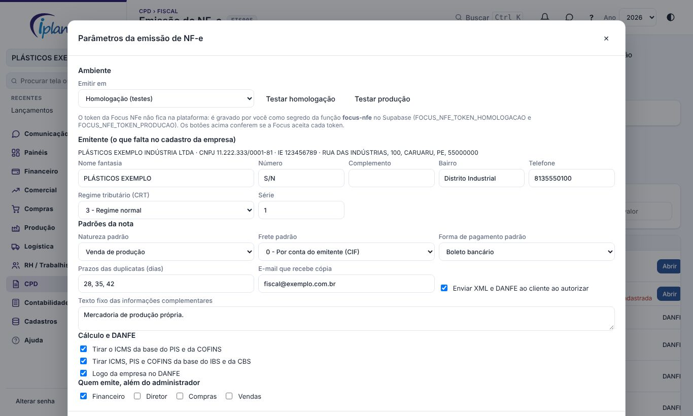
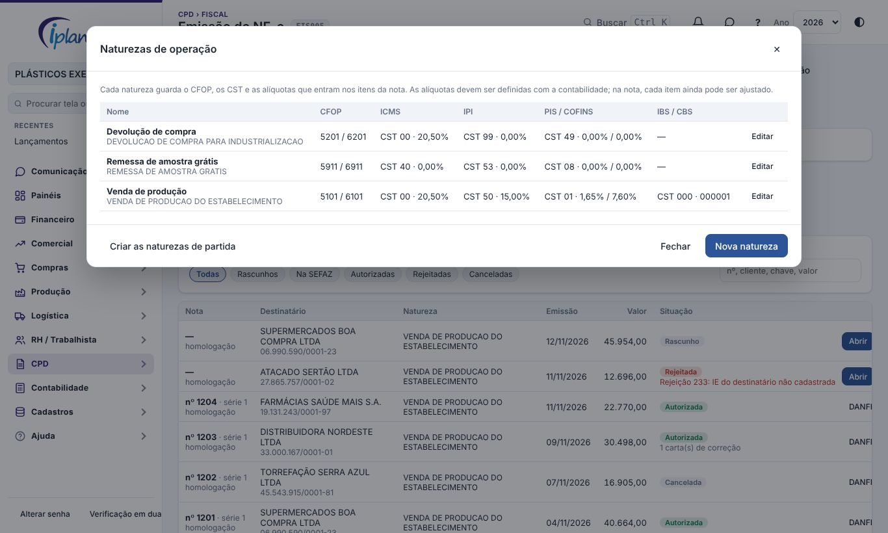
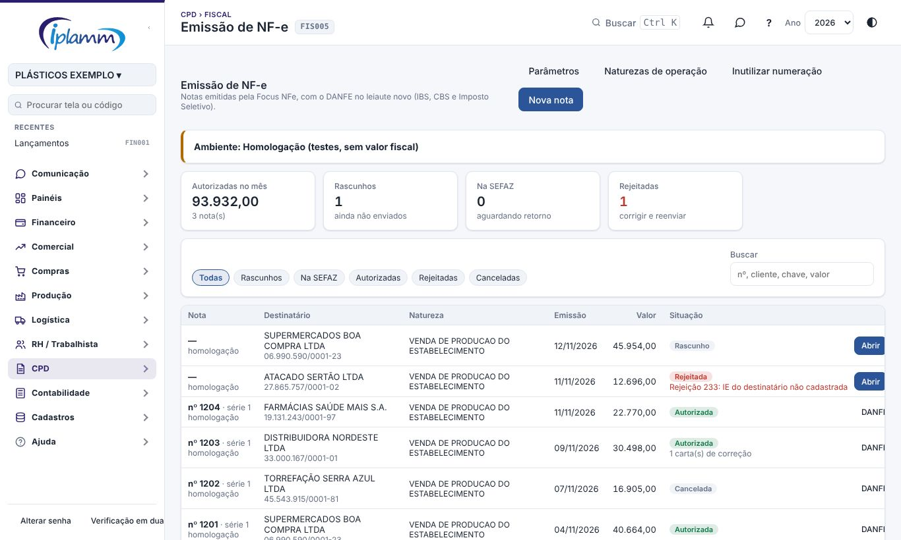
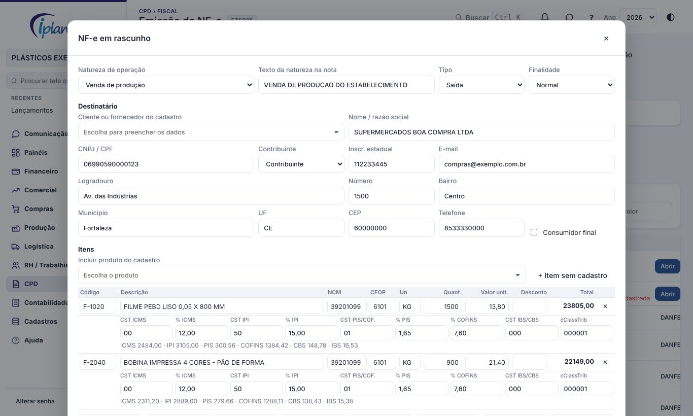
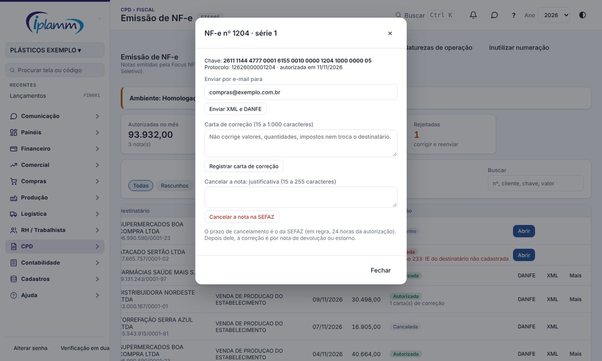
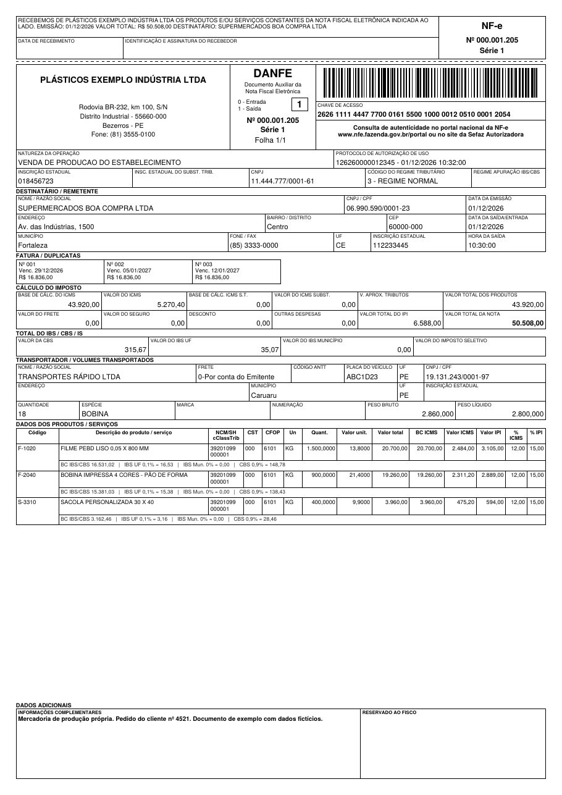

## 1. Para que serve

A tela emite a Nota Fiscal Eletrônica (modelo 55) direto da plataforma. A nota é montada aqui, enviada à SEFAZ pela **Focus NFe** (um serviço contratado que assina e transmite a nota com o certificado da empresa) e volta autorizada, com o XML guardado e o DANFE pronto.

O DANFE é gerado pela própria plataforma, já no **leiaute novo da Nota Técnica 2026.010**, que passa a valer em 01/12/2026 e mostra os tributos da Reforma Tributária: IBS, CBS e Imposto Seletivo.

O que esta primeira versão faz:

- nota avulsa (digitada na tela), de saída ou de entrada, normal, complementar, de ajuste ou de devolução;
- impostos sugeridos pela natureza de operação e ajustáveis item a item;
- prévia do DANFE antes de emitir;
- cancelamento, carta de correção, envio por e-mail e inutilização de numeração;
- ambiente de homologação (testes) e de produção.

O que ainda não faz: substituição tributária, DIFAL, FCP, ICMS desonerado, importação e exportação, e a nota nascida de uma carga ou de um pedido. Notas com essas situações continuam sendo emitidas no sistema atual.

## 2. Quem tem acesso

| Perfil | O que faz |
|---|---|
| Administrador | Tudo, inclusive os Parâmetros e a troca de ambiente |
| Financeiro (e outros perfis marcados nos Parâmetros) | Cadastra naturezas, monta, emite, cancela e corrige notas |
| Demais perfis com acesso ao CPD | Consultam as notas e baixam DANFE e XML |

O token da Focus NFe não fica na plataforma nem aparece para ninguém: ele é guardado como segredo no servidor.

## 3. Implantação do ambiente

Faça os passos na ordem. Do 3.1 ao 3.3 é uma vez só por empresa.

### 3.1 Contratar e preparar a Focus NFe

1. Crie a conta no site da Focus NFe (focusnfe.com.br) e contrate o plano com NF-e.
2. No painel da Focus, cadastre a **empresa emitente** com CNPJ, inscrição estadual, endereço e regime tributário, e marque NF-e entre os documentos.
3. Envie o **certificado digital A1** da empresa (arquivo .pfx e a senha) no cadastro da empresa, no painel da Focus.
4. Ainda no cadastro da empresa, confira a **série** e o **próximo número** da NF-e de produção. Ele precisa continuar a numeração do sistema atual, sem repetir e sem pular.
5. Em Painel API › Tokens, copie o **token de homologação** e o **token de produção**.
6. No Supabase, em Edge Functions › Secrets, grave os dois segredos:
   - `FOCUS_NFE_TOKEN_HOMOLOGACAO`
   - `FOCUS_NFE_TOKEN_PRODUCAO`
7. Opcional, para a nota mudar de situação sozinha: grave também `FOCUS_NFE_HOOK_CHAVE` com uma senha longa criada por você e, no painel da Focus (Webhooks), cadastre o endereço da função `focus-nfe` terminado em `?hook=` seguido dessa senha, para o evento de NF-e.

Com mais de uma empresa, cada uma pode ter o próprio token: acrescente o CNPJ (só números) ao nome do segredo, por exemplo `FOCUS_NFE_TOKEN_PRODUCAO_11444777000161`.

### 3.2 Parâmetros da emissão

Em **Parâmetros** (só o administrador):

1. **Ambiente**: comece em Homologação. Use **Testar homologação** e **Testar produção** para conferir se a Focus aceita cada token.
2. **Emitente**: complete o que o cadastro da empresa não tem (número, bairro, telefone, nome fantasia), o **regime tributário (CRT)** e a série. CNPJ, inscrição estadual, logradouro, município, UF e CEP vêm de Cadastros › Empresa.
3. **Padrões da nota**: natureza, frete, forma de pagamento, prazos das duplicatas, texto fixo das informações complementares e o envio automático do XML e do DANFE ao cliente.
4. **Cálculo e DANFE**: se o ICMS sai da base do PIS e da COFINS, se ICMS, PIS e COFINS saem da base do IBS e da CBS, e se o DANFE leva a logo da empresa.
5. **Quem emite**, além do administrador.

### 3.3 Naturezas de operação

A natureza de operação é o molde da nota: guarda o CFOP dentro e fora do estado, os CST e as alíquotas de ICMS, IPI, PIS e COFINS, e os dados do IBS e da CBS (CST, classificação tributária e alíquotas).

1. Clique em **Naturezas de operação** e depois em **Criar as naturezas de partida**: são seis modelos comuns, só com os códigos.
2. Abra cada uma e preencha as **alíquotas com a contabilidade**. A plataforma não decide tributação: aplica o que estiver cadastrado.
3. Em "% ICMS outro estado", deixar em branco usa a regra geral (4% para importados; 7% do Sul e Sudeste, menos o Espírito Santo, para as demais regiões; 12% nos outros casos).
4. Sem CST de IBS/CBS, a nota sai sem o grupo da Reforma Tributária.

### 3.4 Testar em homologação

1. Emita notas de teste para cada natureza que a empresa usa (item 5).
2. Confira com a contabilidade, no DANFE e no XML, bases, alíquotas, valores e textos.
3. Teste também uma rejeição, uma carta de correção e um cancelamento.
4. Só então, nos Parâmetros, mude o ambiente para **Produção**. A tela pede confirmação.

Em homologação a nota não tem valor fiscal e o DANFE sai com a marca "SEM VALOR FISCAL".

## 4. Visão geral da tela

1. **Faixa do ambiente**: mostra se a empresa está em homologação ou em produção, e o que falta configurar.
2. **Indicadores**: autorizadas no mês, rascunhos, notas na SEFAZ e rejeitadas. Clicar filtra a lista.
3. **Lista**: número, destinatário, natureza, emissão, valor e situação.

| Situação | Significado | O que fazer |
|---|---|---|
| Rascunho | Ainda não foi enviada | Abrir, conferir e emitir |
| Na SEFAZ | Enviada, aguardando retorno | **Consultar** em alguns segundos |
| Autorizada | Tem valor fiscal (em produção) | Baixar DANFE e XML |
| Rejeitada | A SEFAZ ou a Focus recusou | Abrir, corrigir pelo motivo mostrado e emitir de novo |
| Cancelada | Cancelada na SEFAZ | — |

## 5. Emitir uma nota

1. Clique em **Nova nota** e escolha a **natureza de operação**. Tipo, finalidade e texto da natureza vêm dela.
2. Em **Destinatário**, escolha o cliente ou fornecedor do cadastro: nome, documento, inscrição estadual e endereço são preenchidos. Confira e complete o que faltar. O CFOP dos itens se ajusta ao estado do destinatário.
3. Em **Itens**, escolha o produto do cadastro (ou **+ Item sem cadastro**) e informe quantidade e valor unitário. Abaixo de cada item ficam os CST e as alíquotas, já preenchidos pela natureza; altere só se aquele item for diferente. A linha cinza mostra o imposto calculado.
4. Informe **frete, seguro e outras despesas**, se houver. Eles são rateados entre os itens e entram nas bases.
5. Preencha **transporte e volumes**.
6. Em **Cobrança**, informe os prazos e clique em **Gerar duplicatas**, ou deixe sem duplicatas.
7. Revise as **informações complementares**.
8. Clique em **Prévia do DANFE** para ver a nota como vai sair.
9. **Salvar rascunho** guarda para depois. **Emitir** confere a nota, pede confirmação e envia.

Antes de enviar, a plataforma confere o que costuma causar rejeição: dados do emitente e do destinatário, NCM com 8 dígitos, CFOP coerente com a operação e o destino, quantidade e valor, classificação do IBS/CBS, soma das duplicatas e a chave da nota referenciada na devolução.

Como os impostos são calculados:

| Imposto | Base |
|---|---|
| IPI | Valor do item menos desconto, mais frete, seguro e outras despesas |
| ICMS | A mesma base; soma o IPI quando o destinatário é consumidor final; aplica a redução, se houver |
| PIS e COFINS | A mesma base, menos o ICMS (se marcado nos Parâmetros) |
| IBS e CBS | A mesma base, menos ICMS, PIS e COFINS (se marcado nos Parâmetros) |

Empresa do Simples Nacional não destaca ICMS. O total da nota é produtos menos desconto, mais frete, seguro, outras despesas e IPI.

## 6. Depois de autorizada

Na linha da nota: **DANFE** (PDF no leiaute novo), **XML** e **Mais**, que abre:

- **Enviar por e-mail**: a Focus envia o XML e o DANFE dela aos endereços informados.
- **Carta de correção**: corrige dados como endereço de entrega, transportador ou texto. Não corrige valores, quantidades, impostos, nem troca o destinatário.
- **Cancelar a nota**: exige justificativa de 15 a 255 caracteres e respeita o prazo da SEFAZ (em regra, 24 horas da autorização). Depois do prazo, a correção é por nota de devolução ou de estorno.

**Inutilizar numeração** (botão no alto) registra na SEFAZ os números pulados que não serão usados.

## 7. O novo DANFE (NT 2026.010)

O que mudou em relação ao DANFE anterior:

| Onde | O que entrou |
|---|---|
| Quadro do emitente | **Código do regime tributário (CRT)** e uma área reservada para o regime de apuração do IBS/CBS, que fica vazia até a nota técnica que vai defini-la |
| Depois do cálculo do imposto | Bloco **Total do IBS / CBS / IS**: valor da CBS, do IBS UF, do IBS Município e do Imposto Seletivo; os valores monofásicos aparecem só quando existem na nota |
| Itens | **Classificação tributária (cClassTrib)** junto do NCM e, abaixo do item, base, alíquota e valor de IBS UF, IBS Município e CBS, e do Imposto Seletivo quando houver |

Regras seguidas:

- só é impresso o que existe no XML; nada é calculado ou suposto na impressão;
- quando há redução de alíquota, aparece a alíquota efetiva;
- nota sem o grupo da Reforma sai com o bloco de totais em branco e sem a linha extra nos itens.

O mesmo gerador é usado no Portal do Cliente e nas notas recebidas, que passam a sair no leiaute novo.

A nota técnica traz os campos obrigatórios e dois modelos de referência, sem medidas exatas. O DANFE da plataforma segue os campos e a ordem dos quadros; a posição fina de cada campo pode diferir do modelo de referência. O QR Code no quadro de dados adicionais depende de nota técnica futura e ainda não é impresso.

## 8. Regras e travas

- O token da Focus fica só no servidor; a tela nunca o recebe.
- A tela só grava rascunho e nota rejeitada. Número, chave, protocolo, XML e situação são gravados apenas pelo retorno da Focus.
- O emitente da nota é sempre a empresa aberta na plataforma.
- A nota nasce no ambiente em que a empresa está nos Parâmetros.
- Nota enviada não pode ser excluída nem alterada pela tela.
- Trocar para produção exige o administrador e uma confirmação.
- Tudo fica na Auditoria.

## 9. Perguntas frequentes e erros comuns

**"Token da Focus NFe não configurado".** Falta gravar o segredo do ambiente no Supabase (item 3.1).

**"Token da Focus NFe recusado".** O token gravado não é o daquele ambiente, ou foi trocado no painel da Focus. Grave de novo e use o botão Testar.

**A nota ficou "Na SEFAZ".** A SEFAZ ainda não respondeu. Clique em **Consultar**. Com o gatilho do item 3.1 configurado, a situação muda sozinha.

**A nota foi rejeitada.** Abra a nota: o motivo aparece no alto. Corrija e clique em Emitir de novo; a nota mantém o mesmo registro.

**Rejeição de duplicidade de número.** O próximo número no painel da Focus está atrás do último número já usado no sistema atual. Corrija o próximo número no cadastro da empresa na Focus.

**O CFOP não combina com a operação.** Saída dentro do estado começa com 5, para outro estado com 6 e para o exterior com 7; entrada usa 1, 2 e 3. Confira a UF do destinatário e a natureza.

**O imposto calculado não bate com o da contabilidade.** Confira as alíquotas e os CST da natureza e as duas opções de base nos Parâmetros. Situações com substituição tributária, DIFAL ou benefício fiscal ainda não são calculadas por esta tela.

**O e-mail do cliente chegou com um DANFE diferente.** O e-mail é enviado pela Focus com o DANFE dela. O DANFE no leiaute novo é o baixado pela plataforma.

**Emiti em homologação e quero em produção.** A nota de homologação não vira nota de produção. Mude o ambiente e monte a nota de novo.

## 10. Histórico de alterações

| Versão | Data | O que mudou |
|---|---|---|
| 1.0 | 12/11/2026 | Primeira versão: implantação do ambiente da Focus NFe, parâmetros, naturezas de operação, nota avulsa com impostos calculados, prévia, emissão, consulta, cancelamento, carta de correção, e-mail, inutilização e DANFE no leiaute da NT 2026.010. |
