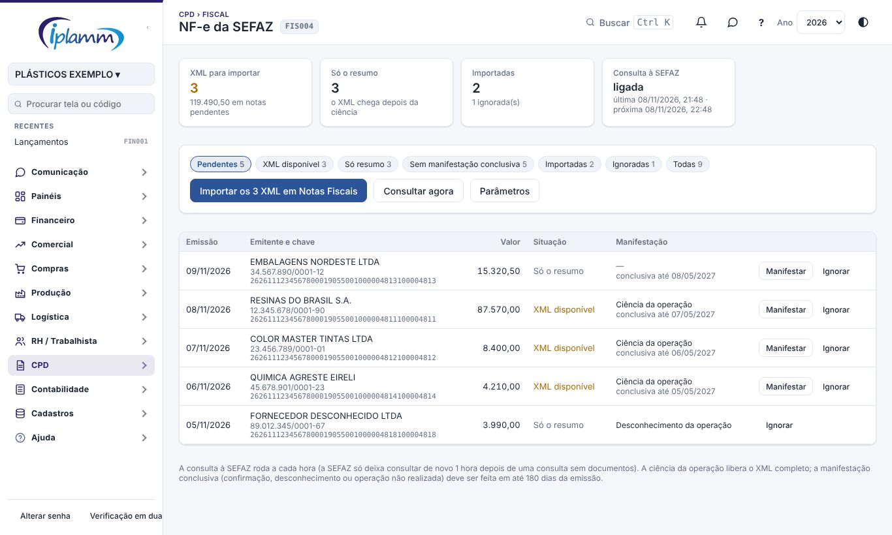
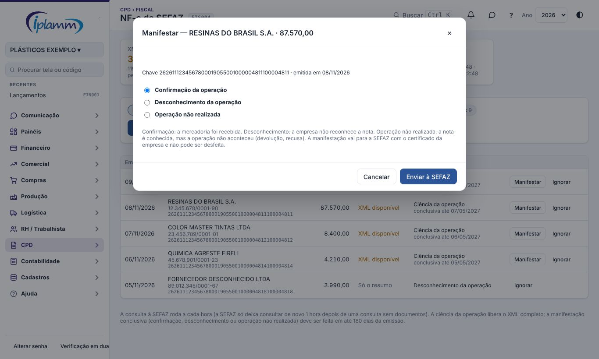
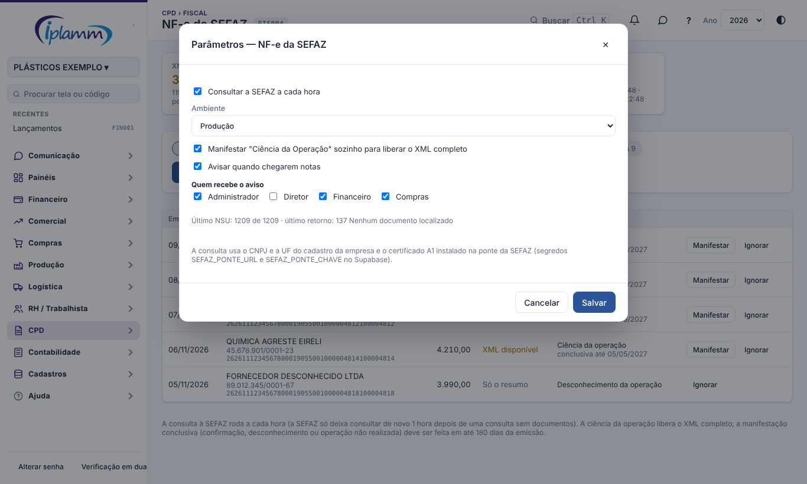

## 1. Para que serve

Busca **sozinha na SEFAZ** todas as NF-e emitidas **contra o CNPJ da empresa** (as notas dos fornecedores), pelo serviço oficial **Distribuição DF-e**. Assim a nota de entrada chega à plataforma mesmo quando o fornecedor esquece de mandar o XML por e-mail.

O caminho de cada nota:

| Etapa | O que acontece |
|---|---|
| Resumo | a SEFAZ entrega primeiro um **resumo** (emitente, data, valor, chave) |
| Ciência da operação | a plataforma manifesta a **ciência** sozinha (se o parâmetro estiver ligado) e a SEFAZ libera o **XML completo** na consulta seguinte |
| XML disponível | o XML fica guardado, pronto para importar em **Notas Fiscais** |
| Importada | depois de importada (por esta tela ou pelo arquivo, em Notas Fiscais), a nota é marcada sozinha |
| Manifestação conclusiva | **confirmação**, **desconhecimento** ou **operação não realizada**, em até **180 dias** da emissão |

Veem a tela o administrador, o diretor, o financeiro e compras.

## 2. A tela

No topo:

- **XML para importar** e o valor das notas ainda pendentes;
- **Só o resumo**: notas que aguardam a ciência para liberar o XML;
- **Importadas** e **ignoradas**;
- **Consulta à SEFAZ**: ligada, desligada ou com erro, com a última e a próxima consulta.

Os filtros separam as notas **pendentes**, com **XML disponível**, **só resumo**, **sem manifestação conclusiva**, **importadas**, **ignoradas** e **todas**.

Cada linha mostra a emissão, o emitente e o CNPJ, a chave de acesso, o valor, a situação (e se a NF-e foi **cancelada** pelo emitente), a manifestação já feita e o **prazo da conclusiva** (em laranja quando faltam 15 dias ou menos).

## 3. Importar os XML

**Importar os XML em Notas Fiscais** abre o mesmo importador da tela Notas Fiscais, já com os XML recebidos da SEFAZ: confira a prévia (fornecedor, CFOP, parcelas) e grave. As notas gravadas passam para **Importadas**.

Notas que já existiam em Notas Fiscais (importadas antes pelo arquivo) são reconhecidas pela chave e ficam como **Importadas** sem duplicar.

**Consultar agora** pede à SEFAZ os documentos novos sem esperar a próxima hora. Se a última consulta não trouxe nada, a SEFAZ só aceita outra **1 hora** depois; a tela avisa quando for o caso.

## 4. Manifestar

**Manifestar** envia o evento à SEFAZ com o certificado da empresa:

| Manifestação | Quando usar |
|---|---|
| Confirmação da operação | a mercadoria ou o serviço foi recebido |
| Desconhecimento da operação | a empresa não reconhece a nota (possível uso indevido do CNPJ) |
| Operação não realizada | a nota é conhecida, mas a operação não aconteceu (recusa, devolução); exige justificativa de 15 a 255 caracteres |

A manifestação conclusiva **não pode ser desfeita**. Se a SEFAZ recusar, o motivo aparece na linha.

## 5. Ignorar

**Ignorar** tira a nota das pendentes (por exemplo, um CT-e de frete que não entra em Notas Fiscais, ou uma nota de outro estabelecimento). **Voltar** traz a nota de novo para as pendentes.

## 6. Parâmetros (administrador)

- **Consultar a SEFAZ a cada hora**: liga a consulta automática.
- **Ambiente**: produção ou homologação (testes).
- **Ciência automática**: manifesta a ciência sozinha para liberar o XML completo.
- **Avisar quando chegarem notas** e **quem recebe o aviso** (administrador, diretor, financeiro, compras).

A janela mostra também o último NSU lido e o último retorno da SEFAZ.

A consulta usa o **CNPJ** e a **UF** do cadastro da empresa e o **certificado A1** instalado na ponte da SEFAZ. A instalação (uma vez, pelo responsável técnico) é:

1. publicar a ponte da SEFAZ na Vercel com os segredos `PONTE_CHAVE`, `SEFAZ_PFX_B64` (o arquivo .pfx em base64) e `SEFAZ_PFX_SENHA`;
2. no Supabase, cadastrar os segredos `SEFAZ_PONTE_URL` e `SEFAZ_PONTE_CHAVE`;
3. ligar a consulta nesta tela.

## 7. Problemas comuns

**"com erro" na consulta.** O motivo aparece no aviso vermelho. Os mais comuns: certificado vencido ou de outro CNPJ, ponte fora do ar, CNPJ ou UF errados no cadastro da empresa.

**A nota ficou só no resumo.** A ciência ainda não foi feita (parâmetro desligado) ou a SEFAZ ainda não liberou o XML; ele chega numa das próximas consultas.

**O certificado vai vencer.** A tela avisa 30 dias antes. Renove o A1 e troque os segredos da ponte.

**Nota cancelada.** Quando o emitente cancela, a linha mostra "NF-e cancelada" e a nota sai das pendentes.

## 8. Histórico de alterações

| Versão | Data | O que mudou |
|---|---|---|
| 1.0 | 08/11/2026 | Primeira versão: consulta horária à Distribuição DF-e, ciência automática, importação em Notas Fiscais, manifestação conclusiva com prazo e parâmetros (melhoria 9.1). |
