## 1. Para que serve

> **Notas Fiscais × Notas Recebidas da SEFAZ.** **Notas Fiscais (Entradas e Saídas)** é a base fiscal: todas as notas já importadas, de entrada e de saída. **Notas Recebidas da SEFAZ (Manifestação)** é a caixa de entrada das notas dos fornecedores: a plataforma as busca na SEFAZ, você manifesta e importa, e então elas aparecem aqui.

- **Notas Fiscais**: importa os **XML das NF-e**, de entrada e de saída, com os itens, os impostos, as parcelas e os eventos. A tela também:
  - consulta as notas por período;
  - soma os impostos por CFOP;
  - liga as parcelas das notas aos recebimentos e pagamentos que já existem nos lançamentos;
  - liga os títulos dos borderôs FIDC às notas;
  - tira os **relatórios de faturamento e de compras** (tela, PDF e Excel).
- **Apuração de Impostos**: a memória de cálculo a partir dos itens das notas, com o livro por CFOP/CST e o resumo dos impostos destacados. Por enquanto é **só leitura e só prévia**. Também traz a **reforma tributária**: a conferência da CBS e do IBS destacados nas notas, o simulador de 2027, a tabela de alíquotas por ano e a fila das **notas de débito** de juros e multa.

## 2. Quem tem acesso

O administrador e o financeiro importam, ligam e desfazem. Quem tem a área CPD consulta. Só o administrador ajusta a tabela de alíquotas da reforma.

## 3. Importar os XML

1. Clique em **Importar XML**.
2. Selecione a **pasta do mês** (por exemplo, "1.7 NF-e Saídas (XML)"), os arquivos XML ou um .zip.
3. A plataforma reconhece pelo próprio XML se a nota é de entrada ou de saída e mostra:
   - as notas novas, o valor das saídas e o das entradas;
   - as notas já importadas, que são ignoradas;
   - os eventos: cancelamento e carta de correção, que são aplicados.
4. Clique em **Importar**. Os lançamentos **não** são alterados.

Depois da importação, a plataforma oferece **conferir o cadastro** dos clientes e fornecedores dessas notas. Os cadastros novos e as diferenças aparecem para aprovação campo a campo; nada muda sem marcar. Use **Aprovar todas** ou **Só completar campos vazios**.

## 4. Consultar as notas

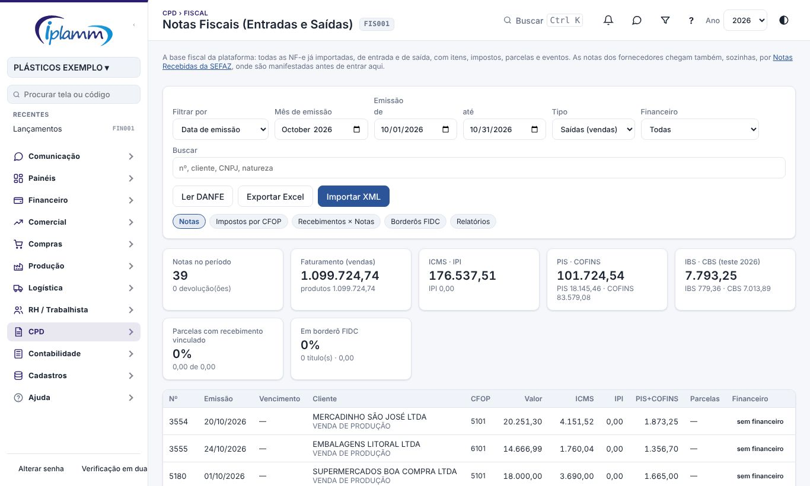

Use os filtros: o período (**Filtrar por** emissão ou vencimento, **até**), o **tipo** (entrada ou saída), o **financeiro** e a busca. As opções do filtro de financeiro são:

- vencidas sem nada ligado;
- sem nada ligado;
- recebidas em parte;
- com título a receber;
- antecipadas no FIDC;
- recebidas.

Os indicadores mostram as notas no período, os impostos (ICMS, IPI, PIS, COFINS, IBS e CBS), as parcelas vencendo, as que têm recebimento vinculado e as que estão em borderô FIDC.

Clique na nota para ver os **itens**, os impostos e as **parcelas, borderôs e recebimentos vinculados**. Na nota, os botões são:

- **Baixar XML**.
- **Usar crédito**: abate um crédito ou adiantamento do cliente ou fornecedor.
- **Marcar como cancelada**: a nota sai do faturamento, dos impostos e das contas a receber. O XML continua guardado e dá para desfazer.
- **Desfazer vínculos de recebimento** e **Desfazer ligação com borderô**.

## 5. As abas

### 5.1 Impostos por CFOP

Os valores das notas autorizadas no período (as canceladas ficam fora), por CFOP. É a base para a apuração.

### 5.2 Recebimentos × Notas (ou Pagamentos × Notas)

Liga cada parcela da nota ao lançamento de recebimento (nas saídas) ou de pagamento (nas entradas) que já existe, no mesmo modelo da Conciliação bancária:

1. Marque a parcela à esquerda. Os recebimentos mais prováveis (mesma NF citada, mesmo cliente, valor e data próximos) sobem para o topo.
2. Marque o recebimento à direita. Quando os totais batem, as linhas ficam verdes.
3. Clique em **Vincular**, ou em **Aceitar sugestões** para fazer em lote.

**Lançar contas a receber das notas** cria um título **Em aberto** (receita 1.01.01, com a data do vencimento e o documento NF-parcela) para cada parcela de venda que ainda não tem lançamento, já ligado à nota. Parcelas que já têm um lançamento da mesma NF e valor só são ligadas a ele.

### 5.3 Borderôs FIDC

Liga cada título dos borderôs (base FIDC) à parcela da nota de onde ele veio. Os casos verdes vêm marcados; os amarelos e vermelhos ficam para você conferir. Clique em **Ligar**.

Borderôs, títulos, lançamentos e notas não são alterados. A gestão dos borderôs fica em Propostas de borderô.

### 5.4 Relatórios: faturamento e compras

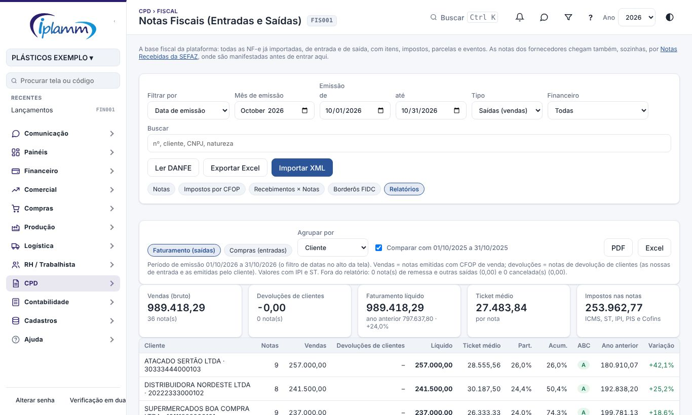

1. Escolha o período no alto da tela (**Emissão de … até …**). Para o ano, ponha de 01/01 até o fim do último mês fechado.
2. Clique na aba **Relatórios** e escolha **Faturamento (saídas)** ou **Compras (entradas)**. A tela abre no relatório do tipo escolhido no filtro.
3. Em **Agrupar por**, escolha **Mês**, **Cliente** (ou **Fornecedor**), **Produto** (ou **Item comprado**), **UF do cliente** (ou **Origem**) ou **CFOP**. Sem escolha, um mês só abre por cliente e um período maior abre por mês.
4. Deixe marcado **Comparar com** para ver o mesmo período do ano anterior e a variação.
5. **PDF** abre o relatório no padrão de impressão da empresa; **Excel** baixa a tabela.

Como os valores são montados:

- **Faturamento** = vendas (notas emitidas pela empresa com CFOP de venda, inclusive com ST e exportação por trading) **menos** as devoluções de clientes (as nossas notas de entrada de devolução e as notas de devolução emitidas pelo cliente).
- **Compras** = notas de fornecedores com CFOP de venda e as nossas notas de entrada de compra, energia, comunicação, transporte, ativo e uso e consumo, **menos** as nossas devoluções a fornecedores.
- Notas **canceladas**, **remessas** (conserto, industrialização, bonificação, simples faturamento de entrega futura) e outras operações ficam fora; o total delas aparece na linha de explicação.
- Os valores são os da nota, **com IPI e ST**. **Ticket médio** = vendas ÷ número de notas. **Part.** = participação no líquido.
- **Curva ABC**: A até 80% do acumulado, B até 95%, C o restante.
- Em **Origem** (compras), a UF do fornecedor sai do CFOP: mesmo estado, outros estados ou exterior.

## 6. Apuração de Impostos

1. Escolha o **mês** e a aba **Saídas** (notas emitidas) ou **Entradas** (compras e devoluções).
2. Escolha a aba: livro por CFOP / CST, resumo dos impostos, **imposto a recolher** ou regras e parâmetros.
3. A tabela mostra o valor contábil, a base do ICMS, o ICMS, o ICMS-ST, o IPI, o PIS e o COFINS. **Exportar Excel** baixa a memória de cálculo.

> **Atenção:** o livro e o resumo são a **soma do que está destacado nas notas**. O imposto a recolher, com o PRODEPE, o FEEF, a taxa AD/DIPER, o FECEP, os ajustes e os créditos de PIS/COFINS, está na aba **Imposto a recolher** (6.5) e segue os parâmetros cadastrados (6.6).

Nas notas de fornecedores, o CFOP e o CST são os do emitente.

### 6.1 Conferência IBS/CBS

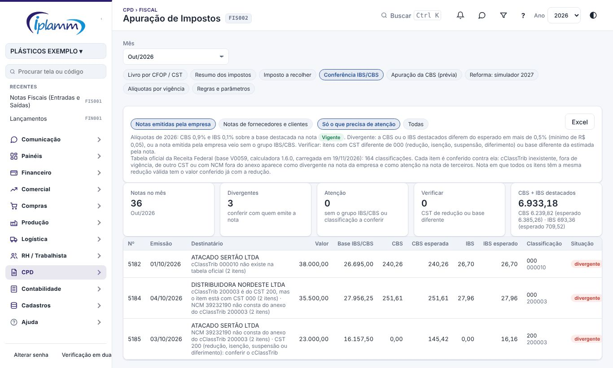

Confere, nota a nota, a CBS e o IBS destacados contra as alíquotas do ano da emissão (em 2026: CBS de 0,9% e IBS de 0,1% sobre a base destacada).

1. Escolha o **mês** e a aba **Conferência IBS/CBS**.
2. Escolha **Notas emitidas pela empresa** ou **Notas de fornecedores e clientes**, e **Só o que precisa de atenção** ou **Todas**.
3. As situações são:
   - **divergente**: a CBS ou o IBS diferem do esperado em mais de 0,5% (mínimo de R$ 0,05), ou a nota emitida pela empresa veio **sem o grupo IBS/CBS**. Desde agosto de 2026 a nota errada já gera multa: corrija o cadastro do produto no emissor;
   - **atenção**: nota de terceiro sem o grupo IBS/CBS, ou com a classificação errada pela tabela oficial;
   - **verificar**: itens com CST diferente de 000 (redução, isenção, suspensão ou diferimento) ou base diferente da estimada pela nota. Quando a classificação é válida, a linha mostra a redução prevista para ela;
   - **confere**.
4. A coluna **Classificação** mostra o CST e os cClassTrib dos itens da nota.
5. **Excel** baixa a lista.

**Conferência pela tabela oficial da Receita.** A plataforma guarda a tabela de classificação que a Receita Federal publica junto com o código aberto da Calculadora de Tributos. Cada item das notas é conferido contra ela:

| O que é conferido | Mensagem na nota |
|---|---|
| O cClassTrib existe | "cClassTrib … não existe na tabela oficial" |
| Está em vigor na data da emissão | "cClassTrib … fora de vigência em …" |
| Pertence ao CST informado | "cClassTrib … é do CST …, mas o item está com CST …" |
| O NCM consta do anexo da classificação (cesta básica, saúde etc.) | "NCM … não consta do anexo do cClassTrib …" |
| É aceito no tipo de documento | "cClassTrib … não é aceito em NF-e" |

- Nota em que **todos os itens têm a mesma redução válida** (por exemplo, cesta básica com 100%) tem a CBS e o IBS conferidos já com a redução; se bater, a situação é **confere**. Nota com itens de reduções diferentes continua em **verificar**.
- Erro em nota **emitida pela empresa** aparece como **divergente**: corrija a natureza ou o item antes da próxima emissão.
- Erro em nota **de terceiro** aparece como **atenção**: avise o fornecedor, porque classificação errada pode comprometer o crédito.
- O rodapé do quadro informa a versão da base em uso e a data em que foi carregada. Quando a Receita publicar versão nova, a atualização é feita pelo suporte da plataforma; não há nada a digitar.
- A tabela cobre CBS e IBS. O Imposto Seletivo fica de fora.

### 6.2 Reforma: simulador 2027

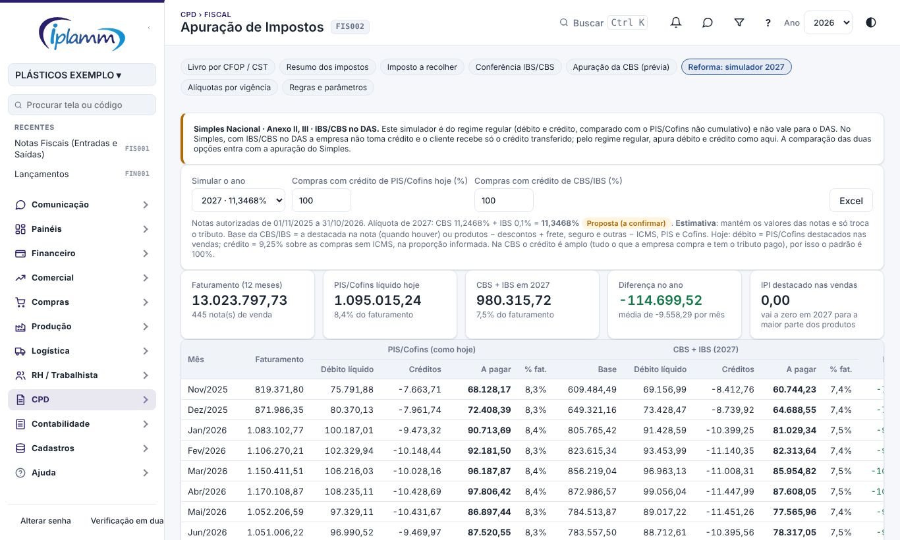

Mostra quanto a empresa pagaria de CBS e IBS em 2027 sobre as notas dos **últimos 12 meses fechados**, comparado com o PIS/Cofins de hoje.

1. Clique na aba **Reforma: simulador 2027**.
2. Escolha o **ano** (2027 em diante, com as alíquotas da tabela da seção 6.3).
3. Informe a proporção das **compras com crédito** de PIS/Cofins hoje e de CBS/IBS. Na CBS o crédito é amplo (tudo o que a empresa compra e tem o tributo pago); no PIS/Cofins, só os insumos e os demais itens da lei.
4. A tabela mostra, por mês: faturamento, débito líquido das devoluções, créditos, valor a pagar e o percentual sobre o faturamento, nos dois regimes, e a **diferença**.

Como o cálculo é feito:

- **Hoje**: débito = PIS/Cofins destacados nas vendas; crédito = 9,25% sobre as compras sem o ICMS, na proporção informada.
- **2027**: base = a base IBS/CBS destacada na nota (quando houver) ou produtos − descontos + frete, seguro e outras despesas − ICMS, PIS e Cofins; débito e crédito = base × alíquota do ano.

> **Atenção:** é uma **estimativa** para o planejamento. Mantém os valores das notas e só troca o tributo. Não considera a mudança de preço (a CBS é cobrada “por fora”), o split payment (o tributo sai no recebimento, o que afeta a antecipação no FIDC), os redutores e regimes específicos, os créditos presumidos e o fim do IPI.

### 6.3 Alíquotas por vigência

A tabela de CBS e IBS por ano usada no simulador e na conferência. O padrão da plataforma foi atualizado em **30/10/2026**:

| Ano | CBS | IBS | Total | Situação |
|---|---|---|---|---|
| 2026 | 0,9% | 0,1% | 1% | vigente (ano-teste: só destacados e compensados com o PIS/Cofins) |
| 2027 | 11,2468% | 0,1% (0,05% estadual + 0,05% municipal) | 11,3468% | proposta do TCU (processo TC 006.529/2026-7), a confirmar por resolução do Senado até dezembro; sem a votação, vale o valor do TCU |
| 2028 | 11,2468% | 0,1% | 11,3468% | estimativa |
| 2029 a 2032 | cerca de 11,25% | 10% a 40% do IBS de referência (projetado em cerca de 18,7%) | 13,1% a 18,7% | estimativa; o ICMS cai na mesma proporção |
| 2033 | cerca de 11,25% | cerca de 18,7% | cerca de 30% | estimativa; fim do ICMS |

Quando sair a alíquota definitiva, o **administrador** clica no ano, ajusta os percentuais, a situação e a **fonte** (lei ou resolução e a data) e salva. **Voltar ao padrão** apaga o ajuste da empresa para aquele ano.

### 6.4 Notas de Débito (juros e multa)

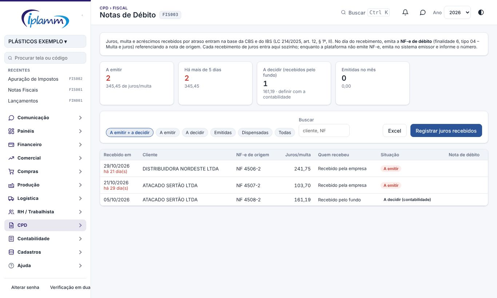

Juros, multa e acréscimos recebidos por atraso entram na base da CBS e do IBS (LC 214/2025, art. 12, § 1º, II). No **dia do recebimento**, a empresa emite a **NF-e de débito**:
- finalidade **6** (nota de débito), tipo de débito **04 – Multa e juros**;
- cada item referencia a chave e o item da NF-e de origem, com a mesma classificação e a alíquota do ano da nota de origem;
- só CBS e IBS (sem ICMS); o valor é o de juros e multa efetivamente recebido.

Não confunda com a **nota de crédito** de multa e juros (finalidade 5, tipo 01): é a que o **cliente** emite quando o fornecedor não emitiu a nota de débito.

Como a fila se forma (**CPD › Fiscal › Notas de Débito**):

1. Todo recebimento de juros vira um lançamento em **1.02.17 JUROS E MULTAS RECEBIDOS**, ligado ao título; o título continua com o valor de face. Isso acontece:
   - na **Conciliação**, ao clicar em **Conciliar com R$ X de juros/multa** quando o extrato é maior que o título;
   - no **Importar do ERP**, na ação **Baixar + juros** (recebimento acima do título);
   - no quadro **Juros e multa** do lançamento pago;
   - em **Registrar juros recebidos**, na própria tela.
2. Cada lançamento desses cria uma pendência **A emitir**, com o cliente, a NF-e de origem, a parcela e o valor. Administradores e financeiro recebem notificação, e a pendência aparece no **Decision Center**. Com mais de 5 dias fica em vermelho.
3. Clique na pendência para ver o rateio por item (CST, cClassTrib, valor, CBS e IBS) e o texto das informações complementares. **Copiar dados para o emissor** copia tudo.
4. Emita a nota de débito no sistema emissor e informe o **número**, a **série**, a **data** e a **chave**: a pendência passa a **Emitida**. **Dispensar** pede o motivo.
5. Juros que o cliente pagou ao **fundo** (mora no relatório de pagos da Carteira cedida) entram como **A decidir (contabilidade)**, até a definição sobre quem emite. **Passar para "a emitir"** ou **Dispensar** resolve cada uma.

> Quando a integração com a API de emissão (Focus NF-e) estiver ligada, a pendência já traz os dados da nota de débito no layout da NT 2025.002 para a emissão direta.

### 6.5 Imposto a recolher

Calcula, para o mês escolhido, o que vai para as guias:

| Imposto | Como é calculado |
|---|---|
| ICMS | débitos das saídas − devoluções de clientes − créditos das compras, com os ajustes do mês e o saldo credor anterior. Do saldo devedor sai o **crédito presumido do PRODEPE** sobre a parte incentivada (CFOP e NCM incentivados) |
| FEEF e taxa AD/DIPER | percentuais sobre o benefício (ou sobre o saldo incentivado, no FEEF, conforme o parâmetro) |
| FECEP | percentual sobre a base do ICMS dos itens de saída com NCM sujeito |
| IPI | débitos − devoluções − créditos das compras − saldo credor anterior |
| PIS/COFINS | débitos destacados nas saídas − devoluções − créditos das compras com CFOP aceito (alíquotas da empresa) − outros créditos − saldo credor anterior |

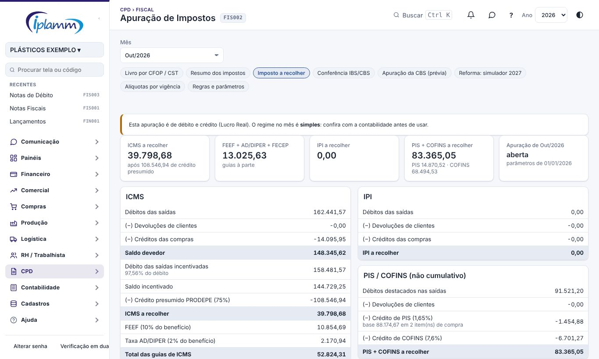

O quadro **Antes de fechar** lista o que merece atenção: mês sem parâmetros, PRODEPE ligado sem nenhuma saída incentivada, FECEP sem lista de NCM, nenhum CFOP de crédito de PIS/COFINS, itens sem NCM.

**Ajustes do mês:** saldo credor anterior (ICMS, IPI, PIS/COFINS), outros débitos e créditos, estornos e outros créditos de PIS/COFINS (energia, aluguéis, depreciação). Quando o mês anterior está fechado, os saldos credores dele já vêm preenchidos. **Salvar ajustes** grava sem fechar.

**Fechar a apuração** (administrador ou financeiro) grava a memória de cálculo do mês; os valores deixam de mudar com novas notas e os saldos credores passam para o mês seguinte. Só o administrador **reabre**. **Exportar Excel** baixa a memória.

> É uma prévia gerencial: confira com a apuração da contabilidade (EFD ICMS/IPI e EFD Contribuições) antes de pagar as guias.

### 6.6 Parâmetros da apuração

Na aba **Regras e parâmetros**, o administrador cadastra os parâmetros por **vigência** (cada uma vale do início até a próxima), sempre com a **fonte** (decreto, termo de concessão ou orientação da contabilidade):

- **PRODEPE:** percentual do crédito presumido; cálculo sobre o *saldo devedor × proporção das saídas incentivadas* ou sobre o *débito das saídas incentivadas*; CFOP de saída e início do NCM incentivados (vazio = todos); FEEF e taxa AD/DIPER;
- **FECEP:** percentual, início do NCM sujeito e CFOP de saída (vazio = todos);
- **PIS/COFINS:** alíquotas, CFOP do fornecedor que dão crédito, e se o frete e o IPI entram e o ICMS sai da base do crédito.

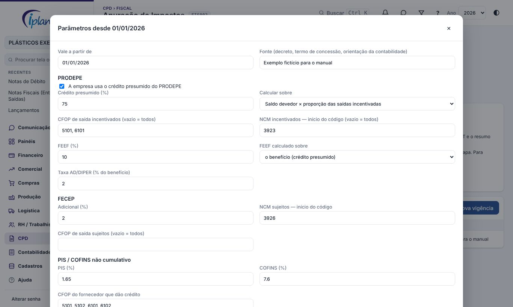

Nenhum percentual é suposto pela plataforma: sem parâmetros, a apuração mostra só o destacado nas notas. Uma vigência nova não altera os meses já fechados.

### 6.7 Transição até 2033

No fim da aba **Reforma: simulador 2027**, a tabela **Transição até 2033** repete a base dos últimos 12 meses em cada ano da reforma: o ICMS líquido (com o crédito presumido do PRODEPE, o FEEF e a taxa AD/DIPER) reduzido pelo percentual de ICMS mantido no ano, o PIS/Cofins enquanto cobrado e a CBS/IBS (débito − crédito) pelas alíquotas do ano. A última coluna compara com o total de hoje.

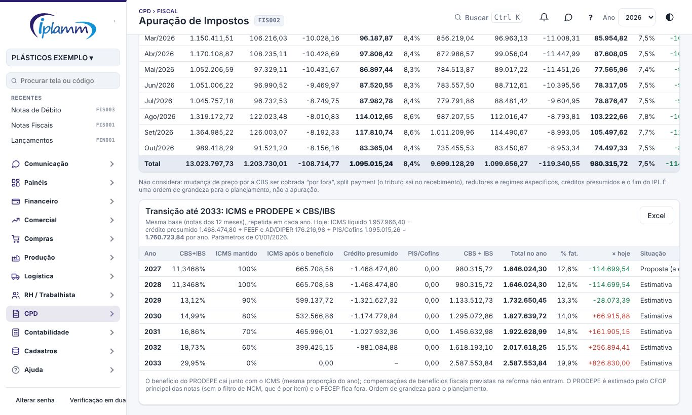

O PRODEPE entra pelo CFOP principal de cada nota (sem o filtro de NCM) e o FECEP fica fora; as compensações de benefícios previstas na reforma não entram. É ordem de grandeza para o planejamento.

### 6.8 Apuração da CBS (prévia)

A aba **Apuração da CBS (prévia)** monta, com as notas importadas, a mesma conta da Apuração Assistida da Receita Federal: débitos, créditos e saldo do mês.

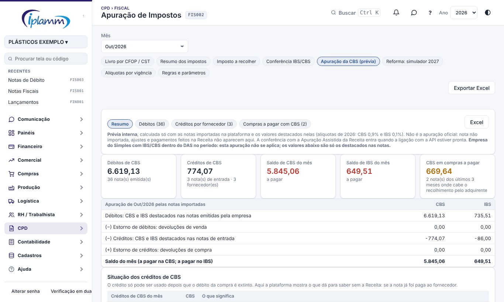

| Linha | De onde vem |
|---|---|
| Débitos | CBS e IBS destacados nas notas de saída emitidas pela empresa |
| Estorno de débitos | Devoluções de venda |
| Créditos | CBS e IBS destacados nas notas de entrada de fornecedores |
| Estorno de créditos | Devoluções de compra emitidas pela empresa |
| Saldo do mês | Débitos menos créditos. Positivo é a pagar; negativo é saldo credor |

As quatro visões da aba:

- **Resumo**: a conta do mês e a situação dos créditos de CBS (em notas já pagas, em notas ainda a pagar e em notas sem título ligado).
- **Débitos**: nota a nota, com a base e os valores. A nota emitida sem o grupo IBS/CBS aparece marcada.
- **Créditos por fornecedor**: quanto de CBS e IBS cada fornecedor destacou e quanto disso está em nota ainda a pagar.
- **Compras a pagar com CBS**: as compras do mês e dos dois meses anteriores com CBS destacada e título em aberto.

**Por que olhar as compras a pagar.** O crédito de CBS só pode ser usado depois que o débito da compra é extinto. No recolhimento pelo adquirente (RAD), a empresa paga a CBS da compra por DARF e o restante ao fornecedor: o desembolso total é o mesmo e o crédito não depende de o fornecedor recolher. A coluna "Líquido com o RAD" mostra quanto ele receberia.

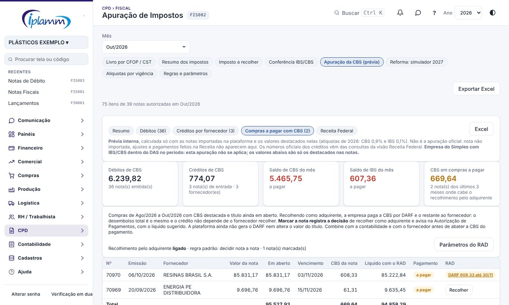

**Limites desta prévia**

- Não é a apuração oficial e não fala com a Receita: ajustes, pagamentos e recolhimentos feitos lá não aparecem.
- Só entram as notas importadas na plataforma, pelos valores destacados nelas. Nota sem o grupo IBS/CBS fica sem débito ou crédito (veja a seção 6.1).
- "Paga" ou "a pagar" vem do título ligado à nota em Notas Fiscais. Nota sem título ligado aparece à parte.
- A plataforma ainda não gera o DARF do RAD nem altera o valor do título (seção 6.9). Combine com a contabilidade e com o fornecedor antes de abater a CBS de um pagamento.
- Para empresa do Simples com IBS/CBS dentro do DAS, a apuração não se aplica; a aba avisa.

### 6.9 Recolhimento pelo adquirente (RAD)

Na visão **Compras a pagar com CBS**, a empresa registra em quais notas decidiu recolher a CBS como adquirente. O recurso vem **desligado**.

**Ligar e definir as regras.** Clique em **Parâmetros do RAD** (administrador ou financeiro):

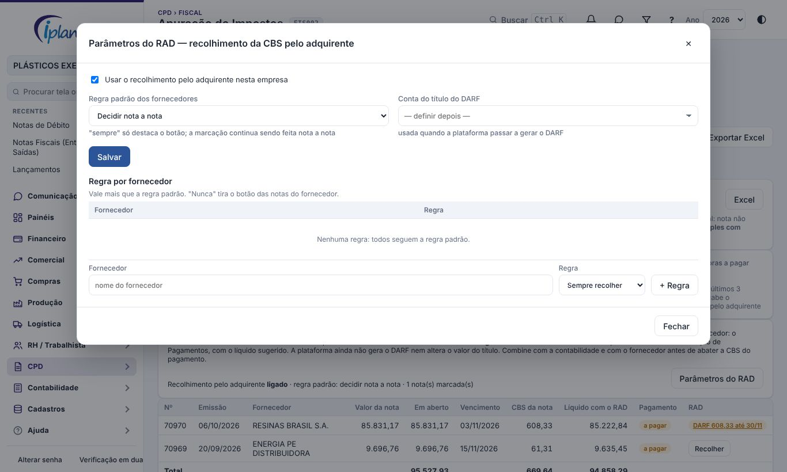

| Parâmetro | O que faz |
|---|---|
| Usar o recolhimento pelo adquirente | Mostra o botão de marcar nas notas |
| Regra padrão dos fornecedores | Sempre recolher, nunca recolher ou decidir nota a nota |
| Conta do título do DARF | Reservada para quando a plataforma passar a gerar o DARF |
| Regra por fornecedor | Vale mais que a padrão. "Nunca" tira o botão das notas daquele fornecedor; "sempre" destaca o botão |

**Marcar a nota.**

1. Na linha da nota, coluna **RAD**, clique em **Recolher**.
2. Confira a CBS da nota e o líquido sugerido ao fornecedor, escreva uma observação se quiser e clique em **Marcar a nota**.
3. A linha passa a mostrar **marcada**, com quem marcou e quando. **Desfazer** tira a marcação.

**Na Autorização de Pagamentos**, o título da nota marcada aparece com o aviso **RAD**, a CBS e o líquido sugerido. A CBS é abatida, na sugestão, do título em aberto de vencimento mais próximo.

**Gerar o DARF (desligado por enquanto).** A geração do DARF pela plataforma está travada: hoje a ligação com a Receita só testa a conexão e consulta. Quando for liberada, a nota marcada mostrará **gerar DARF**:

1. Clique em **gerar DARF** e escolha recolher todo o débito da nota ou só uma parte.
2. Confirme. A Receita devolve o valor, a data máxima, o PIX, o código de barras e o PDF.
3. A linha passa a mostrar o DARF com o valor e a data. Clicar nele abre o PIX para copiar e o PDF.

O valor do DARF é o que a Receita calcula para a nota; a CBS mostrada na lista é a prévia. Gerar o DARF não paga: o pagamento é feito depois, no banco. Com a **conta do título do DARF** preenchida nos parâmetros, a plataforma cria o título a pagar. Quando a consulta de recolhimentos confirma o pagamento, a nota passa a **recolhido**.

A marcação e o DARF **não** alteram o valor do título do fornecedor: para abater a CBS, ajuste o valor autorizado na Autorização de Pagamentos.

A regra "sempre" não marca sozinha; a decisão continua sendo nota a nota.

### 6.10 Ligação com a Receita Federal

A visão **Receita Federal** consulta a Apuração Assistida da CBS direto na Receita, com a credencial da empresa.

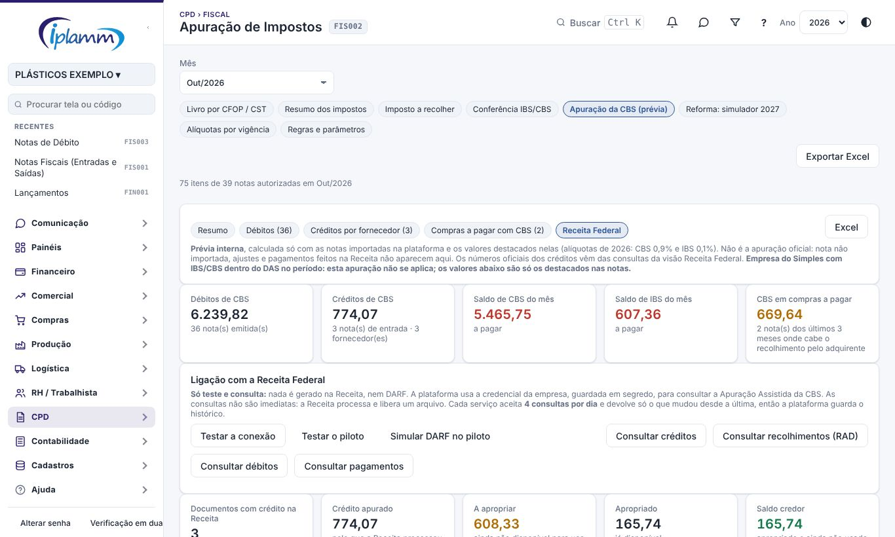

**Antes de usar (uma vez).** Quem representa a empresa gera a credencial em Serviços da Receita Federal › Gerar Credencial de Acesso para API › Chaves Secretas, e o administrador da plataforma guarda o Client Id e o Client Secret como segredos. A credencial não aparece em nenhuma tela.

1. Clique em **Testar a conexão**. A resposta diz se a Receita aceitou a credencial.
2. Clique no serviço que quer consultar: **créditos**, **recolhimentos (RAD)**, **débitos** ou **pagamentos**.
3. A consulta entra na lista como "na fila". Depois do tempo estimado, clique em **Atualizar**, uma vez só. Concluída, a plataforma pede o link do arquivo à Receita, baixa e importa.
4. Se a consulta foi concluída mas o arquivo não veio, a linha mostra o motivo na coluna **Observação** e o botão **Tentar de novo**, que não gasta consulta do dia.

O que saber sobre as consultas:

- Cada serviço aceita **4 consultas por dia**. A plataforma avisa quando o limite do dia acabou.
- A Receita devolve só o que mudou desde a última consulta (no máximo 8 dias). Sem consulta nos últimos 3 meses, começa no dia 1º do mês corrente. Por isso a plataforma guarda o histórico; meses antigos não voltam.
- A consulta que passa de 4 horas sem resposta aparece como "expirada": peça outra.
- O arquivo de uma consulta concluída fica disponível na Receita por até 48 horas.
- Além das 4 consultas por dia, a Receita limita o total de chamadas da credencial em pouco tempo. Se aparecer "o limite de chamadas desta credencial foi atingido", a credencial está correta: aguarde e tente mais tarde, sem repetir cliques, porque cada tentativa conta. No primeiro teste o bloqueio durou menos de duas horas.
- Os números mostram só o que a Receita devolveu nas consultas feitas, e não o saldo total de créditos da empresa.

O que cada consulta alimenta:

| Consulta | O que a plataforma faz |
|---|---|
| Créditos | Guarda, por nota, o crédito apurado, a apropriar, apropriado e o saldo credor, e mostra os totais |
| Recolhimentos (RAD) | Guarda os DARFs pagos como adquirente e marca a nota como **recolhido** |
| Débitos e pagamentos | Por enquanto, só registra que a consulta foi concluída e os períodos recebidos |

## 7. Regras e travas

- Nota já importada (mesma chave) não entra de novo.
- Importar, ligar e desfazer vínculos nunca altera os lançamentos.
- Nota marcada como cancelada sai do faturamento, dos impostos e das contas a receber, mas o XML fica guardado.
- O cadastro de clientes e fornecedores só muda com a sua aprovação.

## 8. Perguntas frequentes e erros comuns

**Algumas notas foram ignoradas.** O resumo da importação diz o motivo: XML repetido, nota já importada ou arquivo que não é NF-e.

**A nota de venda não aparece nas contas a receber.** Use **Lançar contas a receber das notas** na aba Recebimentos × Notas, ou **Importar XML das NFs** em Lançamentos.

**No Fechamento do mês, "Notas de venda ligadas ao financeiro" está vermelho.** Ligue as parcelas aos recebimentos ou lance os títulos (item 5.2).

**O faturamento do relatório não bate com o do indicador da aba Notas.** O indicador soma o valor das notas de venda (finalidade normal); o relatório vai item a item pelo CFOP e desconta as devoluções. Remessas e simples faturamento ficam fora do relatório.

**Recebi com juros e a nota de débito não apareceu.** Os juros precisam estar num lançamento em 1.02.17 (pago). Se o título foi baixado pelo valor recebido inteiro, corrija: baixe pela face e use **Registrar juros recebidos**.

**A tabela de alíquotas mostra “SQL 072 pendente”.** A tabela da empresa ainda não foi criada no banco: a plataforma usa o padrão e não deixa ajustar até o SQL rodar.

## 9. Histórico de alterações

| Versão | Data | O que mudou |
|---|---|---|
| 1.0 | 28/10/2026 | Primeira versão do manual: importação dos XML, conferência do cadastro, consulta, impostos por CFOP, recebimentos e pagamentos × notas, borderôs × notas e apuração (prévia). |
| 1.1 | 29/10/2026 | Imagens das telas, com dados fictícios. |
| 1.2 | 30/10/2026 | Importação aceita XML com o número do item gravado fora do padrão (como o de alguns emissores); antes a nota entrava sem os itens. |
| 1.3 | 30/10/2026 | Relatórios de faturamento e de compras (tela, PDF e Excel) por mês, cliente/fornecedor, produto, UF e CFOP, com devoluções, comparativo do ano anterior, ticket médio e curva ABC. Reforma tributária na Apuração: conferência da CBS/IBS das notas, simulador de 2027 e alíquotas por vigência com a proposta do TCU de 11,3% (SQL 072). |
| 1.4 | 31/10/2026 | Notas de débito de juros e multa (finalidade 6, tipo 04): fila gerada pelos recebimentos com juros, rateio pelos itens da nota de origem, registro da emissão e juros recebidos pelo fundo como "a decidir" (SQL 074). |
| 1.5 | 05/11/2026 | Nomes das telas iguais aos do menu, com o código da tela no cabeçalho. |
| 1.6 | 08/11/2026 | Imposto a recolher (ICMS com PRODEPE, FEEF, AD/DIPER e FECEP; IPI; PIS/COFINS com créditos), ajustes e fechamento do mês; parâmetros por vigência com fonte; transição da reforma até 2033 (SQL 141, melhoria 9.2). |
| 1.7 | 17/11/2026 | Apuração da CBS (prévia): débitos, créditos, estornos por devolução e saldo do mês pelas notas importadas; crédito por fornecedor; compras a pagar com CBS destacada (onde cabe o recolhimento pelo adquirente). |
| 1.8 | 17/11/2026 | Recolhimento pelo adquirente (RAD), primeira parte: parâmetros, regra por fornecedor, marcação da nota e aviso com o líquido sugerido na Autorização de Pagamentos. |
| 1.9 | 18/11/2026 | Ligação com a Receita Federal (Apuração Assistida da CBS): testar a conexão, consultas de créditos, recolhimentos, débitos e pagamentos, geração do DARF do recolhimento pelo adquirente com PIX, código de barras e título a pagar. |
| 1.10 | 18/11/2026 | Geração do DARF pela plataforma travada: a ligação com a Receita Federal fica só em teste de conexão e consultas. |
| 1.11 | 19/11/2026 | Conferência IBS/CBS pela tabela oficial de classificação da Receita Federal (cClassTrib, vigência, CST, NCM do anexo e tipo de documento). Ligação com a Receita: botão Tentar de novo, aviso de limite de chamadas e prazo de 48 horas do arquivo. |
| 1.12 | 23/11/2026 | Nome no menu: Notas Fiscais (Entradas e Saídas), com uma frase no topo explicando a diferença para Notas Recebidas da SEFAZ. |
