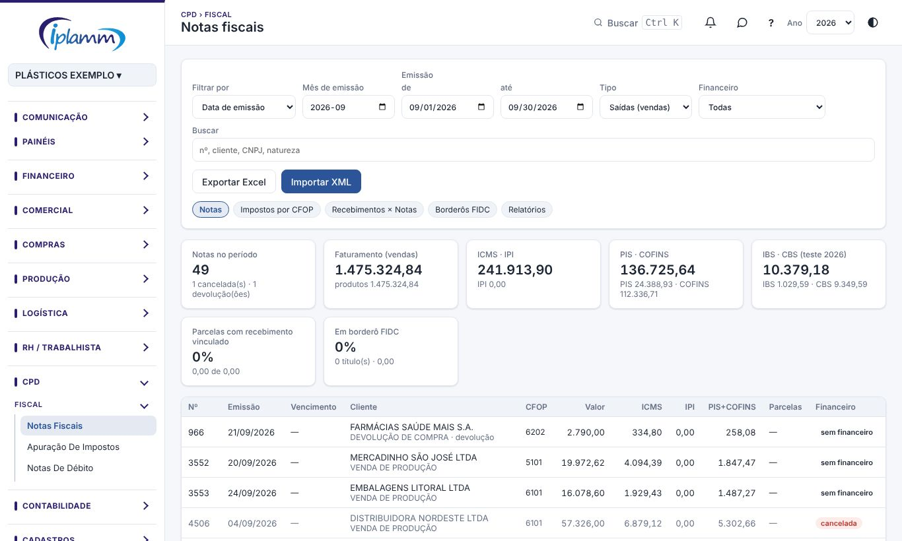
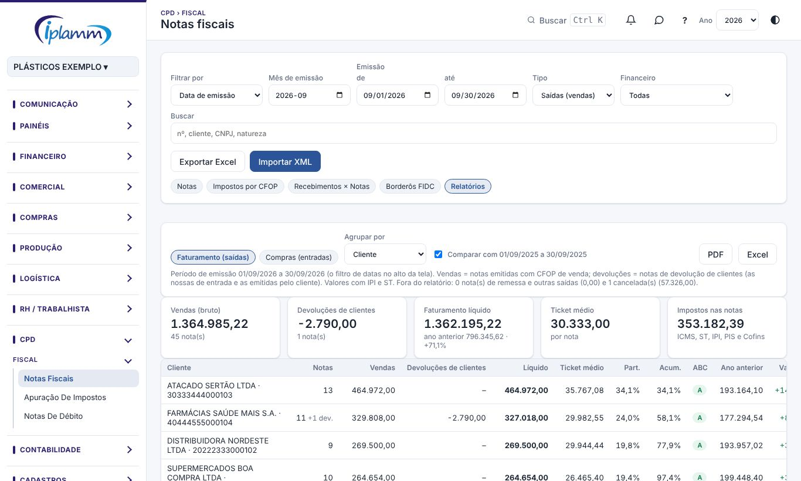
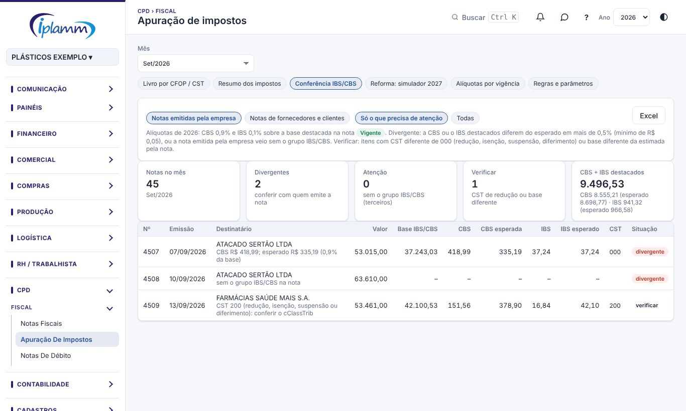
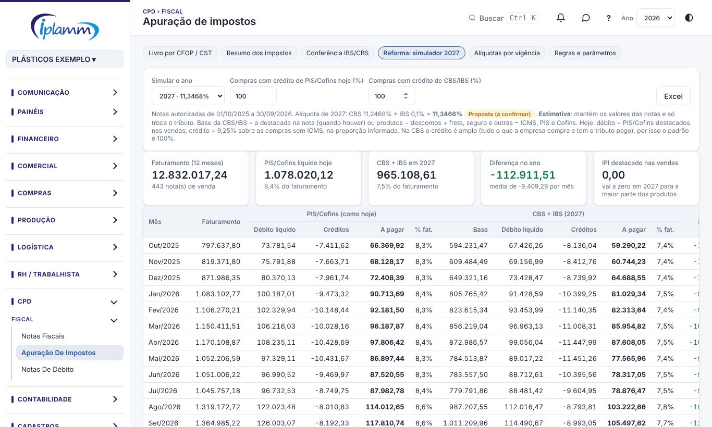
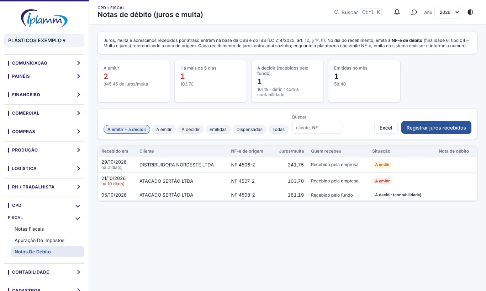

## 1. Para que serve

- **Notas Fiscais**: importa os **XML das NF-e**, de entrada e de saída, com os itens, os impostos, as parcelas e os eventos. A tela também:
  - consulta as notas por período;
  - soma os impostos por CFOP;
  - liga as parcelas das notas aos recebimentos e pagamentos que já existem nos lançamentos;
  - liga os títulos dos borderôs FIDC às notas;
  - tira os **relatórios de faturamento e de compras** (tela, PDF e Excel).
- **Apuração de impostos**: a memória de cálculo a partir dos itens das notas, com o livro por CFOP/CST e o resumo dos impostos destacados. Por enquanto é **só leitura e só prévia**. Também traz a **reforma tributária**: a conferência da CBS e do IBS destacados nas notas, o simulador de 2027, a tabela de alíquotas por ano e a fila das **notas de débito** de juros e multa.

## 2. Quem tem acesso

O administrador e o financeiro importam, ligam e desfazem. Quem tem a área CPD consulta. Só o administrador ajusta a tabela de alíquotas da reforma.

## 3. Importar os XML

1. Clique em **Importar XML**.
2. Selecione a **pasta do mês** (por exemplo, "1.7 NF-e Saídas (XML)"), os arquivos XML ou um .zip.
3. A plataforma reconhece pelo próprio XML se a nota é de entrada ou de saída e mostra:
   - as notas novas, o valor das saídas e o das entradas;
   - as notas já importadas, que são ignoradas;
   - os eventos: cancelamento e carta de correção, que são aplicados.
4. Clique em **Importar**. Os lançamentos **não** são alterados.

Depois da importação, a plataforma oferece **conferir o cadastro** dos clientes e fornecedores dessas notas. Os cadastros novos e as diferenças aparecem para aprovação campo a campo; nada muda sem marcar. Use **Aprovar todas** ou **Só completar campos vazios**.

## 4. Consultar as notas

Use os filtros: o período (**Filtrar por** emissão ou vencimento, **até**), o **tipo** (entrada ou saída), o **financeiro** e a busca. As opções do filtro de financeiro são:

- vencidas sem nada ligado;
- sem nada ligado;
- recebidas em parte;
- com título a receber;
- antecipadas no FIDC;
- recebidas.

Os indicadores mostram as notas no período, os impostos (ICMS, IPI, PIS, COFINS, IBS e CBS), as parcelas vencendo, as que têm recebimento vinculado e as que estão em borderô FIDC.

Clique na nota para ver os **itens**, os impostos e as **parcelas, borderôs e recebimentos vinculados**. Na nota, os botões são:

- **Baixar XML**.
- **Usar crédito**: abate um crédito ou adiantamento do cliente ou fornecedor.
- **Marcar como cancelada**: a nota sai do faturamento, dos impostos e das contas a receber. O XML continua guardado e dá para desfazer.
- **Desfazer vínculos de recebimento** e **Desfazer ligação com borderô**.

## 5. As abas

### 5.1 Impostos por CFOP

Os valores das notas autorizadas no período (as canceladas ficam fora), por CFOP. É a base para a apuração.

### 5.2 Recebimentos × Notas (ou Pagamentos × Notas)

Liga cada parcela da nota ao lançamento de recebimento (nas saídas) ou de pagamento (nas entradas) que já existe, no mesmo modelo da Conciliação bancária:

1. Marque a parcela à esquerda. Os recebimentos mais prováveis (mesma NF citada, mesmo cliente, valor e data próximos) sobem para o topo.
2. Marque o recebimento à direita. Quando os totais batem, as linhas ficam verdes.
3. Clique em **Vincular**, ou em **Aceitar sugestões** para fazer em lote.

**Lançar contas a receber das notas** cria um título **Em aberto** (receita 1.01.01, com a data do vencimento e o documento NF-parcela) para cada parcela de venda que ainda não tem lançamento, já ligado à nota. Parcelas que já têm um lançamento da mesma NF e valor só são ligadas a ele.

### 5.3 Borderôs FIDC

Liga cada título dos borderôs (base FIDC) à parcela da nota de onde ele veio. Os casos verdes vêm marcados; os amarelos e vermelhos ficam para você conferir. Clique em **Ligar**.

Borderôs, títulos, lançamentos e notas não são alterados. A gestão dos borderôs fica em Propostas de borderô.

### 5.4 Relatórios: faturamento e compras

1. Escolha o período no alto da tela (**Emissão de … até …**). Para o ano, ponha de 01/01 até o fim do último mês fechado.
2. Clique na aba **Relatórios** e escolha **Faturamento (saídas)** ou **Compras (entradas)**. A tela abre no relatório do tipo escolhido no filtro.
3. Em **Agrupar por**, escolha **Mês**, **Cliente** (ou **Fornecedor**), **Produto** (ou **Item comprado**), **UF do cliente** (ou **Origem**) ou **CFOP**. Sem escolha, um mês só abre por cliente e um período maior abre por mês.
4. Deixe marcado **Comparar com** para ver o mesmo período do ano anterior e a variação.
5. **PDF** abre o relatório no padrão de impressão da empresa; **Excel** baixa a tabela.

Como os valores são montados:

- **Faturamento** = vendas (notas emitidas pela empresa com CFOP de venda, inclusive com ST e exportação por trading) **menos** as devoluções de clientes (as nossas notas de entrada de devolução e as notas de devolução emitidas pelo cliente).
- **Compras** = notas de fornecedores com CFOP de venda e as nossas notas de entrada de compra, energia, comunicação, transporte, ativo e uso e consumo, **menos** as nossas devoluções a fornecedores.
- Notas **canceladas**, **remessas** (conserto, industrialização, bonificação, simples faturamento de entrega futura) e outras operações ficam fora; o total delas aparece na linha de explicação.
- Os valores são os da nota, **com IPI e ST**. **Ticket médio** = vendas ÷ número de notas. **Part.** = participação no líquido.
- **Curva ABC**: A até 80% do acumulado, B até 95%, C o restante.
- Em **Origem** (compras), a UF do fornecedor sai do CFOP: mesmo estado, outros estados ou exterior.

## 6. Apuração de impostos

1. Escolha o **mês** e a aba **Saídas** (notas emitidas) ou **Entradas** (compras e devoluções).
2. Escolha como **agrupar**: livro por CFOP / CST, resumo dos impostos, ou regras e parâmetros.
3. A tabela mostra o valor contábil, a base do ICMS, o ICMS, o ICMS-ST, o IPI, o PIS e o COFINS. **Exportar Excel** baixa a memória de cálculo.

> **Atenção:** os valores são a **soma do que está destacado nas notas**, ainda não o imposto a recolher. Faltam as regras de PRODEPE, FEEF, AD/DIPER, FECEP, os estornos e os créditos de PIS/COFINS pelas regras da empresa. Cada regra entra com fonte e vigência, conforme forem definidas com a contabilidade.

Nas notas de fornecedores, o CFOP e o CST são os do emitente.

### 6.1 Conferência IBS/CBS

Confere, nota a nota, a CBS e o IBS destacados contra as alíquotas do ano da emissão (em 2026: CBS de 0,9% e IBS de 0,1% sobre a base destacada).

1. Escolha o **mês** e a aba **Conferência IBS/CBS**.
2. Escolha **Notas emitidas pela empresa** ou **Notas de fornecedores e clientes**, e **Só o que precisa de atenção** ou **Todas**.
3. As situações são:
   - **divergente**: a CBS ou o IBS diferem do esperado em mais de 0,5% (mínimo de R$ 0,05), ou a nota emitida pela empresa veio **sem o grupo IBS/CBS**. Desde agosto de 2026 a nota errada já gera multa: corrija o cadastro do produto no emissor;
   - **atenção**: nota de terceiro sem o grupo IBS/CBS;
   - **verificar**: itens com CST diferente de 000 (redução, isenção, suspensão ou diferimento) ou base diferente da estimada pela nota. Confira o **cClassTrib** do produto;
   - **confere**.
4. **Excel** baixa a lista.

### 6.2 Reforma: simulador 2027

Mostra quanto a empresa pagaria de CBS e IBS em 2027 sobre as notas dos **últimos 12 meses fechados**, comparado com o PIS/Cofins de hoje.

1. Clique na aba **Reforma: simulador 2027**.
2. Escolha o **ano** (2027 em diante, com as alíquotas da tabela da seção 6.3).
3. Informe a proporção das **compras com crédito** de PIS/Cofins hoje e de CBS/IBS. Na CBS o crédito é amplo (tudo o que a empresa compra e tem o tributo pago); no PIS/Cofins, só os insumos e os demais itens da lei.
4. A tabela mostra, por mês: faturamento, débito líquido das devoluções, créditos, valor a pagar e o percentual sobre o faturamento, nos dois regimes, e a **diferença**.

Como o cálculo é feito:

- **Hoje**: débito = PIS/Cofins destacados nas vendas; crédito = 9,25% sobre as compras sem o ICMS, na proporção informada.
- **2027**: base = a base IBS/CBS destacada na nota (quando houver) ou produtos − descontos + frete, seguro e outras despesas − ICMS, PIS e Cofins; débito e crédito = base × alíquota do ano.

> **Atenção:** é uma **estimativa** para o planejamento. Mantém os valores das notas e só troca o tributo. Não considera a mudança de preço (a CBS é cobrada “por fora”), o split payment (o tributo sai no recebimento, o que afeta a antecipação no FIDC), os redutores e regimes específicos, os créditos presumidos e o fim do IPI.

### 6.3 Alíquotas por vigência

A tabela de CBS e IBS por ano usada no simulador e na conferência. O padrão da plataforma foi atualizado em **30/10/2026**:

| Ano | CBS | IBS | Total | Situação |
|---|---|---|---|---|
| 2026 | 0,9% | 0,1% | 1% | vigente (ano-teste: só destacados e compensados com o PIS/Cofins) |
| 2027 | 11,2468% | 0,1% (0,05% estadual + 0,05% municipal) | 11,3468% | proposta do TCU (processo TC 006.529/2026-7), a confirmar por resolução do Senado até dezembro; sem a votação, vale o valor do TCU |
| 2028 | 11,2468% | 0,1% | 11,3468% | estimativa |
| 2029 a 2032 | cerca de 11,25% | 10% a 40% do IBS de referência (projetado em cerca de 18,7%) | 13,1% a 18,7% | estimativa; o ICMS cai na mesma proporção |
| 2033 | cerca de 11,25% | cerca de 18,7% | cerca de 30% | estimativa; fim do ICMS |

Quando sair a alíquota definitiva, o **administrador** clica no ano, ajusta os percentuais, a situação e a **fonte** (lei ou resolução e a data) e salva. **Voltar ao padrão** apaga o ajuste da empresa para aquele ano.

### 6.4 Notas de débito de juros e multa

Juros, multa e acréscimos recebidos por atraso entram na base da CBS e do IBS (LC 214/2025, art. 12, § 1º, II). No **dia do recebimento**, a empresa emite a **NF-e de débito**:
- finalidade **6** (nota de débito), tipo de débito **04 – Multa e juros**;
- cada item referencia a chave e o item da NF-e de origem, com a mesma classificação e a alíquota do ano da nota de origem;
- só CBS e IBS (sem ICMS); o valor é o de juros e multa efetivamente recebido.

Não confunda com a **nota de crédito** de multa e juros (finalidade 5, tipo 01): é a que o **cliente** emite quando o fornecedor não emitiu a nota de débito.

Como a fila se forma (**CPD › Fiscal › Notas de débito**):

1. Todo recebimento de juros vira um lançamento em **1.02.17 JUROS E MULTAS RECEBIDOS**, ligado ao título; o título continua com o valor de face. Isso acontece:
   - na **Conciliação**, ao clicar em **Conciliar com R$ X de juros/multa** quando o extrato é maior que o título;
   - no **Importar do ERP**, na ação **Baixar + juros** (recebimento acima do título);
   - no quadro **Juros e multa** do lançamento pago;
   - em **Registrar juros recebidos**, na própria tela.
2. Cada lançamento desses cria uma pendência **A emitir**, com o cliente, a NF-e de origem, a parcela e o valor. Administradores e financeiro recebem notificação, e a pendência aparece no **Decision Center**. Com mais de 5 dias fica em vermelho.
3. Clique na pendência para ver o rateio por item (CST, cClassTrib, valor, CBS e IBS) e o texto das informações complementares. **Copiar dados para o emissor** copia tudo.
4. Emita a nota de débito no sistema emissor e informe o **número**, a **série**, a **data** e a **chave**: a pendência passa a **Emitida**. **Dispensar** pede o motivo.
5. Juros que o cliente pagou ao **fundo** (mora no relatório de pagos da Carteira cedida) entram como **A decidir (contabilidade)**, até a definição sobre quem emite. **Passar para "a emitir"** ou **Dispensar** resolve cada uma.

> Quando a integração com a API de emissão (Focus NF-e) estiver ligada, a pendência já traz os dados da nota de débito no layout da NT 2025.002 para a emissão direta.

## 7. Regras e travas

- Nota já importada (mesma chave) não entra de novo.
- Importar, ligar e desfazer vínculos nunca altera os lançamentos.
- Nota marcada como cancelada sai do faturamento, dos impostos e das contas a receber, mas o XML fica guardado.
- O cadastro de clientes e fornecedores só muda com a sua aprovação.

## 8. Perguntas frequentes e erros comuns

**Algumas notas foram ignoradas.** O resumo da importação diz o motivo: XML repetido, nota já importada ou arquivo que não é NF-e.

**A nota de venda não aparece nas contas a receber.** Use **Lançar contas a receber das notas** na aba Recebimentos × Notas, ou **Importar XML das NFs** em Lançamentos.

**No Fechamento do mês, "Notas de venda ligadas ao financeiro" está vermelho.** Ligue as parcelas aos recebimentos ou lance os títulos (item 5.2).

**O faturamento do relatório não bate com o do indicador da aba Notas.** O indicador soma o valor das notas de venda (finalidade normal); o relatório vai item a item pelo CFOP e desconta as devoluções. Remessas e simples faturamento ficam fora do relatório.

**Recebi com juros e a nota de débito não apareceu.** Os juros precisam estar num lançamento em 1.02.17 (pago). Se o título foi baixado pelo valor recebido inteiro, corrija: baixe pela face e use **Registrar juros recebidos**.

**A tabela de alíquotas mostra “SQL 072 pendente”.** A tabela da empresa ainda não foi criada no banco: a plataforma usa o padrão e não deixa ajustar até o SQL rodar.

## 9. Histórico de alterações

| Versão | Data | O que mudou |
|---|---|---|
| 1.0 | 28/10/2026 | Primeira versão do manual: importação dos XML, conferência do cadastro, consulta, impostos por CFOP, recebimentos e pagamentos × notas, borderôs × notas e apuração (prévia). |
| 1.1 | 29/10/2026 | Imagens das telas, com dados fictícios. |
| 1.2 | 30/10/2026 | Importação aceita XML com o número do item gravado fora do padrão (como o de alguns emissores); antes a nota entrava sem os itens. |
| 1.3 | 30/10/2026 | Relatórios de faturamento e de compras (tela, PDF e Excel) por mês, cliente/fornecedor, produto, UF e CFOP, com devoluções, comparativo do ano anterior, ticket médio e curva ABC. Reforma tributária na Apuração: conferência da CBS/IBS das notas, simulador de 2027 e alíquotas por vigência com a proposta do TCU de 11,3% (SQL 072). |
| 1.4 | 31/10/2026 | Notas de débito de juros e multa (finalidade 6, tipo 04): fila gerada pelos recebimentos com juros, rateio pelos itens da nota de origem, registro da emissão e juros recebidos pelo fundo como "a decidir" (SQL 074). |
