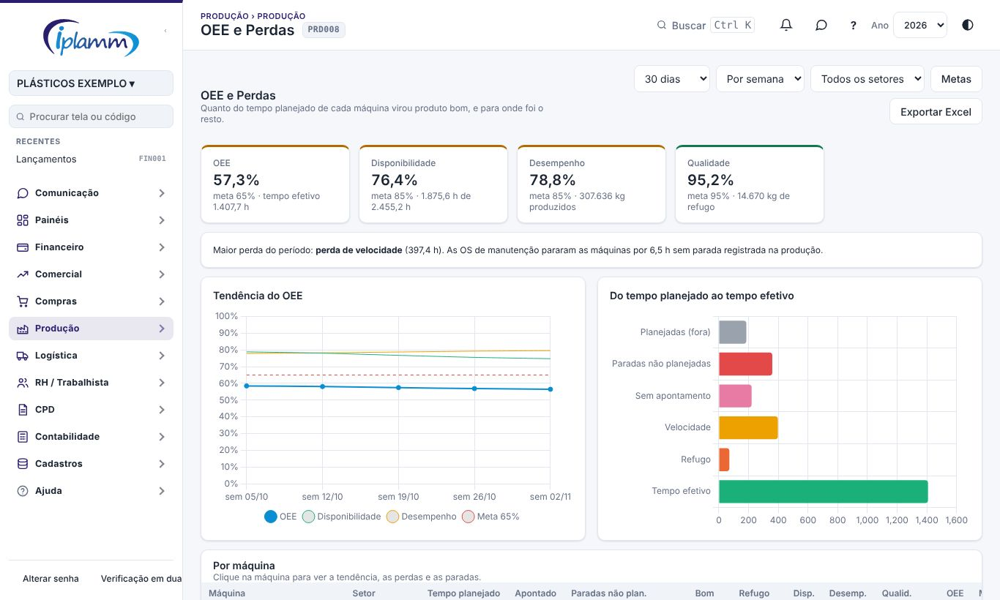
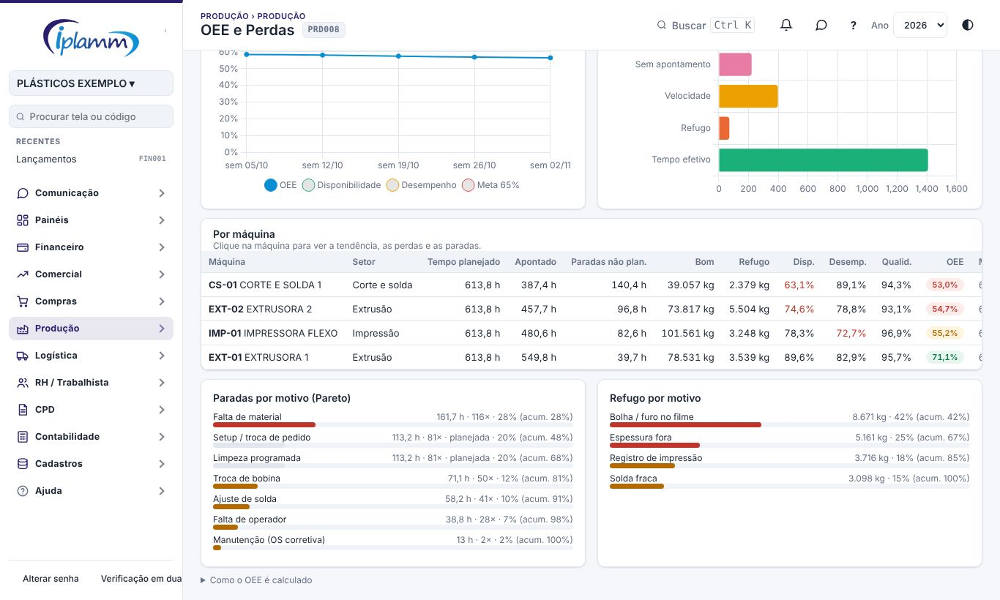
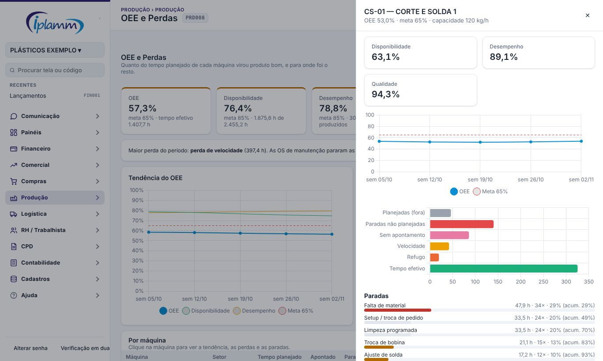

## 1. Para que serve

Mostra, por máquina, quanto do **tempo planejado** virou **produto bom**, e para onde foi o resto. O OEE junta três números:

- **disponibilidade**: quanto do tempo planejado a máquina produziu;
- **desempenho**: quanto ela produziu perto da capacidade (kg/h);
- **qualidade**: quanto do que saiu foi bom.

Os números vêm:

- dos **apontamentos** do Terminal do Setor ou da importação do Iniflex;
- das **paradas** registradas na produção;
- das **OS de manutenção** que pararam a máquina;
- do **refugo** apontado.

## 2. Quem tem acesso

| Perfil | O que faz |
|---|---|
| Administrador e financeiro | Veem a tela, exportam e alteram as metas. |
| Diretor e leitura | Veem a tela e exportam. |
| Produção | Não vê a tela (vê os números do seu setor no Terminal). |

## 3. A tela

No alto, escolha:

- o **período**: 7 dias, 30 dias, 90 dias, 6 meses ou 12 meses;
- o **agrupamento** da tendência: por dia, por semana ou por mês;
- o **setor**.

Os quatro cartões mostram o **OEE**, a **disponibilidade**, o **desempenho** e a **qualidade** do período, com a meta. A cor da borda segue a meta:

- verde: atingiu a meta;
- amarelo: até 10 pontos abaixo (ajustável);
- vermelho: além disso.

A frase abaixo dos cartões aponta a **maior perda** do período.

### 3.1 Tendência e perdas

O gráfico **Tendência do OEE** mostra o OEE de cada período com a meta tracejada. A disponibilidade e o desempenho aparecem em linhas finas, para mostrar qual dos dois puxou o OEE.

O gráfico **Do tempo planejado ao tempo efetivo** mostra, em horas, para onde foi o tempo:

| Barra | O que é |
|---|---|
| Planejadas (fora) | Paradas planejadas (setup, limpeza programada). Ficam fora do tempo planejado e não derrubam o OEE. |
| Paradas não planejadas | Paradas registradas na produção com motivo não planejado e paradas de máquina das OS de manutenção. |
| Sem apontamento | Tempo planejado sem apontamento e sem parada registrada. Costuma ser parada não anotada ou apontamento esquecido. |
| Velocidade | A máquina produziu abaixo da capacidade cadastrada. |
| Refugo | Tempo gasto produzindo o que virou refugo. |
| Tempo efetivo | O que sobrou: tempo planejado × OEE. |

### 3.2 Por máquina

A tabela lista as máquinas do pior para o melhor OEE, com:

- o tempo planejado, o apontado e as paradas não planejadas;
- o bom e o refugo, em kg;
- a disponibilidade, o desempenho e a qualidade (em vermelho quando estão abaixo da faixa de atenção);
- o OEE e a meta da máquina.

Abaixo, os **Paretos**:

- **Paradas por motivo**: horas, quantidade e percentual acumulado. Os motivos que somam até 80% das horas ficam em vermelho e as paradas planejadas em cinza. As OS de manutenção aparecem como "Manutenção (OS corretiva)", "(OS preventiva)" e assim por diante.
- **Refugo por motivo**: em kg.

## 4. Detalhe da máquina

Clique na máquina para abrir o detalhe ao lado:

- disponibilidade, desempenho e qualidade;
- a tendência do OEE contra a meta da máquina;
- as perdas em horas;
- as paradas por motivo;
- a tabela por período.

## 5. Como é calculado

| Número | Cálculo |
|---|---|
| Tempo calendário | Horas produtivas do setor por dia (Cadastros de Produção) × dias do período |
| Tempo planejado | Calendário − paradas planejadas |
| Disponibilidade | Horas apontadas ÷ tempo planejado |
| Desempenho | (Bom + refugo) ÷ (horas apontadas × capacidade em kg/h da máquina) |
| Qualidade | Bom ÷ (bom + refugo) |
| OEE | Disponibilidade × desempenho × qualidade |

Regras:

- Apontamentos e paradas entram no período pela **data de início**. O que passa do fim do período é cortado. Parada ainda aberta conta até agora.
- Uma OS de manutenção com **"máquina parou"** já abre sozinha uma parada na produção, que conta uma vez só. Entram pelas horas de máquina parada da própria OS só as OS registradas depois, sem parada ligada. Isso pode ser desligado nas Metas.
- Máquina **sem capacidade (kg/h)** fica sem desempenho e sem OEE. A tela avisa quais são.
- Disponibilidade e desempenho são limitados a 100%.

## 6. Metas

Em **Metas** (administrador e financeiro), ajuste:

- a meta do **OEE** (padrão 65%), da **disponibilidade** (85%), do **desempenho** (85%) e da **qualidade** (95%);
- a faixa de **atenção**: até quantos pontos abaixo da meta (padrão 10);
- se as **OS de manutenção** sem parada registrada contam como parada não planejada;
- a **meta de OEE de cada máquina**. Vazio usa a meta geral.

**Exportar Excel** baixa os números por máquina e por período.

## 7. Dúvidas frequentes

**O OEE da máquina aparece "—".** Falta a capacidade (kg/h) da máquina em Cadastros de Produção, ou não houve apontamento no período.

**"Sem apontamento" está alto.** O tempo planejado não teve nem apontamento nem parada registrada. Confira se os operadores estão apontando no Terminal e registrando as paradas.

**A disponibilidade passou de 100% no Iniflex.** Aqui ela é limitada a 100%. Apontamentos sobrepostos na mesma máquina somam horas a mais. Confira a importação.

**Por que a meta padrão é 65% e não 85%?** 85% é a referência de classe mundial. Para começar, a meta padrão é a média típica da indústria. Ajuste nas Metas.

## 8. Histórico de alterações

| Versão | Data | O que mudou |
|---|---|---|
| 1.0 | 08/11/2026 | Primeira versão: OEE, disponibilidade, desempenho e qualidade contra metas; tendência por dia, semana ou mês; perdas em horas; OS de manutenção nas paradas; Pareto das paradas e do refugo; detalhe da máquina; metas por máquina; Excel. |
