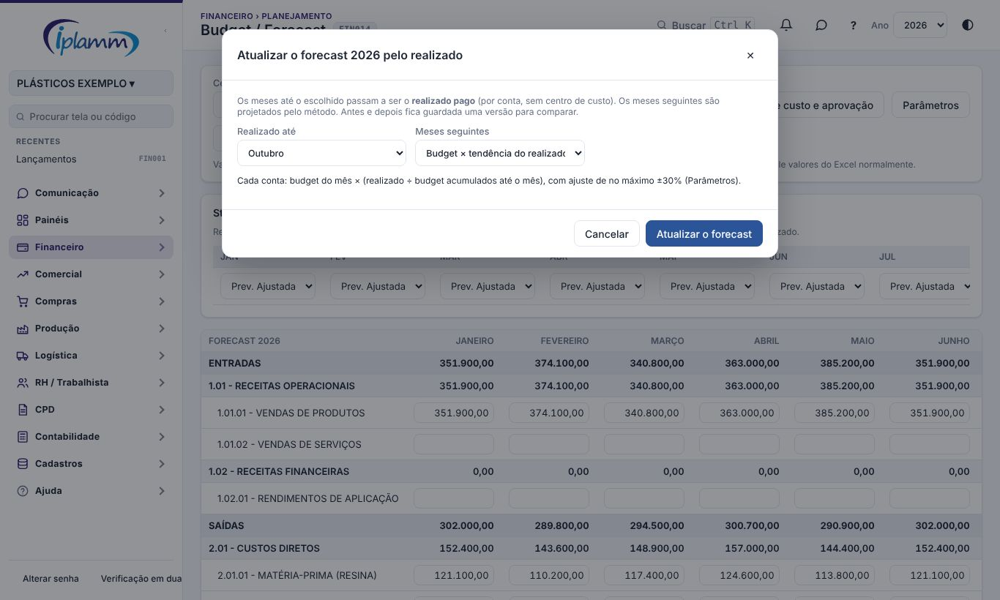
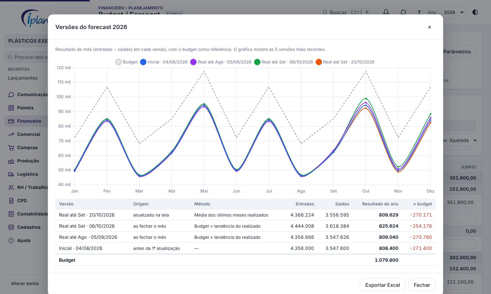
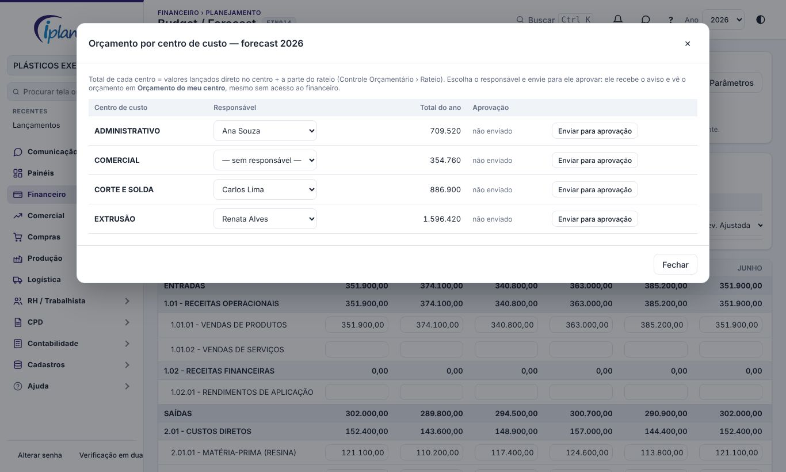
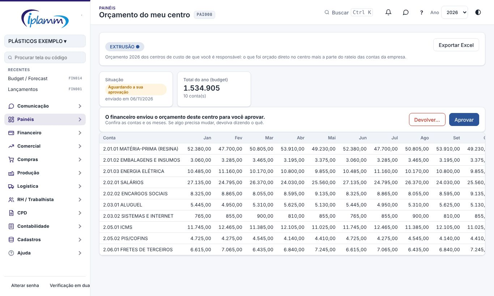
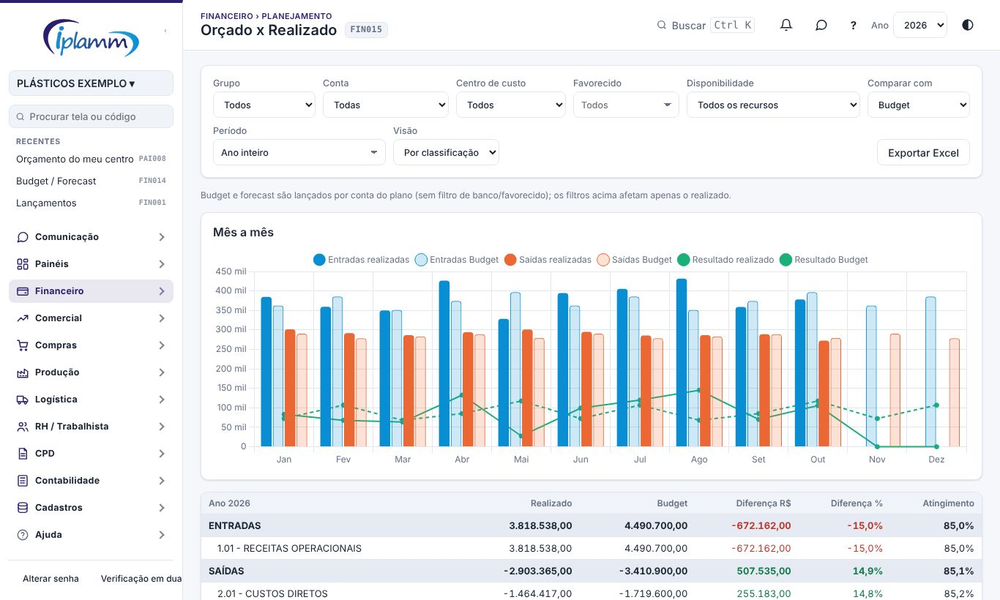
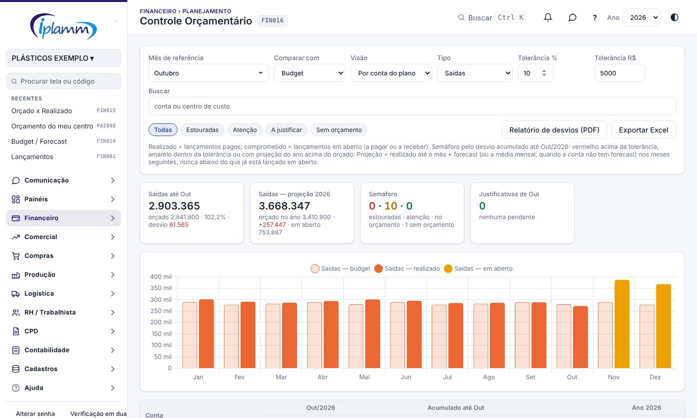

## 1. Para que serve

- **Budget / Forecast**: onde se lança o orçamento do ano, por conta do plano e por mês.
  - **Budget** é o planejamento inicial.
  - **Forecast** é a revisão ao longo do ano. Ele é **contínuo**: os meses fechados viram o realizado e os meses seguintes são projetados de novo, com uma versão guardada a cada atualização.
  - O orçamento de cada **centro de custo** vai para o **responsável** aprovar.
- **Orçado x Realizado**: compara o orçamento com o que aconteceu, mês a mês.
- **Controle Orçamentário**: acompanha cada conta do plano e cada centro de custo:
  - orçado, comprometido (em aberto) e realizado;
  - semáforo e projeção do ano;
  - justificativa dos desvios, com relatório em PDF.

## 2. Quem tem acesso

| Perfil | O que faz |
|---|---|
| Administrador e financeiro | Lançam o budget e o forecast, definem o rateio e escrevem as justificativas. |
| Administrador, diretor e financeiro | Atualizam o forecast pelo realizado. Escolhem o responsável de cada centro de custo e enviam o orçamento para aprovação. Ajustam os **Parâmetros do orçamento**. |
| Responsável pelo centro de custo (qualquer perfil) | Vê o orçamento do seu centro em **Painéis › Orçamento do meu centro** e o aprova ou devolve. |
| Diretor e leitura | Consultam e geram os relatórios. |

## 3. Budget / Forecast

### 3.1 Lançar o orçamento

1. Escolha o **cenário**: Budget (planejamento inicial) ou Forecast (revisão). O ano vem do seletor no topo da plataforma.
2. Digite os valores nas células, por conta e por mês.
   - Os valores são **sempre positivos**: as entradas somam e as saídas subtraem, pelo plano de contas.
   - **Tab** passa para a próxima célula.
   - Dá para **colar do Excel** normalmente.
3. Clique em **Salvar alterações**.

### 3.2 Atalhos

- No budget, **Copiar realizado do ano anterior** preenche o budget com o que foi realizado no ano anterior. Ele substitui o budget atual.
- No forecast, **Copiar budget → forecast** substitui todo o forecast do ano pelos valores do budget.

### 3.3 Status de cada mês no forecast

No forecast, escolha para cada mês o que vale nas comparações:

- **Realizado**: usa o caixa real;
- **Prev. Ajustada**: usa os valores do forecast;
- **Prev. Inicial**: mantém o budget.

### 3.4 Forecast contínuo: atualizar pelo realizado

No forecast, clique em **Atualizar pelo realizado…** e escolha:

- **Realizado até**: os meses até ele passam a ter o **realizado pago** de cada conta. Entram só os lançamentos com conta bancária; as transferências ficam de fora.
- **Meses seguintes**, isto é, como projetar o resto do ano:

| Método | Como projeta |
|---|---|
| Budget × tendência do realizado | Para cada conta: budget do mês × (realizado ÷ budget acumulados até o mês). O ajuste máximo é de ±30%, definido nos Parâmetros. |
| Média dos últimos meses realizados | A média do realizado nos últimos N meses, repetida até dezembro. |
| Budget dos meses seguintes | Os meses seguintes voltam a ser o budget. |
| Manter o forecast dos meses seguintes | Só os meses realizados mudam. |

O **status de cada mês** é ajustado sozinho: **Realizado** até o mês escolhido e **Prev. Ajustada** depois dele.

Quando um mês é **fechado** no Fechamento do Mês, o forecast é atualizado sozinho até esse mês, com o método padrão. Isso pode ser desligado nos Parâmetros.

### 3.5 Versões do forecast

Cada atualização guarda uma **versão** do forecast. Na primeira vez, a versão **inicial** guarda o forecast como estava antes. Clique em **Versões** para ver:

- o gráfico do resultado do mês (entradas − saídas) nas 5 versões mais recentes, com o budget como referência;
- a tabela de todas as versões: origem (na tela ou ao fechar o mês), método, entradas, saídas, resultado do ano e a diferença para o budget.

**Exportar Excel** baixa o resultado mês a mês de cada versão.

### 3.6 Orçamento por centro de custo e aprovação

Em **Centros de custo e aprovação**, cada centro mostra o **total do ano**. O total soma o que foi lançado direto no centro e a parte do **rateio** das contas (seção 5.4).

1. Escolha o **responsável** de cada centro. Pode ser uma pessoa de qualquer perfil, inclusive produção ou compras.
2. Clique em **Enviar para aprovação**. O responsável recebe o aviso e o item aparece em **Minhas aprovações**.
3. O responsável abre **Painéis › Orçamento do meu centro**, confere as contas e os meses e clica em **Aprovar** ou **Devolver**. Para devolver, ele precisa dizer o que precisa mudar.
4. O financeiro recebe a resposta. Se o orçamento for corrigido, **Reenviar** manda de novo.

Se o total mudar depois do envio, aparece a marca **mudou**.

### 3.7 Parâmetros do orçamento

Valem para a empresa toda:

- **Desvios:**
  - a **tolerância** em % e em R$: o desvio conta quando passa do maior dos dois;
  - com o que **comparar** o realizado (budget ou forecast);
  - o **prazo para justificar**: D+N, em dia útil do mês seguinte;
  - se o desvio **exige justificativa**;
  - quem é **cobrado** no prazo.
- **Forecast contínuo:**
  - se atualiza ao fechar o mês;
  - o **método padrão**;
  - a quantidade de meses da média;
  - o **ajuste máximo** da tendência.

O Controle Orçamentário abre com a tolerância e a base dos Parâmetros, e a etapa "Desvios do orçamento justificados" do Fechamento do mês usa os mesmos números.

No prazo, as pessoas escolhidas recebem o aviso com quantos desvios do mês anterior ainda estão **sem justificativa**. O aviso sai uma vez por mês, às 8h.

## 4. Orçado x Realizado

1. Escolha com o que **comparar** (budget ou forecast), o **período** e a **visão**.
2. A tabela mostra, por conta: o orçado, o realizado, a diferença em R$ e em %, e o **atingimento**. O quadro **Mês a mês** abre a comparação por mês.
3. Os indicadores mostram as entradas, as saídas e o resultado realizados.

O budget e o forecast são lançados por conta do plano, sem banco nem favorecido. Os filtros da tela afetam só o realizado.

## 5. Controle Orçamentário

### 5.1 Os parâmetros

Escolha:

- o **mês de referência**;
- com o que **comparar** (budget ou forecast);
- a **visão**: por conta do plano ou por centro de custo;
- o **tipo**: entradas ou saídas;
- a **tolerância** em % e em R$. A tela abre com os valores dos Parâmetros do orçamento e você pode mudar na hora.

Use a busca e os filtros **Todas**, **Estouradas**, **Atenção**, **A justificar** e **Sem orçamento**.

### 5.2 Ler o semáforo

- **Realizado** = lançamentos pagos. **Comprometido** = lançamentos em aberto (a pagar ou a receber).
- **Vermelho**: o desvio acumulado até o mês passou da tolerância.
- **Amarelo**: dentro da tolerância, mas com a projeção do ano acima do orçado.
- **Projeção do ano** = realizado até o mês + orçado nos meses seguintes. Nunca fica abaixo do que já está lançado em aberto.

Clique numa conta para ver o orçado, o realizado, o desvio, o consumo, o que está em aberto, o saldo e a projeção, os **maiores lançamentos** do período e as **justificativas**.

### 5.3 Justificar um desvio

1. Na conta com desvio, clique em **Justificar**.
2. Escreva a **justificativa** (o que causou o desvio) e, se quiser, a **ação prevista**.
3. Clique em **Salvar**.

As justificativas escritas na Autorização de pagamentos, para pagamentos acima do orçado, também aparecem aqui.

### 5.4 Rateio do orçamento por centro de custo

O orçamento é feito **por conta do plano**. Para ver o orçado de cada centro de custo:

1. Clique em **Rateio do orçamento por centro de custo**, ou em **definir** na linha da conta.
2. Para cada conta, informe a porcentagem de cada centro de custo, ou clique em **Sugerir pela participação realizada**.
3. Clique em **Salvar rateio da conta**. Para todas de uma vez, use **Aplicar a sugestão em todas as contas sem rateio**.

O rateio não muda o budget nem o forecast: só distribui o valor na visão por centro de custo. Conta sem rateio aparece como "sem orçamento" nessa visão.

### 5.5 Relatórios

**Relatório de desvios (PDF)** gera o resumo, as contas com desvio, as justificativas e as ações, no padrão IPLAMM. **Exportar Excel** baixa a tabela.

## 6. Regras e travas

- Nada no Controle orçamentário altera lançamentos nem o orçamento.
- Pagamento acima do orçado **não é bloqueado**. A Autorização de pagamentos pede justificativa.
- A soma do rateio de uma conta não pode passar de 100%.
- No Fechamento do mês, a etapa "Desvios do orçamento justificados" só fica verde quando todos os desvios do mês têm justificativa. Ela usa a tolerância e a base dos Parâmetros. Se a justificativa não for exigida, a etapa fica verde.
- **Atualizar pelo realizado** substitui os valores do forecast dos meses realizados e, conforme o método, os dos meses seguintes. O forecast anterior fica guardado nas Versões. O budget nunca muda.
- Só o responsável pelo centro de custo aprova ou devolve o orçamento do centro. O administrador também pode decidir no lugar dele.

## 7. Perguntas frequentes e erros comuns

**O forecast de um mês fechado ficou zerado numa conta.** O realizado pago da conta no mês foi zero. Confira se os lançamentos têm conta bancária e estão pagos, e atualize de novo.

**O responsável não vê o orçamento.** Confira se ele está escolhido como responsável do centro e se o orçamento foi **enviado**. A tela é **Painéis › Orçamento do meu centro**.

**Colei do Excel e os valores ficaram negativos.** Digite sempre positivo; o sinal vem do plano de contas.

**A conta aparece "sem orçamento" na visão por centro de custo.** Falta o rateio dessa conta (item 5.4).

**A mensagem diz "Esta conta não tem realizado por centro de custo para sugerir".** Os lançamentos dessa conta não têm centro de custo. Informe o rateio à mão.

## 8. Histórico de alterações

| Versão | Data | O que mudou |
|---|---|---|
| 1.0 | 28/10/2026 | Primeira versão do manual: budget, forecast e status do mês, orçado x realizado, controle orçamentário com semáforo, justificativas, rateio por centro de custo e relatório. |
| 1.1 | 29/10/2026 | Imagens das telas, com dados fictícios. |
| 1.2 | 05/11/2026 | Nomes das telas iguais aos do menu, com o código da tela no cabeçalho. |
| 1.3 | 08/11/2026 | Forecast contínuo: atualizar pelo realizado com 4 métodos, automático ao fechar o mês e versões para comparar. Orçamento por centro de custo com responsável e aprovação (Orçamento do meu centro e Minhas aprovações). Parâmetros do orçamento: tolerância, base, prazo e cobrança das justificativas. |
