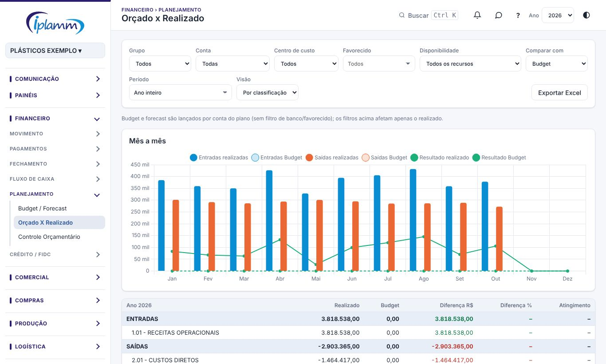
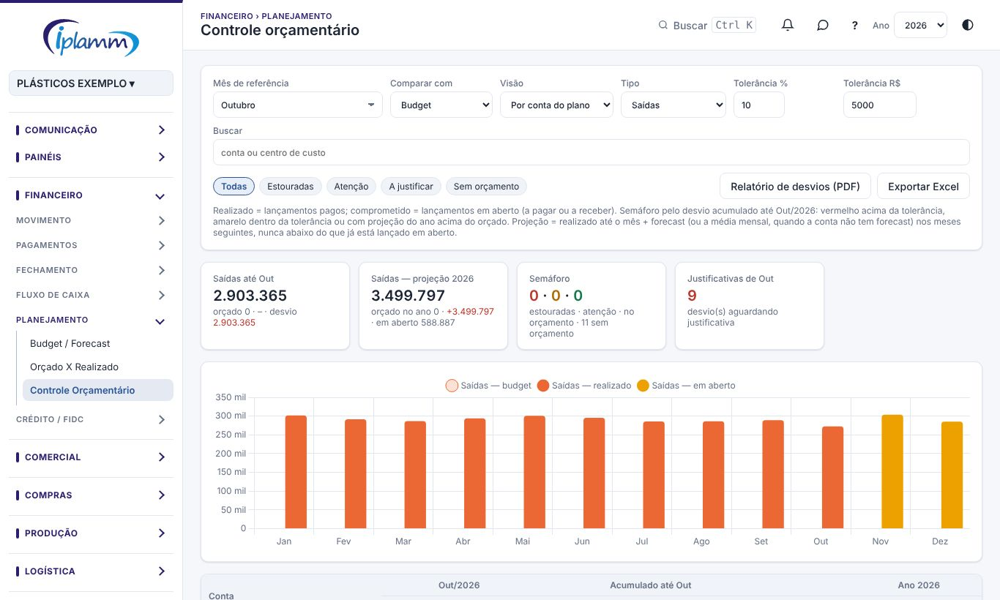

## 1. Para que serve

- **Budget / Forecast**: onde se lança o orçamento do ano, por conta do plano e por mês.
  - **Budget** é o planejamento inicial.
  - **Forecast** é a revisão ao longo do ano.
- **Orçado x Realizado**: compara o orçamento com o que aconteceu, mês a mês.
- **Controle orçamentário**: acompanha cada conta do plano e cada centro de custo:
  - orçado, comprometido (em aberto) e realizado;
  - semáforo e projeção do ano;
  - justificativa dos desvios, com relatório em PDF.

## 2. Quem tem acesso

| Perfil | O que faz |
|---|---|
| Administrador e financeiro | Lançam o budget e o forecast, definem o rateio e escrevem as justificativas. |
| Diretor e leitura | Consultam e geram os relatórios. |

## 3. Budget / Forecast

### 3.1 Lançar o orçamento

1. Escolha o **cenário**: Budget (planejamento inicial) ou Forecast (revisão). O ano vem do seletor no topo da plataforma.
2. Digite os valores nas células, por conta e por mês.
   - Os valores são **sempre positivos**: as entradas somam e as saídas subtraem, pelo plano de contas.
   - **Tab** passa para a próxima célula.
   - Dá para **colar do Excel** normalmente.
3. Clique em **Salvar alterações**.

### 3.2 Atalhos

- No budget, **Copiar realizado do ano anterior** preenche o budget com o que foi realizado no ano anterior. Ele substitui o budget atual.
- No forecast, **Copiar budget → forecast** substitui todo o forecast do ano pelos valores do budget.

### 3.3 Status de cada mês no forecast

No forecast, escolha para cada mês o que vale nas comparações:

- **Realizado**: usa o caixa real;
- **Prev. Ajustada**: usa os valores do forecast;
- **Prev. Inicial**: mantém o budget.

## 4. Orçado x Realizado

1. Escolha com o que **comparar** (budget ou forecast), o **período** e a **visão**.
2. A tabela mostra, por conta: o orçado, o realizado, a diferença em R$ e em %, e o **atingimento**. O quadro **Mês a mês** abre a comparação por mês.
3. Os indicadores mostram as entradas, as saídas e o resultado realizados.

O budget e o forecast são lançados por conta do plano, sem banco nem favorecido. Os filtros da tela afetam só o realizado.

## 5. Controle orçamentário

### 5.1 Os parâmetros

Escolha:

- o **mês de referência**;
- com o que **comparar** (budget ou forecast);
- a **visão**: por conta do plano ou por centro de custo;
- o **tipo**: entradas ou saídas;
- a **tolerância %**.

Use a busca e os filtros **Todas**, **Estouradas**, **Atenção**, **A justificar** e **Sem orçamento**.

### 5.2 Ler o semáforo

- **Realizado** = lançamentos pagos. **Comprometido** = lançamentos em aberto (a pagar ou a receber).
- **Vermelho**: o desvio acumulado até o mês passou da tolerância.
- **Amarelo**: dentro da tolerância, mas com a projeção do ano acima do orçado.
- **Projeção do ano** = realizado até o mês + orçado nos meses seguintes. Nunca fica abaixo do que já está lançado em aberto.

Clique numa conta para ver o orçado, o realizado, o desvio, o consumo, o que está em aberto, o saldo e a projeção, os **maiores lançamentos** do período e as **justificativas**.

### 5.3 Justificar um desvio

1. Na conta com desvio, clique em **Justificar**.
2. Escreva a **justificativa** (o que causou o desvio) e, se quiser, a **ação prevista**.
3. Clique em **Salvar**.

As justificativas escritas na Autorização de pagamentos, para pagamentos acima do orçado, também aparecem aqui.

### 5.4 Rateio do orçamento por centro de custo

O orçamento é feito **por conta do plano**. Para ver o orçado de cada centro de custo:

1. Clique em **Rateio do orçamento por centro de custo**, ou em **definir** na linha da conta.
2. Para cada conta, informe a porcentagem de cada centro de custo, ou clique em **Sugerir pela participação realizada**.
3. Clique em **Salvar rateio da conta**. Para todas de uma vez, use **Aplicar a sugestão em todas as contas sem rateio**.

O rateio não muda o budget nem o forecast: só distribui o valor na visão por centro de custo. Conta sem rateio aparece como "sem orçamento" nessa visão.

### 5.5 Relatórios

**Relatório de desvios (PDF)** gera o resumo, as contas com desvio, as justificativas e as ações, no padrão IPLAMM. **Exportar Excel** baixa a tabela.

## 6. Regras e travas

- Nada no Controle orçamentário altera lançamentos nem o orçamento.
- Pagamento acima do orçado **não é bloqueado**. A Autorização de pagamentos pede justificativa.
- A soma do rateio de uma conta não pode passar de 100%.
- No Fechamento do mês, a etapa "Desvios do orçamento justificados" só fica verde quando todos os desvios do mês têm justificativa.

## 7. Perguntas frequentes e erros comuns

**Colei do Excel e os valores ficaram negativos.** Digite sempre positivo; o sinal vem do plano de contas.

**A conta aparece "sem orçamento" na visão por centro de custo.** Falta o rateio dessa conta (item 5.4).

**A mensagem diz "Esta conta não tem realizado por centro de custo para sugerir".** Os lançamentos dessa conta não têm centro de custo. Informe o rateio à mão.

## 8. Histórico de alterações

| Versão | Data | O que mudou |
|---|---|---|
| 1.0 | 28/10/2026 | Primeira versão do manual: budget, forecast e status do mês, orçado x realizado, controle orçamentário com semáforo, justificativas, rateio por centro de custo e relatório. |
| 1.1 | 29/10/2026 | Imagens das telas, com dados fictícios. |
