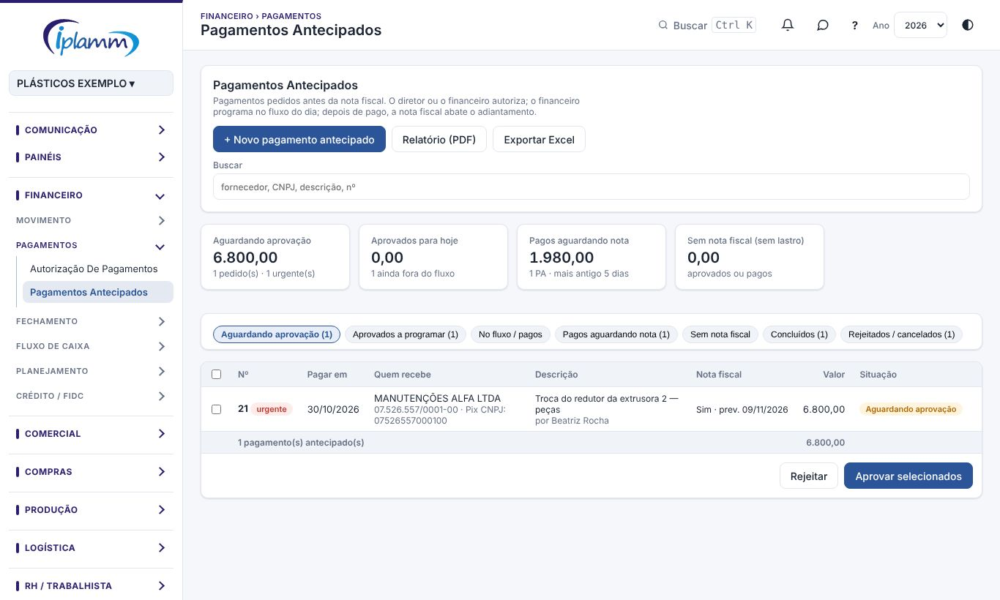

## 1. Para que serve

A tela **Pagamentos Antecipados** (o antigo "paraquedas") controla todo pagamento pedido **antes da nota fiscal**: adiantamento a fornecedor, sinal de pedido, compra do dia, frete pago na hora.

O caminho de cada pedido é sempre o mesmo:

1. Alguém **pede** o pagamento.
2. O diretor ou o financeiro **aprova**.
3. O financeiro **programa** no fluxo de caixa do dia.
4. O pagamento é feito e **registrado**, com o comprovante.
5. Quando a nota fiscal chega, ela é **ligada** ao pagamento e abate o adiantamento.

Cada pedido recebe um número: **PA nº**.

## 2. Quem tem acesso

| Perfil | O que faz |
|---|---|
| Compras | Cria pedidos e acompanha os seus na aba **Meus pedidos**. Corrige e reenvia os rejeitados. |
| Diretor e financeiro | Aprovam ou rejeitam. |
| Financeiro e administrador | Programam no fluxo, registram pagamentos e comprovantes, ligam a nota, concluem e cancelam. |

## 3. A tela

No topo ficam os botões **+ Novo pagamento antecipado**, **Relatório (PDF)** e **Exportar Excel**, e o campo **Buscar** (fornecedor, CNPJ, descrição ou nº).

Os quatro indicadores mostram:

- **Aguardando aprovação**: valor e quantidade de pedidos, com os urgentes.
- **Aprovados para hoje**: o que está aprovado com data até hoje, e quantos ainda não foram programados.
- **Pagos aguardando nota**: fica vermelho quando o mais antigo passa de 30 dias.
- **Sem nota fiscal (sem lastro)**: pagamentos aprovados ou pagos que não terão nota.

As abas separam os pedidos pela situação: **Aguardando aprovação**, **Aprovados a programar**, **No fluxo / pagos**, **Pagos aguardando nota**, **Sem nota fiscal**, **Concluídos** e **Rejeitados / cancelados**.

## 4. Passo a passo

### 4.1 Pedir um pagamento antecipado

1. Clique em **+ Novo pagamento antecipado**.
2. Em **Quem recebe**, preencha a **razão social** (ao escolher um fornecedor do cadastro, o CNPJ entra sozinho), o **CNPJ / CPF** e a **chave Pix** (com o tipo) ou o **banco, agência e conta**.
3. Em **O pagamento**, informe o **valor**, a data em **Pagar em**, a **prioridade** (normal ou urgente) e se **terá nota fiscal**. Se tiver nota, informe a previsão dela.
4. Escreva a **Descrição / motivo**. Pode informar também o **pedido / proforma**, um **anexo** (link do pedido, proforma ou boleto) e o **solicitante**.
5. Clique em **Enviar para aprovação**. A tela mostra o número do PA.

> **Dica:** o pedido de compra aprovado tem o botão **Pagamento antecipado**, que abre este formulário já preenchido com o fornecedor, o valor e o nº do pedido.

### 4.2 Aprovar ou rejeitar

1. Abra a aba **Aguardando aprovação**.
2. Marque os pedidos. O total marcado aparece embaixo da lista.
3. Clique em **Aprovar selecionados** ou em **Rejeitar**.
4. Na rejeição, o **motivo** é obrigatório. O pedido volta para quem pediu, que vê o motivo, corrige e clica em **Reenviar para aprovação**.

### 4.3 Programar no fluxo de caixa

1. Abra a aba **Aprovados a programar** e clique em **Programar no fluxo**.
2. Escolha o **plano de contas** (obrigatório), o **centro de custo**, a **conta de saída** e a **data**.
3. Confira o **fornecedor no cadastro**. Se ele não existir, a opção **Cadastrar agora** cria o cadastro com a razão social, o CNPJ e os dados bancários do pedido.
4. Clique em **Criar lançamento**.

O pagamento vira um lançamento **Em aberto** e aparece no fluxo de caixa diário, em Contas a pagar e na Autorização de pagamentos.

### 4.4 Registrar o pagamento

Há dois jeitos:

- **Pela tela de Pagamentos Antecipados**, com o botão **Registrar pagamento**. Informe o **valor pago**, a **data**, a **conta de saída**, uma observação e anexe os **comprovantes**. O lançamento programado em aberto é reduzido pelo valor pago, para o fluxo não contar duas vezes.
- **Pela baixa do lançamento**, como em qualquer título. Depois, na tela de Pagamentos Antecipados, aparece o aviso **Confirmar pagos**. Clique nele para que os pagamentos virem **adiantamento ao fornecedor** e aguardem a nota.

Quando o pedido tem nota e fornecedor cadastrado, o pagamento vira adiantamento ao fornecedor. Quando não terá nota, fica como **pago sem lastro**.

### 4.5 Pagamento em partes e complemento

Se o valor pago for menor que o do pedido, ele fica como **Pago parcialmente · falta R$ X**.

1. Clique em **Registrar complemento**. O valor que falta já vem preenchido.
2. Informe a data e a conta e anexe o comprovante desse pagamento.

A plataforma não deixa registrar mais do que falta.

### 4.6 Pagamentos, comprovantes e anexos

O botão **Pagamentos e anexos** abre uma janela com:

- Cada pagamento: data, conta, valor e situação (programado ou pago).
- **+ Comprovante** em cada pagamento.
- **Corrigir valor**, para quando o que saiu do banco foi diferente do registrado. O lançamento e o adiantamento mudam juntos. Lançamento já conciliado não pode mudar.
- **Outros anexos**: orçamento, pedido, proforma ou boleto. Escolha o **tipo** (documento ou comprovante) e, se quiser, a qual pagamento ele pertence.

Os arquivos aceitos são PDF e fotos (JPG, PNG), com até 10 MB cada. Dá para enviar vários de uma vez. Quem lançou o pedido é avisado quando um comprovante é anexado.

### 4.7 Ligar a nota fiscal

1. Abra a aba **Pagos aguardando nota** e clique em **Ligar nota**.
2. A janela mostra as notas de entrada desse fornecedor que ainda têm valor a abater, com a mais próxima do valor no topo.
3. Escolha a nota e clique em **Ligar e abater**. O valor da nota abate o adiantamento.

Se a nota não aparecer, importe o XML em **CPD › Notas Fiscais** e tente de novo.

### 4.8 Pedido sem nota fiscal

Pedidos marcados com **Terá nota fiscal = Não** ficam na aba **Sem nota fiscal**. Depois de pagos, clique em **Concluir**.

### 4.9 Cancelar

Clique em **Cancelar** e escreva o motivo. Se houver lançamento em aberto no fluxo, ele é excluído junto. Pedido já pago não pode ser cancelado.

### 4.10 Relatório e Excel

**Relatório (PDF)** gera o relatório da aba aberta, com a busca aplicada, no padrão IPLAMM e com campos de assinatura. **Exportar Excel** baixa a lista da aba.

## 5. Regras e travas

- Todo pedido precisa da **chave Pix ou da conta bancária** de quem recebe. Se informar chave Pix, escolha o tipo dela.
- O CNPJ tem 14 dígitos e o CPF tem 11.
- Só o **diretor, o financeiro ou o administrador** aprovam.
- Sem **plano de contas** não dá para programar no fluxo.
- Um pagamento não pode passar do que **falta pagar** no pedido.
- Pagamento já baixado (Pago) não pode ser cancelado. Lançamento conciliado não pode ter o valor corrigido.
- Pedido pago e aguardando nota há mais de **30 dias** aparece em vermelho: cobre a nota do fornecedor.

## 6. Perguntas frequentes e erros comuns

**Não vejo os botões Aprovar e Rejeitar.** Eles só aparecem na aba **Aguardando aprovação**, para diretor, financeiro e administrador.

**A mensagem diz "Informe a chave Pix ou a conta bancária de quem recebe".** Preencha um dos dois no bloco **Quem recebe**.

**A mensagem diz "Passa do que falta".** O valor digitado é maior que o saldo do pedido. Confira o que já foi pago em **Pagamentos e anexos**.

**Paguei pelo banco e o pedido não mudou.** Depois da baixa do lançamento, clique em **Confirmar pagos** no aviso do topo da tela.

**A nota não aparece em Ligar nota.** A nota ainda não foi importada, ou foi emitida por outro CNPJ do fornecedor. Importe o XML em Notas Fiscais.

**Paguei a menos.** Registre o complemento (item 4.5). Se o valor registrado estiver errado, use **Corrigir valor** (item 4.6).

## 7. Conversa sobre o registro

No topo da janela do pagamento antecipado ficam dois botões das **Conversas**:

- **💬 Conversa** abre o bate-papo da equipe sobre este registro. Cada registro tem uma conversa só, e só entra quem consegue ver o registro.
- **↗ Enviar no chat** manda o registro como cartão numa conversa. Quem recebe clica no cartão e abre o registro.

Veja o manual **Conversas** para os detalhes.

## 8. Histórico de alterações

| Versão | Data | O que mudou |
|---|---|---|
| 1.0 | 28/10/2026 | Primeira versão do manual: pedido, aprovação, programação, vários pagamentos e comprovantes, ligar a nota e relatório no padrão IPLAMM. |
| 1.1 | 29/10/2026 | Botões **💬 Conversa** e **↗ Enviar no chat** do pagamento antecipado (Conversas, etapa 2). |
| 1.2 | 29/10/2026 | Imagens das telas, com dados fictícios. |
