## 1. Para que serve

Os painéis juntam, numa tela só, o que precisa de atenção e de decisão:

- **Minha Manhã**: a tela inicial, montada por blocos que cada pessoa escolhe.
- **Central de Decisões**: reúne quatro coisas:
  - os alertas calculados por regras explícitas, que podem ser resolvidos, adiados ou delegados;
  - os pagamentos do dia (simular, registrar e aprovar);
  - a saúde da empresa por área;
  - o histórico do que foi decidido.
- **Dashboard Executivo**: a visão de um mês para a direção, com a nota de saúde financeira.
- **Meus Painéis**: cada pessoa monta os seus painéis com os indicadores, gráficos e tabelas que mais acompanha.

## 2. Quem tem acesso

A **Minha Manhã** é de todos os perfis, e cada um vê só as suas áreas. Os demais painéis fazem parte da área **Financeiro**. Na Central de Decisões:

- o administrador, o diretor e o financeiro resolvem, adiam e delegam os alertas; os parâmetros são do administrador e do diretor.

Nos Pagamentos do dia:

- o administrador e o financeiro registram e enviam a decisão;
- o diretor e o administrador aprovam ou rejeitam.

## 3. Minha Manhã

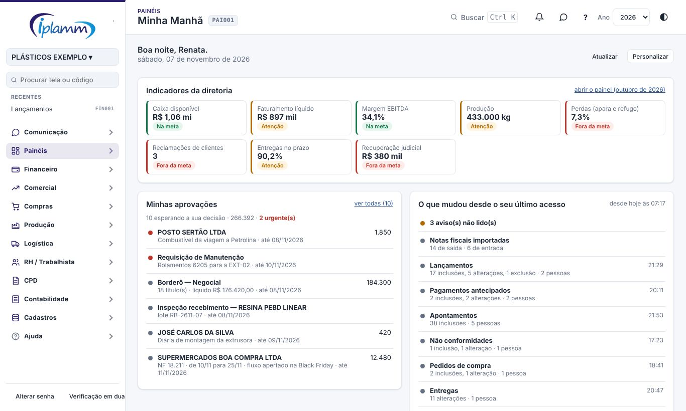

A Minha Manhã é a tela inicial. Ela é montada por **blocos**, e cada pessoa escolhe quais aparecem e em que ordem. Agora vale para todos os perfis, inclusive Compras, Vendas e Produção, cada um vendo só as suas áreas.

### 3.1 Os blocos

| Bloco | O que mostra | Quem pode ter |
|---|---|---|
| Indicadores da diretoria | Os oito indicadores do Painel da Diretoria do mês anterior, com a situação de cada um. | Administrador, diretor, financeiro e leitura |
| Minhas aprovações | As 6 decisões mais urgentes, o total e o link para ver todas. | Todos |
| Situação do dia | Saldo disponível, conferência, extratos e travas. | Quem tem a área Financeiro |
| O que mudou desde o seu último acesso | O que outras pessoas incluíram, alteraram ou excluíram nas suas áreas, notas importadas e avisos não lidos. | Todos |
| Resumo do dia anterior | O último dia útil: recebido e pago, faturamento, notas de entrada, produção e refugo, não conformidades e entregas. | Todos (cada um vê as suas áreas) |
| Agenda de hoje | O que vence hoje, nos próximos 7 dias e o que está vencido. | Quem tem a área Financeiro |
| Alertas | Caixa abaixo do mínimo, contas negativas, títulos vencidos, extratos atrasados e conferência pendente. | Quem tem a área Financeiro |
| Meus atalhos | As telas que você mais usa, a um clique. | Todos |

Os blocos que aparecem logo de saída dependem do perfil:

| Perfil | Blocos ligados no padrão |
|---|---|
| Administrador | Indicadores da diretoria, aprovações, situação, o que mudou, dia anterior, alertas e agenda |
| Diretor | Indicadores da diretoria, aprovações, dia anterior, o que mudou, situação e alertas |
| Financeiro | Situação, aprovações, agenda, alertas, dia anterior e o que mudou |
| Leitura | Situação, dia anterior, o que mudou e indicadores da diretoria |
| Compras e Vendas | Aprovações, o que mudou, dia anterior e atalhos |
| Produção | Dia anterior, o que mudou, aprovações e atalhos |

Cada bloco carrega sozinho: se um demora, os outros já aparecem. Cada item leva à tela certa. **Atualizar** recarrega os dados.

### 3.2 O que mudou e o dia anterior

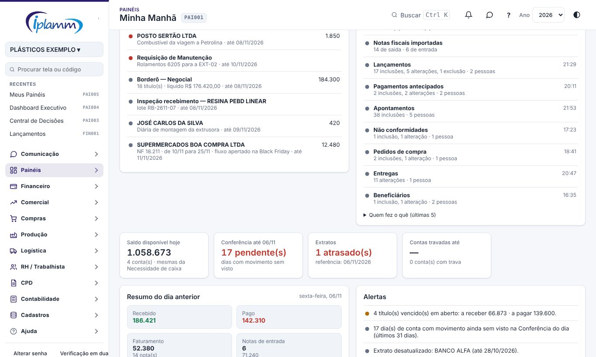

**O que mudou desde o seu último acesso** conta, por módulo, as inclusões, alterações e exclusões feitas **por outras pessoas**. O que você mesmo fez não aparece.

- **Último acesso** é a sua entrada anterior na plataforma. Recarregar a página dentro de 30 minutos não conta como novo acesso. O limite é de 30 dias.
- Cada pessoa vê só os módulos das áreas que enxerga. Usuários e papéis aparecem só para o administrador e o diretor.
- Para o administrador e o diretor, **Quem fez o quê** lista as últimas alterações com o nome de quem fez e leva à Auditoria.

**Resumo do dia anterior** mostra o último dia útil (na segunda-feira, a sexta). Cada número leva à tela de detalhe.

### 3.3 Personalizar

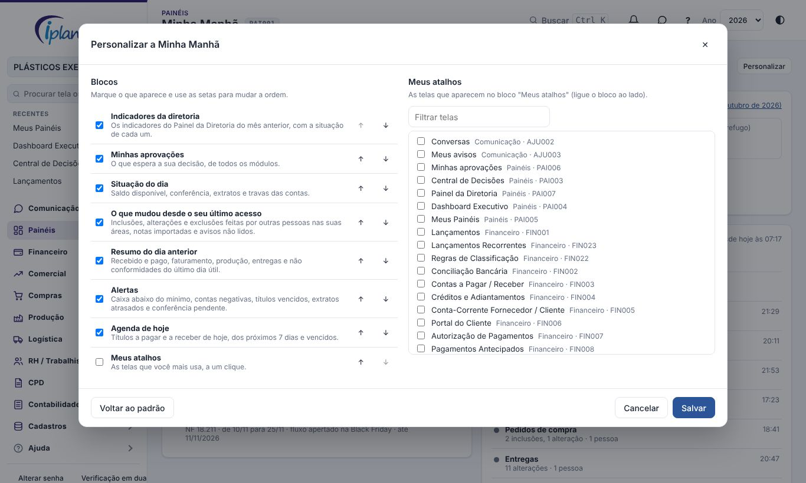

Clique em **Personalizar**:

1. Em **Blocos**, marque os que aparecem. Use as setas ↑ e ↓ para mudar a ordem.
2. Em **Meus atalhos**, marque as telas que você mais usa (use o filtro). Ligue também o bloco **Meus atalhos**.
3. Clique em **Salvar**.

A escolha vale para você, nesta empresa, em todos os aparelhos. **Voltar ao padrão** devolve os blocos do seu perfil.

## 4. Central de Decisões

A **Central de Decisões** junta numa tela só o antigo Decision Center e a antiga Decisão do Dia. Ela tem quatro abas:

- **Alertas**;
- **Pagamentos do dia**;
- **Saúde da empresa**;
- **Histórico**.

Os links antigos da Decisão do Dia (avisos, aprovações) abrem direto a aba **Pagamentos do dia**.

### 4.1 Alertas

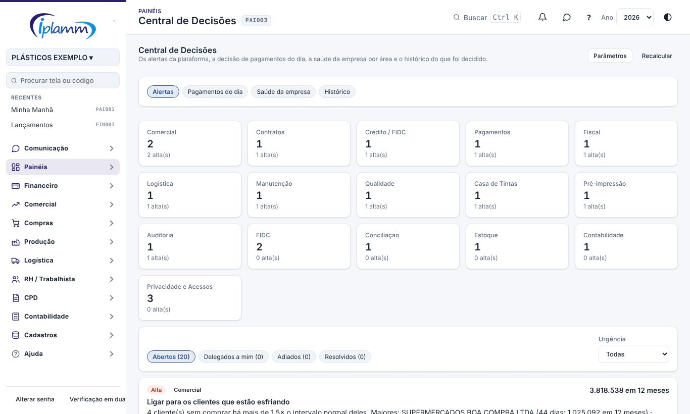

Os alertas são calculados com **regras fixas** sobre os dados da plataforma, sem inteligência artificial. Cada um mostra:

- o motivo;
- o impacto estimado;
- a urgência;
- a **regra usada** ("Como foi calculado");
- o botão para a tela certa.

Exemplos de alerta:

- cobrir a falta de caixa prevista;
- cobrar os títulos vencidos de maior valor;
- priorizar o fundo FIDC mais barato;
- importar os extratos parados;
- conferir as ações sensíveis da Auditoria;
- responder às solicitações de titulares (LGPD).

Os quadros no alto contam os alertas abertos por origem. Clique num quadro para filtrar. Use as abas **Abertos**, **Delegados a mim**, **Adiados** e **Resolvidos** e o filtro de **urgência**.

Em cada alerta, o administrador, o diretor e o financeiro podem:

| Ação | O que acontece |
|---|---|
| **Resolver** | Exige dizer o que foi feito. O alerta some **enquanto o conteúdo for o mesmo**. Se mudar (outro valor, mais itens), ele volta marcado "voltou". |
| **Adiar** | Escolha até quando (padrão: 7 dias, ajustável). O alerta volta sozinho na data. |
| **Delegar** | Escolha a pessoa e escreva a instrução. Ela recebe um aviso no sino e o alerta mostra "Delegado a…". Ele continua aberto até ser resolvido. |
| **Reabrir** | Nos adiados e resolvidos: o alerta volta para os abertos. |

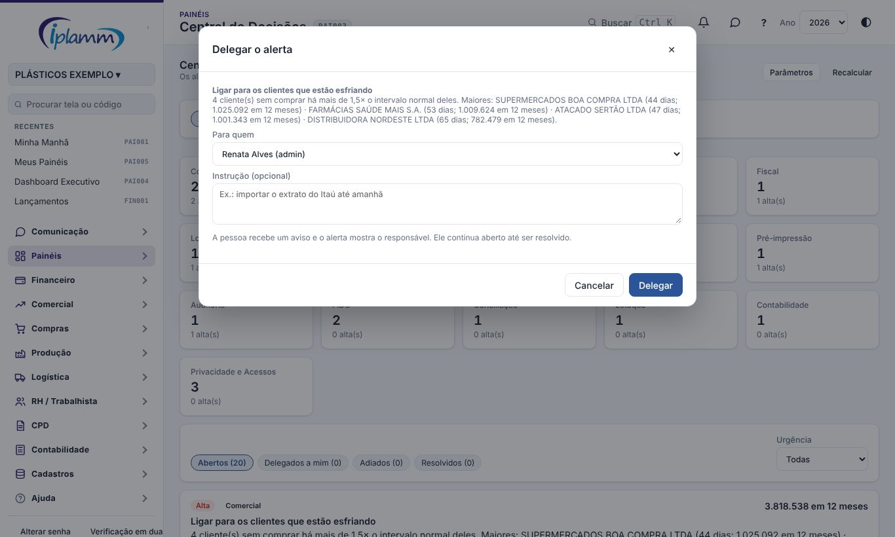

Tudo fica registrado com quem fez, quando e a observação (aba **Histórico**).

### 4.2 Saúde da empresa

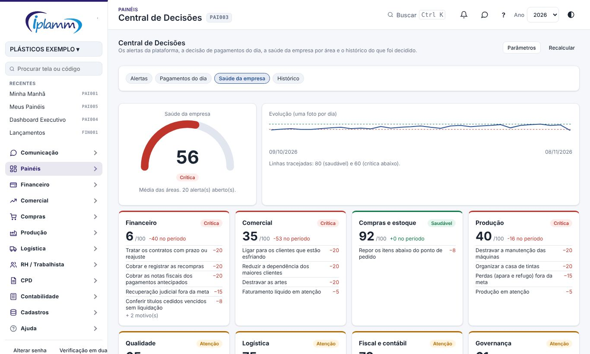

Um índice de **0 a 100** para a empresa e para cada área:

- Financeiro;
- Comercial;
- Compras e estoque;
- Produção;
- Qualidade;
- Logística;
- Fiscal e contábil;
- Governança.

Cada área começa com 100 e perde pontos:

| Motivo | Pontos (padrão) |
|---|---|
| Alerta aberto de urgência alta | −20 |
| Alerta aberto de urgência média | −8 |
| Alerta aberto de urgência baixa | −3 |
| Indicador do Painel da Diretoria (mês anterior) fora da meta | −15 |
| Indicador em atenção | −5 |

Como cada alerta conta:

- resolvidos e adiados não contam;
- delegados contam até serem resolvidos;
- a nota nunca fica abaixo de 0.

O índice **geral** é a média das áreas. As faixas são:

- **Saudável**: 80 ou mais;
- **Atenção**: de 60 a 79;
- **Crítica**: abaixo de 60.

Cada cartão de área lista os motivos que mais tiram pontos. Toda vez que a tela é aberta, a plataforma guarda a **foto do dia**. O gráfico **Evolução** mostra a tendência e cada área mostra a variação no período.

### 4.3 Pagamentos do dia

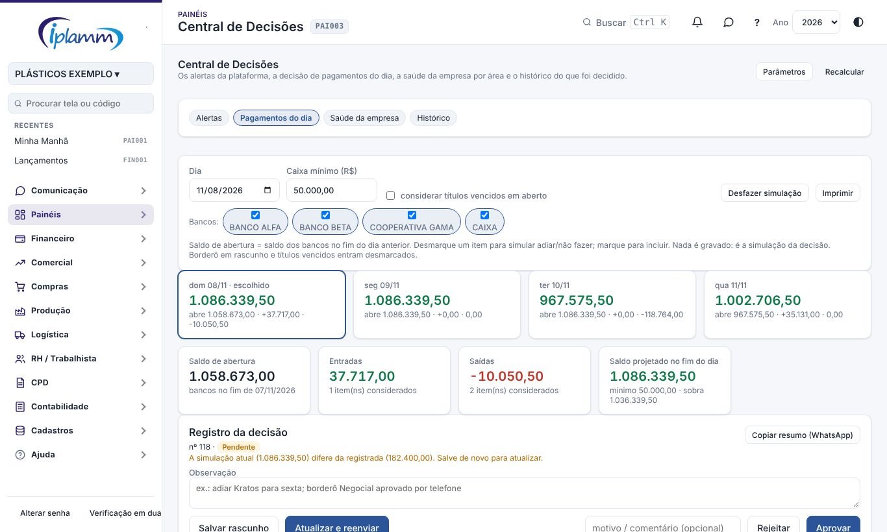

É a antiga Decisão do Dia, sem mudanças: simular, registrar e aprovar a decisão de pagamentos.

#### Simular

1. Escolha o **dia**.
2. O **saldo de abertura** é o saldo dos bancos no fim do dia anterior.
3. As **Entradas** trazem:
   - os borderôs pendentes de aprovação (o líquido na conta de crédito);
   - os recebimentos em aberto;
   - o que já entrou.
4. As **Saídas** trazem:
   - as contas a pagar em aberto;
   - os pagamentos antecipados aguardando autorização;
   - o que já saiu.
5. **Desmarque** um item para simular adiar ou não fazer; **marque** para incluir. O saldo projetado no fim do dia, total e por banco, recalcula na hora.
   - Borderô em rascunho e títulos vencidos entram **desmarcados**.
   - As **transferências entre contas** não mudam o total, só o saldo de cada banco.
6. **Desfazer simulação** volta ao estado inicial.

A **Decisão sugerida** resume o que a plataforma propõe para o dia.

#### Registrar e aprovar

1. Escreva uma **observação** e clique em **Salvar rascunho** ou **Enviar para aprovação**.
2. O diretor abre a decisão e clica em **Aprovar** ou **Rejeitar**. Decisão aprovada pode ser **reaberta**: ela volta como rejeitada para ser refeita.
3. Passado o dia, o quadro **Decidido × realizado** compara o que foi decidido com o que aconteceu: lançamentos pagos, pagamentos antecipados, borderôs e o saldo real dos bancos.

**Imprimir** gera a decisão no padrão IPLAMM. **Copiar resumo (WhatsApp)** copia o texto pronto para colar na conversa.

### 4.4 Histórico

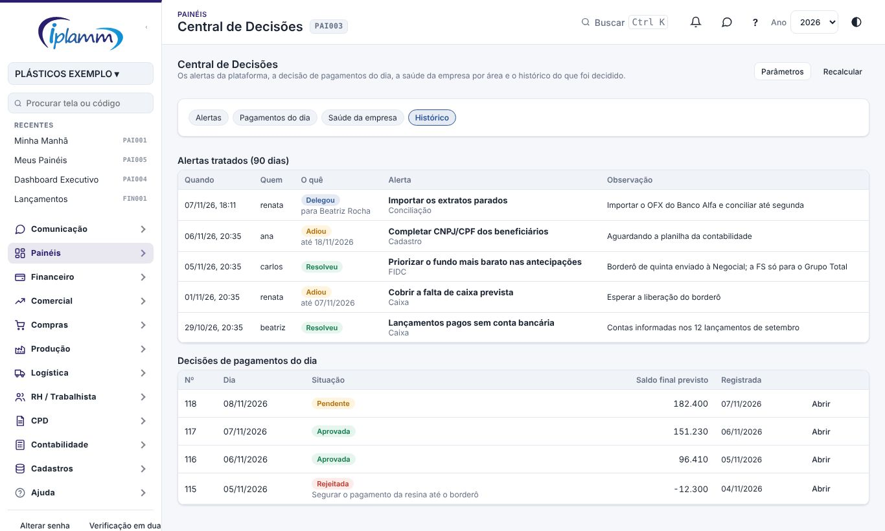

Mostra duas listas:

- os alertas **tratados** nos últimos 90 dias: quem, quando, o que fez (resolveu, adiou, delegou, reabriu), o alerta e a observação;
- as **decisões de pagamentos do dia**, com a situação e o saldo final previsto. **Abrir** leva à aba Pagamentos do dia naquele dia.

### 4.5 Parâmetros

Só o administrador e o diretor alteram. Em **Parâmetros**:

- os **pontos** de cada tipo de alerta e de indicador;
- as **faixas** (saudável a partir de / crítica abaixo de);
- o **prazo padrão** para adiar;
- o **peso de cada área** no índice geral. Com peso 0, a área sai da média, mas continua aparecendo.

## 5. Dashboard Executivo

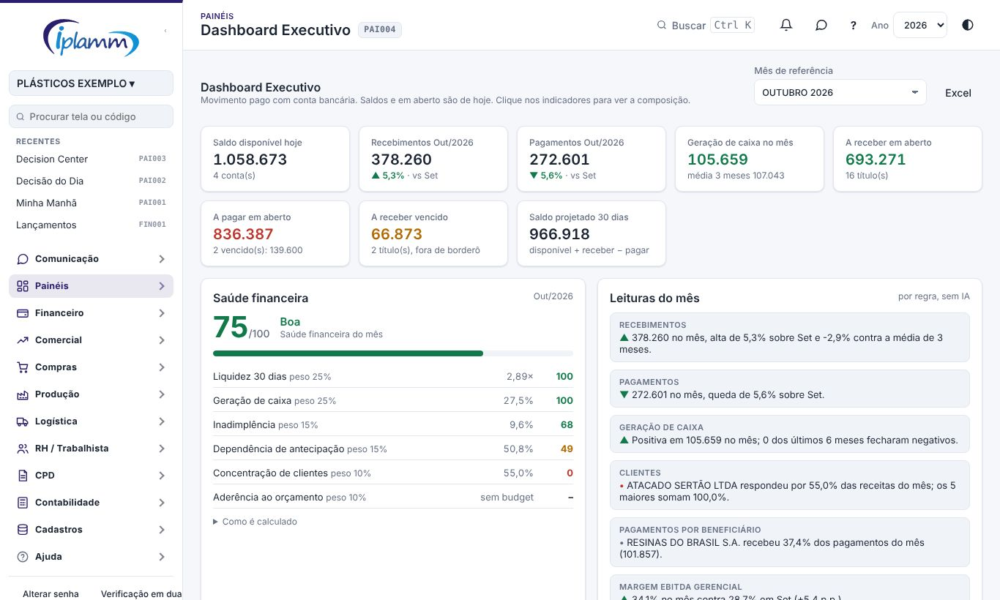

1. Escolha o **mês de referência**.
2. Os indicadores podem ser clicados para ver a composição:
   - saldo disponível hoje;
   - geração de caixa no mês;
   - a receber e a pagar em aberto;
   - a receber vencido;
   - saldo projetado em 30 dias.
3. A **Saúde financeira** é uma nota de 0 a 100 com seis fatores e pesos à vista:

   | Fator | Peso |
   |---|---|
   | Liquidez 30 dias | 25% |
   | Geração de caixa | 25% |
   | Inadimplência | 15% |
   | Dependência de antecipação | 15% |
   | Concentração de clientes | 10% |
   | Aderência ao orçamento | 10% |

4. Mais abaixo ficam as **Leituras do mês**, a evolução de 12 meses, o aging do a receber e do a pagar, os maiores clientes e os maiores pagamentos.
5. **Excel** exporta os números.

O painel usa só lançamentos com conta bancária, a mesma base dos saldos.

## 6. Meus Painéis

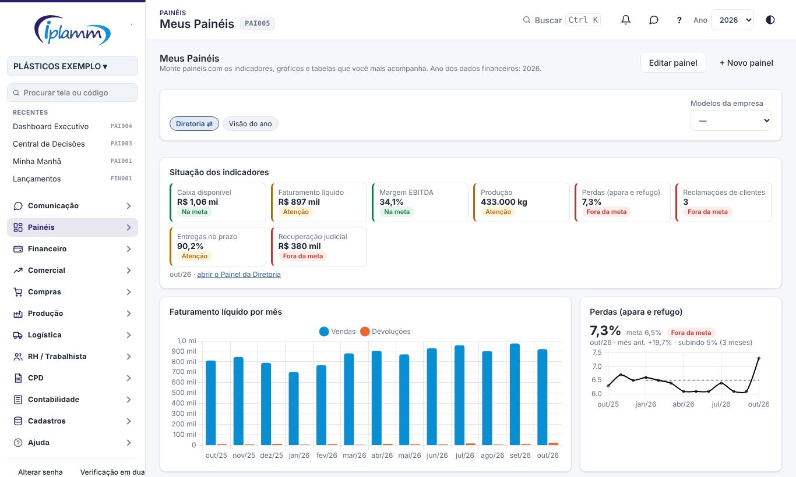

O antigo **Dashboard** virou **Meus Painéis**: cada pessoa monta **um ou mais painéis** com os cartões que já existem na plataforma. Quem ainda não montou nada vê o painel padrão **Visão do ano**, igual ao Dashboard antigo:

- o saldo em bancos;
- as entradas e as saídas;
- o EBITDA e o resultado;
- o que está em aberto;
- os gráficos de entradas e saídas e de composição das saídas;
- os saldos por conta;
- os próximos vencimentos.

### 6.1 Os cartões

| Área | Cartões |
|---|---|
| Financeiro | Saldo em bancos · Entradas e saídas do ano · EBITDA e resultado do ano · A pagar e a receber · Entradas × saídas e saldo · Composição das saídas · Receita e EBITDA por mês · Caixa projetado por semana · Saldos por conta · Próximos vencimentos |
| Painel da Diretoria | Indicador da diretoria (escolha qual dos oito) · Situação dos indicadores |
| Comercial | Faturamento líquido por mês |
| Produção e qualidade | Produção e perdas por mês · Não conformidades por mês |
| Logística | Entregas no prazo por mês |

Cada pessoa vê só os cartões das áreas que enxerga. Os do Painel da Diretoria são para o administrador, o diretor, o financeiro e o leitura.

Os cartões financeiros usam o **ano** escolhido no alto da tela. Os demais mostram os últimos 13 meses até o mês anterior. Os dados são carregados uma vez por painel, mesmo que vários cartões usem a mesma informação.

### 6.2 Montar e editar

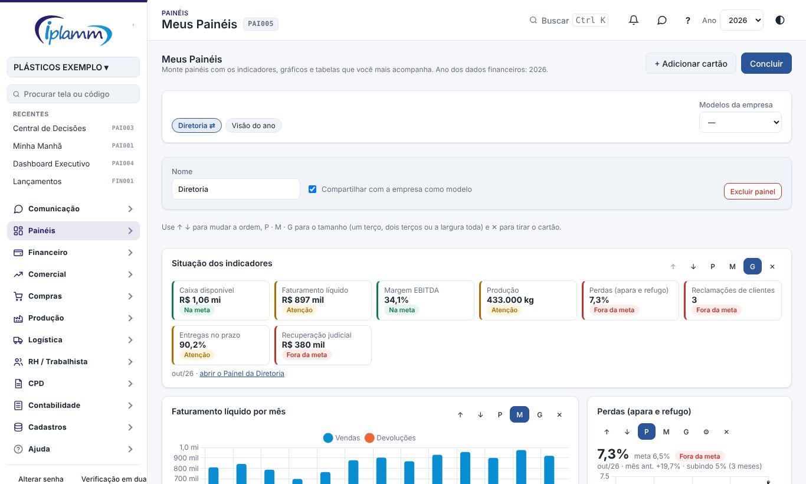

1. **+ Novo painel** cria um painel vazio, com o nome que você escolher.
2. **Editar painel** abre o modo de edição:
   - **↑ ↓** mudam a ordem;
   - **P · M · G** escolhem o tamanho: um terço, dois terços ou a largura toda da tela;
   - **⚙** escolhe o indicador, no cartão "Indicador da diretoria";
   - **✕** tira o cartão.
3. **+ Adicionar cartão** abre o catálogo, separado por área.
4. Em **Nome**, renomeie o painel. **Excluir painel** apaga o painel (só o seu).
5. **Concluir** sai da edição. As mudanças ficam salvas na hora.

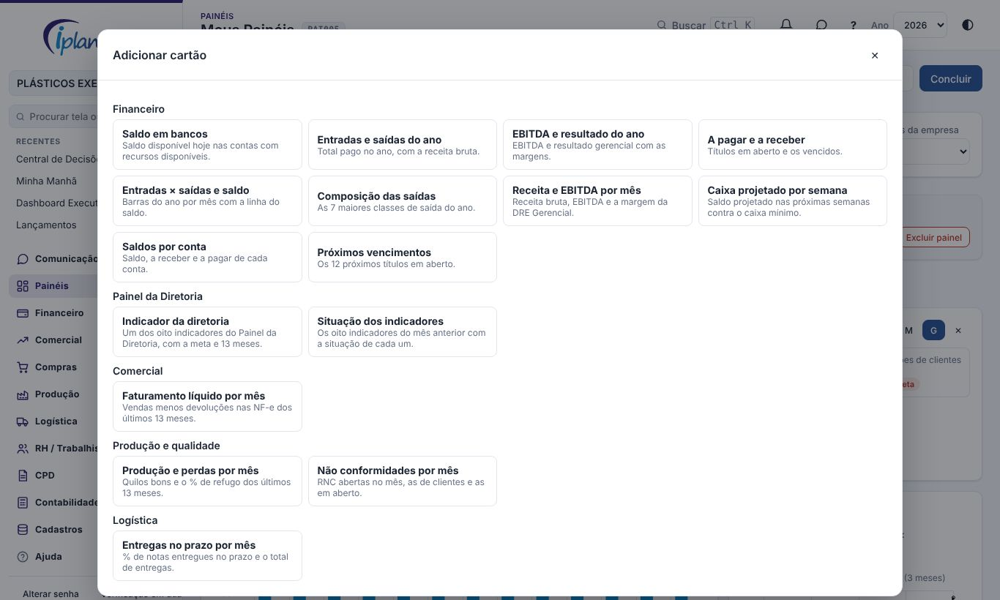

Se você editar o painel padrão "Visão do ano", ele vira um painel seu.

### 6.3 Compartilhar como modelo

Marque **Compartilhar com a empresa como modelo** no modo de edição. O painel aparece em **Modelos da empresa** para as outras pessoas, que podem **Copiar para mim** e então ajustar a cópia. Só o dono altera o modelo. O sinal ⇄ ao lado do nome indica que o painel está compartilhado.

Os painéis ficam guardados por pessoa e por empresa e valem em todos os aparelhos.

## 7. Perguntas frequentes e erros comuns

**O saldo de abertura dos Pagamentos do dia não bate com o banco.** Falta lançar ou conciliar algo do dia anterior. Veja a Conferência do dia.

**Uma recomendação não faz sentido para nós.** Use **Adiar 7 dias**. Se a regra estiver errada para a IPLAMM, avise o administrador para ajustá-la.

## 8. Histórico de alterações

| Versão | Data | O que mudou |
|---|---|---|
| 1.0 | 28/10/2026 | Primeira versão do manual: Minha Manhã, Decisão do Dia com registro e aprovação, Decision Center, Dashboard Executivo e Dashboard. |
| 1.1 | 29/10/2026 | Imagens das telas, com dados fictícios. |
| 1.2 | 05/11/2026 | Nomes das telas iguais aos do menu, com o código da tela no cabeçalho. |
| 1.3 | 07/11/2026 | Minha Manhã personalizada: blocos por perfil, o que mudou desde o último acesso, resumo do dia anterior, aprovações, indicadores da diretoria e atalhos. |
| 1.4 | 07/11/2026 | Central de Decisões: Decisão do Dia e Decision Center numa tela só, com resolver, adiar e delegar cada alerta, histórico e saúde da empresa 0–100 por área. |
| 1.5 | 07/11/2026 | O Dashboard virou Meus Painéis: painéis montados por cada pessoa com 16 cartões de várias áreas, tamanho e ordem, e modelos compartilhados com a empresa. |
