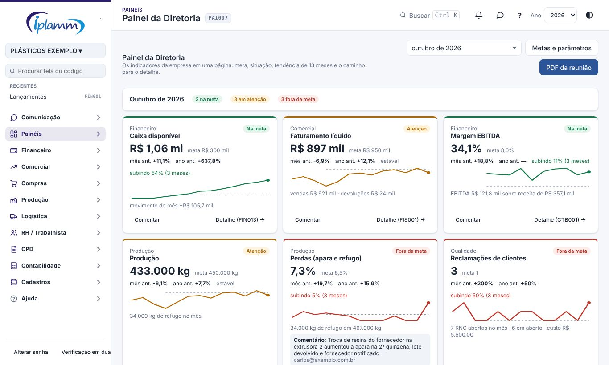
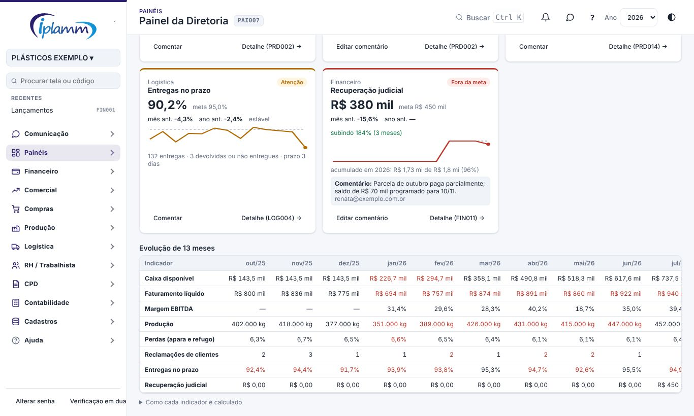
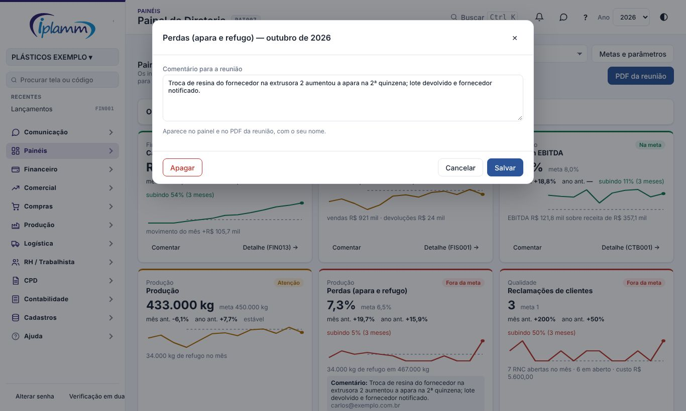
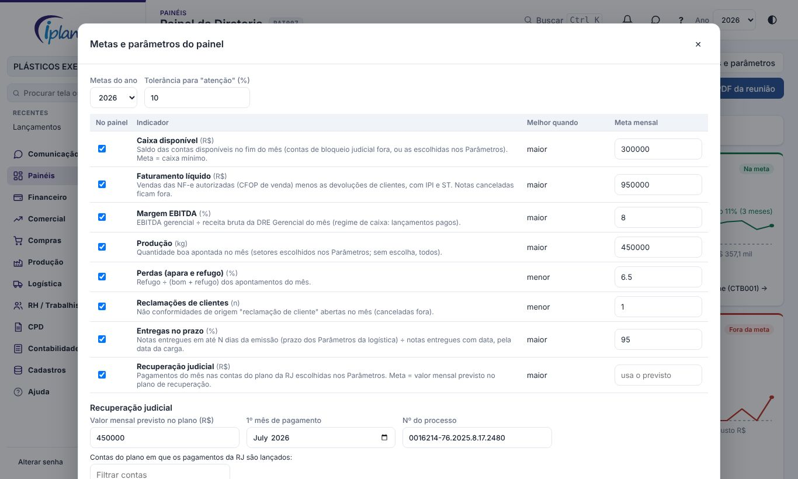
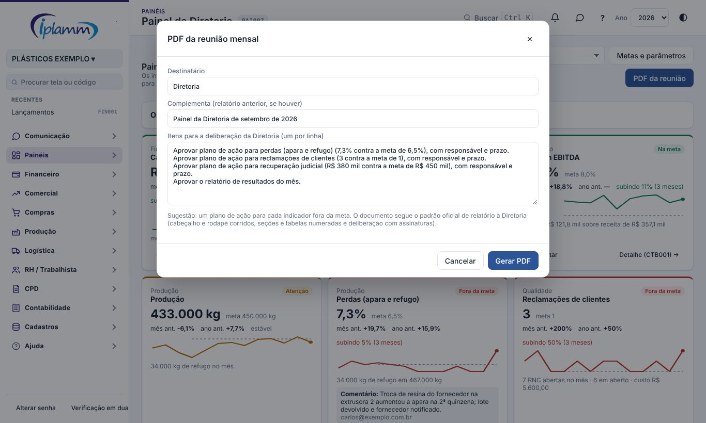
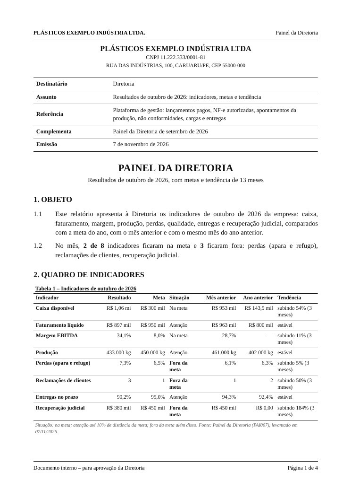
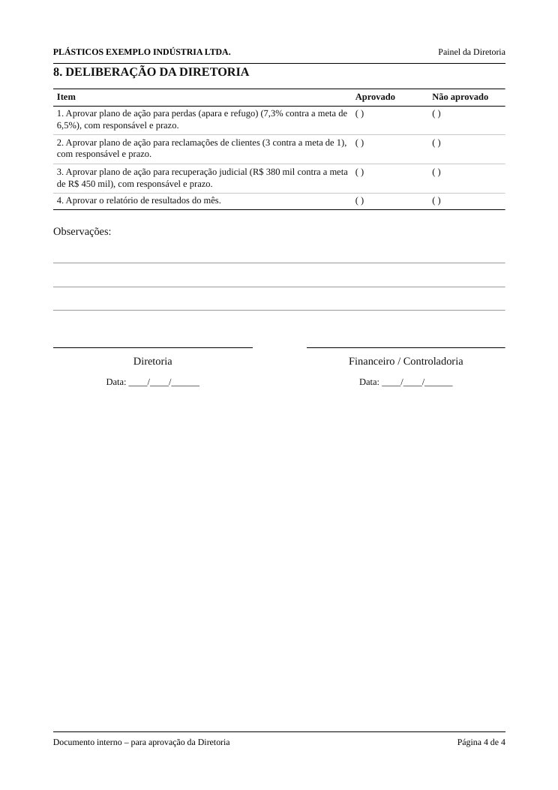

## 1. Para que serve

Mostra **em uma página** os oito indicadores que a Diretoria acompanha todo mês:

- caixa;
- faturamento;
- margem;
- produção;
- perdas;
- qualidade;
- entregas;
- recuperação judicial.

Cada um vem com:

- a **meta** do ano;
- a **situação**;
- a comparação com o mês anterior e com o mesmo mês do ano anterior;
- a **tendência** de 13 meses;
- o atalho para a tela de detalhe.

O botão **PDF da reunião** gera o relatório do mês no padrão oficial de relatório à Diretoria, com a deliberação para assinatura.

## 2. Quem tem acesso

| Perfil | O que faz |
|---|---|
| Administrador e diretor | Veem o painel, comentam, geram o PDF e alteram as metas e os parâmetros. |
| Financeiro | Vê o painel, comenta e gera o PDF. |
| Leitura | Vê o painel e gera o PDF. |
| Compras, vendas e produção | Não veem o painel. |

## 3. O painel

No alto, escolha o **mês**. O padrão é o mês anterior, que é o mês da reunião. O mês atual aparece como "parcial". A faixa de resumo conta quantos indicadores estão:

- na meta;
- em atenção;
- fora da meta;
- sem meta.

### 3.1 O cartão do indicador

Cada cartão mostra:

- a **área** e o **nome**, com a **situação** no canto;
- o **resultado do mês**, em destaque, e a **meta**;
- **mês ant.** e **ano ant.**: a variação sobre o mês anterior e sobre o mesmo mês do ano anterior;
- a **tendência**: a média dos 3 últimos meses contra a dos 3 anteriores. Fica verde quando melhora e vermelha quando piora, conforme o sentido do indicador (para perdas e reclamações, cair é bom);
- o **gráfico de 13 meses**, com a meta tracejada;
- uma linha de apoio, por exemplo vendas e devoluções ou RNCs em aberto;
- o **comentário** do responsável, quando houver;
- **Detalhe**: abre a tela de origem, com o código.

A situação segue estas regras:

| Situação | Quando |
|---|---|
| Na meta | Atingiu a meta. |
| Atenção | Não atingiu, mas está a até 10% da meta (tolerância ajustável). |
| Fora da meta | Mais longe que a tolerância. |
| Sem meta | Meta não definida para o ano. |

Os indicadores e as regras de cálculo:

| Indicador | Como é calculado | Melhor quando |
|---|---|---|
| Caixa disponível | Saldo das contas disponíveis no fim do mês. As contas de bloqueio judicial ficam fora (ou entram só as escolhidas nos Parâmetros). Meses passados = saldo de hoje menos o movimento pago dos meses seguintes. | Maior |
| Faturamento líquido | Vendas das NF-e autorizadas (CFOP de venda), menos as devoluções de clientes, com IPI e ST. É a mesma regra do relatório de faturamento das Notas Fiscais. | Maior |
| Margem EBITDA | EBITDA gerencial ÷ receita bruta da DRE Gerencial (regime de caixa). | Maior |
| Produção | Quantidade boa apontada no mês, nos setores escolhidos nos Parâmetros. | Maior |
| Perdas (apara e refugo) | Refugo ÷ (bom + refugo) dos apontamentos. | Menor |
| Reclamações de clientes | Não conformidades de origem "reclamação de cliente" abertas no mês. | Menor |
| Entregas no prazo | Notas entregues em até N dias da emissão (prazo dos Parâmetros da Logística) ÷ notas entregues com data. | Maior |
| Recuperação judicial | Pagamentos do mês nas contas do plano da RJ. A meta é o valor mensal previsto, a partir do 1º mês de pagamento. | Maior |

### 3.2 Evolução de 13 meses

Abaixo dos cartões, uma tabela mostra os 13 meses de cada indicador. Os meses que não atingiram a meta aparecem em vermelho. Em **Como cada indicador é calculado** estão as regras acima.

## 4. Comentários

Clique em **Comentar** no cartão e explique o resultado e o que está sendo feito. Por exemplo: "troca de resina do fornecedor aumentou a apara; lote devolvido".

O comentário vale para o mês escolhido. Aparece no cartão e no PDF da reunião, com o seu nome. Para mudar, use **Editar comentário**. Para tirar, use **Apagar**.

## 5. Metas e parâmetros

Só administrador e diretor. Clique em **Metas e parâmetros**.

**Metas**

1. Escolha o **ano**.
2. Informe a **meta mensal** de cada indicador. Em branco, o indicador fica sem meta.
   - Recuperação judicial em branco usa o valor previsto no plano.
   - Entregas em branco usa a meta da Logística.
3. Marque em **No painel** os indicadores que aparecem.

**Tolerância para "atenção"**: a distância da meta, em %, que ainda conta como atenção. O padrão é 10%.

**Recuperação judicial**

- o valor mensal previsto no plano;
- o **1º mês de pagamento** (antes dele não há meta);
- o nº do processo, que aparece no PDF;
- as **contas do plano** em que os pagamentos da RJ são lançados. Use o filtro para achar.

**Produção**: marque os setores que contam na produção. Para não somar a mesma bobina duas vezes, marque só o setor final. Sem marcar nada, entram todos.

**Caixa**: marque as contas do caixa disponível. Sem marcar nada, entram todas, menos as de bloqueio judicial.

## 6. PDF da reunião

1. Clique em **PDF da reunião**.
2. Confira o **destinatário** e o relatório que este complementa (o painel do mês anterior).
3. Revise os **itens da deliberação**, um por linha. A plataforma sugere um plano de ação para cada indicador fora da meta e a aprovação do relatório.
4. Clique em **Gerar PDF**. Abre uma janela com o documento e o diálogo de impressão. Escolha **Salvar como PDF**.

O documento segue o **padrão oficial de relatório à Diretoria**:

- cabeçalho e rodapé em todas as páginas, com "Página X de Y";
- bloco da empresa e quadro de identificação;
- **Objeto**;
- **Quadro de indicadores** (Tabela 1);
- **Análise por indicador**, com os comentários;
- **Evolução dos últimos 6 meses** (Tabela 2);
- **Recuperação judicial**;
- **Considerações**;
- **Fontes**: as telas da plataforma;
- **Deliberação da Diretoria**, em página nova, com aprovado / não aprovado, observações e as duas assinaturas.

## 7. Dúvidas frequentes

**Um indicador aparece com "—".** Não há dado no mês. Por exemplo: nenhuma nota importada, nenhum apontamento ou nenhuma carga com entrega registrada. Confira a tela de detalhe.

**A margem do mês passado mudou.** A DRE Gerencial é por regime de caixa: um pagamento lançado depois, com data do mês passado, muda a margem daquele mês.

**O caixa de um mês antigo não bate com o extrato.** O caixa de meses passados é reconstituído pelo saldo de hoje e pelo movimento pago. Lançamentos sem conta ou transferências para contas fora da seleção causam diferença. Para o saldo exato de um dia, use a Conferência do Dia.

**A recuperação judicial aparece fora da meta antes do plano começar.** Informe o **1º mês de pagamento** nos Parâmetros.

## 8. Histórico de alterações

| Versão | Data | O que mudou |
|---|---|---|
| 1.0 | 07/11/2026 | Primeira versão: oito indicadores com meta, situação, tendência e detalhe; comentários; metas e parâmetros; PDF da reunião no padrão de relatório à Diretoria. |
