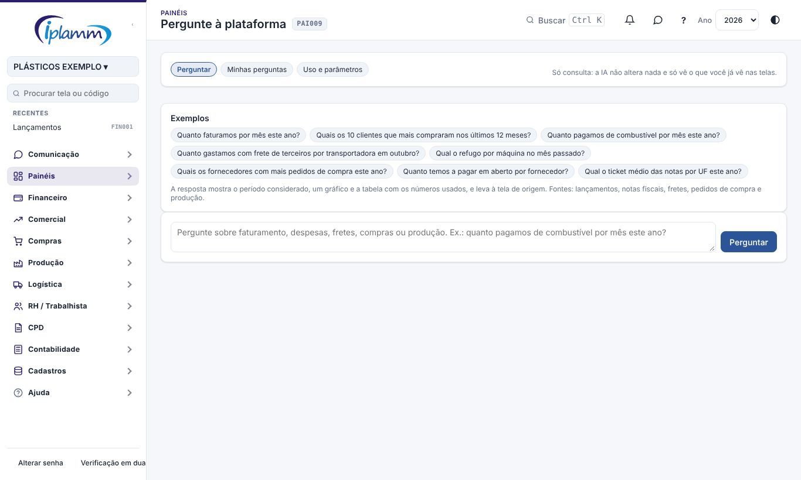
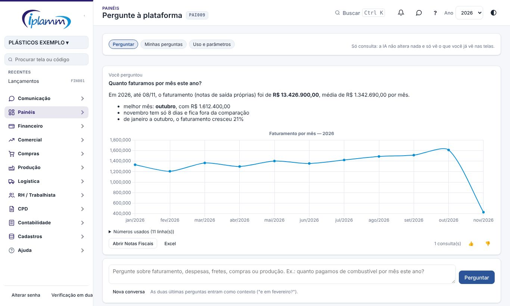
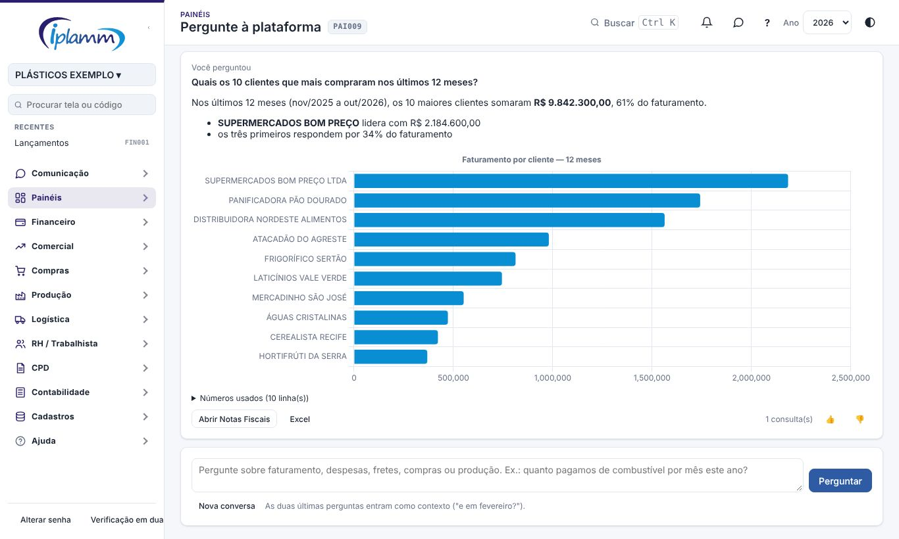
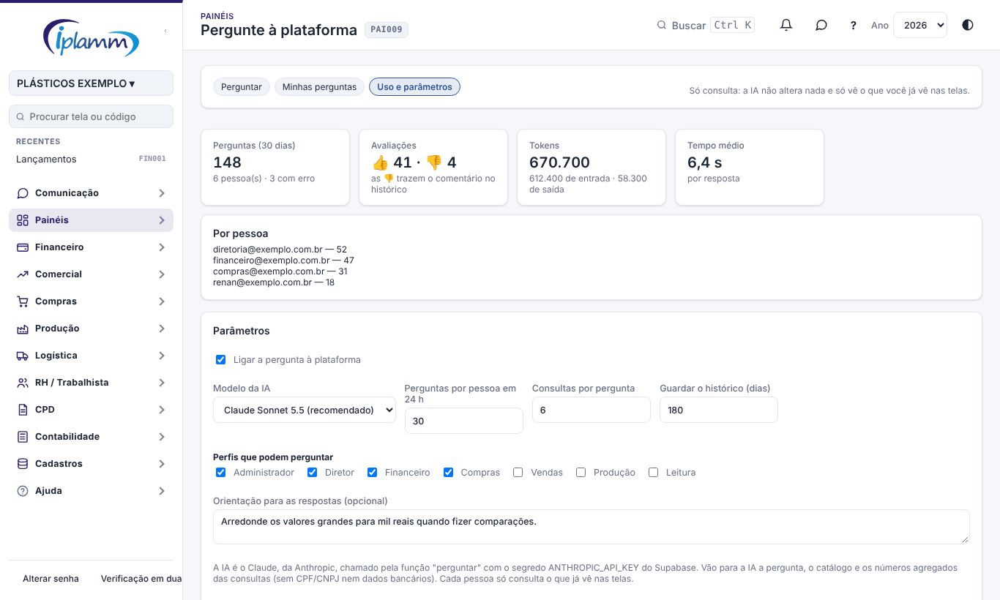

## 1. Para que serve

Responde, em português, perguntas sobre os dados da empresa, como:

- "quanto faturamos por mês este ano?";
- "quanto pagamos de combustível em outubro?";
- "qual o refugo por máquina no mês passado?".

A resposta vem com:

- o **período** considerado;
- um **gráfico**;
- os **números usados**;
- o link para a **tela de origem**, onde você confere o detalhe.

A IA é o **Claude**, da Anthropic.

**Só consulta.** A IA não lança, não aprova e não altera nada. Ela também só vê o que **você** já vê nas telas: as mesmas regras de acesso valem aqui.

## 2. Perguntar

1. Abra **Painéis › Pergunte à plataforma**.
2. Escreva a pergunta e tecle **Enter** (ou clique em **Perguntar**). Você também pode clicar num dos exemplos.

A resposta traz:

- o texto, com o período e os números principais;
- o **gráfico**: linha quando é ao longo do tempo, barras quando é um ranking. Os números do gráfico saem da consulta ao banco, não do texto da IA;
- **Números usados**: a tabela da consulta. Clique para abrir. O botão **Excel** baixa a tabela;
- **Abrir a tela**: leva à tela de origem (Notas Fiscais, Lançamentos, Fretes, Pedidos de compra ou Produção);
- **👍 / 👎**: diga se a resposta estava certa. No 👎, conte o que estava errado, porque isso ajuda a melhorar as respostas.

A conversa guarda as **duas últimas perguntas** como contexto. Depois de "quanto faturamos em outubro?", pode perguntar só "e em setembro?". Para começar outro assunto, clique em **Nova conversa**.

### 2.1 Dicas para perguntar

- Diga o **período**: "em outubro", "este ano", "nos últimos 12 meses". Sem período, a IA usa o ano corrente até hoje e avisa.
- Diga **como quer ver**: "por mês", "por cliente", "por máquina", "os 10 maiores".
- **Faturamento** = notas fiscais de saída emitidas pela empresa. **Despesas** e **receitas** vêm dos lançamentos do financeiro, sem as transferências entre contas.
- Se a pergunta sai do que a IA consegue consultar, ela diz isso e indica a tela.

## 3. O que dá para perguntar

| Fonte | Medidas | Por |
|---|---|---|
| Lançamentos do financeiro | valor, saldo (entradas − saídas), quantidade, média | mês, ano, dia, conta do plano, classe, favorecido, centro de custo, conta bancária, situação, entrada/saída |
| Notas fiscais (autorizadas) | valor, produtos, frete, ICMS, IPI, quantidade, ticket médio | mês, ano, dia, cliente, fornecedor, UF, natureza, CFOP |
| Fretes de terceiros | valor, pedágio, km, quantidade, média | mês, ano, transportadora, destino, placa |
| Pedidos de compra | valor, quantidade, média | mês, ano, fornecedor, situação |
| Produção (apontamentos) | kg, refugo, refugo %, horas, quantidade | mês, ano, dia, máquina, setor, turno, operador |

Cada fonte tem os seus filtros: situação, tipo, conta do plano, nome do favorecido, CFOP, UF, máquina e outros. A IA escolhe sozinha. **Minhas perguntas** guarda o histórico, para rever qualquer resposta com o gráfico.

## 4. Uso e parâmetros (administrador)

A aba **Uso e parâmetros** mostra os últimos 30 dias:

- perguntas, pessoas e erros;
- avaliações 👍 e 👎;
- tokens consumidos e tempo médio;
- perguntas por pessoa.

Os **parâmetros**:

- **ligar** a pergunta à plataforma (começa desligada);
- o **modelo** da IA:
  - Sonnet (recomendado);
  - Haiku (mais rápido e barato);
  - Opus (mais preciso e mais caro);
- **perguntas por pessoa** em 24 horas (padrão 30);
- **consultas por pergunta** (padrão 6);
- dias de **histórico** guardado (padrão 180). O histórico é apagado depois, todo domingo;
- **perfis** que podem perguntar (padrão: administrador, diretor e financeiro);
- uma **orientação** para as respostas (ex.: "arredonde para mil reais").

## 5. Segurança e privacidade

- A IA não escreve consultas ao banco. Ela escolhe, numa lista fechada, a fonte, a medida, o agrupamento e os filtros, e o banco monta a consulta. Pedidos fora da lista são recusados.
- A consulta roda com o **seu** acesso: quem não vê lançamentos na tela também não os vê aqui.
- Vão para a IA: a pergunta, a lista do que pode ser consultado e os **números agregados**. Não vão CPF/CNPJ, dados bancários nem documentos.
- Toda pergunta fica registrada, com as consultas usadas, os tokens e o tempo.

## 6. Problemas comuns

**"A IA está desligada ou o seu perfil não tem acesso".** O administrador liga a ferramenta e escolhe os perfis em **Uso e parâmetros**.

**"Falta configurar o segredo ANTHROPIC_API_KEY".** É a chave da conta da empresa na Anthropic. O administrador do Supabase cadastra a chave nos segredos das funções.

**"Limite de N perguntas em 24 horas atingido".** O administrador pode aumentar o limite nos parâmetros.

**A resposta não bateu com a tela.** Abra **Números usados**: lá aparecem o período e o agrupamento que a IA escolheu. Pergunte de novo dizendo o período e o filtro, e marque 👎 com o comentário.

## 7. Histórico de alterações

| Versão | Data | O que mudou |
|---|---|---|
| 1.0 | 08/11/2026 | Primeira versão: perguntas em português com resposta, gráfico, números usados, link da tela, avaliação, histórico, uso e parâmetros (melhoria 1.8). |
