## 1. Para que serve

O **Portal do Cliente** é uma área separada da plataforma, aberta ao cliente por convite. Nele o cliente:

- vê os **títulos** dele, em aberto e pagos;
- vê as **notas fiscais** e baixa o XML;
- vê o que comprou;
- **pede prorrogação** de um vencimento;
- **confere e aprova as artes** das embalagens dele, com pinos de comentário, comparação de versões e assinatura.

O vencimento **só muda** quando o Financeiro aprova o pedido nesta tela. O cliente nunca vê os dados de outros clientes nem as telas internas.

## 2. Quem tem acesso

| Perfil | O que faz |
|---|---|
| Administrador e financeiro | Aprovam ou recusam os pedidos de prorrogação. |
| Administrador, financeiro e diretor | Convidam clientes, bloqueiam e liberam acessos, cancelam convites. |

## 3. Passo a passo

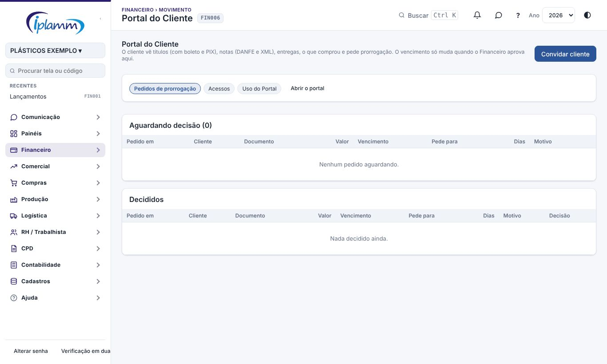

### 3.1 Convidar um cliente

1. Clique em **Convidar cliente**.
2. Escolha o **cliente** na lista (do cadastro de clientes) e informe o **e-mail de quem vai acessar**. Se o cadastro tiver e-mail, ele entra sozinho.
3. Clique em **Gerar convite** e depois em **Copiar link**.
4. Mande o link ao cliente por e-mail ou WhatsApp. **A plataforma não envia e-mail.**

O cliente abre o link, cria a própria senha e confirma o e-mail. O convite vale **14 dias**.

### 3.2 Decidir um pedido de prorrogação

Na aba **Pedidos de prorrogação**, a lista **Aguardando decisão** mostra cada pedido: o cliente, o documento, o valor, o vencimento atual, a nova data pedida, quantos dias a mais e o motivo.

- **Aprovar**: escreva, se quiser, uma mensagem para o cliente e confirme. O vencimento do título muda no contas a receber.
- **Recusar**: escreva o motivo. O cliente vê esse texto.

Os pedidos já decididos ficam em **Decididos**, com a resposta dada.

### 3.3 Gerenciar os acessos

Na aba **Acessos**:

- **Clientes com acesso**: o e-mail, a data em que começou, o último acesso e a situação. Use **Bloquear** e **Liberar**.
- **Convites pendentes**: **Copiar link** para mandar de novo, ou **Cancelar**.

**Abrir o portal** mostra o portal como o cliente o vê, numa nova aba.

### 3.4 O que o cliente faz com as artes

Quando a equipe de pré-impressão envia uma arte (manual **Pré-impressão**), o cliente vê um aviso no topo do portal e a aba **Artes para aprovar**, com o número de artes pendentes.

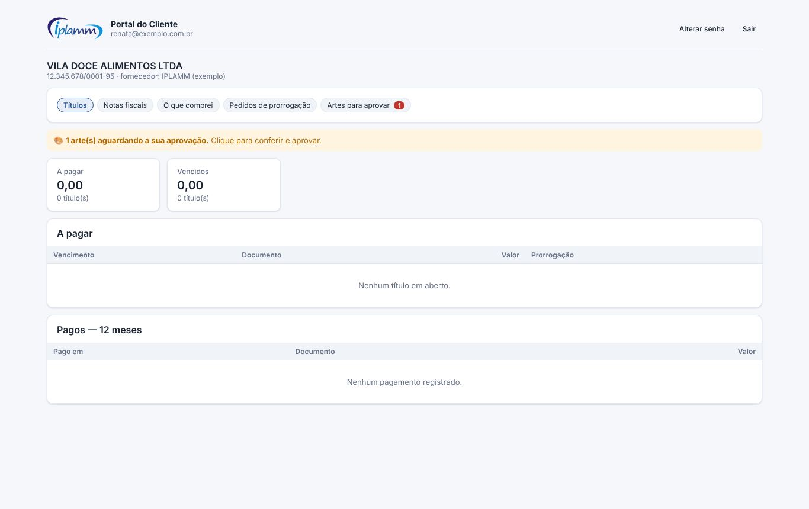

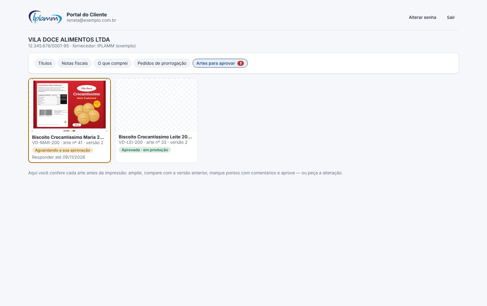

Ao abrir uma arte, o cliente vê:

- a ficha técnica: medidas, material, cores, código de barras conferido e posição de desbobinamento;
- a arte, com zoom, tela cheia e a opção **Comparar com a versão anterior** (cortina, lado a lado ou diferença);
- os comentários e a linha do tempo.

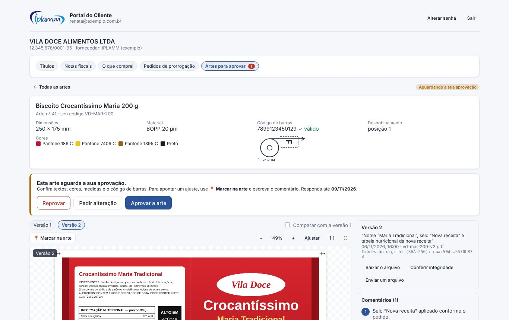

**Para pedir um ajuste**, ele clica em **📍 Marcar na arte**, clica no ponto, escreve o comentário e clica em **Comentar**. Depois clica em **Pedir alteração** (ou **Reprovar**) e explica o que precisa mudar.

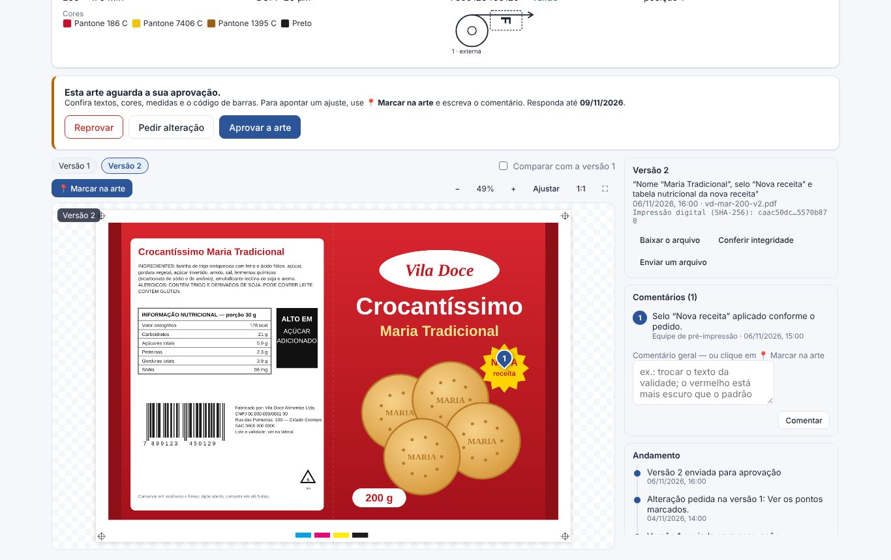

**Para aprovar**, ele clica em **Aprovar a arte**, lê a declaração, marca **Li e concordo**, digita o **nome completo** e confirma. Ficam gravados:

- o nome digitado e o usuário;
- a data e a hora;
- o IP e o navegador;
- a impressão digital (SHA-256) do arquivo aprovado.

Depois da aprovação, o botão **Comprovante** imprime o comprovante para o cliente.

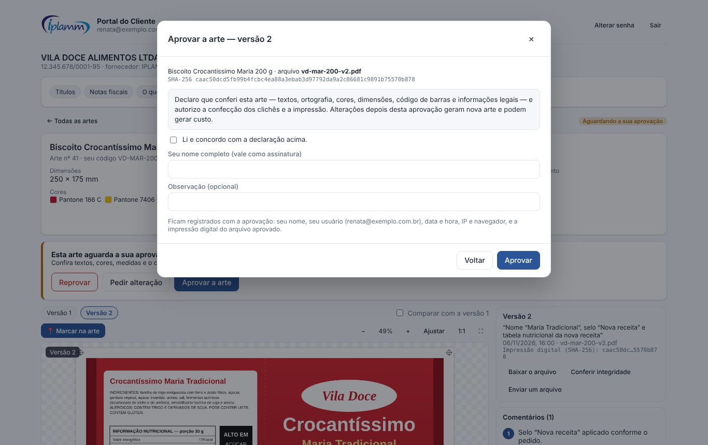

Mais ações do cliente:

- **Enviar um arquivo** (por exemplo, a arte da agência dele): a equipe recebe o arquivo, revisa e manda a versão para aprovação;
- **Baixar o arquivo** e **Conferir integridade**.

O portal funciona no celular.

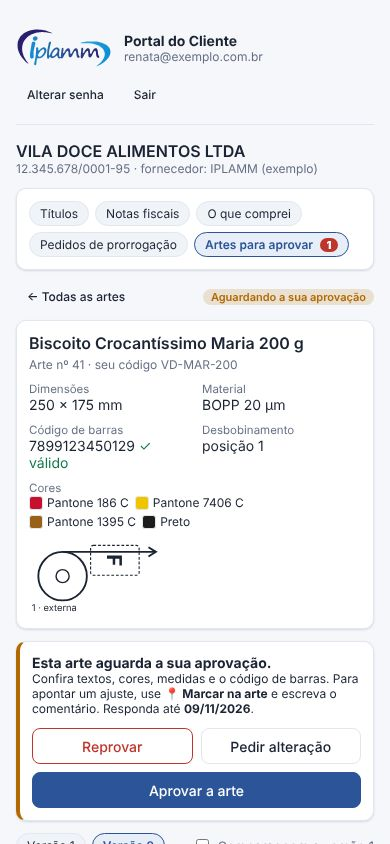

### 3.5 Títulos, notas e entregas (para o cliente)

- Em **Títulos**, o botão **Pagar com PIX** mostra o QR e o PIX copia e cola do título, com o valor (manual **Cobrança**).
- O botão **Boleto** aparece quando o financeiro anexou o boleto do título (manual **Cobrança**, item 3.3). O cliente copia a linha digitável ou abre o PDF.

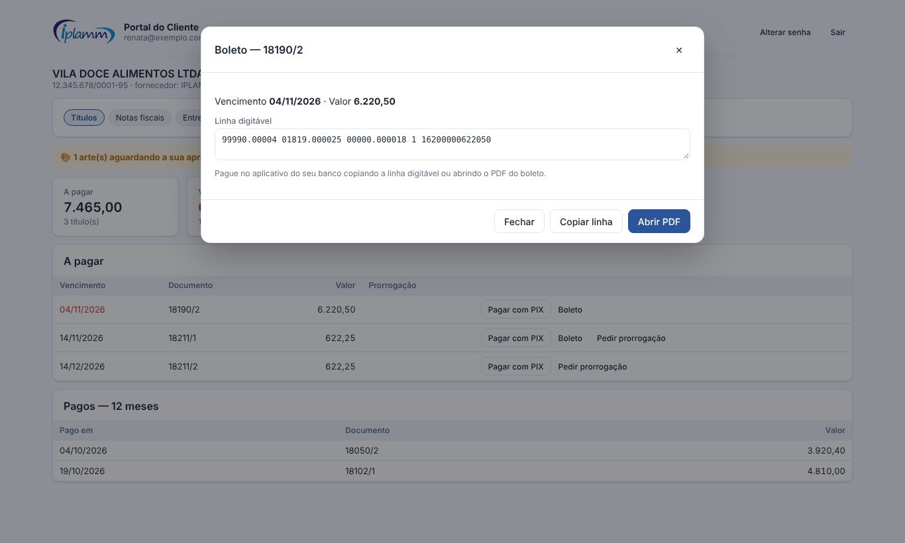

- Em **Notas fiscais**, o botão **DANFE** gera o PDF da nota a partir do XML autorizado, com o código de barras da chave de acesso. O botão **XML** baixa o arquivo da nota.

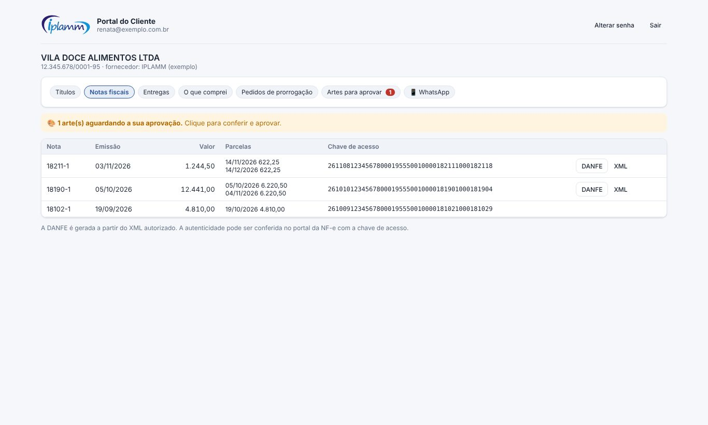

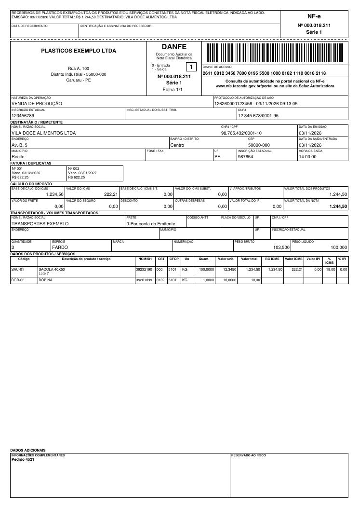

- A aba **Entregas** mostra as notas entregues pela frota da empresa: programada, saiu para entrega (com quantas entregas faltam antes da dele), entregue com quem recebeu e o **canhoto** assinado, ou não entregue. Os dados vêm do App do Motorista.
- O botão **📱 WhatsApp** cadastra o celular do cliente com o aceite: as mensagens de arte, prorrogação e entrega vão também pelo WhatsApp (manual **WhatsApp da Plataforma**).

### 3.6 Uso do Portal

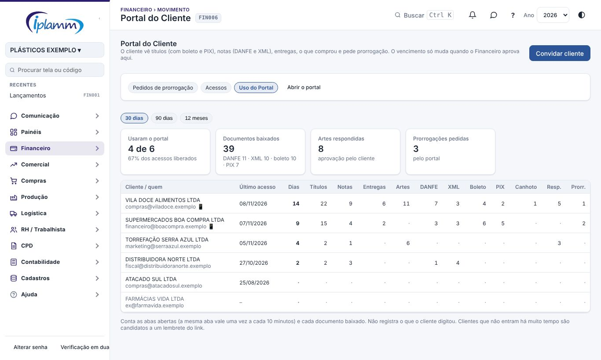

A aba **Uso do Portal** mostra, para cada acesso liberado, nos últimos 30 dias, 90 dias ou 12 meses:

- o último acesso e em quantos dias diferentes o cliente entrou;
- as abas que abriu (títulos, notas, entregas, artes);
- o que baixou (DANFE, XML, boleto, PIX e canhoto);
- as artes que respondeu e os pedidos de prorrogação. O 📱 indica quem aceitou receber avisos pelo WhatsApp.

No topo, quantos clientes usaram o portal no período e o total de documentos baixados. Quem não entra há muito tempo é candidato a um lembrete com o link do portal.

## 4. Regras e travas

- Um convite é para um cliente e um e-mail.
- Convite vencido ou cancelado não funciona. Gere outro.
- A prorrogação só vale depois de aprovada.
- Cliente bloqueado não entra mais no portal até ser liberado.
- O cliente só vê as artes dele que a equipe já enviou. Rascunhos e notas internas não aparecem.
- Só a última versão enviada pode ser aprovada, e só enquanto a arte aguarda o cliente.
- Arte aprovada não recebe arquivo do cliente: uma mudança depois da aprovação vira arte nova.
- O boleto só aparece enquanto o título está em aberto, e o link do PDF vale 10 minutos.
- Nota sem XML importado não tem DANFE nem XML no portal. Nota sem protocolo de autorização sai com a marca "NÃO AUTORIZADA".
- O uso do portal registra a aba aberta (uma vez a cada 10 minutos) e cada documento baixado, nunca o que o cliente digitou.

## 5. Perguntas frequentes e erros comuns

**O cliente não recebeu e-mail.** A plataforma não envia e-mail. Copie o link e mande você mesmo.

**A mensagem diz "Escolha o cliente da lista".** Selecione o nome exatamente como aparece na lista de clientes.

**O cliente não vê a aba de artes.** A aba aparece quando há pelo menos uma arte enviada a ele. Confira se a arte é do cadastro desse cliente e se a versão foi enviada.

**O cliente não vê uma nota.** A nota precisa estar importada em Notas Fiscais e ligada ao cadastro desse cliente.

**O cliente não vê o botão Boleto.** O financeiro ainda não anexou o boleto do título, ou o título já foi pago.

**O Uso do Portal está vazio.** O registro começou com esta versão: acessos anteriores não aparecem.

## 6. Histórico de alterações

| Versão | Data | O que mudou |
|---|---|---|
| 1.0 | 28/10/2026 | Primeira versão do manual: convites, pedidos de prorrogação e acessos. |
| 1.1 | 29/10/2026 | Imagens das telas, com dados fictícios. |
| 1.2 | 05/11/2026 | Nomes das telas iguais aos do menu, com o código da tela no cabeçalho. |
| 1.3 | 07/11/2026 | Aprovação de artes pelo cliente: aviso e aba de artes, pinos, comparação de versões, aprovação com declaração e assinatura, pedido de alteração, envio de arquivo, comprovante e celular. |
| 1.4 | 08/11/2026 | Aba Entregas (situação, fila e canhoto) e cadastro do WhatsApp com aceite. |
| 1.5 | 08/11/2026 | Pagar com PIX (QR e copia e cola) nos títulos em aberto. |
| 1.6 | 08/11/2026 | Boleto do título (linha digitável e PDF), DANFE em PDF gerada do XML e aba Uso do Portal. |
