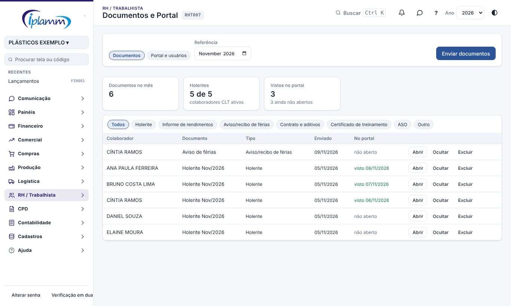
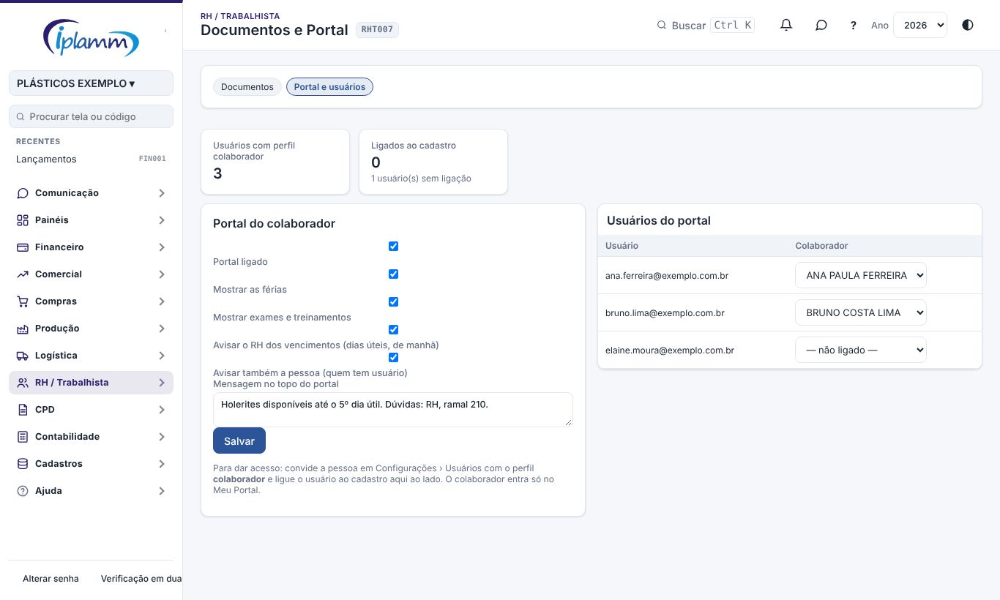
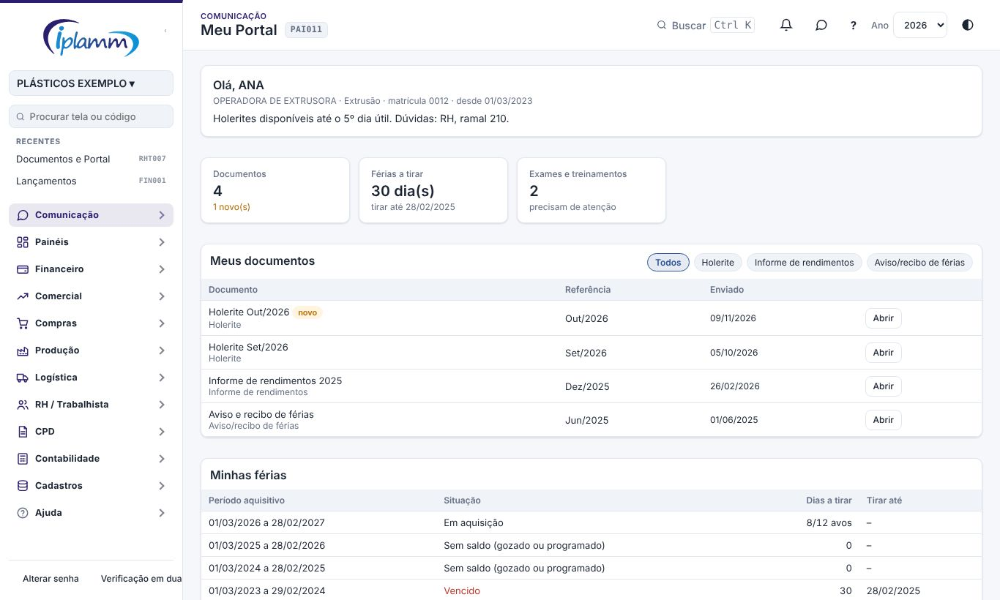
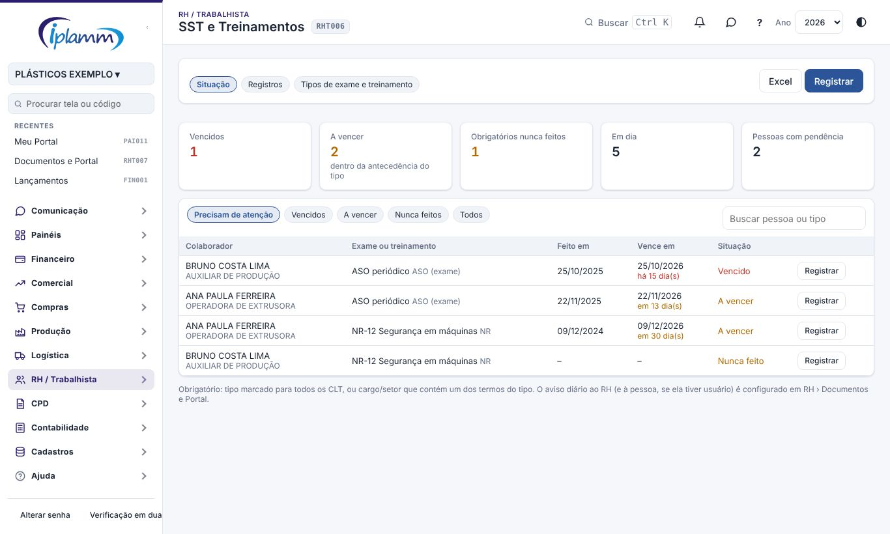
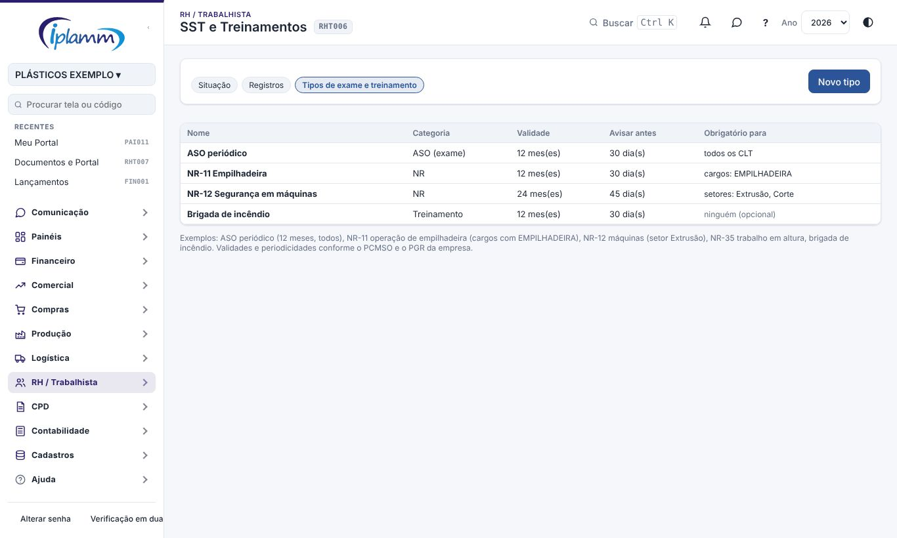

## 1. Para que serve

- **Documentos e Portal:** o RH envia holerites, informes de rendimentos, avisos de férias e outros documentos para cada colaborador e acompanha quem já abriu.
- **Meu Portal:** cada colaborador entra com o próprio usuário e vê só os documentos, as férias e os exames e treinamentos dele.
- **SST e Treinamentos:** ASO, NR e treinamentos com validade e obrigatoriedade por cargo ou setor, a situação de cada pessoa e um aviso diário dos vencimentos.

Documentos e SST são do administrador e de quem tem a área **RH** liberada. O colaborador entra com o perfil **colaborador** e só vê o Meu Portal e os avisos dele.

## 2. Enviar documentos

Em **RH › Documentos e Portal**, aba **Documentos**, escolha a **referência** (mês) e clique em **Enviar documentos**:

1. escolha o **tipo** (holerite, informe de rendimentos, aviso de férias, contrato, certificado, ASO, outro) e confira o **título**;
2. selecione **vários arquivos de uma vez** (PDF ou imagem);
3. cada arquivo é ligado à pessoa pelo **CPF**, pela **matrícula** ou pelo **nome** que estiver no nome do arquivo; confira e escolha quem não foi achado;
4. **Enviar**.

Os arquivos ficam num espaço **privado**: o RH vê todos, e cada colaborador só os dele. A coluna **No portal** mostra quando a pessoa abriu. **Ocultar** tira do portal sem apagar; **Excluir** apaga.

## 3. Portal e usuários

Na aba **Portal e usuários**:

- ligar ou desligar o portal, mostrar ou não as férias e os exames, e uma **mensagem** no topo do portal;
- **avisos de SST**: aviso diário ao RH (dias úteis, de manhã) e, se marcado, à própria pessoa;
- **Usuários do portal**: cada usuário convidado com o perfil **colaborador** (Configurações › Usuários) é ligado ao cadastro da pessoa aqui.

## 4. Meu Portal (visão do colaborador)

O colaborador vê:

- **Meus documentos**, com os novos marcados; **Abrir** baixa o arquivo e registra a ciência;
- **Minhas férias**: períodos aquisitivos, dias a tirar, prazo e as férias programadas;
- **Meus exames e treinamentos**: feito em, vence em e situação.

Qualquer usuário ligado a um cadastro de colaborador (inclusive de outros perfis) vê o Meu Portal no menu Comunicação.

## 5. SST e treinamentos

Em **RH › SST e Treinamentos**, aba **Situação**, cada pessoa ativa aparece com os exames e treinamentos que se aplicam a ela:

| Situação | Quando |
|---|---|
| Vencido | a validade passou |
| A vencer | vence dentro da antecedência do tipo |
| Nunca feito | obrigatório para a pessoa e sem registro |
| Em dia | dentro da validade (ou tipo sem validade) |

Filtros, busca e **Excel**. **Registrar** (na linha ou no topo) grava o que foi feito: tipo, data, resultado (apto, apto com restrição, inapto, concluído, reprovado), carga horária, instrutor ou clínica — para **várias pessoas de uma vez** (turma). O vencimento sai da validade do tipo. A aba **Registros** lista tudo o que foi registrado.

## 6. Tipos de exame e treinamento

Na aba **Tipos**: nome, categoria (ASO, NR, treinamento, outro), **validade em meses** (vazio = não vence), **avisar quantos dias antes** e **para quem é obrigatório**: todos os CLT, cargos que contêm um termo (ex.: EMPILHADEIRA) ou setores que contêm um termo (ex.: Extrusão).

> As validades e periodicidades seguem o PCMSO e o PGR da empresa. Confira com o médico do trabalho e o técnico de segurança.

## 7. Problemas comuns

**O colaborador entra e vê "usuário não ligado".** Ligue o usuário ao cadastro em Documentos e Portal › Portal e usuários.

**Arquivo não foi ligado a ninguém.** O nome do arquivo não tem CPF, matrícula nem o nome completo: escolha a pessoa na lista antes de enviar.

**Pessoa sem a NR na situação.** O cargo ou o setor do cadastro não contém o termo do tipo; ajuste o tipo ou o cadastro.

## 8. Histórico de alterações

| Versão | Data | O que mudou |
|---|---|---|
| 1.0 | 08/11/2026 | Primeira versão: documentos do RH por colaborador, Meu Portal com ciência, SST e treinamentos com vencimento, obrigatoriedade e aviso diário (melhoria 8.2). |
