## 1. Para que serve

Levar cada arte de embalagem da criação até a máquina sem retrabalho e com prova do que o cliente aprovou:

- **ficha técnica da embalagem**: cliente, produto, OP, largura e passo, substrato, tipo de impressão, cores na ordem das estações (ligadas às cores da Casa de Tintas), código de barras com o dígito conferido e a posição de desbobinamento (1 a 8);
- **versões que não mudam**: cada arquivo enviado vira uma versão nova, com a **impressão digital (SHA-256)** calculada no navegador. O PDF vira prévia em imagem, e as medidas da página são conferidas com a ficha;
- **checklist de pré-impressão** antes de a arte ir ao cliente;
- **comentários com pinos** na arte: os do cliente, os da equipe e as notas internas, que o cliente não vê;
- **comparação de versões**: lado a lado, cortina e **diferença** (o que mudou aparece em vermelho, com a % da área);
- **aprovação do cliente no Portal do Cliente**, só da última versão enviada. Ficam registrados o termo aceito, o nome digitado, o usuário, a data e a hora, o IP, o navegador e o SHA-256 do arquivo. A aprovação gera o **certificado de aprovação** em PDF;
- **clicheria**: envio, previsão, custo e recebimento. O clichê entra nas ferramentas da produção;
- **liberação para a produção** e, se ligada, a **trava da OP**: a OP não começa enquanto a arte mais recente do produto não estiver aprovada.

## 2. Quem tem acesso

| Perfil | O que faz |
|---|---|
| Administrador, financeiro, diretor e produção | Criam artes, enviam versões, comentam, enviam ao cliente e cuidam da clicheria. |
| Vendas | O mesmo, só nas artes dos clientes da própria carteira. |
| Leitura | Vê as artes. |
| Administrador, diretor e financeiro (muda nos Parâmetros) | Registram a decisão recebida por e-mail e liberam para a produção. O administrador sempre pode. |
| Cliente, no Portal do Cliente | Vê só as artes dele que já foram enviadas. Comenta, aprova, pede alteração, reprova e envia arquivos. Nunca vê os rascunhos nem as notas internas. |

## 3. Primeiros passos

1. Rode o SQL 089 (pré-impressão) no Supabase.
2. Em **Artes e Aprovações**, clique em **Parâmetros** e revise:
   - o checklist;
   - o prazo de resposta do cliente;
   - o termo de aprovação;
   - quem libera para a produção;
   - a trava da OP.
3. Convide o cliente para o Portal do Cliente (Financeiro › Portal do Cliente), se ele ainda não tiver acesso.
4. Crie a primeira arte e envie o PDF.

## 4. Painel da Pré-impressão

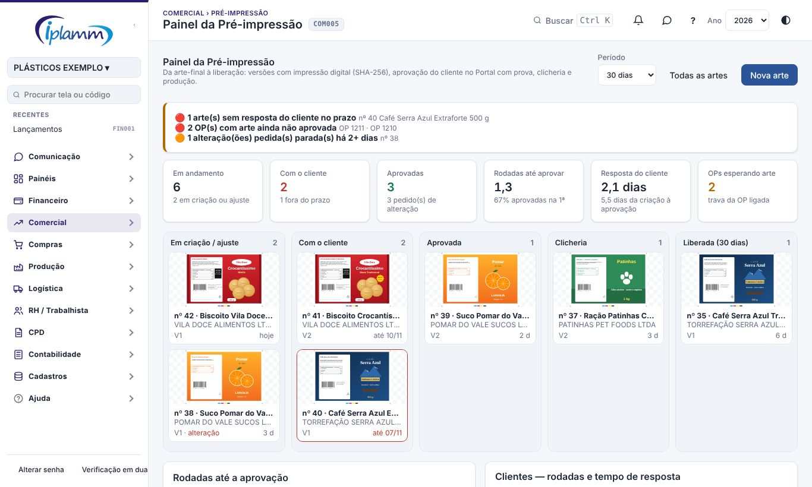

**Alertas.** O painel avisa de:

- arte sem resposta do cliente no prazo;
- OP de produto cuja arte não está aprovada;
- alteração pedida parada há 2 dias ou mais;
- clichê atrasado;
- arte aprovada que ainda não foi liberada.

Os mesmos alertas vão para a Central de Decisões (regra 21).

**Indicadores do período:**

- artes em andamento;
- artes com o cliente (e quantas estão fora do prazo);
- artes aprovadas;
- **rodadas até aprovar**: quantas versões foram ao cliente até a aprovada, e a % aprovada na primeira;
- **tempo de resposta do cliente**;
- OPs esperando arte.

**Quadro.** As artes aparecem por etapa, com a miniatura da última versão: criação ou ajuste, com o cliente, aprovada, clicheria e liberada. Clique num cartão para abrir a ficha.

Abaixo do quadro ficam:

- a distribuição das rodadas;
- os clientes com mais rodadas e o tempo de resposta de cada um;
- as OPs que esperam arte.

## 5. Artes e Aprovações

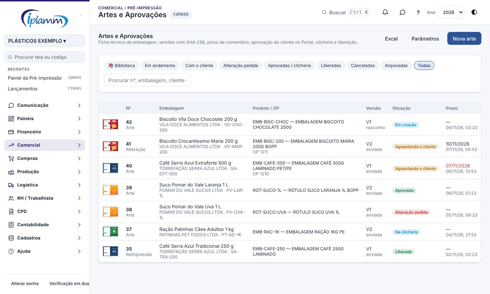

Filtros: em andamento, com o cliente, alteração pedida, aprovadas, liberadas, canceladas, arquivadas e todas. A busca procura pelo número, pela embalagem, pelo cliente, pelo código no cliente e pelo código de barras. O botão Excel exporta a lista.

### 5.1 Nova arte

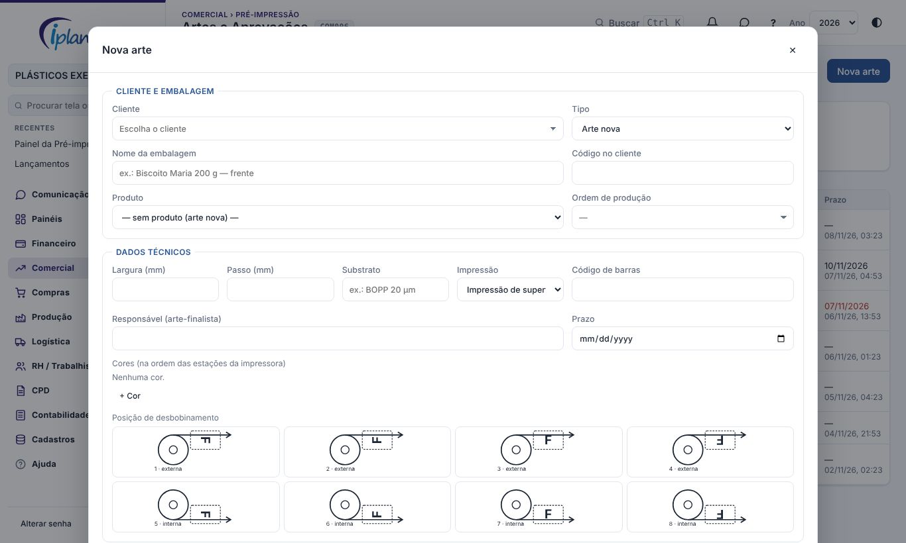

1. Clique em **Nova arte** e escolha:
   - o cliente;
   - o tipo: arte nova, alteração ou reimpressão;
   - o produto e a OP, se já existirem.
2. Preencha os dados técnicos:
   - largura e passo, em mm;
   - substrato;
   - impressão: superfície, verso ou verso para laminação;
   - código de barras. A plataforma confere o dígito do EAN-13, EAN-8, UPC-A ou DUN-14 enquanto você digita;
   - responsável e prazo.
3. Em **Cores**, use uma linha por estação. Escolha a cor da Casa de Tintas quando ela existir.
4. Clique na **posição de desbobinamento** (externa ou interna; topo, pé, direita ou esquerda saindo primeiro).
5. Clique em **Criar e enviar o arquivo**.

### 5.2 Enviar uma versão

Na ficha, clique em **+ Nova versão** e arraste o arquivo. O PDF é o formato recomendado; também aceita PNG e JPG. AI, EPS e TIFF entram sem prévia. Antes de salvar, a plataforma mostra:

- a **prévia** da página 1;
- as **medidas da página do PDF** comparadas com a ficha (avisa se a página está girada);
- o **SHA-256** do arquivo;
- um aviso se o arquivo é idêntico a uma versão já enviada.

Escreva **o que mudou** e salve. A versão não muda depois: para corrigir, envie outra versão.

### 5.3 Checklist e envio ao cliente

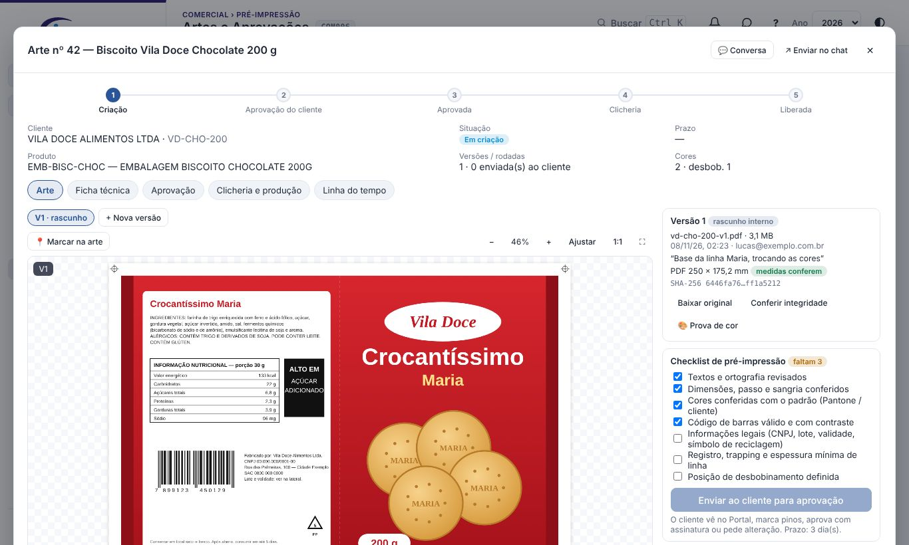

A versão nova fica como **rascunho interno**: o cliente não a vê. Para enviá-la:

1. Marque os itens do checklist.
2. Clique em **Enviar ao cliente para aprovação**. Com o checklist exigido nos Parâmetros, o botão só funciona com todos os itens marcados.

A arte passa para **Aguardando o cliente**, com o prazo de resposta dos Parâmetros. O cliente vê a versão no Portal.

### 5.4 Comentários e pinos

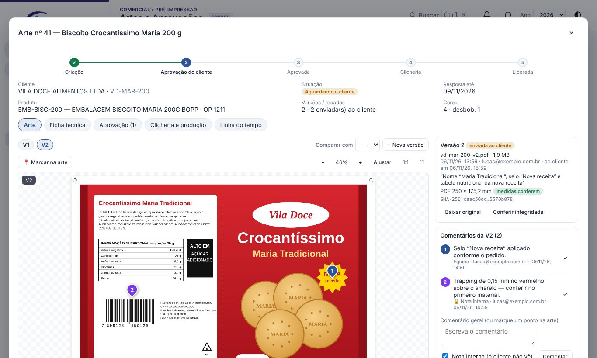

1. Clique em **📍 Marcar na arte** e clique no ponto da arte.
2. Escreva o comentário e clique em **Comentar**.

**Nota interna** vem marcada: o cliente não vê a nota. Desmarque para a equipe responder ao cliente.

Na lista, clicar num comentário leva a arte até o pino. O ✓ marca o comentário como resolvido.

Cores dos pinos:

- **vermelho**: do cliente;
- **azul**: da equipe;
- **roxo**: nota interna;
- **verde**: resolvido.

O visualizador amplia pelos botões, pela roda do mouse e com dois dedos no celular. Arraste para mover a arte; ⛶ abre em tela cheia.

### 5.5 Comparar versões

Em **Comparar com**, escolha a versão anterior. Há três modos:

- **Lado a lado**: as duas versões com o mesmo zoom;
- **Cortina**: arraste a divisória amarela sobre a arte;
- **Diferença**: o que mudou aparece em **vermelho**, com a % da área alterada. É o jeito mais rápido de conferir se só mudou o que o cliente pediu.

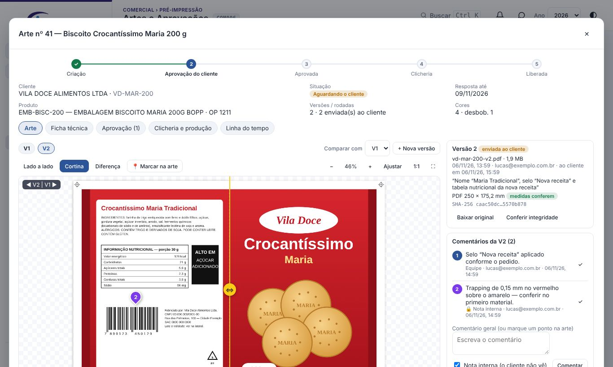

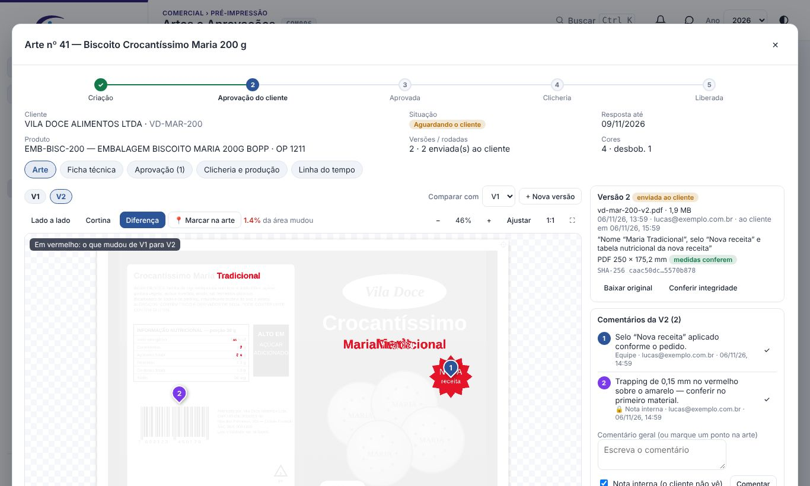

### 5.6 Aprovação, prova e certificado

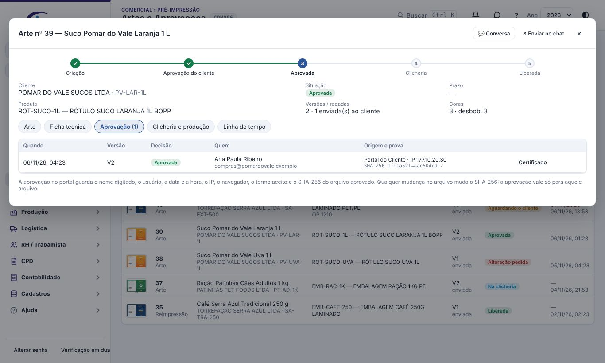

**Decisões do cliente.** O cliente decide no Portal. As decisões possíveis são:

- **aprovar**: ele marca a declaração e digita o nome completo;
- **pedir alteração**: com comentário ou pinos;
- **reprovar**.

Só a **última versão enviada** pode ser decidida. Se a equipe já preparou uma versão nova, o cliente espera o envio dela.

**O que fica gravado em cada decisão:**

- o nome digitado e o usuário;
- a data e a hora;
- o IP e o navegador;
- o termo aceito;
- o SHA-256 da versão.

**Decisão recebida por e-mail ou mensagem.** Quem libera pode registrá-la na aba Aprovação, com o nome de quem decidiu e a **evidência** (cole o e-mail ou a mensagem, com data e remetente). A decisão fica marcada como "registrada pela equipe".

**Certificado de aprovação.** O botão **Certificado** gera o PDF com:

- a ficha técnica;
- a prévia aprovada;
- o arquivo e o SHA-256;
- quem aprovou, quando e de onde;
- o termo aceito;
- o histórico das rodadas;
- um QR que abre a arte na plataforma.

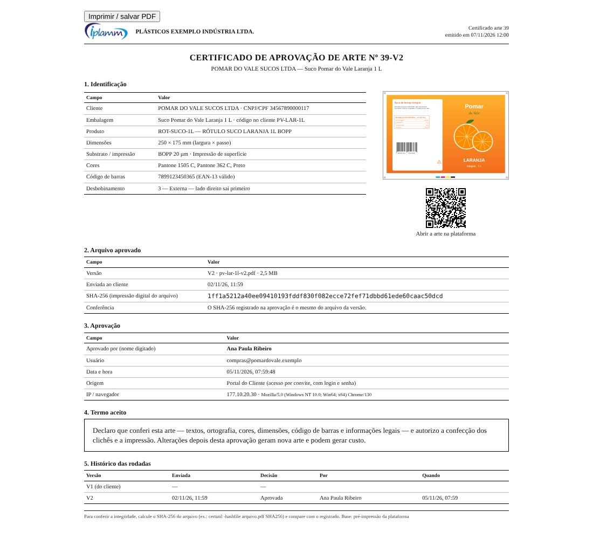

**Conferir integridade** baixa o arquivo guardado e recalcula o SHA-256. Se der o mesmo valor, o arquivo é exatamente o que foi aprovado.

### 5.7 Clicheria e produção

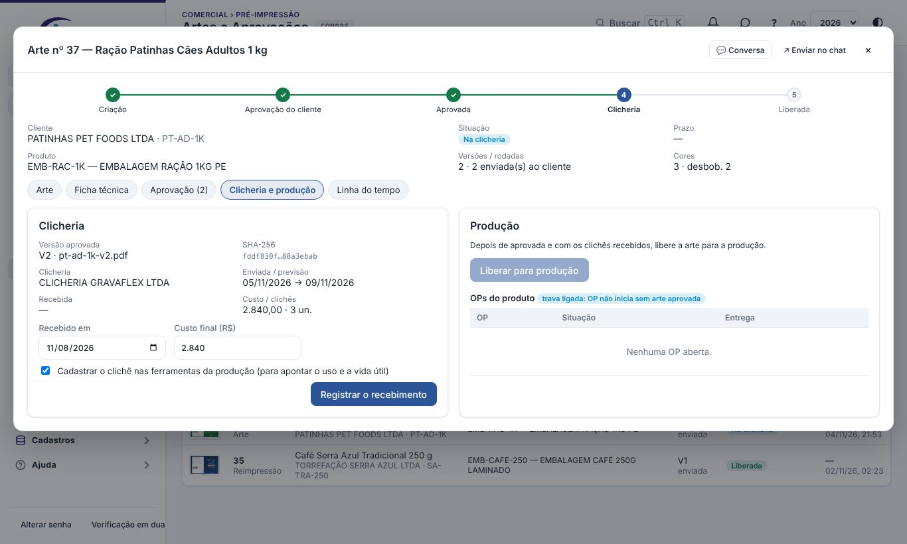

1. Com a arte aprovada, informe na aba **Clicheria e produção**:
   - a clicheria (fornecedor);
   - a data de envio e a previsão;
   - o custo e o número de clichês.
2. Clique em **Enviar para a clicheria**.
3. Quando os clichês chegarem, clique em **Registrar o recebimento**. Se a opção estiver marcada, o clichê é cadastrado nas **ferramentas da produção** com o código CL-nº da arte-versão aprovada.
4. Clique em **Liberar para produção**. Em reimpressão sem mudança, **Liberar sem clicheria** pula a clicheria.

A aba mostra as OPs abertas do produto. Com a trava ligada, a OP não passa para liberada nem para em produção enquanto a arte mais recente do produto não estiver aprovada. A ficha da OP mostra a arte do produto e a situação dela.

### 5.8 Ficha técnica, cancelar e arquivar

Na aba **Ficha técnica** você pode:

- editar os dados técnicos;
- **cancelar** a arte, informando o motivo;
- **arquivar** ou restaurar a arte;
- em arte aprovada, **duplicar como alteração**: cria uma arte nova (tipo alteração) com a mesma ficha.

A **Linha do tempo** guarda tudo o que aconteceu. Os eventos com ponto azul também aparecem para o cliente.

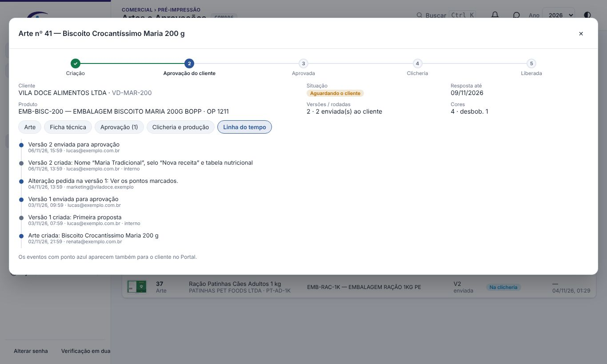

### 5.9 Biblioteca de artes

O filtro **📚 Biblioteca** mostra as artes de cada cliente, agrupadas. Cada cartão traz a prévia da versão em vigor (a aprovada ou, se ainda não houver, a última com prévia), o código da embalagem no cliente, o código de barras, as cores e a situação.

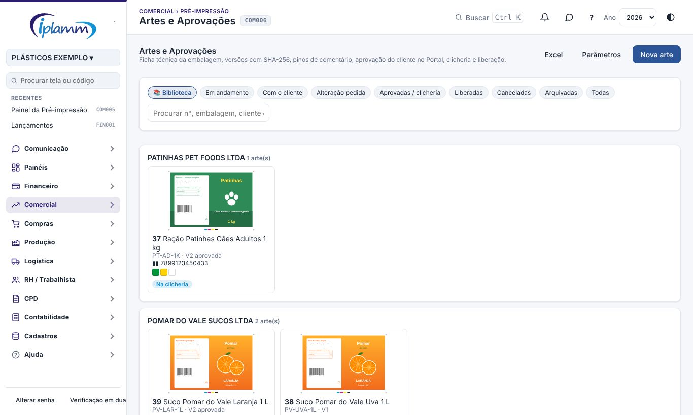

Para achar a arte de uma embalagem, leia o **código de barras** com o leitor no campo de busca (ou digite os números). A tela:

- confere o dígito verificador (EAN-8, UPC-A, EAN-13 ou DUN-14);
- diz se o prefixo é do Brasil;
- mostra as artes com esse código.

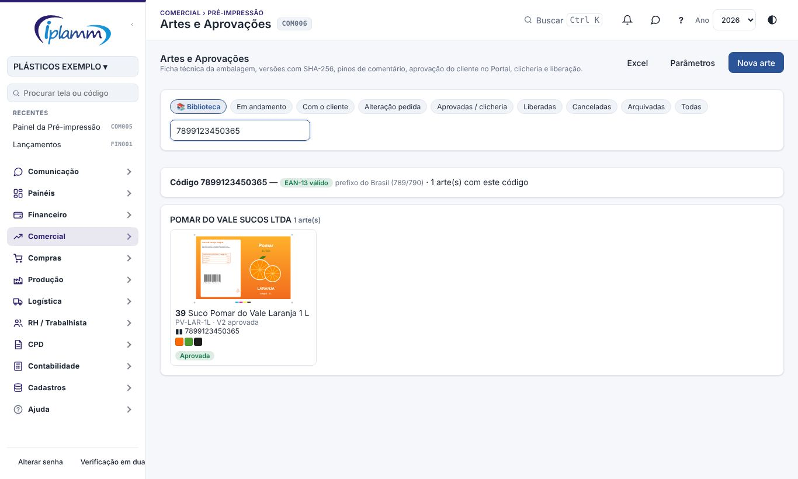

### 5.10 Prova de cor

Na aba **Arte**, o botão **🎨 Prova de cor** simula a versão com as **tintas reais** da Casa de Tintas. Cada cor da arte ligada a uma tinta (aba Ficha técnica) é trocada pela cor medida do padrão da tinta (Lab). Se a tinta não tiver Lab, a troca usa a cor de tela da tinta.

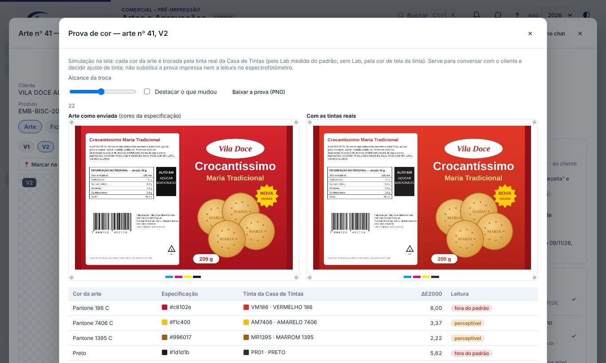

A tabela mostra cada cor com a especificação, a tinta e o **ΔE2000**, a diferença de cor que o olho percebe. A leitura segue as faixas dos Parâmetros:

- **aceitável**: até 2;
- **perceptível**: até 3,5;
- **fora do padrão**: acima disso.

Os controles da simulação:

- **Alcance da troca** define quanto das sombras e degradês próximos da cor também mudam;
- **Destacar o que mudou** deixa cinza o que não muda;
- **Baixar a prova (PNG)** salva a imagem para mandar ao cliente.

A prova de cor é uma simulação na tela: não substitui a prova impressa nem a leitura no espectrofotômetro. Use-a para decidir, antes da impressão, se a tinta precisa de ajuste ou se o cliente deve ser avisado da diferença.

### 5.11 Lembrete ao cliente

Quando a arte está aguardando o cliente, a plataforma manda **lembretes automáticos** por e-mail e WhatsApp, todo dia às 9h:

- o primeiro, 2 dias depois do envio;
- os seguintes, a cada 2 dias;
- no máximo 3 por versão.

Quando o último lembrete sai sem resposta, quem libera a produção recebe o aviso **Arte sem resposta do cliente**, para ligar para o cliente. Tudo é configurável nos Parâmetros.

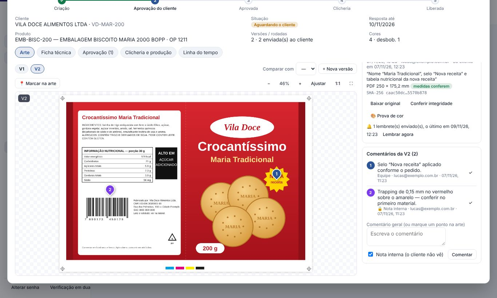

Na aba Arte, a versão enviada mostra quantos lembretes já saíram. **Lembrar agora** manda um lembrete na hora (no máximo um a cada 12 horas), que conta no limite. Uma versão nova enviada zera a contagem. Os lembretes ficam na Linha do tempo, só para a equipe.

## 6. Parâmetros

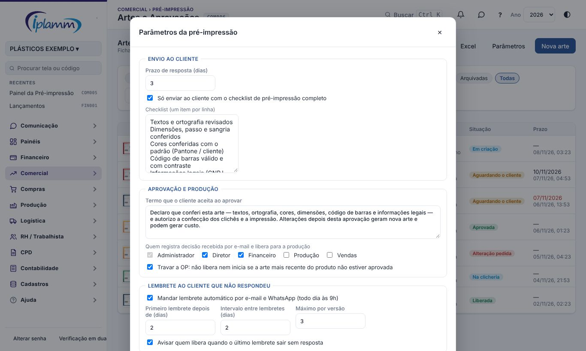

- **Prazo de resposta** do cliente, em dias.
- **Exigir o checklist completo** para enviar ao cliente, e os **itens do checklist** (um por linha).
- **Termo** que o cliente aceita ao aprovar.
- **Quem registra a decisão recebida por fora e libera para a produção.**
- **Trava da OP**.
- **Lembrete ao cliente**: ligar e desligar, primeiro lembrete depois de N dias, intervalo, máximo por versão e aviso à equipe no último (padrão 2, 2, 3 e ligado).
- **Prova de cor**: as faixas do ΔE2000 — aceitável até 2 e perceptível até 3,5.

## 7. O que o cliente vê no Portal

O cliente vê a aba **Artes para aprovar**, com um aviso no topo quando há arte pendente. A tela dele mostra:

- a ficha técnica e as cores;
- o código de barras conferido;
- a posição de desbobinamento;
- as versões que já foram enviadas a ele.

Nessa tela ele pode:

- comparar com a versão anterior;
- marcar pinos e comentar;
- aprovar, pedir alteração ou reprovar;
- baixar o arquivo e conferir a integridade;
- **enviar um arquivo**, por exemplo a arte da agência dele. O arquivo enviado pelo cliente volta a arte para **Em criação**, para a equipe revisar.

O passo a passo está no manual do Portal do Cliente.

## 8. Regras e travas

- O SHA-256 e o arquivo da versão não mudam. A versão enviada ao cliente também não muda: nem o checklist nem a observação.
- A situação da arte só muda pelos botões: enviar ao cliente, decisão, clicheria e liberar. Cancelar exige motivo.
- O cliente só decide a **última versão enviada**, e só quando a arte está aguardando o cliente.
- Para aprovar, o cliente marca a declaração e digita o nome.
- Para pedir alteração ou reprovar, o cliente escreve o motivo ou marca pinos.
- O cliente só lê os arquivos das versões que foram enviadas a ele. Rascunhos e notas internas ficam só com a equipe.
- A decisão registrada pela equipe exige a evidência e um perfil que libera.
- Só arte aprovada vai para a clicheria. A liberação só acontece com os clichês recebidos, ou sem clicheria, pelo botão próprio.
- Arte liberada, cancelada ou arquivada não recebe versão nova.
- Arquivos de até 50 MB.
- Lembrete só para arte aguardando o cliente, só para os usuários ativos do Portal daquele cliente (WhatsApp só para quem aceitou), no máximo um por dia e o limite por versão.

## 9. Perguntas frequentes e erros comuns

**O botão "Enviar ao cliente" está apagado.** Falta marcar itens do checklist. Se o checklist não for obrigatório, desmarque a opção nos Parâmetros.

**Enviei um AI e o cliente não vê nada.** AI, EPS e TIFF não têm prévia no navegador. Envie também o PDF da arte.

**"Só a última versão enviada pode ser decidida."** Existe uma versão mais nova. Confira na aba Arte e envie a versão mais nova ao cliente.

**A OP não libera.** A trava da OP está ligada e a arte mais recente do produto ainda não foi aprovada. Veja a arte na ficha da OP.

**O cliente aprovou por e-mail.** Registre na aba Aprovação, colando o e-mail como evidência. O certificado mostra que a decisão foi registrada pela equipe.

**A prova de cor não troca uma cor.** A cor da arte não está ligada a uma tinta da Casa de Tintas. Ligue na aba Ficha técnica.

**O cliente diz que não recebeu o lembrete.** Ele precisa estar ativo no Portal com o e-mail certo. O WhatsApp exige o aceite no Portal.

**Como sei que o arquivo da gráfica é o mesmo aprovado?** Use **Conferir integridade** ou calcule o SHA-256 do arquivo (no Windows: `certutil -hashfile arquivo.pdf SHA256`) e compare com o do certificado.

## 10. Histórico de alterações

| Versão | Data | O que mudou |
|---|---|---|
| 1.0 | 07/11/2026 | Primeira versão. Inclui ficha técnica com cores, código de barras conferido e desbobinamento, versões com SHA-256 e prévia do PDF, conferência das medidas, checklist, pinos, comparação lado a lado, em cortina e por diferença, aprovação do cliente no Portal com termo, nome e prova, decisão registrada por e-mail, certificado com QR, clicheria com cadastro do clichê, liberação, trava da OP e Central de Decisões. |
| 1.1 | 08/11/2026 | Biblioteca de artes por cliente com busca pelo código de barras, prova de cor com as tintas reais (ΔE2000) e lembrete automático ao cliente, com Lembrar agora. Parâmetros novos. |
