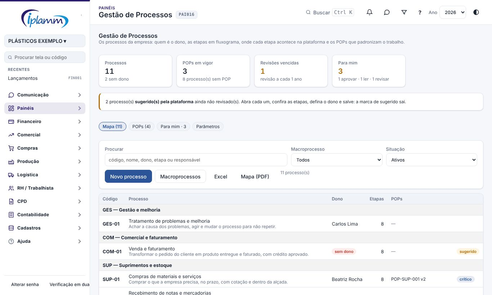
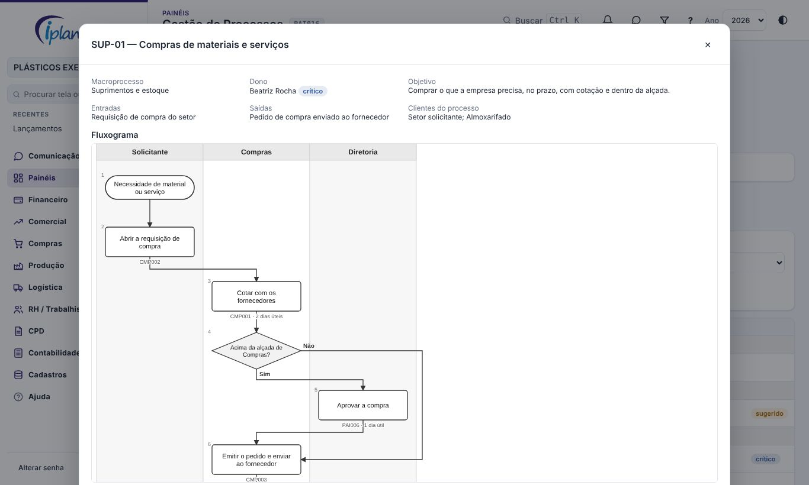
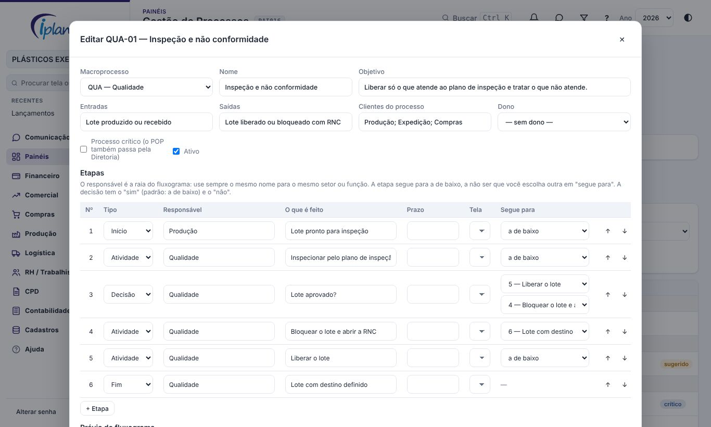
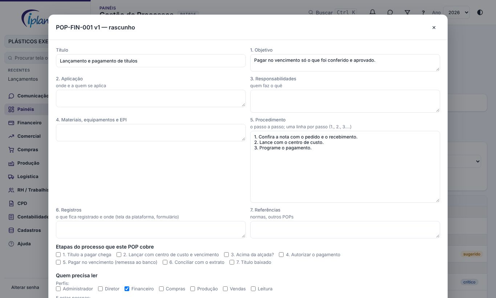
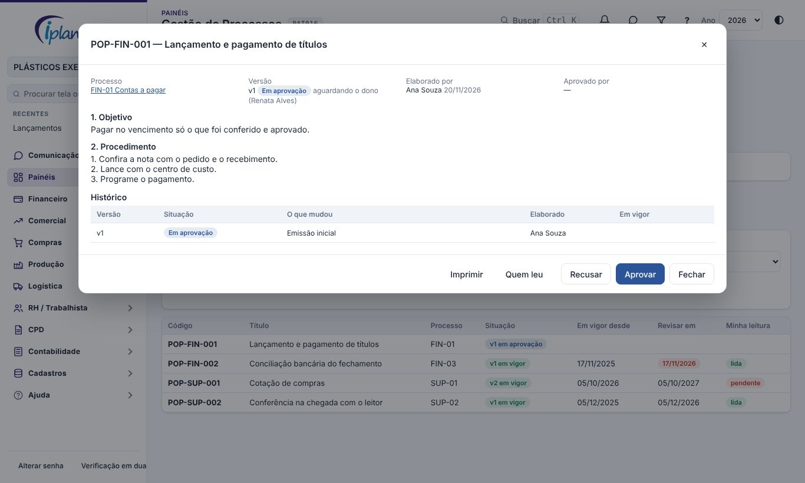
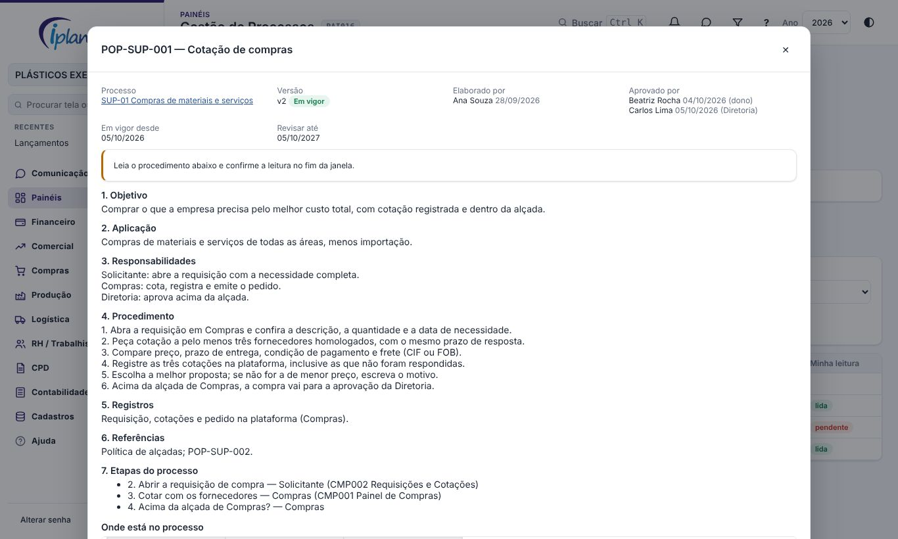
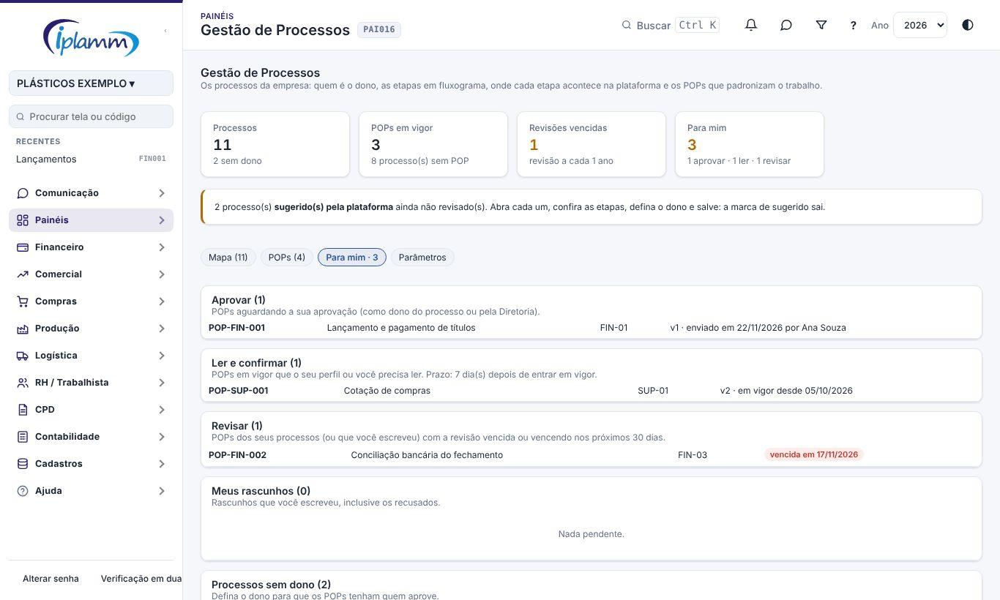
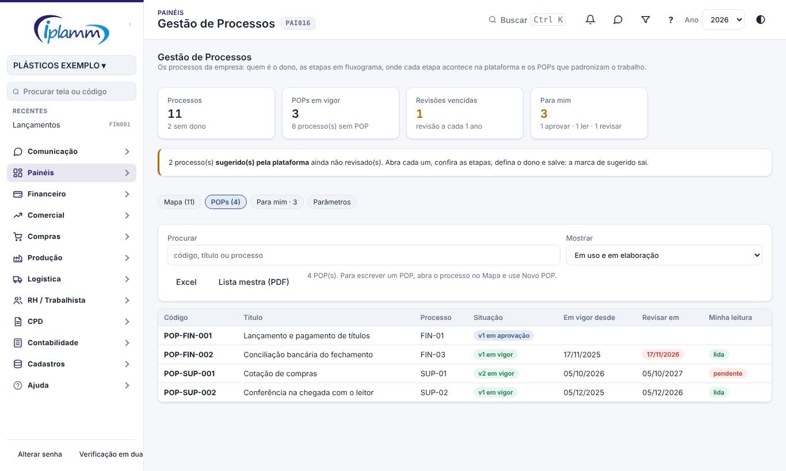
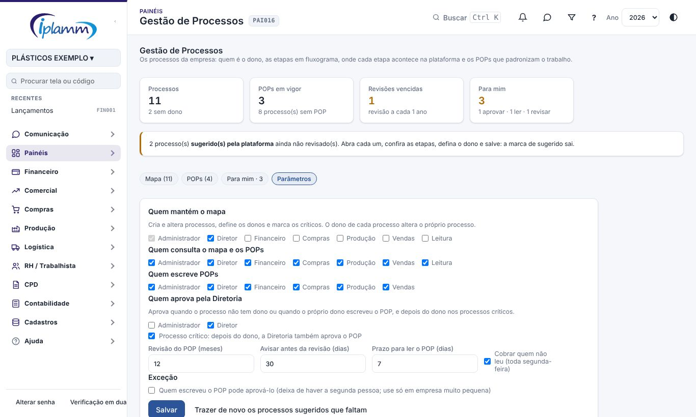

## 1. Para que serve

Organiza e padroniza o trabalho da empresa em dois níveis.

- **Mapa dos processos.** Cada processo tem um dono, um objetivo, entradas, saídas e clientes. As **etapas** dizem quem faz, o que faz, em que prazo e em qual tela da plataforma.
- **Fluxograma.** A plataforma desenha o fluxograma a partir das etapas, em raias por responsável. O desenho fica sempre igual ao texto.
- **POP (Procedimento Operacional Padrão).** É o passo a passo de uma parte do processo. Cada POP tem código e versão, passa por aprovação, tem revisão periódica e registra quem leu.

> Exemplo: o processo SUP-01 Compras de materiais e serviços tem a Beatriz como dona e 8 etapas. O POP-SUP-001 Cotação de compras, versão 2, está em vigor desde 05/10, foi aprovado pela dona e pela Diretoria (o processo é crítico) e precisa ser lido por Compras e pelo administrador.

Os manuais da plataforma ensinam a usar as telas. O POP diz como **a empresa** faz o trabalho.

## 2. Quem tem acesso

| O que | Quem (padrão, muda em Parâmetros) |
|---|---|
| Consultar o mapa e os POPs | Todos os perfis internos, inclusive Leitura |
| Criar e alterar processos, definir donos e críticos | Administrador e Diretor |
| Alterar o próprio processo (texto e etapas) | O dono do processo |
| Escrever POPs | Administrador, Diretor, Financeiro, Compras, Produção e Vendas, e o dono do processo |
| Aprovar o POP | O dono do processo. A Diretoria aprova no lugar dele quando ele mesmo escreveu o POP ou quando o processo não tem dono |
| Aprovar o POP de processo crítico | O dono e, depois dele, a Diretoria |
| Mudar os parâmetros | Administrador |

## 3. A tela

O menu é **Painéis › Gestão de Processos**.

No alto ficam os números: processos (e quantos estão sem dono), POPs em vigor (e processos ainda sem POP), revisões vencidas e o que está pendente para você.

**Primeira vez.** Quem mantém o mapa já encontra **11 processos sugeridos**, que a plataforma executa: compras, recebimento, requisição de material, inventário, venda e faturamento, inspeção e não conformidade, contas a pagar, contas a receber, fechamento mensal, arquivo morto e tratamento de problemas. Eles vêm com as etapas e as telas preenchidas e com a marca **sugerido**. Revise cada um, defina o dono e salve: a marca sai.

**Procurar.** Digite o código, o nome, o dono, uma etapa ou um responsável. Filtre pelo macroprocesso e pela situação (ativos, sem dono, sugeridos, desativados).

**Mapa (PDF)** e **Excel** saem com os filtros da tela. **Macroprocessos** cadastra os grupos (o código de 2 a 5 letras entra nos códigos dos processos e dos POPs e não muda).

## 4. O processo e o fluxograma

Clique num processo para abrir a ficha.

Como ler o fluxograma:

- Cada **coluna** é uma raia: um responsável (setor ou função). A ordem é a da primeira etapa de cada um.
- Cada **linha** é uma etapa, de cima para baixo, com o número à esquerda.
- **Formas:** início (borda arredondada), atividade (retângulo), decisão (losango) e fim (preenchido).
- Embaixo de cada etapa aparecem o **código da tela** e o **prazo**. Exemplo: "CMP001 · 2 dias úteis".
- A seta para a etapa seguinte desce. As setas que pulam ou voltam correm pelas laterais: o **Não** e o "segue para" pela direita, o **Sim** que pula pela esquerda.

Na tabela de etapas, a coluna **Onde, na plataforma** é um link para a tela. **Imprimir** gera o documento do processo com o fluxograma e as etapas.

## 5. Editar o processo e as etapas

**Editar** abre o cadastro com as etapas e a prévia do fluxograma, que muda enquanto você digita.

Para cada etapa informe:

| Campo | O que é |
|---|---|
| Tipo | Início, Atividade, Decisão ou Fim |
| Responsável | A raia. Use sempre o mesmo nome para o mesmo setor (a lista sugere os que já existem) |
| O que é feito | Até 160 letras. O detalhe vai no POP |
| Prazo | Texto livre: "2 dias úteis", "até o 3º dia útil" |
| Tela | A tela da plataforma onde a etapa acontece |
| Segue para | A etapa seguinte, se não for a de baixo. Na decisão: o **sim** (padrão: a de baixo) e o **não** (obrigatório) |

Use ↑ e ↓ para mudar a ordem e ✕ para apagar. Os destinos acompanham a etapa quando ela muda de lugar. Embaixo, a tela avisa os erros (que impedem salvar) e os alertas: processo sem início ou sem fim, e etapa a que nenhuma seta chega.

O dono altera o texto e as etapas do próprio processo. Dono, crítico e macroprocesso só quem mantém o mapa muda.

## 6. Escrever um POP

Na ficha do processo, use **Novo POP** e dê o título. O código sai sozinho: POP, o macroprocesso e o número (POP-SUP-001).

As seções são: 1. Objetivo, 2. Aplicação, 3. Responsabilidades, 4. Materiais, equipamentos e EPI, 5. Procedimento, 6. Registros e 7. Referências. No procedimento, escreva um passo por linha.

Marque também:

- **As etapas do processo que o POP cobre.** Elas aparecem destacadas no fluxograma do POP.
- **Quem precisa ler:** perfis e pessoas.
- **Anexo** (opcional): formulário, foto ou desenho em PDF, JPG ou PNG, até 20 MB.

**Salvar rascunho** guarda sem enviar. **Salvar e enviar para aprovação** confere o procedimento, quem precisa ler e, a partir da versão 2, o que mudou.

## 7. Aprovação

| Situação | Quem aprova |
|---|---|
| O processo tem dono e outra pessoa escreveu o POP | O dono |
| O próprio dono escreveu o POP | A Diretoria |
| O processo não tem dono | A Diretoria |
| Processo crítico | O dono e, depois, a Diretoria (outra pessoa) |

Quem escreveu não aprova o próprio POP. **Recusar** pede o motivo: o POP volta para rascunho com o motivo em vermelho, e quem escreveu é avisado. Corrija e envie de novo.

Na aprovação final o POP entra **em vigor**: a versão anterior fica **obsoleta**, a revisão é marcada para daqui a 12 meses e quem precisa ler recebe o aviso.

## 8. Em vigor: leitura e revisão

**Leitura.** Quem precisa ler abre o POP e usa **Li e entendi**. Cada versão nova pede leitura nova. Depois do prazo (7 dias), quem não leu recebe cobrança, e de novo toda segunda-feira. O dono e quem mantém o mapa veem a lista em **Quem leu**.

**Revisão.** 30 dias antes da data de revisão, o dono e quem escreveu recebem o aviso. Vencida, a cobrança vem no dia seguinte e toda segunda-feira. **Nova revisão** copia a versão em vigor para um rascunho: mude o que precisar, escreva o que mudou e envie. Se nada mudou, escreva isso no motivo. A nova aprovação marca a próxima revisão.

**Tornar obsoleto** tira o POP de uso, com o motivo. O histórico fica.

**Imprimir** gera o POP com o cabeçalho (código, versão, vigência, quem elaborou e aprovou), as seções, o fluxograma e o histórico. A cópia impressa é só para consulta: vale a versão em vigor na plataforma.

## 9. Para mim

Reúne o que depende de você: aprovar, ler e confirmar, revisar (dos seus processos ou dos POPs que você escreveu) e os seus rascunhos, inclusive os recusados. Quem mantém o mapa vê também os processos sem dono.

## 10. Lista de POPs

Mostra todos os POPs em uso ou em elaboração (ou os obsoletos), com a situação, a data de vigência, a revisão (em vermelho quando vencida) e se você já leu. **Lista mestra (PDF)** é a relação oficial dos POPs com versão e aprovação.

## 11. Parâmetros

Só o administrador muda.

| Parâmetro | Padrão | O que faz |
|---|---|---|
| Quem mantém o mapa | Administrador, Diretor | Cria e altera processos, donos e críticos. O administrador fica sempre |
| Quem consulta | Todos os perfis internos | Veem o mapa e os POPs |
| Quem escreve POPs | Todos menos Leitura | Criam rascunhos e novas revisões |
| Quem aprova pela Diretoria | Diretor | Se a empresa não tiver diretor, o administrador |
| Processo crítico passa pela Diretoria | Ligado | Depois do dono, a Diretoria também aprova |
| Revisão do POP | 12 meses | De 1 a 60 meses |
| Avisar antes da revisão | 30 dias | De 0 a 120 dias |
| Prazo para ler | 7 dias | Depois disso, cobrança |
| Cobrar quem não leu | Ligado | Uma vez e depois toda segunda-feira |
| Exceção: quem escreveu aprova | Desligado | Ligado, deixa de haver a segunda pessoa. Use só em empresa muito pequena |

**Trazer de novo os processos sugeridos que faltam** inclui os sugeridos que foram excluídos. Não mexe nos que já existem.

## 12. Roteiro sugerido

1. Revise os 11 processos sugeridos: ajuste as etapas, defina o dono e marque os críticos.
2. Inclua os processos que faltam (produção, manutenção, RH, logística).
3. Peça a cada dono que escreva o POP das etapas mais importantes, começando pelas que mais geram problema.
4. Defina quem precisa ler cada POP e acompanhe em **Quem leu**.
5. Quando um problema for resolvido na **Análise de Problemas**, atualize o processo e o POP (etapa 7 do GES-01).

## 13. Regras

- Código do processo: macroprocesso, traço e número (SUP-01). Muda só se o processo mudar de macroprocesso antes de ter POP.
- Até 60 etapas por processo. Decisão precisa do "não"; nenhuma seta aponta para a própria etapa.
- Processo com POP não é excluído: desative-o, depois de tornar os POPs obsoletos.
- Um POP tem no máximo uma versão aberta (rascunho ou em aprovação) e uma em vigor.
- Só o rascunho é alterado. Em aprovação, recuse para mudar.
- Leitura confirmada só na versão em vigor.

## 14. Dúvidas comuns

**Qual a diferença entre o processo e o POP?** O processo mostra o caminho inteiro e quem participa. O POP detalha como fazer uma parte dele, com o nível de detalhe de quem executa.

**Um processo pode ter mais de um POP?** Sim. Exemplo: Compras pode ter um POP de cotação e outro de acompanhamento da entrega.

**Mudei uma etapa: preciso mudar o POP?** Se o POP cobre a etapa, sim. Abra o POP e use **Nova revisão**.

**Por que o POP que o dono escreveu foi para a Diretoria?** Porque quem escreve não aprova. Com outra pessoa escrevendo, o dono aprova.

## 15. Histórico de versões

| Versão | Data | O que mudou |
|---|---|---|
| 1.0 | 23/11/2026 | Primeira versão: macroprocessos e processos com dono, objetivo, entradas, saídas, clientes e processo crítico; etapas com responsável, prazo e tela da plataforma; fluxograma gerado das etapas em raias; 11 processos sugeridos; POP com código, seções, etapas, leitores e anexo; aprovação pelo dono (Diretoria no lugar dele ou também, no crítico); versões e histórico; revisão periódica e confirmação de leitura com avisos e cobrança; lista mestra (SQL 196). |
