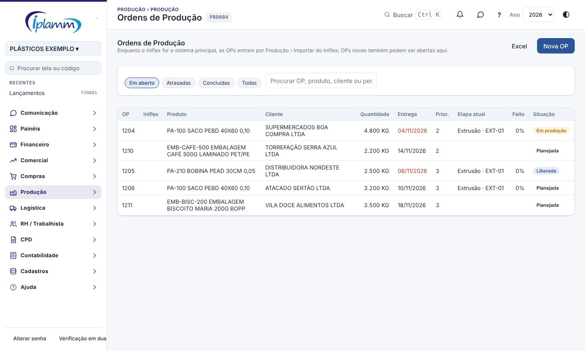
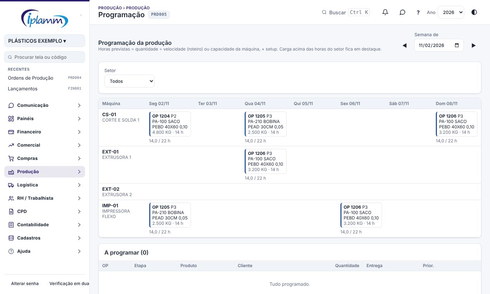
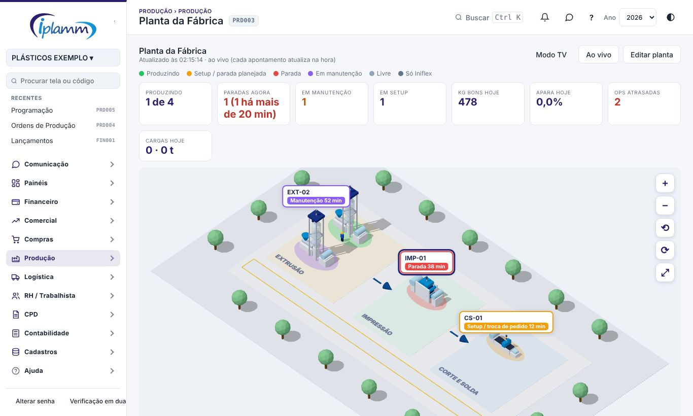

## 1. Para que serve

O módulo **Produção** faz o PCP (planejamento e controle da produção) da IPLAMM na plataforma, enquanto o trabalho oficial continua no **Iniflex**. Os dados do Iniflex entram por importação.

- **Painel de Produção**: produção por dia, apara e refugo, OEE por máquina, paradas, OPs abertas e atrasadas.
- **Planta da Fábrica**: a fábrica ao vivo, em 3D no computador e na TV e em planta baixa no celular, e o editor para montar a planta.
- **Ordens de Produção (OP)**: etapas, necessidade de material contra estoque, apontamentos, bobinas e consumo real contra teórico.
- **Programação**: quadro máquina × dia, com a carga em horas contra a capacidade.
- **Cadastros de Produção**: setores, máquinas, motivos, operadores, ferramentas e roteiros.
- **Importar do Iniflex**: OPs e apontamentos por planilha.

## 2. Quem tem acesso

| Perfil | O que faz |
|---|---|
| Administrador, diretor e financeiro | Fazem tudo: cadastros, OPs, programação, importação e planta. |
| Produção (operador) | Usa o Terminal do setor e consulta as Ordens de produção (veja o manual do Terminal). |

## 3. Cadastros de Produção (comece por aqui)

Nas abas, cadastre na ordem:

1. **Setores**: nome, ordem no fluxo e horas produtivas por dia.
2. **Máquinas**: código, setor, **capacidade (kg/h)** e o desenho na planta. Sem capacidade, a máquina fica sem OEE.
3. **Motivos** de parada e de refugo. **Criar motivos padrão** cria a lista comum (setup, troca de bobina, manutenção, falta de matéria-prima, furo, solda…). Marque como **parada planejada** as que não contam contra a disponibilidade.
4. **Operadores**: nome, matrícula, o **usuário (perfil Produção)** e os setores. O operador entra por convite em **Cadastros › Empresa e Usuários**.
5. **Ferramentas**: clichês, cilindros e facas, com as cores, a vida útil, os metros usados, a localização e a situação.
6. **Roteiros**: para cada produto, as etapas (setor, máquina padrão, velocidade em kg/h e setup em minutos). A OP nasce com as etapas do roteiro.

Prefira **desativar** a excluir o que já foi usado em OPs ou apontamentos.

## 4. Ordens de Produção

### 4.1 Criar uma OP

1. Clique em **Nova OP**.
2. Escolha o **produto** e informe a **quantidade**, a unidade, o cliente, o pedido e o nº da OP no Iniflex, a entrega, a **prioridade** (1 = mais urgente) e a observação.
3. Clique em **Criar OP**. As etapas vêm do roteiro do produto; sem roteiro, inclua as etapas depois com **+ Etapa**.

### 4.2 Acompanhar a OP

Clique na OP para ver:

- as **Etapas**: setor, máquina, previsto, bom e refugo;
- a **Necessidade de material**: necessário, em estoque e falta, pela estrutura do produto (**Estoque › Produtos › Estrutura**). **Gerar requisição dos materiais em falta** cria a requisição de compra;
- os **Apontamentos** do terminal: início, fim, operador, bom, refugo e motivo;
- as **Bobinas / volumes**: código, peso, metros, bobina mãe e lote da matéria-prima, para a rastreabilidade;
- o **Consumo de matéria-prima**, real (apontado com **+ Consumo**) contra o teórico (pela estrutura), com o custo.

Os botões são **Concluir**, **Reabrir**, **Cancelar** e **Imprimir OP**, que gera a OP no padrão IPLAMM, com as etapas e os materiais para preencher na produção.

Os filtros da lista são **Em aberto**, **Atrasadas**, **Concluídas** e **Todas**. **Excel** baixa a lista.

## 5. Programação

1. Escolha a **semana** e o **setor**.
2. Em **A programar**, clique em **Programar** na etapa e informe a máquina, o início previsto, as horas previstas e a quantidade desta etapa.
3. O quadro **máquina × dia** mostra as etapas programadas e a carga em horas contra a capacidade do setor. **Tirar da programação** devolve a etapa para a lista.

## 6. Painel de Produção

Escolha o **período**. O painel mostra:

- o produzido bom, a apara e o refugo, o OEE médio, as paradas não planejadas, e as OPs em aberto e atrasadas;
- a produção por dia, o OEE por máquina, as paradas por motivo (em horas) e o refugo por motivo (em kg).

**Como o OEE é calculado:**

- **Disponibilidade** = horas apontadas ÷ (horas do setor por dia × dias − paradas planejadas).
- **Performance** = (bom + refugo) ÷ (horas apontadas × capacidade em kg/h da máquina).
- **Qualidade** = bom ÷ (bom + refugo).
- **OEE** = disponibilidade × performance × qualidade.

## 7. Planta da Fábrica

A planta mostra cada máquina com a situação ao vivo:

- **produzindo**, em verde, com a OP;
- **setup ou parada planejada**, em amarelo;
- **parada**, em vermelho;
- **em manutenção**, em roxo, quando há OS aberta que parou a máquina ou parada de motivo de manutenção;
- **livre**.

Entre os setores, as setas mostram as bobinas paradas esperando a etapa seguinte. **Modo TV** é para o telão da fábrica; no celular, a planta aparece vista de cima.

Clique numa máquina para ver:

- a OP e o quanto já foi feito;
- o **ritmo agora**: kg por hora da produção em curso e o percentual da capacidade;
- a **OS de manutenção**, com o link para abrir;
- o operador.

A planta se atualiza **na hora** em que o operador aponta, registra uma parada ou a manutenção mexe na OS (tempo real). Também se atualiza de tempos em tempos (padrão: 30 segundos). No alto aparece "ao vivo" quando a ligação em tempo real está ativa.

Uma **parada longa** é a parada não planejada aberta há mais de 20 minutos (ajustável). Ela pisca na planta e aparece nos números do alto. Quem é administrador ou diretor recebe o aviso **Máquina parada há muito tempo**, uma vez por parada.

No botão **Ao vivo** (administrador, financeiro ou diretor), ajuste:

- tempo real ligado ou desligado;
- intervalo da atualização (10 a 300 segundos);
- limite da parada longa (5 a 480 minutos);
- aviso e quem recebe.

Para montar ou mudar a planta:

- **Editar**: clique em **Editar planta** (administrador, financeiro ou diretor).
  1. Informe a largura e a profundidade do galpão.
  2. Inclua os elementos: setor, corredor, área de paletes, estoque de MP, expedição, portão, seta de fluxo, parede, doca, vaga de garagem, pátio, rua, guarita, telões e árvores.
  3. Arraste as máquinas de **Máquinas sem lugar** para o lugar real. **+ Nova máquina** cria a máquina no cadastro na hora.
  4. **Rascunho automático** monta os setores lado a lado na ordem do fluxo, com as máquinas em fila e as setas entre eles. Depois é só arrastar.
  5. Clique em **Salvar planta**.

Tirar uma máquina da planta não a apaga do cadastro.

## 8. Importar do Iniflex

1. Exporte do Iniflex a planilha (Excel ou CSV).
2. Em **1. Ordens de produção**, escolha o arquivo, ligue as colunas e clique em **Importar OPs**:
   - OP nova entra como **liberada**, com as etapas do roteiro;
   - OP já importada atualiza a quantidade, a entrega e a situação.
3. Em **2. Apontamentos**, faça o mesmo e clique em **Importar apontamentos**. Apontamento sem OP importada é ignorado e contado no resultado.

## 9. Perguntas frequentes e erros comuns

**A OP nasceu sem etapas.** O produto não tem roteiro. Cadastre o roteiro em Cadastros › Roteiros, ou inclua as etapas na OP.

**A necessidade de material está vazia.** O produto não tem estrutura em Estoque › Produtos.

**A máquina aparece sem OEE.** Falta a capacidade (kg/h) no cadastro da máquina.

## 10. Conversa sobre o registro

No topo da janela da ordem de produção ficam dois botões das **Conversas**:

- **💬 Conversa** abre o bate-papo da equipe sobre este registro. Cada registro tem uma conversa só, e só entra quem consegue ver o registro.
- **↗ Enviar no chat** manda o registro como cartão numa conversa. Quem recebe clica no cartão e abre o registro.

Veja o manual **Conversas** para os detalhes.

## 11. Histórico de alterações

| Versão | Data | O que mudou |
|---|---|---|
| 1.0 | 28/10/2026 | Primeira versão do manual: cadastros, OPs com necessidade de material e rastreabilidade, programação, painel com OEE, planta da fábrica e importação do Iniflex. |
| 1.1 | 29/10/2026 | Botões **💬 Conversa** e **↗ Enviar no chat** da ordem de produção (Conversas, etapa 2). |
| 1.2 | 29/10/2026 | Imagens das telas, com dados fictícios. |
| 1.3 | 05/11/2026 | Nomes das telas iguais aos do menu, com o código da tela no cabeçalho. |
| 1.4 | 08/11/2026 | Planta da Fábrica ao vivo: atualização na hora pelo tempo real, situação "em manutenção" com a OS, parada longa com aviso, ritmo da produção em curso e parâmetros. |
