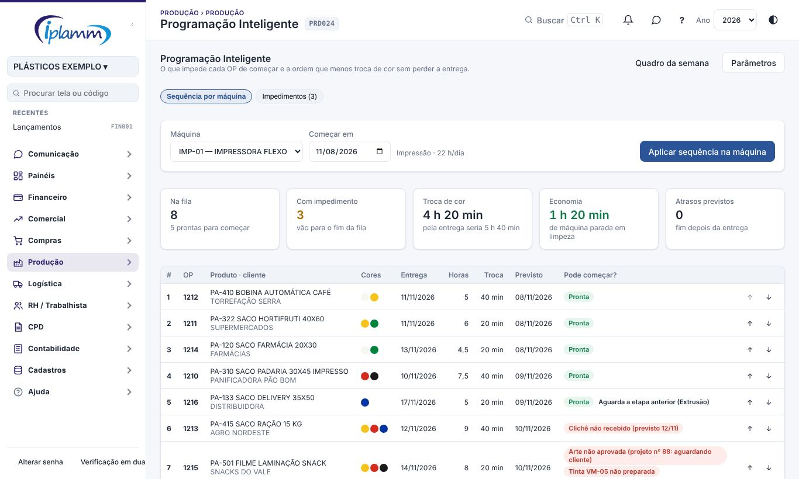
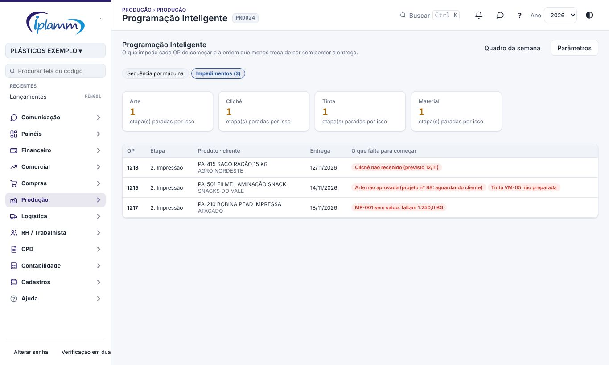
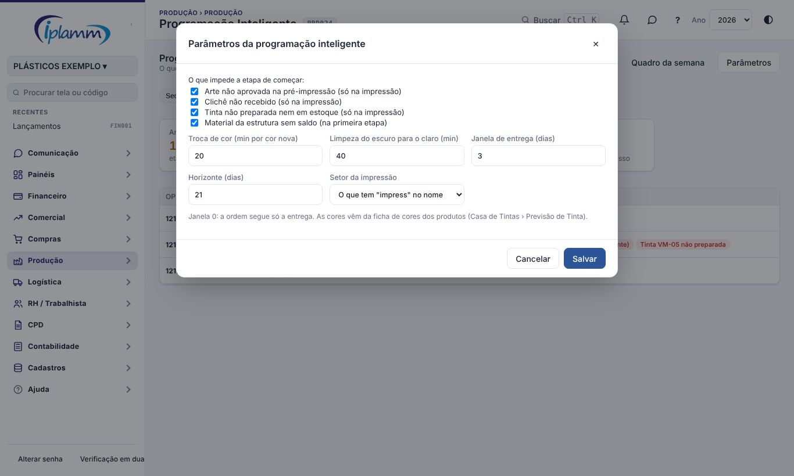

## 1. Para que serve

Ajuda o PCP a decidir **a ordem das OPs em cada máquina**, principalmente na impressão:

- mostra **o que impede cada OP de começar**: arte não aprovada, clichê não recebido, tinta não preparada e material sem saldo;
- sugere a **sequência que menos troca de cor** sem perder a entrega, indo do claro para o escuro;
- calcula as **datas previstas** pelas horas do setor e avisa quando uma OP vai atrasar;
- **aplica a fila** na máquina, com as datas, no quadro da Programação.

As informações vêm da pré-impressão (arte e clichê), da Casa de Tintas (ordens de tinta e ficha de cores dos produtos) e do estoque (estrutura do produto e saldo).

## 2. Quem tem acesso

| Perfil | O que faz |
|---|---|
| Administrador, diretor e financeiro | Veem a tela, ajustam a ordem, aplicam a fila e alteram os parâmetros. |
| Leitura | Vê a sequência sugerida e os impedimentos. |

## 3. Sequência por máquina

1. Abra **Produção › Programação Inteligente** e escolha a **máquina**.
2. Confira o dia em **Começar em**.
3. Leia a fila sugerida. Cada linha mostra:
   - as **cores** do produto, do claro para o escuro;
   - a **entrega** e as **horas** da etapa;
   - a **troca** de cor antes dela;
   - o **previsto**, pelas horas do setor por dia;
   - se a OP **pode começar** ou o que falta.
4. Se quiser, ajuste a ordem com **↑** e **↓**. As trocas e as datas são recalculadas. **Voltar à sugestão** desfaz o ajuste.
5. Clique em **Aplicar sequência na máquina**. A fila e as datas vão para o quadro da **Programação**.

A etapa que já está rodando na máquina fica fixa no topo, marcada com ▶.

### 3.1 Como a sequência é montada

- **A entrega manda.** A próxima OP sai das que vencem até a **janela de entrega** (padrão 3 dias) depois da mais urgente que falta.
- **Dentro da janela, a menor troca de cor.** Cada cor nova custa os minutos de troca (padrão 20). Ir de uma cor escura para uma clara soma a limpeza (padrão 40 minutos). No empate, entra a mais clara.
- **A cor não atrasa a mais urgente.** Uma OP só passa na frente se a mais urgente ainda terminar até a entrega dela.
- **Prioridade 1 não espera.** A OP urgente entra na hora, sem olhar a cor.
- **OP com impedimento vai para o fim da fila**, na ordem de entrega.

Os indicadores do topo mostram as etapas na fila, as que têm impedimento, o tempo de troca da sugestão contra o da ordem só pela entrega, a economia e os atrasos previstos.

## 4. Impedimentos

A aba **Impedimentos** lista todas as etapas paradas, de todas as máquinas, pela entrega:

| Impedimento | Quando aparece | Onde resolver |
|---|---|---|
| Arte | Na impressão, o projeto da OP (ou o mais recente do produto) está em criação, com o cliente, em alteração ou reprovado. | Pré-impressão |
| Clichê | Na impressão, a arte está aprovada ou na clicheria e o clichê não foi recebido. Reimpressão não pede clichê. | Pré-impressão |
| Tinta | Na impressão, uma cor da ficha do produto não tem ordem de tinta aprovada para a OP nem tinta pronta suficiente em estoque (lote bloqueado não conta). | Casa de Tintas |
| Material | Na primeira etapa, um componente da estrutura não tem saldo. O saldo é reservado na ordem de entrega e prioridade: a OP que vence antes fica com o material. | Compras e Estoque |

**Aguarda a etapa anterior** é só um aviso: a OP pode ser programada, mas a etapa anterior ainda não terminou.

## 5. Parâmetros

Em **Parâmetros** (administrador, diretor e financeiro), ajuste:

- quais impedimentos contam (arte, clichê, tinta e material);
- os minutos de **troca de cor** por cor nova e de **limpeza do escuro para o claro**;
- a **janela de entrega**: 0 faz a ordem seguir só a entrega;
- o **horizonte**: quantos dias à frente entram na fila;
- o **setor da impressão**: vazio, vale o setor que tem "impress" no nome.

Para a sugestão funcionar bem, cadastre a **ficha de cores** de cada produto (Casa de Tintas › Previsão de Tinta) e as **horas previstas** das etapas.

## 6. Regras e travas

- Só entram na fila etapas do setor da máquina, sem máquina ou já nela.
- A fila aplicada grava a posição de cada etapa na máquina e as datas, enchendo cada dia até as horas do setor. A troca de cor entra no tempo da etapa.
- Etapa de outro setor, concluída ou repetida não entra.
- Uma etapa que sai da fila perde a posição.
- O perfil leitura não aplica a fila.

## 7. Perguntas frequentes e erros comuns

**Uma OP com entrega mais cedo ficou depois de outra.** A troca de cor ficou menor e a OP ainda termina até a entrega dela (a coluna **Previsto** mostra). Para seguir só a entrega, use janela 0.

**As cores não aparecem.** O produto não tem ficha de cores. Cadastre em Casa de Tintas › Previsão de Tinta.

**A OP aparece com material faltando, mas há saldo.** O saldo está reservado para OPs com entrega antes, ou está num lote bloqueado pela qualidade.

**As datas estão longas demais.** Confira as horas previstas das etapas e as horas por dia do setor em Cadastros de Produção.

## 8. Histórico de alterações

| Versão | Data | O que mudou |
|---|---|---|
| 1.0 | 08/11/2026 | Primeira versão: impedimentos de arte, clichê, tinta e material; sequência por máquina com troca de cor, janela de entrega e proteção da entrega; ajuste manual; datas previstas; aplicar a fila; parâmetros. |
