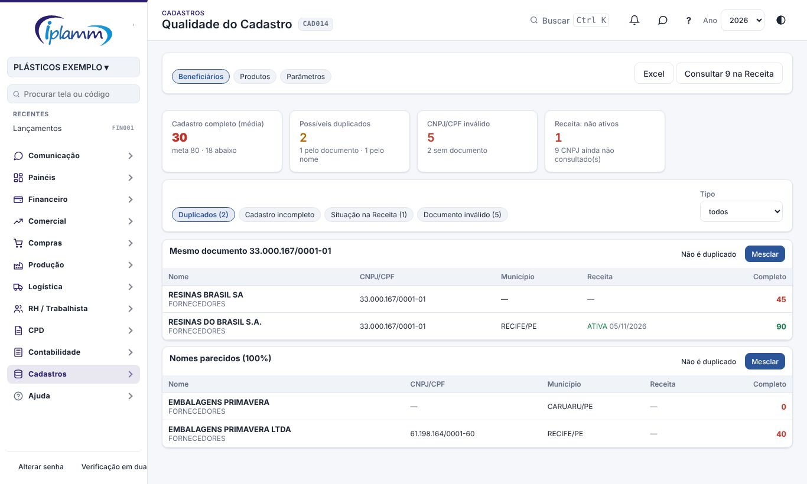
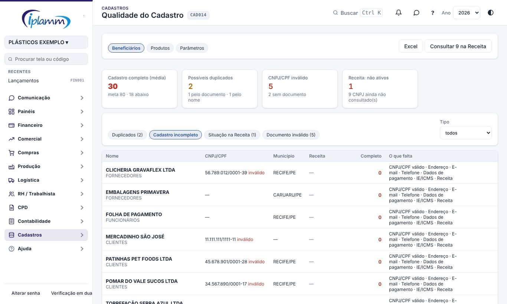
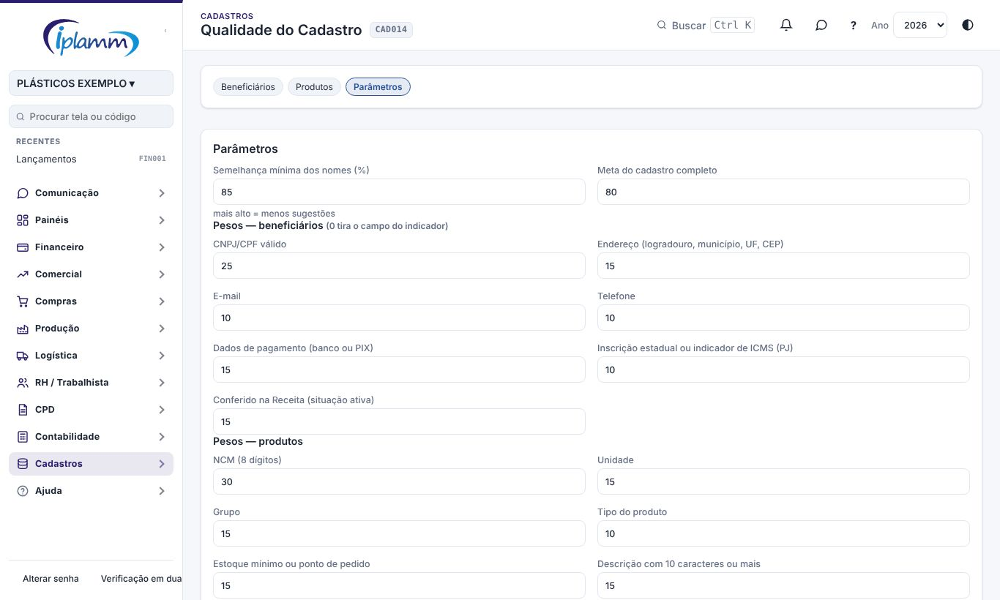

## 1. Para que serve

Mantém os cadastros de **beneficiários** (clientes, fornecedores e demais) e de **produtos** limpos:

- acha **possíveis duplicados**: mesmo CNPJ/CPF no mesmo tipo, ou nomes parecidos;
- **mescla** dois cadastros que são o mesmo (tudo o que estava no repetido passa para o que fica);
- dá uma **nota de cadastro completo** (0 a 100) para cada um e diz o que falta;
- **consulta o CNPJ na Receita** (situação cadastral e endereço) para conferir e completar.

Todos os membros veem a tela; mesclam o administrador e o financeiro; os parâmetros são do administrador.

## 2. Beneficiários

No topo: a nota média do cadastro completo (com a meta), quantos possíveis duplicados, quantos documentos inválidos e quantos CNPJ estão **não ativos** na Receita (baixada, inapta, suspensa). O filtro **Tipo** limita a um tipo de beneficiário.

Na lista **Duplicados**, cada grupo mostra o motivo (mesmo documento ou nomes parecidos, com a semelhança) e os cadastros lado a lado, com documento, município, situação na Receita e nota.

Como os nomes são comparados: maiúsculas, sem acentos e sem LTDA, ME, EPP, EIRELI, S/A, DE, DA, DO…; dois cadastros com **documentos diferentes** nunca são sugeridos como duplicados.

## 3. Mesclar e "não é duplicado"

- **Mesclar**: escolha o cadastro que **fica**. Lançamentos, notas, contratos, pedidos e demais vínculos dos outros passam para ele; os campos vazios dele são completados com os dos outros; os outros são excluídos. Não dá para desfazer, e cadastros com CNPJ/CPF diferentes não são mesclados.
- **Não é duplicado**: o par deixa de aparecer.

## 4. Cadastro incompleto

A lista **Cadastro incompleto** ordena da menor nota para a maior e diz o que falta. Os campos e os pesos padrão:

| Campo | Peso |
|---|---|
| CNPJ/CPF válido | 25 |
| Endereço (logradouro, município, UF, CEP) | 15 |
| Dados de pagamento (banco ou PIX) | 15 |
| Conferido na Receita (situação ativa) | 15 |
| E-mail | 10 |
| Telefone | 10 |
| Inscrição estadual ou indicador de ICMS (PJ) | 10 |

As listas **Situação na Receita** e **Documento inválido** mostram os não ativos e os CNPJ/CPF com dígito errado.

## 5. Consulta na Receita

**Receita** (na linha de um CNPJ válido) consulta a base pública do CNPJ e mostra a situação cadastral, a abertura, o CNAE, o Simples/MEI e os campos que estão diferentes do cadastro. Os campos **vazios** já vêm marcados; marque os que quer trocar e **Gravar**. A situação e a data da consulta ficam no cadastro.

**Consultar N na Receita** (no topo) consulta em sequência até 30 CNPJ ainda não consultados, gravando a situação e só os campos vazios.

> A fonte é a consulta pública do CNPJ (BrasilAPI, dados da Receita Federal); pode estar alguns dias atrás da Receita. Consultas seguidas demais são recusadas por alguns minutos.

## 6. Produtos e parâmetros

Na aba **Produtos**: descrições parecidas do mesmo tipo (com **Não é duplicado** e **Inativar**) e a nota do cadastro (NCM com 8 dígitos, unidade, grupo, tipo, estoque mínimo ou ponto de pedido, descrição). Produtos com movimento não são mesclados: inative o repetido e acerte o estoque no inventário.

Na aba **Parâmetros** (administrador): semelhança mínima dos nomes (padrão 85%), meta do cadastro completo (padrão 80) e o peso de cada campo (0 tira o campo do indicador).

## 7. Histórico de alterações

| Versão | Data | O que mudou |
|---|---|---|
| 1.0 | 08/11/2026 | Primeira versão: duplicados pelo documento e pelo nome, mesclar beneficiários, indicador de cadastro completo, consulta do CNPJ na Receita e produtos parecidos (melhoria 10.1). |
