## 1. Para que serve

Garantir que só material aprovado entre na produção e chegue ao cliente:

- **planos de inspeção** por produto ou por família, em três etapas:
  - recebimento;
  - processo;
  - produto final.

  Cada característica tem a especificação (nominal, mínimo e máximo) ou é contada como atributo (defeitos);
- **quarentena no recebimento**: a entrada da nota fiscal de um produto com plano vai para o local Quarentena, e nada sai de lá sem a decisão da inspeção;
- **liberação do primeiro material** na produção: as bobinas da OP nascem bloqueadas até a qualidade aprovar o setup;
- **inspeção final** aberta sozinha quando a OP é concluída;
- **avaliação ao vivo** das medições: média, mínimo, máximo, fora da especificação e Cpk (capacidade do processo). A plataforma sugere a decisão pela amostragem (aceita e rejeita);
- **decisão parcial**:
  - o aprovado vai para o local de destino;
  - o reprovado vai para o local Reprovado e abre a **não conformidade (RNC)**;
- **disposição do material** executada no estoque: usar como está, retrabalhar, reclassificar, sucatear ou devolver ao fornecedor. Na devolução, a nota de devolução baixa o material do Reprovado;
- **bloqueio** de lote do estoque ou de bobina a qualquer momento, por exemplo por uma reclamação de cliente, com histórico;
- **IQF** (índice de qualidade do fornecedor), Pareto das reprovações, laudo e RNC impressos.

## 2. Quem tem acesso

- **Ver as telas**: quem tem acesso à área Produção. Compras vê as Inspeções.
- **Registrar inspeção, anexar laudo e foto, abrir RNC e bloquear material**: administrador, financeiro, diretor, compras e produção.
- **Decidir**: administrador, diretor e financeiro. Decidir inclui aprovar, reprovar, liberar bloqueio e executar a disposição. A lista de quem decide muda em Planos e Parâmetros › Parâmetros. O administrador sempre decide.
- **Planos, amostragem e parâmetros**: administrador, financeiro e diretor.

## 3. Primeiros passos

1. Abra **Produção › Qualidade › Planos e Parâmetros** e clique em **Configurar a qualidade**. A plataforma faz três coisas:
   - liga o local **Quarentena (QUA)** do estoque;
   - cria o local **Reprovado (REP)**;
   - cria a **tabela de amostragem** de partida.
2. Na aba **Parâmetros**, confira:
   - o prazo para inspecionar;
   - a meta de aprovação;
   - quem decide.
3. Cadastre os **planos de inspeção** (seção 8.1). Comece pelos produtos que mais pesam:
   - o recebimento das resinas;
   - a liberação de setup das extrusoras.
4. Enquanto o estoque não estiver implantado, use **Buscar notas de entrada** no Painel. As inspeções abrem pelas notas, sem mexer no estoque.

## 4. Painel da Qualidade

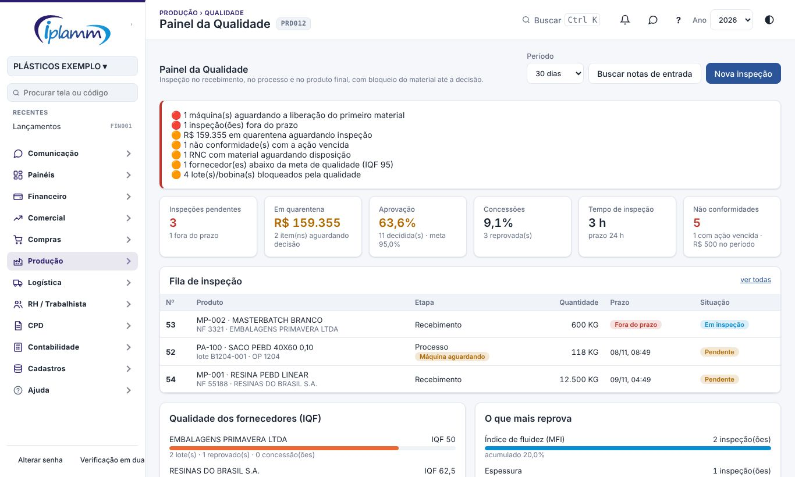

1. Abra **Produção › Qualidade › Painel da Qualidade** e escolha o período.
2. A faixa de alertas mostra:
   - as máquinas aguardando a liberação do primeiro material;
   - as inspeções fora do prazo;
   - o valor parado na quarentena;
   - as RNC vencidas ou sem disposição;
   - os fornecedores abaixo da meta;
   - os lotes e bobinas bloqueados.
3. Os indicadores mostram:
   - as inspeções pendentes;
   - o valor em quarentena;
   - a aprovação e as concessões;
   - o tempo médio de inspeção;
   - as não conformidades.

   Clique em **Inspeções pendentes** ou em **Não conformidades** para abrir a lista.
4. A **Fila de inspeção** vem na ordem de atendimento:
   1. as fora do prazo;
   2. as máquinas aguardando a liberação;
   3. a mais antiga.
5. Logo abaixo ficam:
   - o **IQF dos fornecedores**, do pior para o melhor;
   - **O que mais reprova**: as características que mais saíram da especificação.

## 5. Inspeções

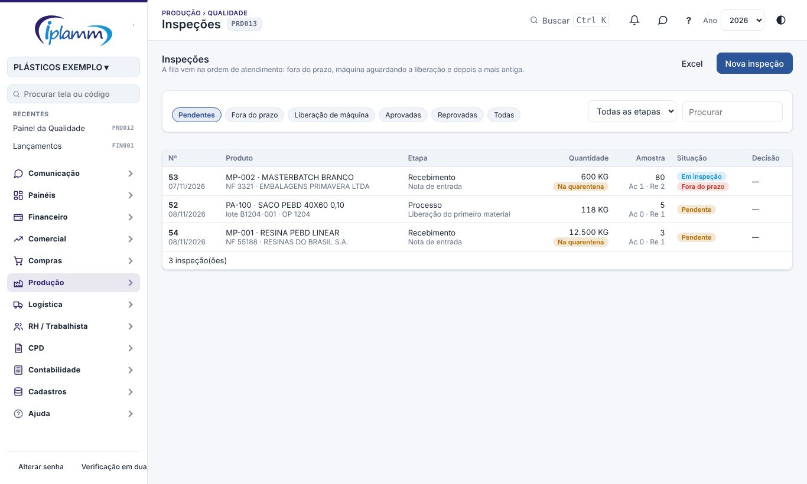

Filtros:

- Pendentes;
- Fora do prazo;
- Liberação de máquina;
- Aprovadas;
- Reprovadas;
- Todas.

Você também pode filtrar pela etapa e pela busca. O selo **Na quarentena** indica que a inspeção controla material parado no local Quarentena.

### 5.1 De onde vêm as inspeções

| Origem | Quando abre |
|---|---|
| Nota de entrada | A entrada da NF-e de um produto com plano de recebimento vai para a Quarentena, e a inspeção abre sozinha. Antes da implantação do estoque, **Buscar notas de entrada** abre as inspeções das notas dos últimos 30 dias. |
| Liberação do primeiro material | A primeira bobina de uma OP com plano de processo "bloqueia a OP até liberar" abre a inspeção. Essa bobina e as seguintes ficam bloqueadas até a decisão. |
| Ordem de produção | A OP concluída abre a inspeção final, quando o produto tem plano final. |
| Manual / reclamação | Clique em **Nova inspeção**: produto, etapa, quantidade, lote, fornecedor e OP. |

O **plano** é escolhido sozinho: o plano do produto vence o da família. A **amostra** sai da tabela pelo tamanho do lote, a não ser que o plano use amostra fixa ou 100%.

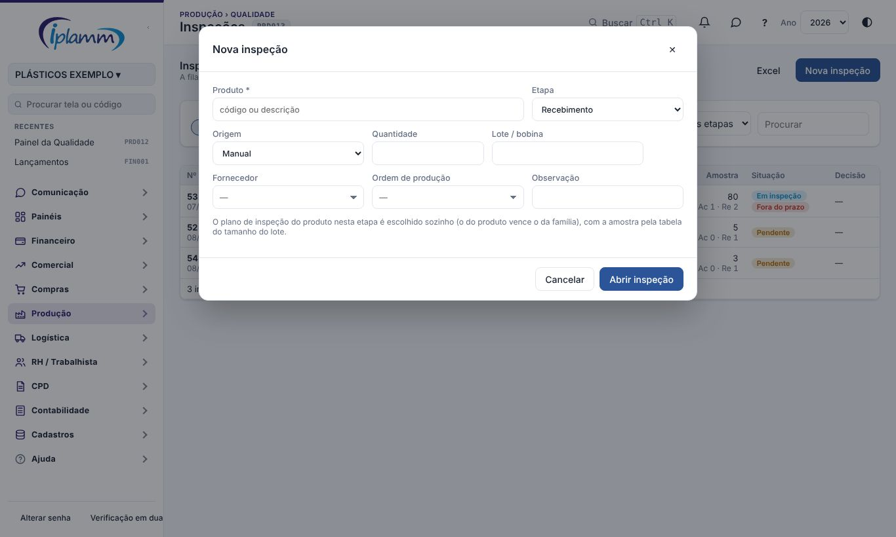

### 5.2 Registrar os resultados

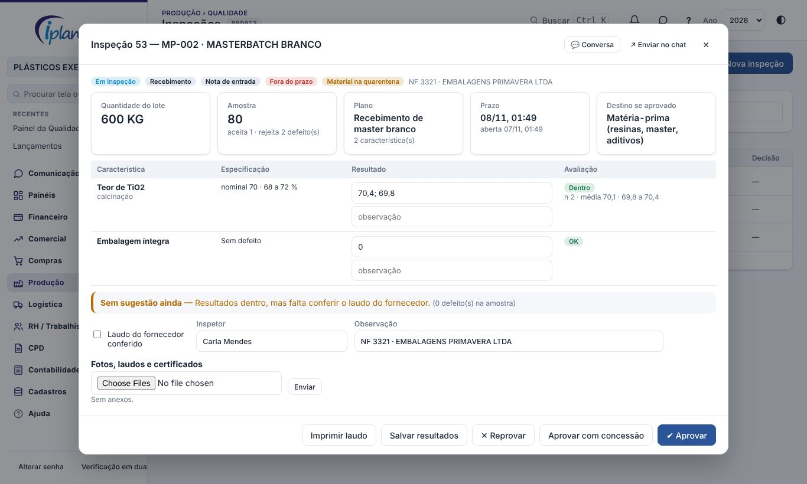

1. Abra a inspeção.
2. Leia as **instruções** do plano.
3. Para cada característica:
   - **medida**: digite os valores medidos separados por ponto e vírgula, por exemplo 50,2; 49,8; 50,1;
   - **atributo**: digite o número de defeitos encontrados na amostra.
4. A coluna **Avaliação** mostra, para cada característica:
   - se está dentro;
   - quantos valores ficaram fora;
   - a média, o mínimo e o máximo;
   - com 5 medições ou mais, o **Cpk**.
5. Se o plano exige laudo, marque **Laudo do fornecedor conferido**. Anexe o laudo, o certificado ou a foto. No celular, a câmera abre direto.
6. A faixa de **sugestão** mostra o que fazer:
   - característica crítica fora da especificação: reprovar;
   - defeitos iguais ou acima do número de rejeição (Re): reprovar;
   - defeitos dentro do aceite (Ac): aprovar;
   - laudo exigido e não conferido: não sugere aprovar.
7. Clique em **Salvar resultados** para continuar depois, ou decida.

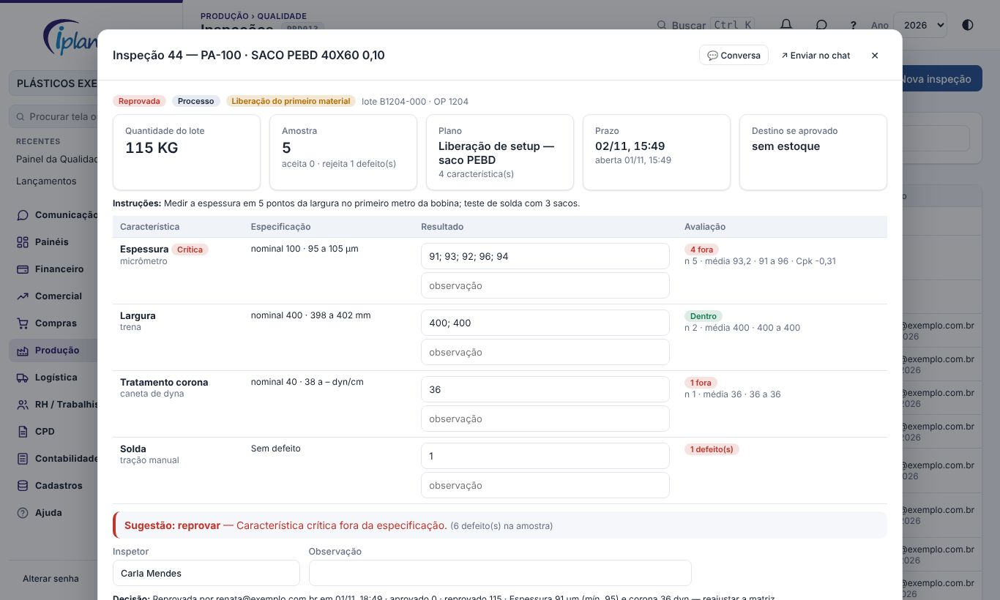

### 5.3 Decidir

- **Aprovar**: todo o lote vai da Quarentena para o local de destino. As bobinas presas pela inspeção são liberadas.
- **Aprovar com concessão**: aprova com um motivo obrigatório, por exemplo "largura 1 mm acima, aceito pelo cliente". Conta como meio ponto no IQF.
- **Reprovar**: pede o motivo e a **quantidade aprovada**. Na reprovação parcial:
  - o aprovado vai para o destino;
  - o reprovado vai para o local **Reprovado**;
  - a **RNC** abre sozinha.
- Se a sugestão é reprovar e você clica em Aprovar, a plataforma pede confirmação. Prefira **Aprovar com concessão**, que registra o motivo.
- A decisão não volta: corrija com uma nova inspeção ou com a RNC.

### 5.4 Laudo impresso

**Imprimir laudo** gera o laudo de inspeção com:

- identificação;
- resultados e avaliação de cada característica;
- decisão;
- as assinaturas do inspetor e de quem decidiu.

Serve de certificado para o cliente.

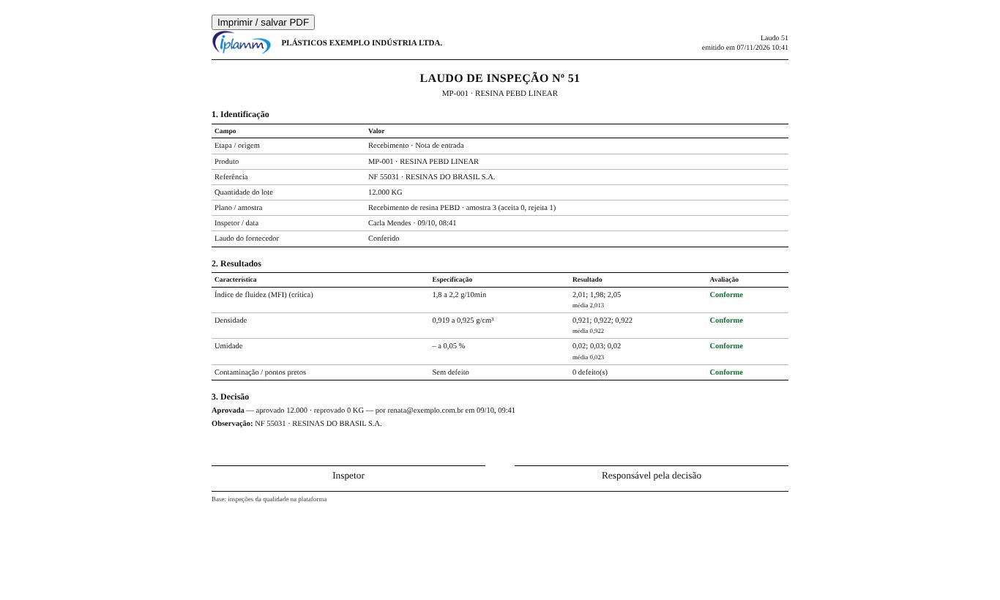

## 6. Não conformidades (RNC)

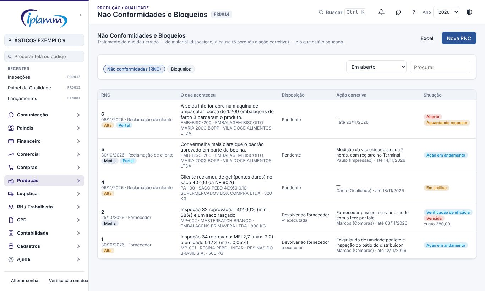

Uma RNC nasce de três formas:

- da inspeção reprovada;
- de uma reclamação de cliente;
- de uma falha interna ou de auditoria, pelo botão **Nova RNC**.

### 6.1 Ficha da RNC

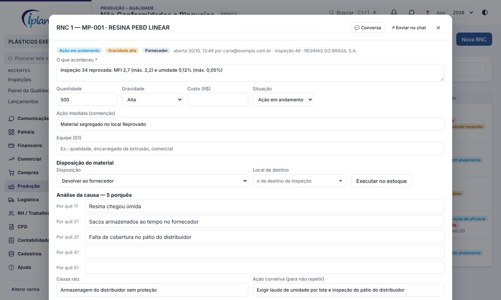

- **O que aconteceu**, quantidade, gravidade, **custo** da não qualidade e situação.
- **Ação imediata (contenção)**: o que foi feito na hora, por exemplo segregar o lote, avisar a expedição ou inspecionar 100% do estoque.
- **Análise da causa — 5 porquês**: pergunte "por quê?" até chegar à causa raiz.
- **Ação corretiva**: o que muda para o problema não voltar, com o responsável e o prazo. O prazo padrão vem dos Parâmetros.
- **Eficácia**: depois do prazo, verifique se o problema voltou e marque **Eficaz** ou **Não eficaz**.
- As situações são:
  - Aberta;
  - Em análise;
  - Ação em andamento;
  - Verificação de eficácia;
  - Encerrada.

  A RNC com material só encerra com a disposição definida.
- **Imprimir RNC** gera o relatório com assinaturas.

### 6.2 Disposição do material

Escolha a disposição e clique em **Executar no estoque**. Só quem decide executa.

| Disposição | O que acontece |
|---|---|
| Usar como está (concessão) | O material sai do Reprovado para o local de destino. A bobina reprovada é liberada. |
| Retrabalhar | O material vai para o local escolhido, por exemplo o Em processo do setor. |
| Reclassificar (2ª linha) | O material vai para o local escolhido. |
| Sucatear | Perda (tipo PERDA) do local Reprovado. A bobina vira refugada. |
| Devolver ao fornecedor | Fica aguardando a nota de devolução. Quando a NF de devolução (CFOP 5201/6201) é processada, ela baixa o material do local Reprovado, e a RNC marca a disposição como executada. |

A disposição executada não muda.

### 6.3 Reclamação do cliente pelo Portal

O cliente abre a reclamação no Portal do Cliente, na aba **Reclamações**. Ele informa a nota fiscal, o produto, o lote ou o número da bobina da etiqueta, a quantidade com problema, o que aconteceu e até 6 fotos. A plataforma então:

- abre uma **RNC de origem "Reclamação de cliente"**, com o selo **Portal** na lista;
- marca o prazo da **primeira resposta** (padrão: 2 dias);
- avisa a equipe escolhida nos Parâmetros (sino, celular e e-mail, conforme Meus avisos);
- manda ao cliente a confirmação com o número da reclamação.

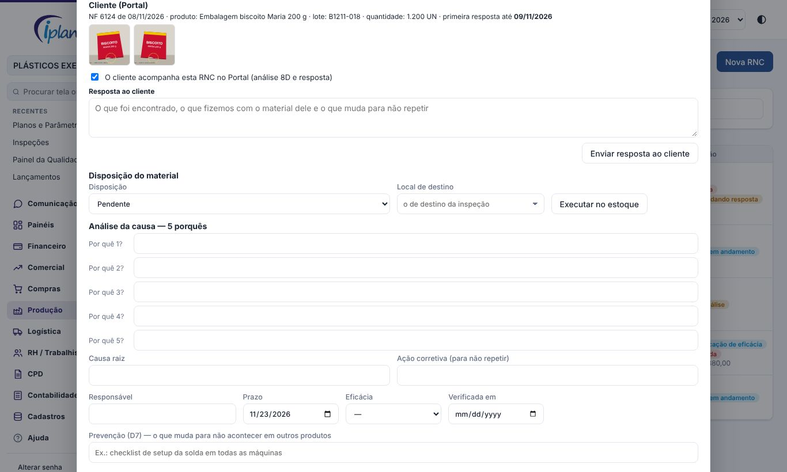

Na ficha da RNC, o quadro **Cliente (Portal)** mostra o que o cliente informou e as fotos. Para tratar:

1. Preencha a **Equipe** (D1) e a **Ação imediata** (D3), por exemplo o bloqueio dos lotes iguais que ainda estão na fábrica (item 7) e a reposição ao cliente;
2. Faça a análise: 5 porquês, **causa raiz** (D4), **ação corretiva** com responsável e prazo (D5 e D6) e **Prevenção** (D7), que é o que muda em outros produtos e máquinas;
3. Escreva a **Resposta ao cliente** e clique em **Enviar resposta ao cliente**. Ele recebe por e-mail e, se aceitou, por WhatsApp. No Portal, vê a resposta e a análise passo a passo (8D);
4. Depois de verificar a eficácia, encerre a RNC (D8).

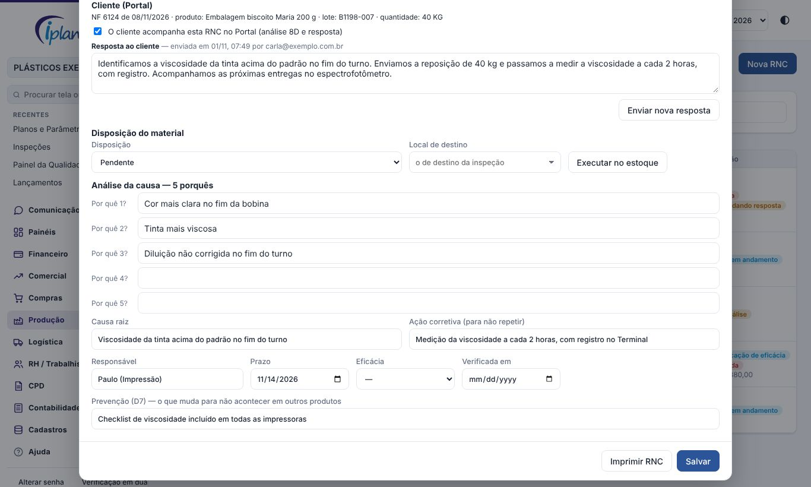

O cliente diz no Portal se a resposta resolveu. Se **não resolveu**, ele escreve o motivo e a equipe recebe um aviso urgente. A RNC encerrada volta para **Em análise**. Uma nova resposta pode ser enviada a qualquer momento: o cliente avalia de novo.

Na lista de RNC, o filtro **Reclamações do Portal** mostra só as que vieram do cliente. Os selos indicam:

- **Aguardando resposta**: a primeira resposta ainda não foi enviada;
- **Resposta ao cliente atrasada**: o prazo da primeira resposta passou;
- **Cliente não aceitou**: o cliente disse que a resposta não resolveu.

Uma RNC aberta pela equipe com o cliente informado também pode aparecer no Portal: marque **O cliente acompanha esta RNC no Portal**.

### 6.4 Certificado de qualidade da NF-e

Para cada nota com bobinas expedidas (Rastreabilidade › Expedir bobinas), a plataforma gera o **certificado de qualidade** em PDF. O certificado traz:

- as bobinas da nota, com o peso, os metros e o lote da matéria-prima;
- as OPs, incluindo a OP de extrusão das bobinas-mãe;
- os resultados das inspeções aprovadas: especificação, média, mínimo e máximo de cada característica;
- a declaração e o responsável que assina, definidos nos Parâmetros.

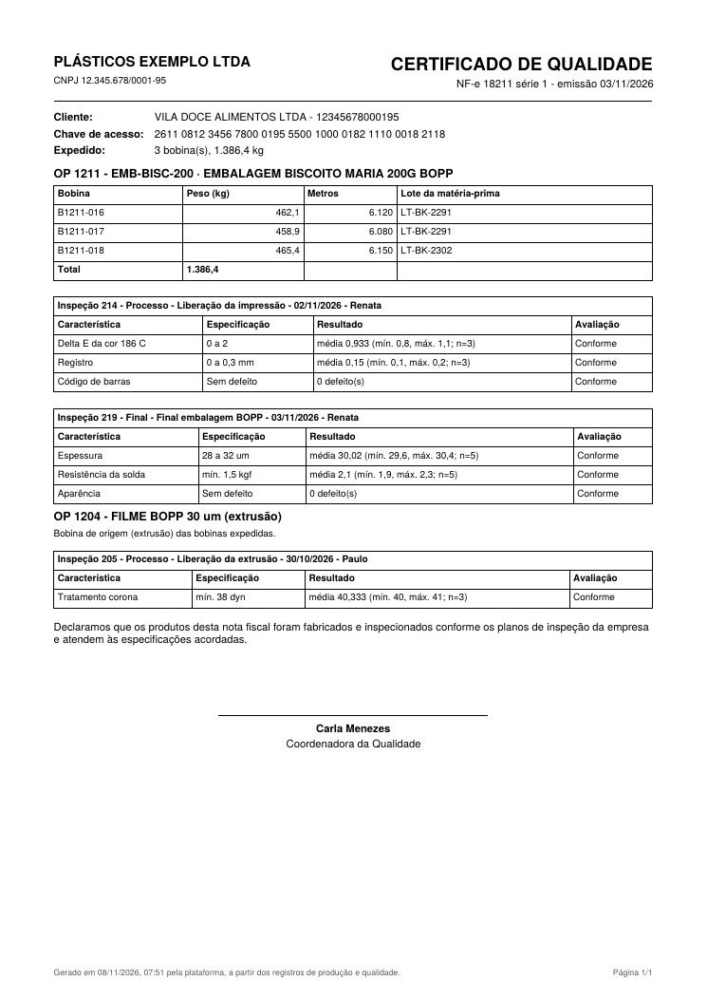

A equipe baixa o certificado na **Rastreabilidade**: busque a nota e clique em **Certificado**. O cliente baixa na aba Notas fiscais do Portal, no mesmo botão.

## 7. Bloqueios

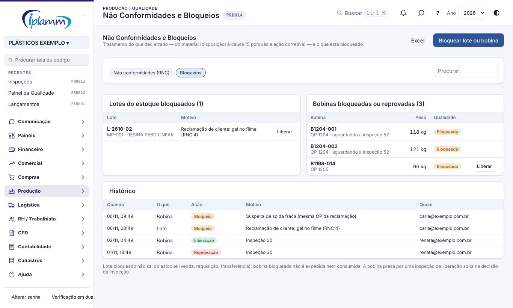

1. Abra a aba **Bloqueios** em Não Conformidades e Bloqueios.
2. Clique em **Bloquear lote ou bobina**.
3. Informe o tipo, o código (nº do lote ou da bobina) e o **motivo**.

O que o bloqueio faz:

- **Lote bloqueado** não sai do estoque: venda, requisição para a produção e transferência são barradas. A nota de venda de um lote bloqueado vai para as pendências do estoque.
- **Bobina bloqueada ou reprovada** não é expedida nem consumida.
- **Liberar** desfaz o bloqueio. Só quem decide libera.
- A bobina presa por uma inspeção de liberação só solta pela decisão da inspeção.
- O **histórico** registra cada bloqueio, liberação e reprovação, com o motivo e o responsável.

## 8. Planos e Parâmetros

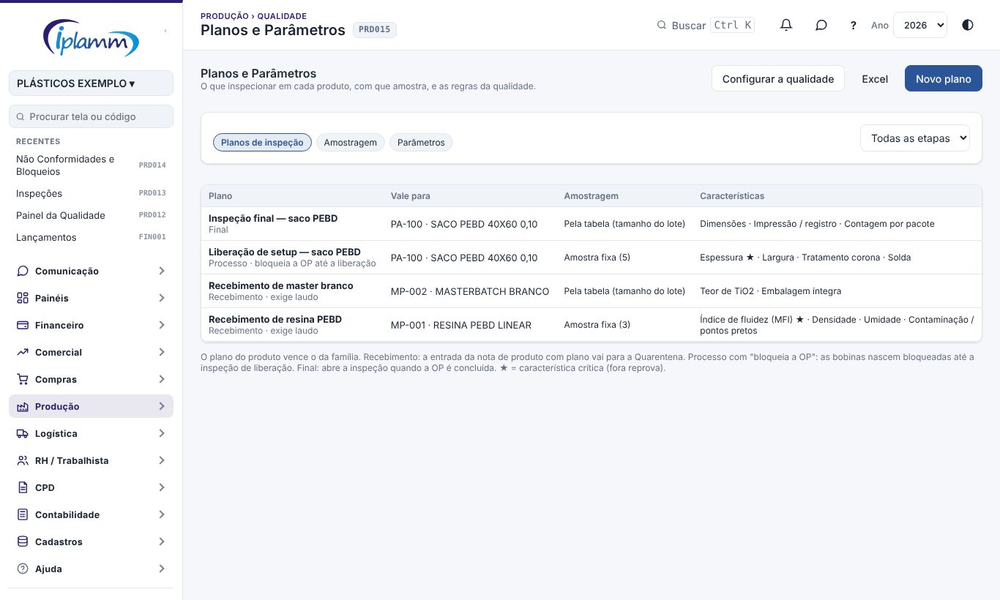

### 8.1 Planos de inspeção

| Campo | Para que serve |
|---|---|
| Nome e etapa | Recebimento, processo ou final. |
| Produto ou família | O plano do produto vence o da família. Use a família para não repetir o plano em cada grau de resina. |
| Amostragem | Pela tabela (tamanho do lote), amostra fixa ou 100%. |
| Exige laudo do fornecedor | No recebimento, a sugestão de aprovar só aparece com o laudo conferido. |
| Processo: bloqueia a OP até liberar | As bobinas da OP nascem bloqueadas até a inspeção de liberação ser aprovada. |
| Instruções | O que o inspetor deve fazer, por exemplo "medir a espessura em 5 pontos da largura". |
| Características | Nome, tipo (medida ou atributo), unidade, nominal, mínimo, máximo, método e se é **crítica**. Característica crítica fora da especificação reprova o lote. |

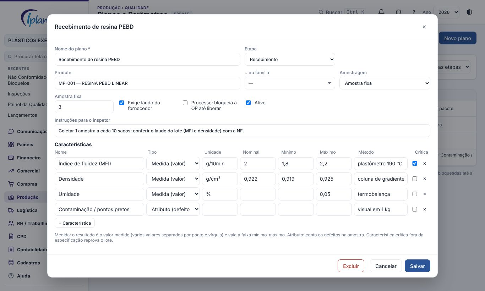

### 8.2 Amostragem

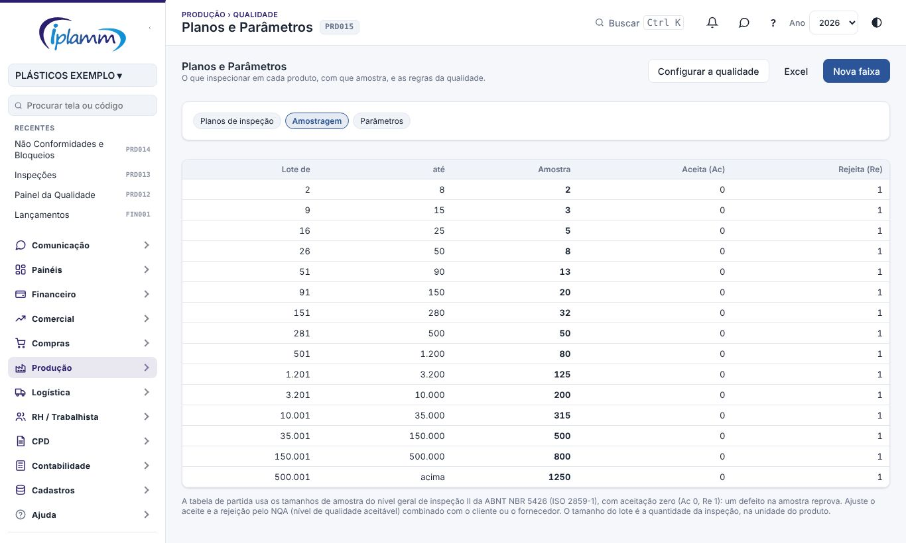

- Cada faixa de tamanho do lote tem:
  - o tamanho da amostra;
  - o **aceita (Ac)**: até quantos defeitos aprova;
  - o **rejeita (Re)**: a partir de quantos reprova.
- A tabela de partida usa os tamanhos de amostra do nível geral de inspeção II da ABNT NBR 5426 (ISO 2859-1), com **aceitação zero** (Ac 0, Re 1): um defeito na amostra reprova.
- Ajuste o aceite e a rejeição pelo NQA (nível de qualidade aceitável) combinado com o cliente ou com o fornecedor.
- O tamanho do lote é a quantidade da inspeção, na unidade do produto.

### 8.3 Parâmetros

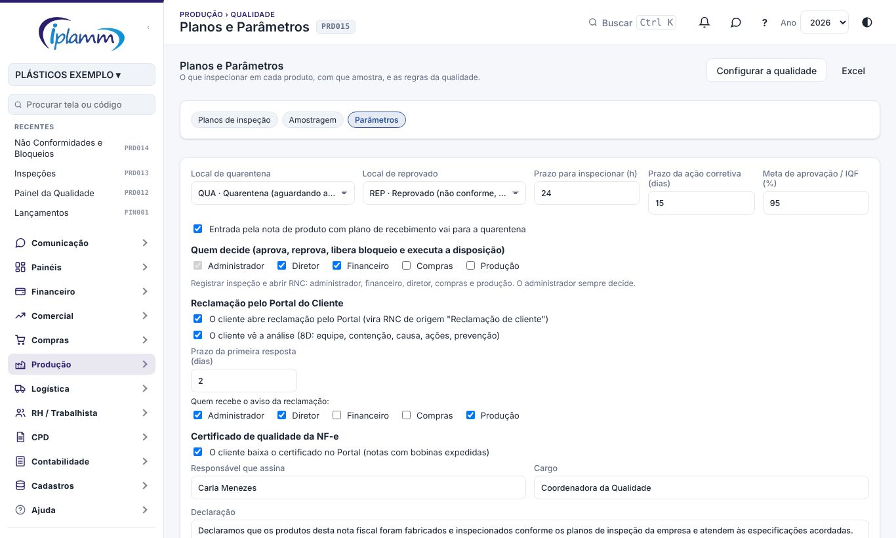

| Parâmetro | O que faz | Padrão |
|---|---|---|
| Local de quarentena | Onde fica o material aguardando a inspeção | QUA |
| Local de reprovado | Onde fica o material reprovado aguardando a disposição | REP |
| Prazo para inspecionar | Horas para a inspeção. Depois disso ela aparece como fora do prazo. A liberação de máquina tem prazo de 2 h. | 24 h |
| Prazo da ação corretiva | Prazo padrão da RNC | 15 dias |
| Meta de aprovação / IQF | Meta do painel e dos fornecedores | 95% |
| Entrada pela nota vai para a quarentena | Desligado, a nota entra direto no local padrão, e a inspeção é feita sem bloqueio | Ligado |
| Quem decide | Papéis que aprovam, reprovam, liberam bloqueio e executam a disposição | Administrador, diretor e financeiro |
| O cliente abre reclamação pelo Portal | Desligado, a aba Reclamações mostra só as reclamações já abertas | Ligado |
| O cliente vê a análise (8D) | Desligado, o cliente vê só a situação e a resposta | Ligado |
| Prazo da primeira resposta | Dias para responder ao cliente, de 0 a 30 | 2 dias |
| Quem recebe o aviso da reclamação | Papéis avisados da reclamação nova e da avaliação do cliente | Administrador, diretor e produção |
| Certificado no Portal | O cliente baixa o certificado das notas com bobinas expedidas | Ligado |
| Responsável, cargo e declaração | O que sai no fim do certificado | — |

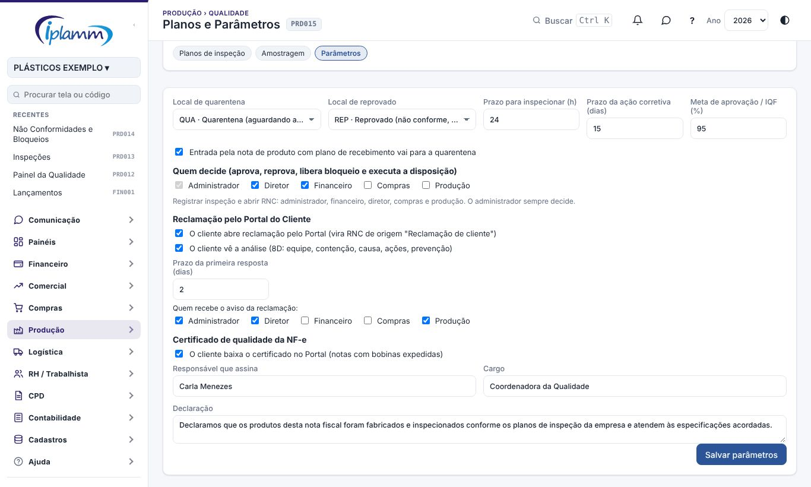

## 9. Como o bloqueio funciona no estoque e na produção

1. **Recebimento**:
   1. A NF-e de resina com plano entra no Kardex pelo custo da nota, mas no local **Quarentena**, e não na Matéria-prima.
   2. A requisição para a produção não enxerga a quarentena. Qualquer saída de lá é barrada com a mensagem "aguardando a inspeção da qualidade".
   3. A decisão transfere o material:
      - o aprovado vai para a Matéria-prima;
      - o reprovado vai para o Reprovado.
   4. O custo médio não muda na transferência.
2. **Estorno**: estornar a entrada que está na quarentena cancela a inspeção que ainda não foi decidida.
3. **Produção**:
   1. Com o plano de liberação, a primeira bobina da OP abre a inspeção, e as bobinas ficam **bloqueadas**.
   2. Aprovada a liberação, todas as bobinas presas são liberadas, e as próximas já nascem liberadas.
   3. Reprovada, as bobinas ficam **reprovadas** até a disposição da RNC.
4. **Expedição**: bobina bloqueada ou reprovada não é expedida.

## 10. Indicadores

| Indicador | Como é calculado |
|---|---|
| Aprovação | Inspeções aprovadas ÷ inspeções decididas no período |
| Concessões | Aprovadas com concessão ÷ decididas |
| Tempo de inspeção | Média das horas entre a abertura e a decisão |
| Em quarentena | Valor do estoque no local Quarentena (custo médio) |
| IQF do fornecedor | Média dos lotes recebidos em 13 meses: aprovado = 100, concessão = 50, reprovado = 0 |
| O que mais reprova | Características fora da especificação, por número de inspeções |
| Custo da não qualidade | Soma do custo das RNC abertas no período |

Os alertas do Painel também aparecem no **Decision Center**.

## 11. Regras e travas

- Nada sai da Quarentena nem do Reprovado sem a decisão da inspeção ou a disposição da RNC.
- A aprovação e a reprovação são feitas só pelos botões de decisão, que movimentam o estoque.
- Reprovação e concessão exigem motivo. A decisão não se altera depois de gravada.
- A inspeção com material na quarentena não pode ser cancelada: decida, ou estorne a entrada no Kardex.
- Uma inspeção por item de nota.
- Lote bloqueado não sai do estoque, e bobina bloqueada não sai da fábrica.
- A disposição executada não muda, e a RNC com material só encerra com a disposição definida.
- Os números da inspeção e da RNC são sequenciais por empresa.
- Todas as alterações ficam na auditoria.
- O cliente só reclama de notas dele e só vê as RNC marcadas para o Portal. Até 6 fotos por reclamação.
- O certificado só sai para nota com bobina expedida e só mostra inspeção aprovada.

## 12. Perguntas frequentes

**A produção precisa da resina agora, mas ela está na quarentena.** Faça a inspeção. Se não der tempo de concluir, quem decide aprova com concessão, com o motivo registrado. A entrega não é feita por fora da qualidade.

**Por que a resina não foi para a quarentena?** Há três motivos possíveis:

- o produto não tem plano de recebimento;
- o parâmetro "Entrada pela nota vai para a quarentena" está desligado;
- o estoque ainda não está implantado.

No último caso, use **Buscar notas de entrada**.

**O cliente reclamou de um lote que já foi entregue.** O melhor caminho é o cliente abrir pelo Portal (item 6.3). Se ele reclamou por telefone, abra uma **Nova RNC** com origem "Reclamação de cliente" e marque que ele acompanha no Portal. Em qualquer caso, bloqueie os lotes e as bobinas do mesmo produto que ainda estão na fábrica e, se precisar, abra uma inspeção de origem "Reclamação".

**O certificado saiu sem resultados.** A OP não tem inspeção aprovada com plano. Registre a inspeção final (ou a de liberação) com o plano de inspeção do produto.

**Como sei se o processo é capaz?** Com 5 medições ou mais e os dois limites informados, a ficha mostra o Cpk. Como referência:

- Cpk ≥ 1,33: processo capaz;
- Cpk entre 1,00 e 1,33: no limite;
- Cpk abaixo de 1,00: o processo produz fora da especificação.

**Posso mudar a tabela de amostragem?** Sim. Em Planos e Parâmetros › Amostragem, clique na faixa e ajuste a amostra, o aceite e a rejeição, ou crie faixas novas.

## 13. Histórico de alterações

| Versão | Data | O que mudou |
|---|---|---|
| 1.0 | 07/11/2026 | Primeira versão. Inclui planos de inspeção, quarentena no recebimento pela nota, liberação do primeiro material e inspeção final na produção, avaliação com Cpk e sugestão pela amostragem, decisão parcial, laudo, RNC com disposição no estoque e 5 porquês, bloqueio de lote e bobina, IQF, parâmetros e Decision Center. |
| 1.1 | 08/11/2026 | Reclamação do cliente pelo Portal (RNC com fotos, prazo da primeira resposta, 8D e resposta ao cliente, avaliação pelo cliente), certificado de qualidade da NF-e e parâmetros. |
