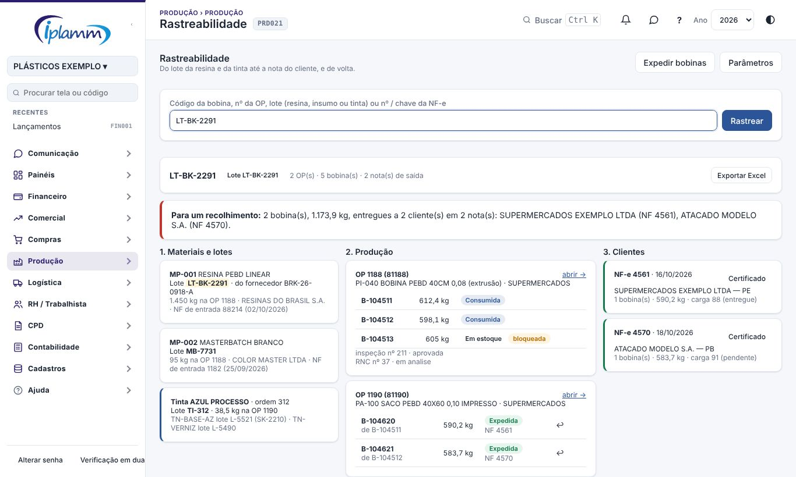
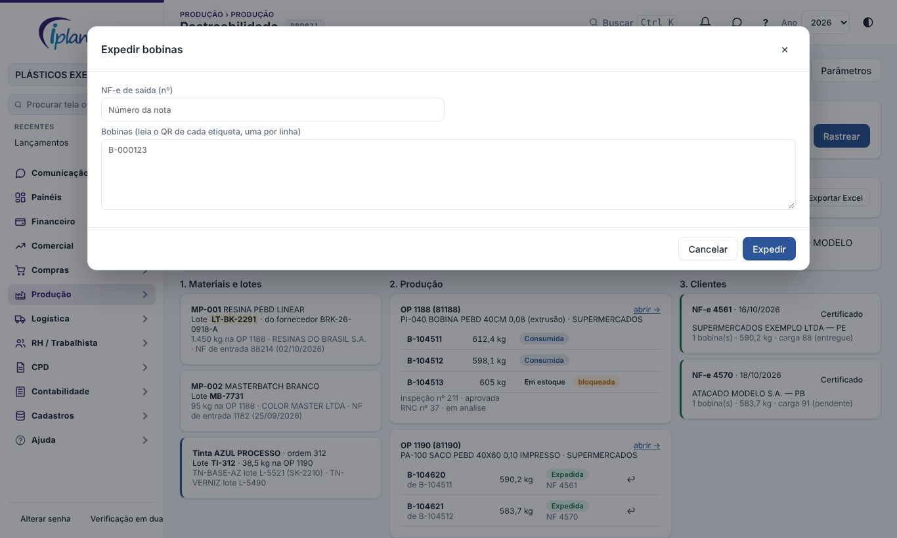

## 1. Para que serve

Liga **o lote da resina, do master e da tinta** à **bobina** e à **NF-e do cliente**, nos dois sentidos:

- **de trás para frente**: uma reclamação do cliente → a bobina → a OP → os lotes de material usados;
- **de frente para trás**: um lote com problema → todas as bobinas feitas com ele → os clientes que receberam, para um **recolhimento**.

A etiqueta da bobina tem um **QR**. Lido no celular, ele abre esta tela já com a bobina.

## 2. Quem tem acesso

| Perfil | O que faz |
|---|---|
| Administrador e financeiro | Rastreiam, expedem, desfazem a expedição e alteram os parâmetros. |
| Diretor, compras e produção | Rastreiam e expedem. |
| Leitura | Rastreia. |

## 3. Rastrear

No campo de busca, leia o QR da etiqueta ou digite:

- o **código da bobina**;
- o **nº da OP**, da plataforma ou do Iniflex;
- um **lote**: o lote interno da resina ou do insumo, o lote do fornecedor ou o lote da tinta;
- o **nº** ou a **chave** da NF-e.

A tela mostra o que o termo é (bobina, OP, lote, nota) e o caminho completo em três colunas.

| Coluna | O que mostra |
|---|---|
| 1. Materiais e lotes | Cada material consumido nas OPs, com o lote, o lote do fornecedor, o fornecedor e a NF de entrada. Também cada tinta da Casa de Tintas, com o lote e os lotes dos componentes pesados. |
| 2. Produção | Cada OP com as bobinas: peso, situação (em estoque, consumida, expedida), bloqueio da qualidade, a bobina-mãe (por exemplo, a bobina extrusada que virou a bobina impressa) e a nota em que saiu. Também as inspeções e RNCs ligadas. |
| 3. Clientes | Cada NF-e de saída com as bobinas: cliente, UF, quantidade, kg, carga e situação da entrega. |

O termo buscado aparece destacado no caminho. O caminho segue as bobinas-mãe e filhas até 6 níveis, então o lote da resina da extrusão chega à nota da bobina impressa.

### 3.1 Recolhimento

Quando a busca é um **lote** e há bobinas expedidas, a faixa vermelha resume:

- quantas bobinas;
- quantos kg;
- quantos clientes receberam, e em quais notas.

**Exportar Excel** baixa a lista de bobinas (com a nota e o cliente) e de materiais. Use essa lista para avisar os clientes.

## 4. Expedir bobinas

Em **Expedir bobinas**:

1. Informe o **nº da NF-e de saída**. A nota precisa estar importada e autorizada. A tela mostra o cliente e a data.
2. Leia o **QR** de cada etiqueta (uma por linha). Também vale digitar o código.
3. A tela confere cada bobina:
   - mostra as prontas e o peso;
   - aponta as não encontradas;
   - aponta as que não podem sair: já consumidas ou expedidas, ou bloqueadas e reprovadas pela qualidade.
4. **Expedir** marca as bobinas prontas como expedidas na nota.

Uma bobina expedida por engano volta ao estoque pelo botão **↩** na coluna Produção (administrador e financeiro), com o motivo. Fica registrado na Auditoria.

Em cada nota da coluna Clientes, o botão **Certificado** gera o certificado de qualidade da nota em PDF: bobinas, OPs e resultados das inspeções aprovadas. O cliente baixa o mesmo certificado no Portal (manual **Qualidade**, item 6.4).

## 5. Etiqueta com QR

A etiqueta impressa na OP (Terminal do Setor e Ordens de Produção) traz o QR com o **endereço desta tela**. O celular abre a rastreabilidade da bobina direto. O leitor de código de barras do computador também funciona: a busca entende o endereço e fica só com o código.

## 6. Parâmetros

Em **Parâmetros** (administrador e financeiro):

- **QR com link**: o QR abre esta tela (padrão). Desmarcado, o QR traz só o código, como antes.
- **Expedição só com a NF-e**: exige a nota para expedir. Assim toda bobina expedida tem cliente.

## 7. Dúvidas frequentes

**O lote da resina não aparece.** O consumo precisa ser apontado na OP com o lote (ficha da OP › Consumo, campo Lote / NF), ou o lote precisa estar na bobina da extrusão.

**A nota do cliente não aparece.** A bobina precisa ser expedida nesta tela com a NF-e. Bobinas expedidas antes desta versão não têm nota.

**Uma bobina bloqueada não sai.** A qualidade bloqueou ou reprovou a bobina. Libere pela inspeção ou pela RNC.

## 8. Histórico de alterações

| Versão | Data | O que mudou |
|---|---|---|
| 1.0 | 08/11/2026 | Primeira versão: busca por bobina, OP, lote ou NF-e; caminho materiais → produção → clientes com bobinas mãe e filha, tintas e qualidade; resumo para recolhimento; expedição na NF-e; QR da etiqueta com link; Excel. |
| 1.1 | 08/11/2026 | Botão Certificado em cada nota: certificado de qualidade da NF-e em PDF. |
