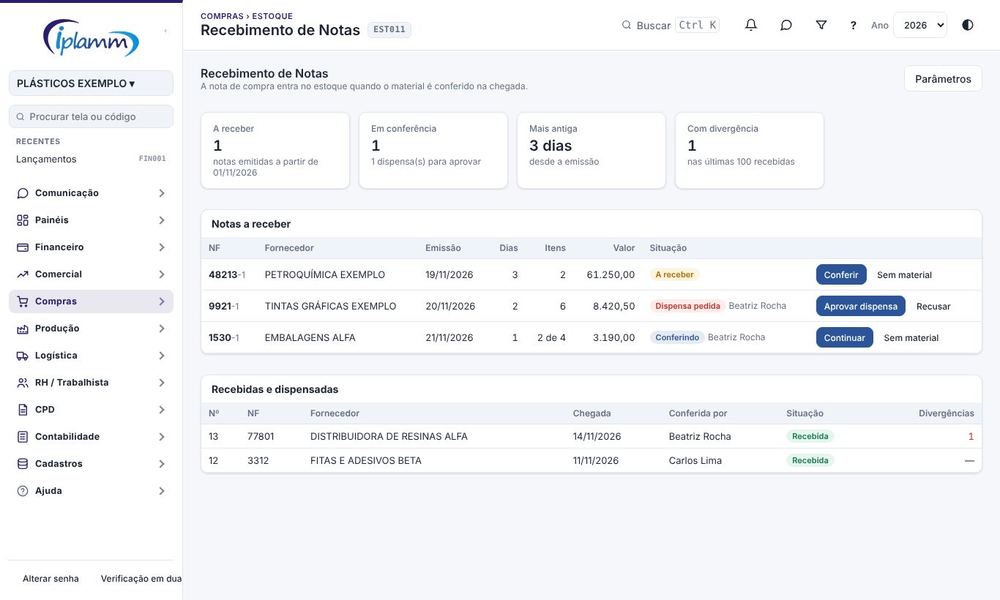
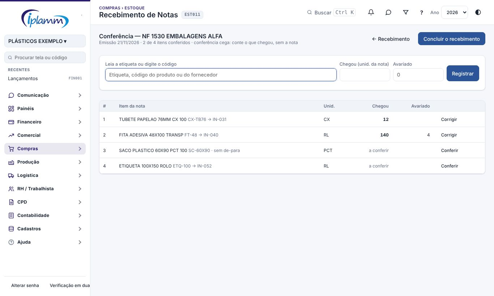
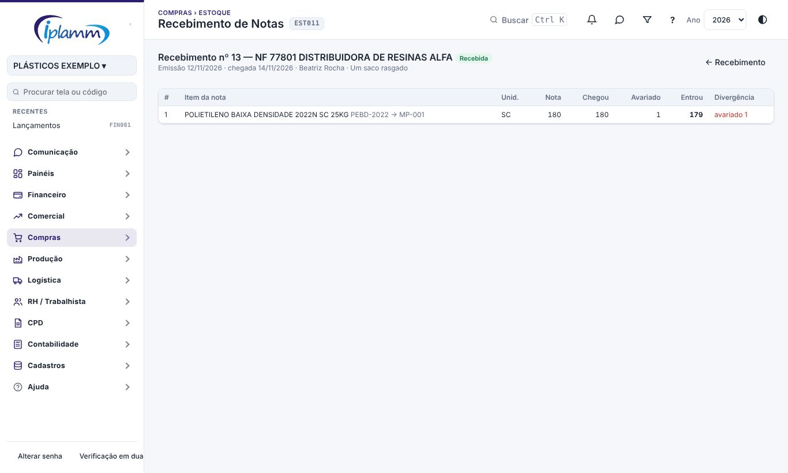
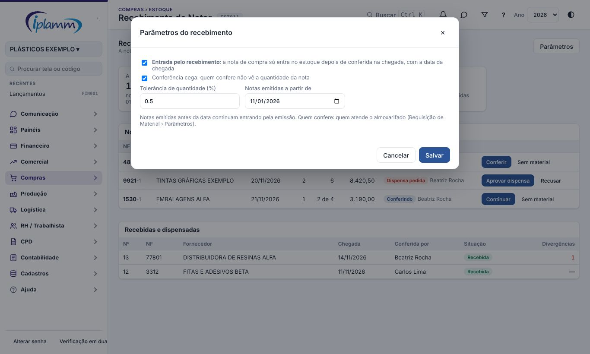

## 1. Para que serve

A nota de compra é emitida antes de o material chegar. Às vezes chega dias depois, às vezes chega a menos ou avariado.

Com a **entrada pelo recebimento** ligada, a nota não entra mais no estoque sozinha. Ela fica **a receber** até alguém conferir o material na chegada. Então:

- entra no estoque **o que chegou em bom estado**, e não o que diz a nota;
- na **data da chegada**, e não na data de emissão;
- ao **custo unitário da nota**;
- **falta, sobra ou avaria** vão como aviso para Compras cobrar o fornecedor.

> Exemplo: a nota de 4 sacos de resina foi emitida no dia 28 e o caminhão chegou no dia 02, com 3 sacos. Entram 75 kg no dia 02, ao custo da nota, e Compras recebe o aviso de que faltou 1 saco.

Isso também resolve o **corte do inventário**: material faturado e ainda em trânsito não está no estoque, e por isso não aparece como falta no inventário do dia 01.

## 2. Quem tem acesso

| O que | Quem |
|---|---|
| Ver a fila de notas a receber | Quem atende o almoxarifado, Administrador, Financeiro, Diretor e Compras |
| Conferir, concluir e pedir a dispensa | Quem atende o almoxarifado (os perfis e pessoas definidos em Requisição de Material › Parâmetros), menos o perfil Compras |
| Aprovar ou recusar a dispensa | Administrador, Financeiro e Diretor (nunca quem pediu) |
| Ver a quantidade da nota | Quem não está conferindo; quem confere só vê depois de concluir (conferência cega) |

**Por que Compras não confere.** Quem compra conhece a quantidade do pedido, e a conferência só funciona feita por outra pessoa. O perfil Compras só confere se a pessoa estiver nomeada entre quem atende o almoxarifado, em Requisição de Material › Parâmetros.
| Ligar, desligar e mudar os parâmetros | Administrador |

## 3. A tela

O menu é **Compras › Estoque › Recebimento de Notas**.

- **Notas a receber**: as notas de compra emitidas a partir da data de início, que ainda não foram conferidas. A coluna **Dias** conta desde a emissão.
- **Recebidas e dispensadas**: as conferências concluídas, com as divergências. Clique para ver a ficha.

## 4. Conferir o material

1. Na linha da nota, clique em **Conferir**.
2. Leia a etiqueta do produto com o leitor, ou digite o código do produto ou do fornecedor. No celular, use **Ler pela câmera**.
3. Digite **quanto chegou**, na unidade da nota (sacos, caixas, rolos).
4. Se parte veio avariada, digite em **Avariado** quanto, dessa quantidade, chegou avariada. O avariado entra no local **Avariados**, fora do custo médio, até Compras resolver com o fornecedor (seção 9).
5. Clique em **Registrar** e passe ao próximo item.

Na **conferência cega** (padrão), a tela não mostra a quantidade da nota: quem confere conta o que está na frente dele. A comparação é feita pela plataforma. Enquanto a conferência está aberta, a nota e os itens dela também ficam fora das outras telas (notas fiscais, pedidos de compra) para quem pode conferir, e o valor da nota não aparece na fila.

O leitor envia Enter depois do código. A plataforma entende esse Enter como a escolha do item, e não como registro da quantidade.

Para corrigir um item, clique em **Corrigir** na linha, enquanto a conferência não foi concluída. A conferência começada fica salva: dá para parar e continuar depois, pelo botão **Continuar**.

## 5. Concluir

Clique em **Concluir o recebimento**, confira a **data da chegada** (hoje, por padrão) e confirme.

- Item sem conferência fica como **não chegou** (zero).
- A data da chegada não pode ser futura, anterior à emissão, de mês fechado nem além do limite de dias para trás do estoque.
- Se algum item não puder entrar no estoque (por exemplo, o local está congelado pelo inventário), nada é gravado: a conferência continua aberta, com a mensagem do item, para corrigir a data ou esperar a liberação.
- Depois de concluída, a conferência não muda.

A plataforma então:

1. lança no estoque o que chegou em bom estado, na data da chegada, ao custo unitário da nota, **até a quantidade da nota**: o que chegou a mais não entra e fica como divergência (sobrou) para Compras resolver com o fornecedor;
2. registra as divergências (faltou, sobrou, avariado) de cada item;
3. avisa Compras e o administrador quando houver divergência.

Se o estoque ainda não foi implantado, a conferência fica registrada, e entra no estoque o que chegar a partir da data de implantação.

## 6. A ficha do recebimento

Depois de concluído, o recebimento mostra, por item, a quantidade da nota, o que chegou, o que veio avariado, o que entrou no estoque e a divergência.

## 7. Nota sem material

Nota de serviço, energia ou frete não tem material para receber.

1. Quem confere clica em **Sem material** e informa o motivo. A nota fica na fila como **Dispensa pedida**.
2. Administrador, financeiro e diretor recebem o aviso.
3. Um deles clica em **Aprovar dispensa** ou em **Recusar**, com o motivo. Quem pediu a dispensa não a aprova.
4. Aprovada, a nota sai da fila e fica na lista como **Dispensada**. Recusada, volta para a fila a receber.

A aprovação existe porque dispensar uma nota de material tira essa nota do estoque: é o controle contra o desvio de mercadoria.

## 8. Parâmetros

| Parâmetro | Padrão | Para que serve |
|---|---|---|
| Entrada pelo recebimento | Desligado | Ligado, a nota de compra só entra no estoque depois de conferida. Desligado, entra pela emissão, como antes |
| Conferência cega | Ligado | Quem confere não vê a quantidade da nota |
| Tolerância de quantidade (%) | 0,5 | Diferença entre o que chegou e a nota que não gera aviso |
| Notas emitidas a partir de | Dia em que foi ligado | Notas emitidas antes dessa data continuam entrando pela emissão |

## 9. Regras

- Só passam pela conferência as **notas de compra** (entrada, emitidas por terceiros, autorizadas). Notas emitidas pela própria empresa seguem como antes.
- Nota que já entrou no estoque pela emissão não aparece na fila.
- A mesma linha de nota nunca entra duas vezes no estoque, mesmo que duas pessoas processem ao mesmo tempo.
- A quantidade contada na unidade da nota é convertida pelo fator do de-para (por exemplo, 1 saco = 25 kg).
- Item sem de-para pode ser conferido. Ele entra no estoque quando o de-para for feito, com a quantidade que chegou e a data da chegada.
- Item que não chegou nada em bom estado não entra no estoque e não gera pendência.
- **Avariados.** O que chega avariado entra no local **Avariados (aguardando devolução ao fornecedor ou descarte)**, ao custo da nota, mas fora do custo médio dos outros locais. Quando Compras decidir, lança-se pelo Kardex a saída desse local: **Devolução a fornecedor** (com a nota de devolução) ou **Perda / sucata**.
- A entrada segue as regras do estoque: não lança em mês fechado nem em local congelado pelo inventário geral.

## 10. Dúvidas comuns

**A nota chegou ao sistema, mas o material ainda não.** Ela fica na fila de notas a receber. Nada entra no estoque até a conferência.

**O material chegou antes da nota.** Guarde o material separado e confira quando a nota aparecer na fila, com a data real da chegada.

**Conferi errado e já concluí.** A conferência concluída não muda. Ajuste pelo Kardex (estorno e lançamento) ou fale com o administrador.

**Por que o custo é o da nota e não o do que chegou?** O preço por unidade é o que o fornecedor cobrou. A falta é cobrada do fornecedor pela divergência avisada a Compras.

## 11. Histórico de versões

| Versão | Data | O que mudou |
|---|---|---|
| 1.0 | 22/11/2026 | Primeira versão: entrada da nota de compra pelo recebimento conferido, conferência cega pelo celular, leitor ou câmera, data da chegada, custo da nota, divergências avisadas a Compras, nota sem material dispensada e parâmetros (SQL 186). |
| 1.1 | 22/11/2026 | Nota e itens fora das outras telas para quem confere, durante a conferência. Chegada respeita mês fechado, limite de dias e local congelado (nada é gravado se não couber). Sobra além da nota não entra. Fila sem notas já lançadas pela emissão. |
| 1.2 | 22/11/2026 | Dispensa de nota pedida por quem confere e aprovada por administrador, financeiro ou diretor. Perfil Compras não confere, a não ser nomeado. Avariado entra no local Avariados, fora do custo médio (SQL 188). |
