A Recuperadora controla o material plástico que entra para ser reprocessado (moído, lavado, aglutinado e granulado). Ela serve a três tipos de empresa:

- **só aparas internas**: a empresa reprocessa a apara da própria produção para o grão voltar à linha;
- **só compra de terceiros**: a empresa compra material reciclável de catadores, cooperativas e sucateiros;
- **as duas coisas**.

O manual segue o caminho do material:

- **entrada:** balança, fornecedores, adiantamentos e lotes (seções 1 a 6);
- **processamento:** qualidade do grão, saída dos lotes, rendimento e custo (seções 7 a 10);
- **controle:** balanço de massa, ambiental, créditos fiscais e alertas (seções 11 a 14).

## 1. Ligar e configurar (Parâmetros da Recuperadora)

Em **Produção › Recuperadora › Parâmetros da Recuperadora** (REC009), quem configura a produção (administrador, financeiro ou diretor) liga o módulo e define as regras. Com o módulo **desligado**, o menu da Recuperadora some para todos, menos os Parâmetros, que continuam visíveis para quem configura.

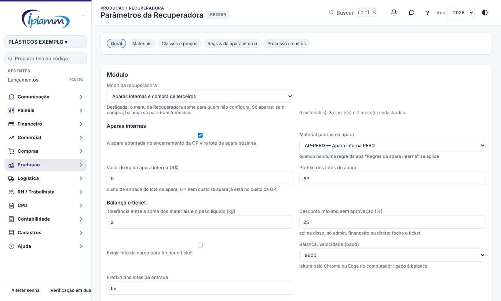

### 1.1 Modo e regras gerais

| Parâmetro | O que faz |
|---|---|
| Modo | Desligada, só aparas internas, só compra de terceiros, ou aparas internas e compra de terceiros |
| Apara vira lote sozinha | O refugo apontado no encerramento da OP entra num lote de apara do dia (seção 6) |
| Material padrão da apara | Material usado quando nenhuma regra da apara se aplica |
| Valor do kg da apara interna | Custo de entrada do lote de apara. Use 0 se a apara já está no custo da OP |
| Tolerância (kg) | Diferença aceita entre a soma dos materiais e o peso líquido da balança |
| Desconto máximo sem aprovação (%) | Acima dele, só administrador, financeiro ou diretor fecha o ticket |
| Exigir foto da carga | O ticket só fecha com ao menos uma foto |
| Balança: velocidade (baud) | Velocidade da leitura direta da balança pelo Chrome ou pelo Edge |
| Conta da compra de reciclável | Conta do título a pagar gerado ao fechar o ticket. Vazia, o ticket não gera título |
| Prazo de pagamento (dias) | Vencimento do título, contado a partir da data da pesagem |
| Conta do adiantamento | Conta do título a pagar gerado pelo adiantamento a fornecedor |
| Abater o adiantamento | Ao fechar o ticket, o saldo de adiantamento do fornecedor abate a compra |
| Lançar a compra no Kardex | O material ligado a um produto entra no estoque, no local escolhido (padrão: aparas, APA) |
| Prefixos | Prefixo do código dos lotes de entrada (LE) e dos lotes de apara (AP) |
| Tolerância do balanço (%) | Perda não explicada aceita no balanço de massa, em % da entrada nas ordens (seção 11) |
| Avisar as licenças com (dias) | Antecedência padrão do aviso das licenças (seção 12) |
| Alertas de ensaio e de adiantamento (dias) | Quando o lote de grão sem ensaio e o adiantamento em aberto viram alerta (seção 14) |
| Conta do custo de destinação | Conta do título a pagar gerado pela destinação de resíduos com custo |
| Avisar as licenças | Liga ou desliga o aviso diário das licenças ao administrador e ao diretor |

Na primeira vez, **Criar as classes padrão** cadastra três classes: A (limpo e seco, desconto de 2%), B (sujeira leve, 8%) e C (sujo ou úmido, 15%). Ajuste os percentuais depois.

### 1.2 Materiais

Cadastre cada tipo de material que entra na recuperadora. Para cada um, informe:

- o código;
- o nome;
- o polímero (PEBD, PEAD, PELBD, PP, BOPP, PET, PS, PVC, misto ou outro);
- a cor e a condição (limpo, sujo, impresso ou misto);
- o **NCM**, que sai na relação para a nota de entrada;
- o produto do Kardex, se a compra deve entrar no estoque.

Quando um material deixa de ser usado, marque-o como inativo. Os tickets antigos continuam com ele.

### 1.3 Classes e preços

A **classe** diz quanto o material está limpo e traz o **desconto padrão**: o percentual de umidade e impureza que sai do peso antes de pagar. No ticket, o desconto pode ser mudado item a item.

A **tabela de preços** guarda o R$/kg de cada material, com data de vigência:

- o preço de uma classe vence o preço geral do material (marcado "todas");
- para mudar o preço, lance uma nova vigência. O histórico fica guardado e os tickets já fechados não mudam;
- uma vigência futura aparece marcada "futuro" e passa a valer na data.

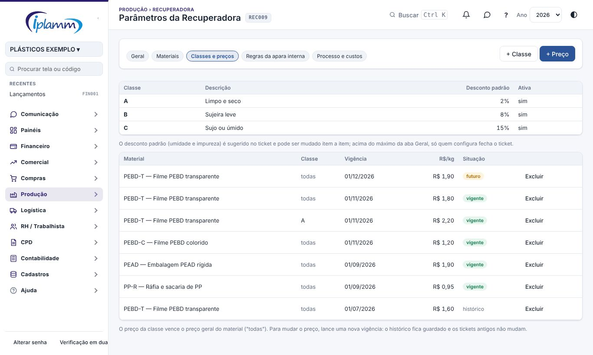

### 1.4 Regras da apara interna

Uma regra diz para qual material vai a apara de um setor, de uma máquina ou de um motivo de refugo. Se mais de uma regra vale para o mesmo apontamento, vence a mais específica: a da máquina vence a do motivo, que vence a do setor.

Escolha **não vai para a recuperadora** para o refugo que não volta para o processo, como o do próprio aglutinador ou a borra. **Refazer as aparas desde…** aplica as regras de novo aos apontamentos já encerrados a partir de uma data.

### 1.5 Processo e custos

Na aba **Processo e custos** ficam:

- **custos do processamento:** energia (R$ por kWh), água (R$ por m³), mão de obra (R$ por hora) e o custo-hora da máquina que não tem custo cadastrado. A plataforma procura o custo-hora nesta ordem: o da máquina, o do setor, o padrão do Custo das OPs e, por último, este;
- **meta de rendimento** (%): o grão que sai dividido pelo material que entrou na ordem;
- **prefixo dos lotes de grão** (GR);
- **exigir o ensaio:** o lote de grão nasce bloqueado e só é liberado pelo ensaio aprovado;
- **etapas do processo:** triagem, moagem, lavagem, secagem, aglutinação e extrusão e granulação, já cadastradas. Ajuste os nomes e a ordem, ou desative as que a empresa não tem;
- **preço da resina virgem** por polímero, com vigência e fonte: é a base da economia (seção 10).

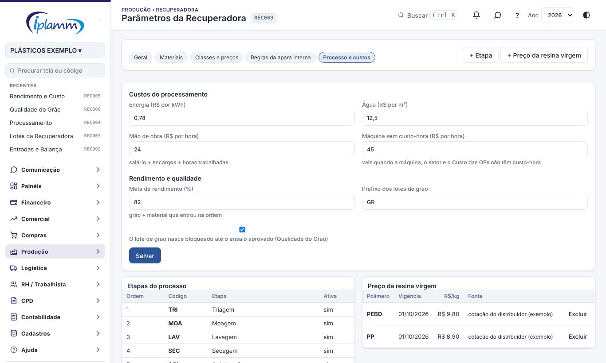

## 2. Painel da Recuperadora

O **Painel da Recuperadora** (REC001) mostra o mês escolhido:

- **Material comprado:** kg pesados nos tickets fechados;
- **Peso pago:** kg depois do desconto, com o desconto médio;
- **Valor das compras:** com o preço médio por kg pago;
- **Apara interna recebida:** kg vindos dos apontamentos da produção;
- **Tickets abertos;**
- **A pagar a fornecedores:** títulos em aberto das compras, com o saldo de adiantamentos.

Abaixo vêm o gráfico das entradas por dia, a tabela **por material** (comprado, valor, apara e saldo em lotes) e a tabela **fornecedores do mês** (peso, desconto, R$/kg pago e valor).

O quadro **Pendências da recuperadora** repete os alertas da Central de Decisões (seção 14), cada um com o atalho para a tela que resolve. Um aviso amarelo aparece quando há apontamentos com refugo que não viraram lote. Isso acontece quando falta o material padrão da apara ou uma regra.

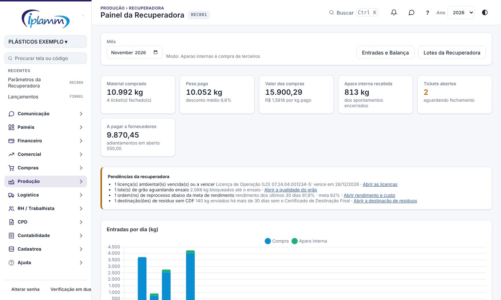

## 3. Entradas e Balança: o ticket de pesagem

Em **Entradas e Balança** (REC002), a aba **Tickets da balança** lista as pesagens do período. Dá para filtrar pela situação (aberto, fechado, cancelado) e buscar pelo número, fornecedor, placa ou motorista. A marca **sem nota** aponta a compra fechada sem nota do fornecedor, que entra na relação para a nota de entrada (seção 4.3).

O operador da balança (perfil Produção) usa esta tela e a de Lotes da Recuperadora. Administrador, financeiro e diretor também.

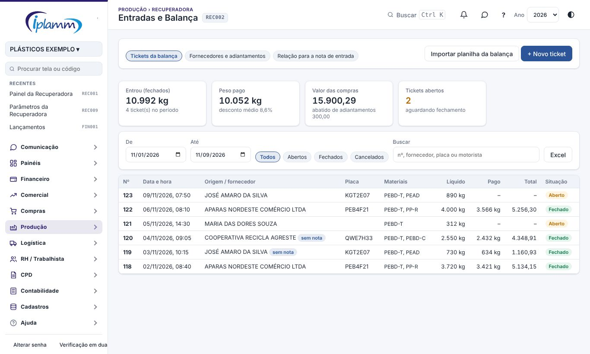

### 3.1 Abrir o ticket

**+ Novo ticket** abre a ficha com estes campos:

- data e hora;
- **origem:** compra, doação ou transferência. No modo "só aparas internas" não há compra;
- fornecedor (obrigatório na compra), placa e motorista;
- **peso bruto** e **tara**. O botão ⚖ lê o peso direto da balança no Chrome ou no Edge do computador ligado a ela; nos outros aparelhos, o peso é digitado;
- **peso líquido**, calculado como bruto − tara. Sem balança de veículo, informe só o líquido;
- **frete pago à parte:** entra no custo dos lotes, dividido pelo peso.

### 3.2 Materiais, classe, desconto e preço

Uma carga pode ter vários materiais. Em cada linha, informe:

- o material e a classe;
- o **peso**;
- o **desconto %**. Vazio, vale o desconto padrão da classe, que aparece em cinza no campo;
- o **R$/kg**. Vazio, vale o preço da tabela na data da pesagem; "sem preço" quando o material não tem preço cadastrado.

O resumo abaixo da tabela confere a **soma dos materiais** contra o peso líquido. Verde está dentro da tolerância; vermelho mostra a diferença. O resumo também traz o **peso pago**, o **total da compra** e, se o fornecedor tiver adiantamento em aberto, quanto vai ser abatido e quanto fica a pagar.

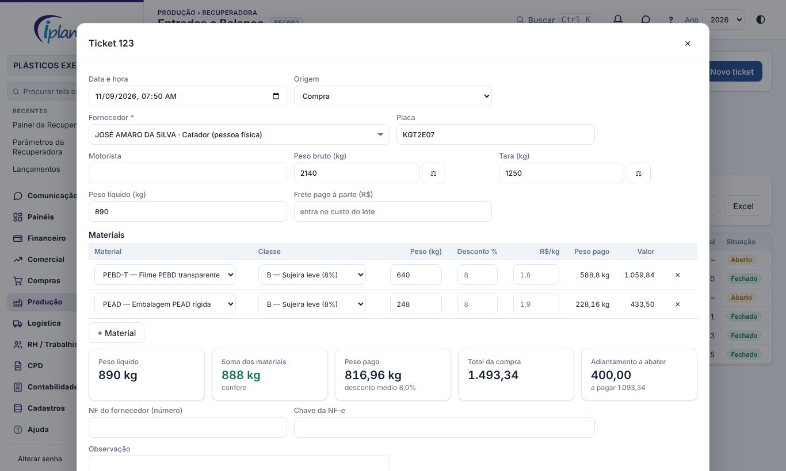

**Salvar aberto** guarda o ticket para terminar depois. Um caso comum: a carga é descarregada e separada antes de pesar cada material.

### 3.3 Fechar o ticket

**Fechar ticket** confere tudo de novo no banco e, se estiver certo, faz cinco coisas:

1. Cria um **lote de entrada** por material, com o peso pago, o custo (valor mais o frete rateado) e o código LE + número do ticket + sequência (ex.: LE123-1).
2. Abate o **adiantamento** em aberto do fornecedor, se a opção estiver ligada, começando pelos mais antigos.
3. Gera o **título a pagar** do que sobrou, na conta e no prazo dos parâmetros, com o documento "REC" + número do ticket. Ele aparece nos Lançamentos e na Autorização de Pagamentos como qualquer conta a pagar.
4. Lança a entrada no **Kardex**, se a opção estiver ligada e o material tiver produto.
5. Trava o ticket: depois de fechado, só a nota e as fotos mudam.

O fechamento não acontece quando:

- falta o fornecedor da compra;
- a soma dos materiais passa da tolerância;
- falta a foto exigida;
- o desconto passa do máximo e quem fecha não é administrador, financeiro ou diretor.

### 3.4 Cancelar ou excluir

- **Ticket aberto:** pode ser excluído (some da lista) ou cancelado (fica guardado como cancelado, com o motivo).
- **Ticket fechado:** só administrador, financeiro ou diretor cancela, e só se os lotes ainda não foram usados no processamento e o título não foi pago. O cancelamento desfaz os lotes, o título em aberto, o abatimento do adiantamento e a entrada no Kardex.

### 3.5 Comprovante, fotos e nota

- **Comprovante:** imprime a pesagem com materiais, descontos, preços, total, abatimento e espaço para as assinaturas do fornecedor e do recebimento.
- **+ Foto:** anexa fotos da carga, tiradas pela câmera do celular ou escolhidas no computador. Ficam guardadas por empresa, com até 8 MB cada.
- **Salvar a nota:** no ticket fechado, informa o número e a chave da NF-e do fornecedor, ou da nota de entrada emitida pela empresa. Com a nota, o ticket sai da relação da seção 4.3.

### 3.6 Importar a planilha da balança

Se a balança tem sistema próprio, use **Importar planilha da balança** com o Excel ou CSV exportado por ele. A plataforma reconhece as colunas pelo nome e você confere antes de importar. As colunas aceitas são:

- data e hora, número do ticket na balança, placa e motorista;
- fornecedor, pelo CPF/CNPJ ou pelo nome;
- peso bruto, tara e peso líquido;
- material e classe;
- observação.

Cada linha vira um ticket **aberto** para conferir e fechar. A mesma linha não entra duas vezes. Linhas com fornecedor ou material não cadastrado voltam na lista de erros.

## 4. Fornecedores, adiantamentos e relação para a nota

### 4.1 Fornecedores de reciclável

Na aba **Fornecedores e adiantamentos**, **Classificar fornecedor** marca um beneficiário do cadastro como fornecedor de reciclável. Os tipos são:

- catador (pessoa física);
- cooperativa de catadores;
- associação de catadores;
- sucateiro ou aparista (empresa);
- indústria (apara de terceiros);
- outro.

Na mesma tela ficam a **chave PIX** e a marca de **coletor incentivado**.

**Coletor incentivado** é a pessoa física que coleta ou faz a triagem de resíduos e a associação ou cooperativa de catadores (Lei Complementar 214/2025, art. 170). A marca é sugerida pelo tipo. A compra de um coletor incentivado gera crédito presumido de IBS e CBS para a empresa do regime regular. A apuração desse crédito chega na parte 3 da Recuperadora.

A tabela mostra o comprado nos últimos 90 dias e o adiantamento em aberto de cada fornecedor.

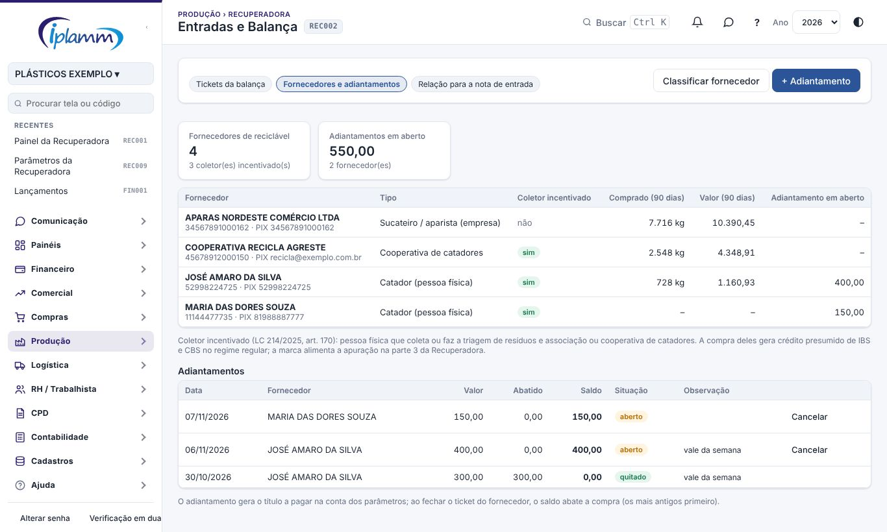

### 4.2 Adiantamentos

**+ Adiantamento** registra o vale ou adiantamento dado ao fornecedor, uma prática comum com catadores e sucateiros, e gera o título a pagar na conta dos parâmetros. Ao fechar o próximo ticket do fornecedor, o saldo abate a compra.

O adiantamento fica **quitado** quando o saldo zera. O cancelamento só vale para adiantamento que ainda não abateu nenhuma compra e não foi pago.

### 4.3 Relação para a nota de entrada

A aba **Relação para a nota de entrada** junta as compras fechadas sem nota do fornecedor no período, por fornecedor e material. A relação traz:

- CPF/CNPJ do fornecedor;
- tipo e a marca de coletor incentivado;
- NCM;
- números dos tickets;
- peso pago, R$/kg médio e valor.

**Excel** baixa a relação para emitir a nota de entrada no sistema fiscal.

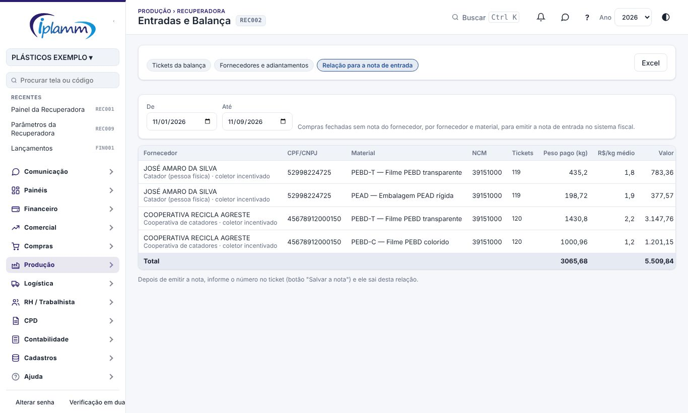

## 5. Lotes e etiquetas

**Lotes da Recuperadora** (REC003) lista os lotes de entrada (da balança), os de apara interna e os de grão (do processamento). Para cada lote, a tabela mostra:

- material e classe;
- origem (fornecedor ou "apontamentos da produção");
- data;
- peso, saldo e R$/kg;
- situação: disponível, em processo, consumido, bloqueado, vendido ou cancelado.

O lote **bloqueado** não entra no processamento até ser liberado. Ao clicar num lote, você vê a origem, que pode ser o ticket com o desconto e o preço, ou a quantidade de apontamentos. Na mesma ficha dá para bloquear, liberar e anotar uma observação.

A ficha do lote também mostra o **movimento**: as ordens de reprocesso que usaram o lote e as saídas. **Dar saída** registra a saída do lote (seção 9).

**Etiqueta** imprime a etiqueta de 100 × 70 mm com o código do lote em QR. Para imprimir várias, marque os lotes na lista e use **Etiquetas dos marcados**.

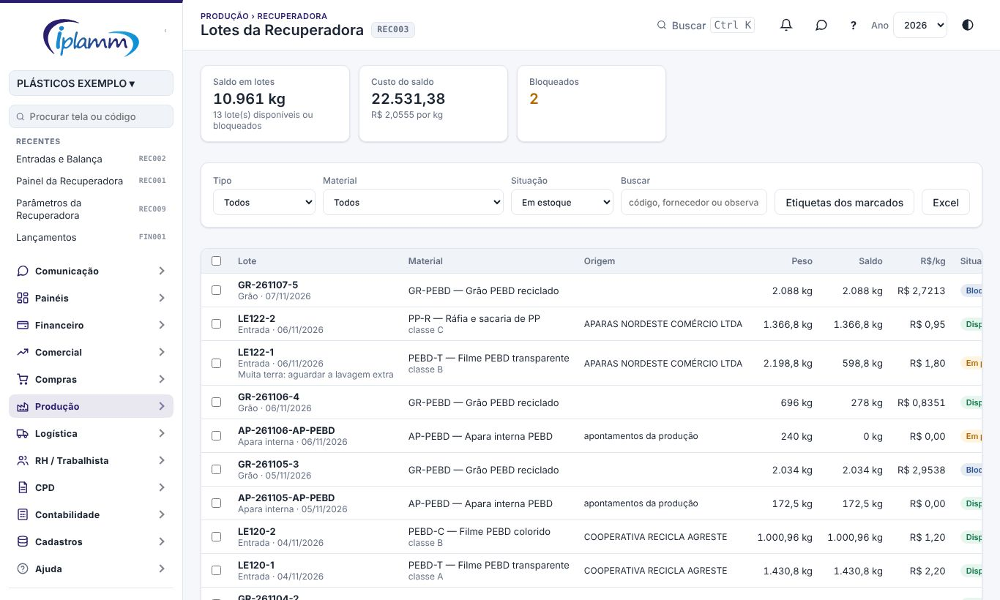

## 6. Aparas internas

Nos modos "só aparas internas" e "aparas internas e compra de terceiros", cada apontamento encerrado com refugo no Terminal do Setor ou na importação do Iniflex manda o kg para um **lote de apara do dia**. O código do lote é AP + data + material, por exemplo AP-261106-AP-PEBD.

O material sai das regras da seção 1.4 ou do material padrão. O lote acompanha o apontamento:

- alterar o refugo, o motivo, a máquina ou o setor refaz a entrada;
- excluir o apontamento tira o kg do lote.

Quando o módulo é ligado depois, ou as regras mudam, use **Refazer as aparas desde…** nos Parâmetros.

## 7. Processamento (ordem de reprocesso)

Em **Processamento** (REC004), cada ordem de reprocesso transforma lotes de entrada (compra, apara ou grão a reprocessar) num **lote de grão**. A lista mostra:

- o grão produzido e a máquina;
- a entrada e a saída em kg;
- o **rendimento**: verde na meta, amarelo até 10 pontos abaixo e vermelho abaixo disso;
- o custo por kg e a situação.

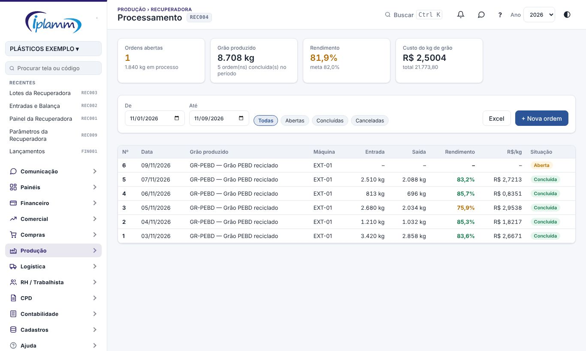

### 7.1 Abrir a ordem e escolher os lotes

**+ Nova ordem** pede a data, o **grão que sai** (um material cadastrado, ex.: GR-PEBD) e a máquina principal. Na ficha da ordem, escolha o lote pela lista ou leia a etiqueta e informe os kg. Com o campo vazio, entra todo o saldo do lote.

O saldo sai do lote na hora e o lote fica **em processo**. Tirar o lote enquanto a ordem está aberta devolve os kg. Lote bloqueado não entra.

### 7.2 Apontar as etapas

Para cada etapa, informe:

- a etapa, a máquina (vazio usa a principal), as horas e o operador;
- os kg de entrada e de saída;
- as perdas por tipo: **umidade**, **sujeira**, **finos** e **rejeito**.

O resumo avisa quando a entrada, a saída e as perdas apontadas não fecham. O apontamento é feito nesta tela, que funciona no celular e está liberada para o perfil Produção.

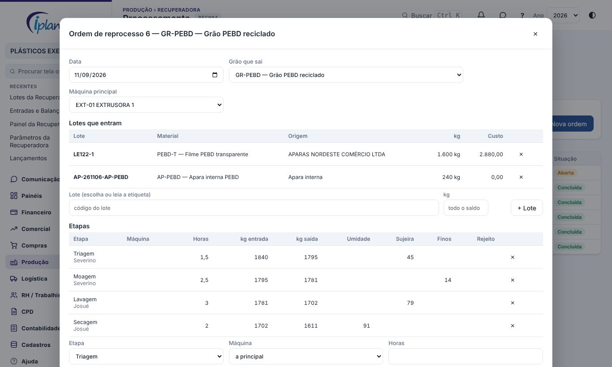

### 7.3 Custos e conclusão

Informe os **custos da ordem**: energia (kWh), água (m³), químicos (R$), mão de obra (horas) e outros (R$). O resumo calcula na hora:

- o custo do processo, item a item, incluindo as horas de máquina de cada etapa;
- o custo do material, pelo custo de cada lote consumido;
- o rendimento previsto e o **custo do kg de grão**.

**Concluir** pede o grão pesado na saída. A conclusão cria o lote de grão, com código GR + data + número da ordem e o custo total. Os lotes de entrada que zeraram passam a **consumidos**.

Se os parâmetros pedirem, o grão fica **bloqueado** até o ensaio. Se a opção do Kardex estiver ligada e o grão tiver produto, o grão entra no estoque como produção.

**Cancelar a ordem** (só a aberta) devolve os kg aos lotes.

## 8. Qualidade do grão

Em **Qualidade do Grão** (REC006), a aba **Lotes de grão e ensaios** mostra os lotes aguardando ensaio, os reprovados, a taxa de aprovação e o grão liberado.

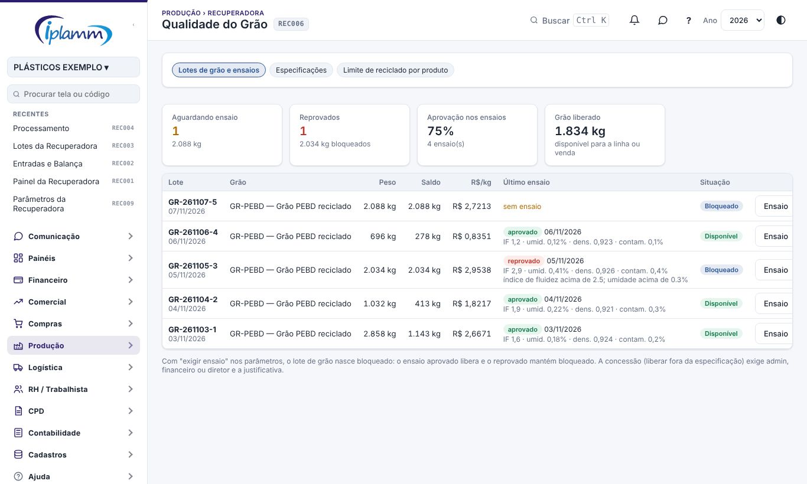

**Ensaio** registra estas medidas:

- índice de fluidez (g/10 min);
- umidade (%);
- densidade (g/cm³);
- contaminação (%);
- cor.

A plataforma compara as medidas com a **especificação** do material e mostra o resultado antes de registrar:

- **dentro da especificação:** registrar libera o lote;
- **fora da especificação:** registrar mantém o lote bloqueado e grava os motivos. **Reprovar** bloqueia mesmo dentro da especificação;
- **Liberar por concessão:** libera fora da especificação. Só administrador, financeiro ou diretor faz, e com a justificativa.

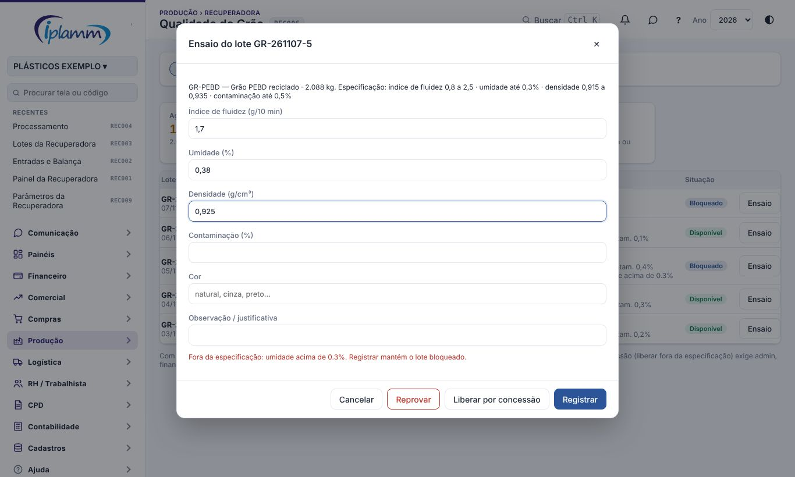

A aba **Especificações** guarda os limites de cada grão. Campo vazio não é verificado. A aba **Limite de reciclado por produto** guarda o percentual máximo de reciclado que cada produto acabado aceita, em relação ao peso da OP.

## 9. Saída dos lotes

Na ficha do lote, **Dar saída** registra o destino:

| Destino | Quem pode | O que acontece |
|---|---|---|
| Volta para a linha (OP) | Quem aponta a produção | O grão sai para a OP escolhida. Se o reciclado da OP passar do limite do produto, a plataforma avisa na hora e manda um aviso ao administrador e ao diretor |
| Venda | Quem aponta a produção | Informe a NF no documento; o lote que zera fica "vendido" |
| Perda | Administrador, financeiro e diretor | Exige o motivo |
| Ajuste | Administrador, financeiro e diretor | Correção de saldo |

O custo da saída é o custo médio do lote. Só sai lote **disponível**: o bloqueado precisa do ensaio aprovado ou da liberação.

## 10. Rendimento e custo

**Rendimento e Custo** (REC005) junta as ordens concluídas no período.

- **Indicadores:**
  - rendimento contra a meta;
  - **custo do kg de grão**, separado em material e processo;
  - **economia contra a resina virgem**: o preço da resina virgem menos o custo do grão, vezes os kg produzidos;
  - perdas por tipo.
- **Gráficos:** rendimento de cada ordem contra a meta e perdas por tipo.
- **Fornecedores: quanto paguei × quanto virou grão:**
  - o grão de cada lote é o kg consumido vezes o rendimento da ordem;
  - **rendimento sobre o pesado:** o grão dividido pelos kg pesados na balança. Junta o desconto da classe e as perdas do processo;
  - **material no kg de grão:** o que foi pago ao fornecedor dividido pelo grão que o material dele virou;
  - **preço equivalente:** o preço pago vezes o rendimento do fornecedor dividido pela média dos fornecedores. A seta ▼ mostra o fornecedor que rende menos que a média: o preço justo do material dele é menor;
  - use esta tabela para negociar o preço com cada fornecedor.
- **Grão produzido:** custo por kg do material e do processo, preço da resina virgem e economia, por grão.
- **Material de entrada:** rendimento de cada material, separando a apara interna e o grão reprocessado.

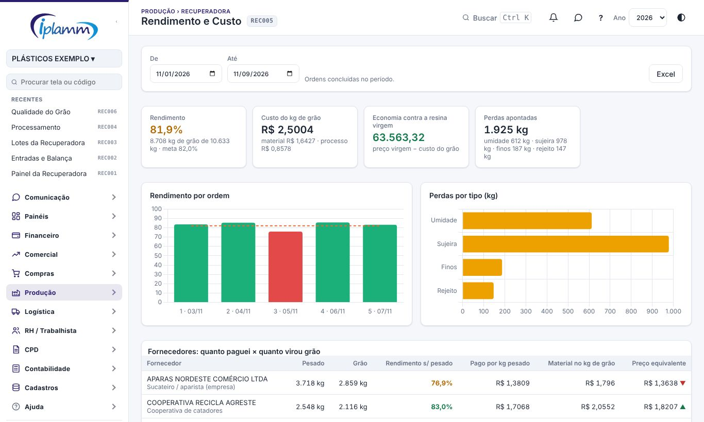

## 11. Balanço de massa

O **Balanço de Massa** (REC007) fecha o mês em quilos e mostra se o material que entrou bate com o que saiu. A tela tem quatro quadros.

- **Material:** estoque inicial em lotes, compra pesada, desconto da classe, apara interna, doações e transferências, consumo no processamento e estoque final. A conta é conferida com o saldo dos lotes.
- **Processo:** entrada nas ordens concluídas, grão produzido, perdas apontadas por tipo e a **perda não explicada**, que é a entrada menos o grão menos as perdas apontadas. Acima da tolerância dos parâmetros (padrão 2%), o quadro fica vermelho e o alerta vai para a Central de Decisões no mês seguinte.
- **Grão:** estoque inicial, produção, saídas por destino e estoque final.
- **Resíduos:** rejeito apontado nas etapas, o que foi destinado no mês por tipo (com e sem CDF) e o total destinado sem CDF.

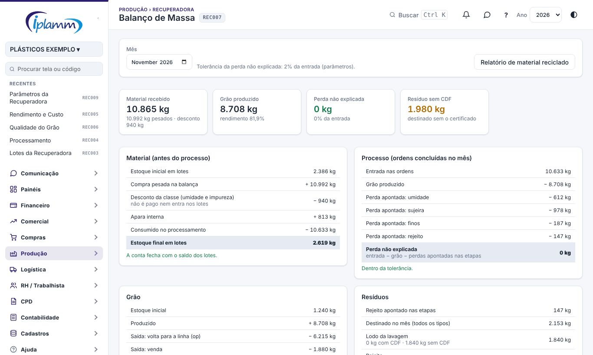

**Relatório de material reciclado** imprime, para o período escolhido:

- as toneladas de grão produzido por material;
- a origem do material recebido: catadores e cooperativas, empresas, doações e aparas da própria produção;
- os resíduos destinados.

O relatório serve para clientes, para a logística reversa e para a comunicação da empresa.

## 12. Ambiental

Em **Ambiental** (REC008), quem configura a produção registra os resíduos e os documentos ambientais.

**Destinação de resíduos.** Cada envio de rejeito, lodo da lavagem, borra, finos ou outro resíduo registra:

- data, peso e destinação (aterro, coprocessamento, reciclagem…);
- transportador e destinador;
- **MTR** (Manifesto de Transporte de Resíduos, emitido no SINIR) e **CDF** (Certificado de Destinação Final, emitido pelo destinador), com as datas;
- custo e anexos.

Com custo e a conta de resíduos nos parâmetros, o registro gera o título a pagar. O envio sem CDF fica marcado "aguardando". Passados 30 dias, ele vira alerta.

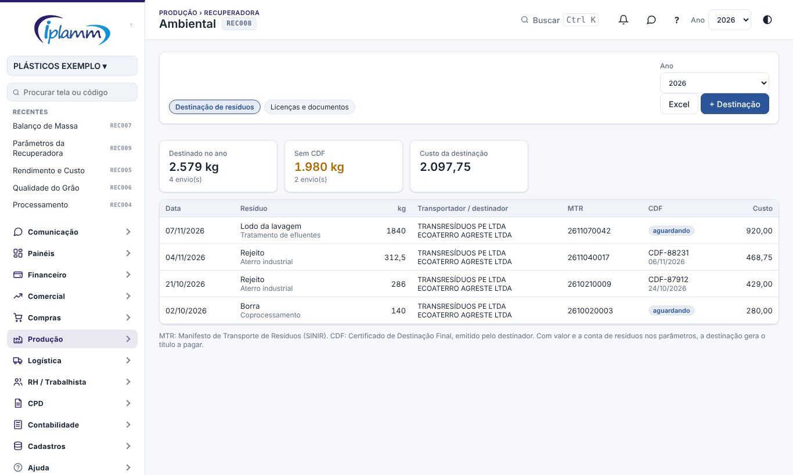

**Licenças e documentos.** Cada licença ou documento ambiental registra o tipo, o número, o órgão, a emissão, a validade, a antecedência do aviso, as condicionantes e os anexos. Exemplos: LO, LI, LP, CTF/IBAMA, outorga de água, licença de efluentes, AVCB, alvará.

A situação aparece como vencida, a vencer ou em dia. O administrador e o diretor recebem um aviso quando a licença entra na antecedência e outro quando ela vence. A rotina roda nos dias úteis às 8h35.

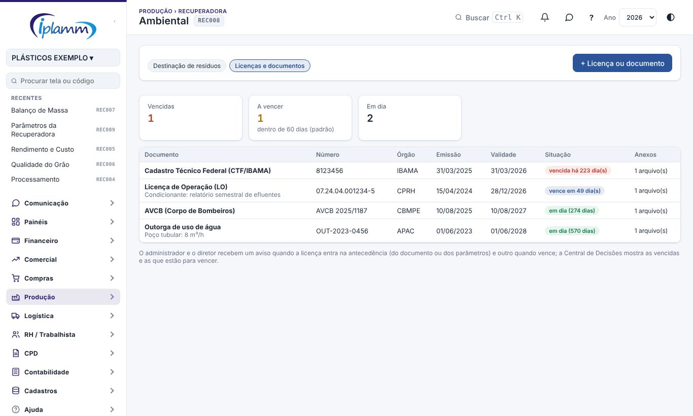

## 13. Créditos fiscais

**Créditos Fiscais da Recuperadora** (REC010) estima, para as compras fechadas no período, dois tipos de crédito:

- **crédito presumido de CBS e IBS** na compra de **coletor incentivado**: pessoa física que coleta ou faz a triagem, e associação ou cooperativa de catadores (Lei Complementar 214/2025, art. 170). Vale para a empresa do regime regular;
- **crédito de PIS/COFINS** na compra de **pessoa jurídica** (CNPJ) que não é coletor incentivado, para a empresa no regime não cumulativo (Tema 304 do STF).

O percentual de cada ticket é o da vigência na data da pesagem. Os **parâmetros por vigência** guardam o percentual de CBS, de IBS e de PIS/COFINS, sempre com a **fonte**. **Carregar os percentuais da LC 214/2025** cria as vigências de 2027 a 2033: CBS de 7%, e IBS de 1,3% em 2029 subindo até 13% em 2033.

Os valores são estimativas para o planejamento. Confira os percentuais com a contabilidade; a apuração oficial é feita no sistema fiscal. O alerta amarelo mostra as compras sem percentual vigente na data.

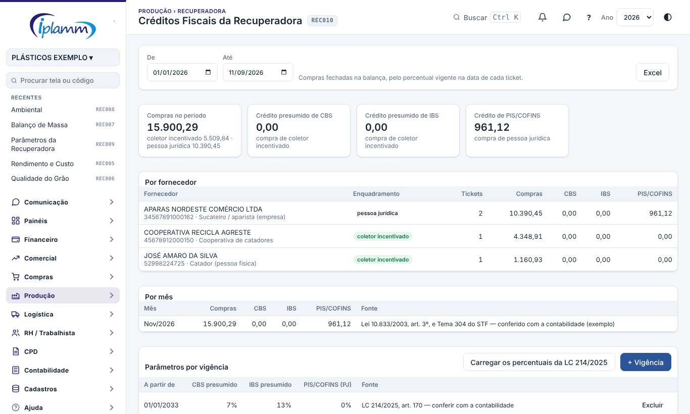

## 14. Central de Decisões e avisos

A regra 27 da Central de Decisões traz as pendências da recuperadora na área Produção da saúde da empresa:

| Alerta | Quando aparece |
|---|---|
| Licenças vencidas ou a vencer | Dentro da antecedência; alta com 15 dias ou menos, ou vencida |
| Grão aguardando ensaio | Lote de grão bloqueado sem ensaio há mais dias que o parâmetro |
| Rendimento abaixo da meta | Ordens dos últimos 30 dias abaixo da meta; alta com 3 ou mais |
| Balanço de massa | Perda não explicada do mês anterior acima da tolerância |
| Resíduo sem CDF | Destinação com mais de 30 dias sem o certificado |
| Adiantamento antigo | Saldo de adiantamento mais antigo que o parâmetro |
| Ticket aberto | Pesagem aberta há 2 dias ou mais |

## 15. Quem pode o quê

| Ação | Quem |
|---|---|
| Ver painel, tickets e lotes | Administrador, financeiro, diretor, leitura e produção |
| Abrir, editar, fechar e excluir ticket aberto; fotos; nota; importar planilha | Administrador, financeiro, diretor e produção |
| Fechar ticket com desconto acima do máximo | Administrador, financeiro e diretor |
| Cancelar ticket fechado; adiantamentos; classificar fornecedor | Administrador, financeiro e diretor |
| Bloquear e liberar lote | Administrador, financeiro e diretor |
| Abrir e apontar ordem de reprocesso; concluir; cancelar ordem aberta | Administrador, financeiro, diretor e produção |
| Registrar ensaio; saída para a OP ou venda | Administrador, financeiro, diretor e produção |
| Concessão no ensaio; saída por perda ou ajuste | Administrador, financeiro e diretor |
| Ver balanço de massa, ambiental e créditos fiscais | Administrador, financeiro, diretor, leitura e produção |
| Destinação de resíduos, licenças e parâmetros fiscais | Administrador, financeiro e diretor |
| Parâmetros, materiais, classes, preços, regras da apara, etapas, custos, especificações e limites | Administrador, financeiro e diretor |

## 16. Histórico de alterações

| Versão | Data | O que mudou |
|---|---|---|
| 1.0 | 09/11/2026 | Primeira versão (Recuperadora, parte 1). Inclui modo do módulo, materiais, classes, preços por vigência, ticket da balança com leitura direta, fechamento com lotes, título a pagar e abatimento do adiantamento, cancelamento, comprovante, fotos, nota, importação da planilha da balança, fornecedores e coletor incentivado, adiantamentos, relação para a nota de entrada, lotes com etiqueta e aparas internas automáticas. |
| 1.1 | 09/11/2026 | Recuperadora, parte 2. Inclui processo e custos nos parâmetros (etapas, energia, água, mão de obra, máquina, meta de rendimento, exigir ensaio, resina virgem), ordem de reprocesso com lotes, etapas e perdas, conclusão com o lote de grão e o custo, qualidade do grão (ensaio, especificação, concessão, limite de reciclado), saída dos lotes, e rendimento e custo por fornecedor e por grão com a economia contra a resina virgem. |
| 1.2 | 09/11/2026 | Recuperadora, parte 3. Inclui balanço de massa do mês, relatório de material reciclado, destinação de resíduos com MTR, CDF e título a pagar, licenças com aviso, créditos fiscais (CBS e IBS presumidos do coletor incentivado, PIS/COFINS de pessoa jurídica) com parâmetros por vigência, alertas na Central de Decisões e no Painel, e novos parâmetros de alerta. |
