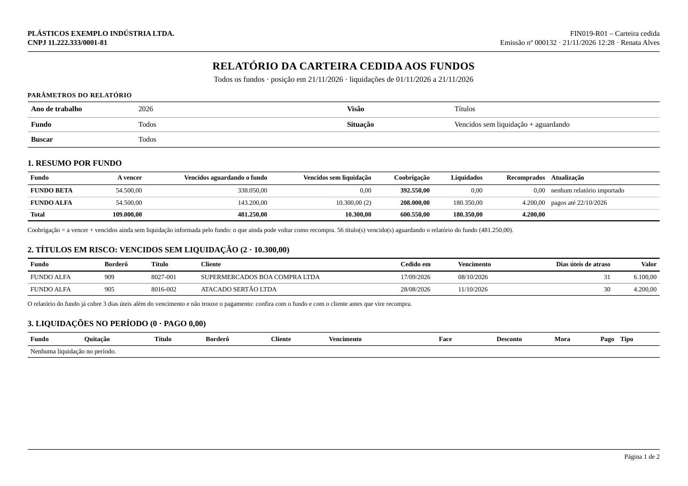
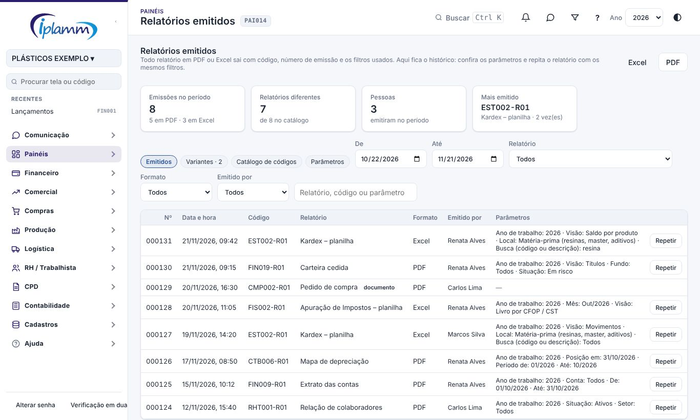
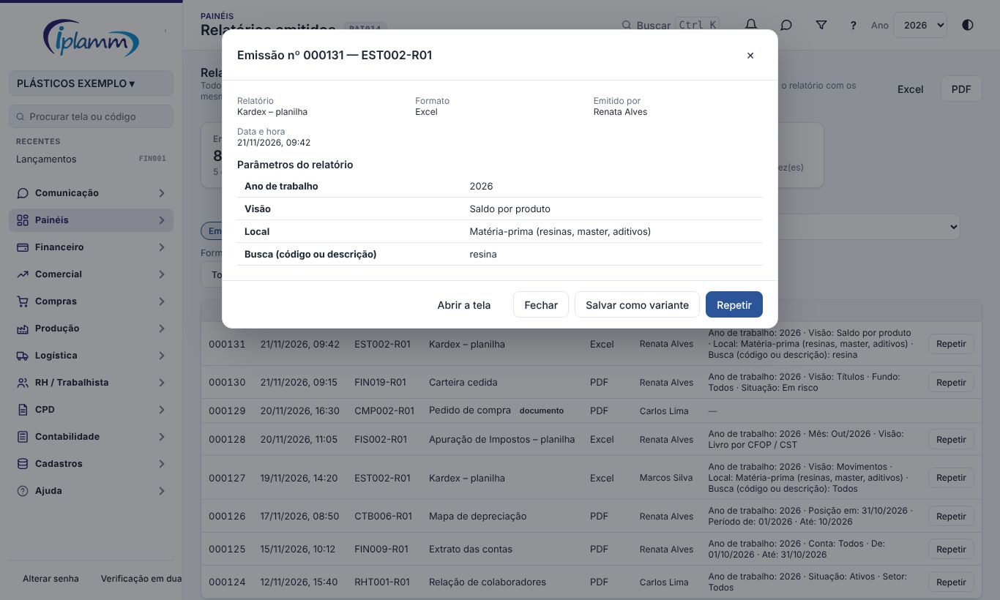
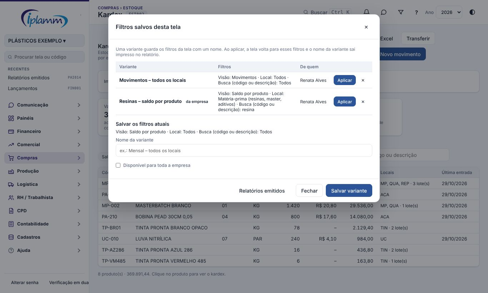
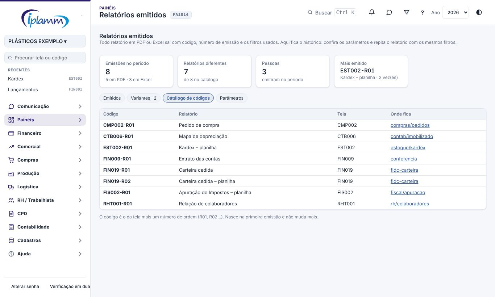
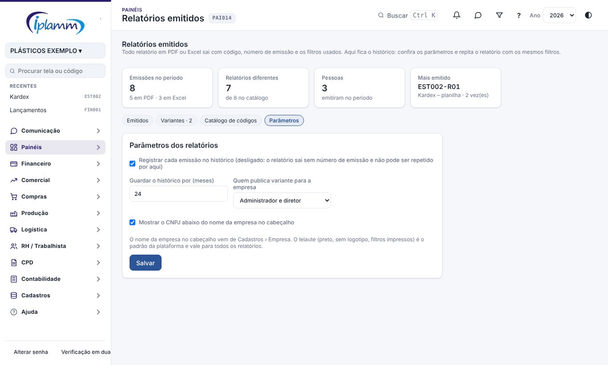

## 1. Para que serve

Todo relatório da plataforma, em PDF ou em Excel, sai no mesmo padrão: identificado, sóbrio e com os filtros escolhidos impressos. Com isso, quem recebe o relatório sabe exatamente o que ele mostra, e quem emitiu consegue repeti-lo.

| O que o padrão garante | Como |
|---|---|
| Saber de onde veio o relatório | Empresa, código do relatório, número da emissão, data, hora e usuário no cabeçalho de todas as páginas |
| Saber o que foi filtrado | Quadro **Parâmetros do relatório** com todos os filtros da tela, inclusive os deixados em "Todos" |
| Repetir o relatório | Histórico das emissões com o botão **Repetir**, que volta à tela com os mesmos filtros |
| Não refazer filtros de rotina | **Variantes**: filtros salvos com um nome, em qualquer tela |
| Leitura sem distração | Preto e cinza, sem cores, sem fundo, sem logotipo: só o nome da empresa |

Nada muda no conteúdo dos relatórios nem nas telas: o padrão trata do leiaute do papel e da planilha.

## 2. Quem tem acesso

| Perfil | O que faz |
|---|---|
| Todos | Emitem relatórios no padrão, veem as próprias emissões, repetem, salvam e aplicam as próprias variantes e as da empresa |
| Administrador e Diretor | Veem as emissões de todos, publicam variante para a empresa, excluem qualquer variante e mudam os parâmetros |

## 3. Como é o relatório em PDF

1. **Cabeçalho em todas as páginas.** À esquerda, o nome da empresa e o CNPJ. À direita, o código e o nome do relatório e, abaixo, o número da emissão, a data, a hora e quem emitiu.
2. **Título e subtítulo**, centralizados.
3. **Parâmetros do relatório.** Cada filtro da tela com o valor escolhido. Filtro vazio aparece como "Todos". Se uma variante estiver aplicada, o nome dela aparece na última linha.
4. **Corpo**, em seções numeradas. Tabelas só com filetes; totais em negrito; valor negativo com sinal de menos.
5. **Rodapé em todas as páginas**: a fonte dos dados e "Página X de Y".
6. **Fecho**: a linha "Fim do relatório", com o código e o número da emissão.

**Documentos** (pedido de compra, ordem de produção, laudo, proposta, termo) usam o mesmo cabeçalho e o mesmo leiaute, mas não têm o quadro de parâmetros, porque não nascem de um filtro. No histórico eles aparecem com a marca "documento".

**De onde vêm os parâmetros.** A plataforma lê sozinha os filtros da barra de filtros da tela (seletores, datas, buscas, caixas de marcar e a aba aberta), além do ano de trabalho. Não é preciso informar nada a mais.

## 4. Como é a planilha do Excel

A planilha exportada leva o mesmo cabeçalho, nas primeiras linhas: empresa, CNPJ, código e nome do relatório, número da emissão com data, hora e usuário e, em seguida, os parâmetros (um por linha). Os dados começam logo abaixo.

As colunas de valor e de quantidade saem como **número**, prontas para somar. Códigos, CFOP e datas saem como texto, do jeito que estão na tela.

O modelo de importação de lançamentos (Configurações) continua saindo sem cabeçalho, porque é um arquivo para ser preenchido e importado.

## 5. Relatórios emitidos

Menu **Painéis › Relatórios emitidos**. A tela mostra as emissões do período, com quatro indicadores no alto: emissões, relatórios diferentes, pessoas e o relatório mais emitido.

Filtros: período, relatório, formato, quem emitiu (administrador e diretor) e busca por nome, código ou parâmetro. Os botões **Excel** e **PDF** emitem a própria lista, já no padrão.

### 5.1 Conferir os parâmetros e repetir

1. Clique na linha da emissão. A janela mostra todos os parâmetros usados.
2. Clique em **Repetir**. A plataforma abre a tela de origem e recoloca os filtros, um por um.
3. Confira os filtros e clique no botão do relatório (PDF, Imprimir ou Excel). A nova emissão ganha um novo número.

Se um filtro não existir mais na tela (uma conta excluída, por exemplo), a plataforma avisa quantos filtros não pôde aplicar. O botão **Salvar como variante** guarda os filtros daquela emissão com um nome.

O **Repetir** recoloca os filtros; os números do relatório são os de hoje. Para um período já encerrado, o resultado é o mesmo; para "posição de hoje", ele reflete os lançamentos feitos depois.

## 6. Variantes (filtros salvos)

Em qualquer tela, o botão **Filtros salvos** (ícone de funil, no alto) mostra as variantes daquela tela.

**Salvar:** escolha os filtros na tela, abra **Filtros salvos**, dê um nome e clique em **Salvar variante**. Marque "Disponível para toda a empresa" para que todos a vejam (por padrão, só administrador e diretor publicam).

**Aplicar:** clique em **Aplicar**. A tela volta para aqueles filtros. Enquanto os filtros não forem alterados, o nome da variante sai impresso no relatório.

**Excluir:** o ✕ ao lado da variante. Cada pessoa exclui as suas; administrador e diretor excluem qualquer uma.

A aba **Variantes** de Relatórios emitidos lista as variantes de todas as telas.

## 7. Catálogo de códigos

Cada relatório tem um código: o da tela mais um número de ordem (por exemplo, FIN019-R01). O código nasce na primeira emissão e não muda mais. A planilha de uma tela tem o seu próprio código.

## 8. Parâmetros

Aba **Parâmetros** (administrador e diretor).

| Parâmetro | Padrão | Efeito |
|---|---|---|
| Registrar cada emissão no histórico | Ligado | Desligado, o relatório sai sem número de emissão e não aparece no histórico |
| Guardar o histórico por | 24 meses | Emissões mais antigas são apagadas no dia 1º de cada mês |
| Quem publica variante para a empresa | Administrador e diretor | "Qualquer pessoa" libera a publicação para todos |
| CNPJ no cabeçalho | Ligado | Desligado, o cabeçalho mostra só o nome da empresa |

O nome da empresa no cabeçalho vem de Cadastros › Empresa.

## 9. Dúvidas comuns

| Situação | O que fazer |
|---|---|
| O relatório saiu sem número de emissão | A emissão não pôde ser registrada (sem internet, ou o registro está desligado nos parâmetros). O relatório vale do mesmo jeito |
| Um filtro não apareceu no quadro de parâmetros | O quadro lê a barra de filtros da tela. Avise o suporte informando a tela e o filtro |
| Não vejo a emissão de um colega | Cada pessoa vê as suas. Administrador e diretor veem todas |
| O relatório ainda sai com cores ou com cara de tela | Alguns relatórios antigos ainda imprimem a própria tela ou usam outro gerador de PDF. A conversão deles é a próxima fase do padrão |

## 10. Histórico de versões

| Versão | Data | O que mudou |
|---|---|---|
| 1.0 | 21/11/2026 | Primeira versão: leiaute padrão nos relatórios e documentos, parâmetros impressos, cabeçalho no Excel, histórico com Repetir, variantes, catálogo e parâmetros (SQL 174) |
