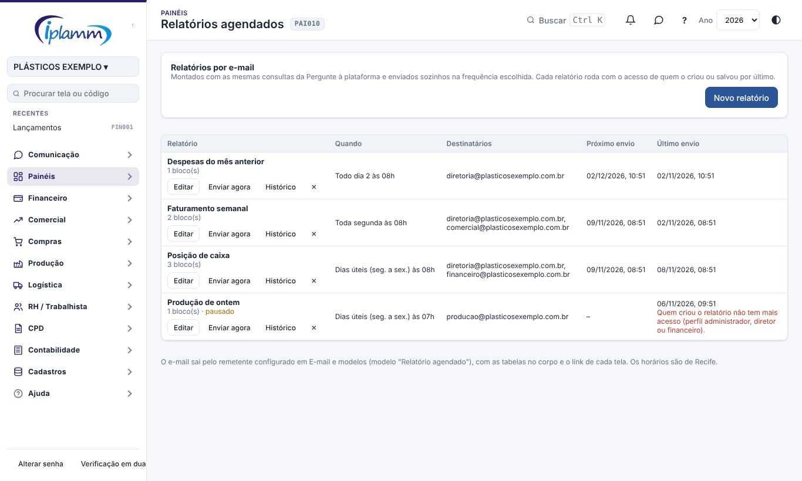
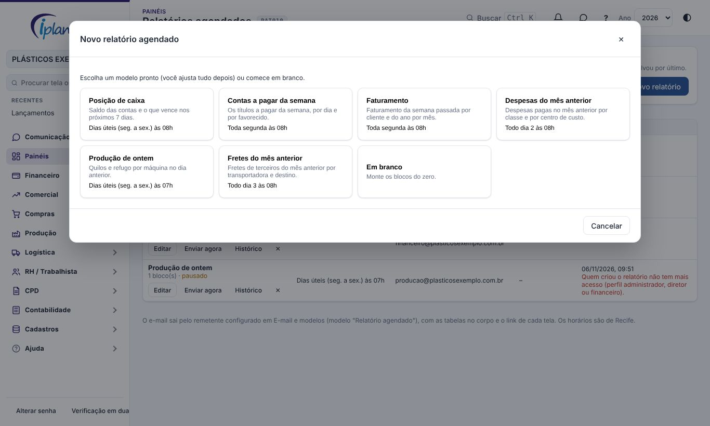
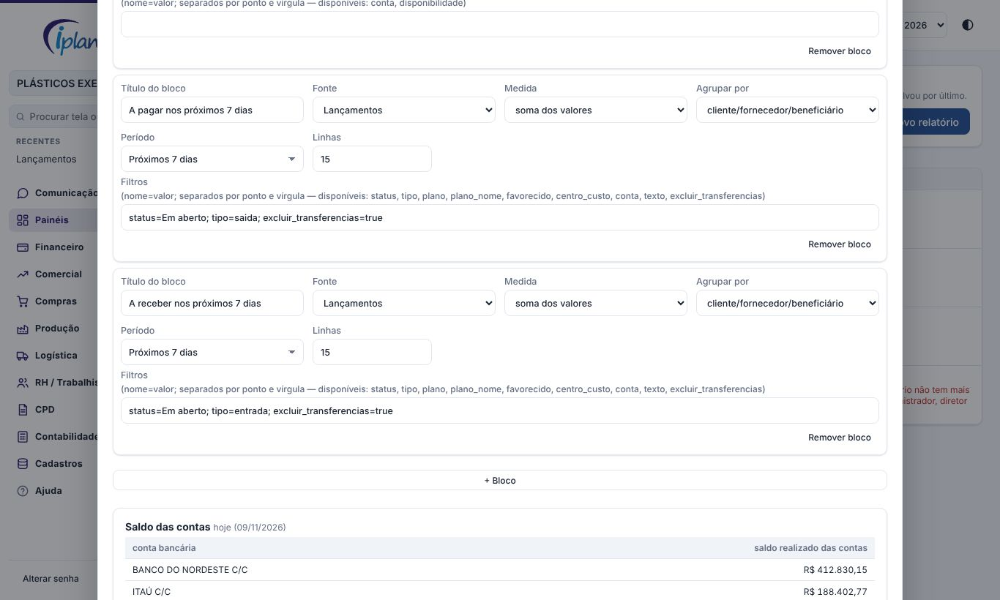
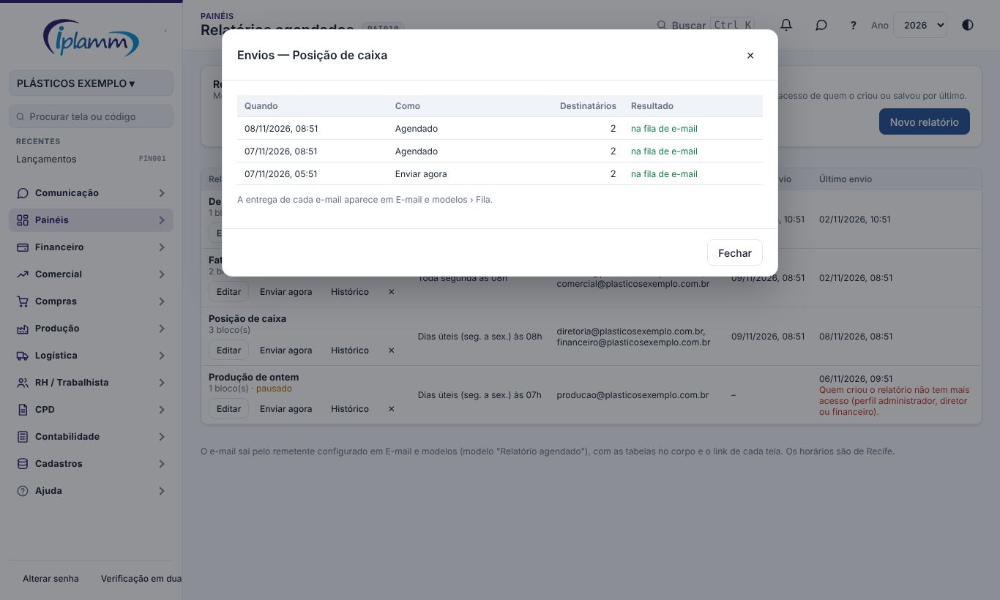

## 1. Para que serve

Manda por **e-mail**, sozinho, os relatórios que a direção e o financeiro acompanham. Por exemplo:

- a **posição de caixa** todo dia útil às 8h;
- as **contas a pagar** da semana toda segunda;
- as **despesas do mês anterior** todo dia 2.

Cada relatório é feito de **blocos**. Cada bloco é uma tabela com as mesmas consultas da **Pergunte à plataforma**: escolhe-se a fonte, a medida, o agrupamento, os filtros e um **período relativo** (ontem, semana passada, mês anterior, próximos 7 dias…). O e-mail chega com as tabelas no corpo e um link para cada tela de origem.

Criam relatórios o **administrador**, o **diretor** e o **financeiro**. O relatório roda com o acesso de quem o criou ou salvou por último. Se essa pessoa perder o perfil, o envio para e o erro aparece na lista.

## 2. A lista

Em **Painéis › Relatórios agendados** aparecem, para cada relatório:

- **quando** sai (ex.: "Toda segunda às 08h");
- os **destinatários**;
- o **próximo envio**;
- o **último envio**, com o erro, se houve.

Os botões de cada linha:

- **Editar**: muda tudo, inclusive pausar;
- **Enviar agora**: manda na hora, sem mudar o agendamento;
- **Histórico**: os envios feitos;
- **✕**: exclui o relatório.

## 3. Criar um relatório

1. Clique em **Novo relatório** e escolha um **modelo pronto** ou comece em branco.

   | Modelo | Quando | Blocos |
   |---|---|---|
   | Posição de caixa | dias úteis às 8h | saldo das contas; a pagar e a receber dos próximos 7 dias |
   | Contas a pagar da semana | segunda às 8h | por dia e por favorecido |
   | Faturamento | segunda às 8h | semana passada por cliente; ano por mês |
   | Despesas do mês anterior | dia 2 às 8h | por classe e por centro de custo |
   | Produção de ontem | dias úteis às 7h | quilos e refugo % por máquina |
   | Fretes do mês anterior | dia 3 às 8h | por transportadora e por destino |

2. Ajuste:
   - o **nome**;
   - a **frequência**: todo dia, dias úteis, toda semana (escolha o dia) ou todo mês (dia de 1 a 28);
   - a **hora**, no horário de Recife;
   - os **destinatários**: até 20 e-mails;
   - uma **observação**, que vai no corpo do e-mail.
3. Em **Blocos**, escolha para cada um:
   - fonte, medida, agrupamento e período;
   - quantas linhas mostrar;
   - os **filtros**, no formato `nome=valor`, separados por ponto e vírgula. Ex.: `status=Em aberto; tipo=saida`. Os filtros disponíveis de cada fonte aparecem ao lado.
   
   Um relatório tem até 10 blocos.
4. Clique em **Pré-visualizar** para ver as tabelas com os dados de hoje, do jeito que vão no e-mail.
5. **Salvar**. O próximo envio é calculado na hora.

### 3.1 Fontes e períodos

As fontes são as da Pergunte à plataforma, mais a **posição de caixa**:

- **Posição de caixa**: saldo de cada conta bancária ativa e o que está em aberto a receber e a pagar;
- **Lançamentos**;
- **Notas fiscais**;
- **Fretes**;
- **Pedidos de compra**;
- **Produção**.

Os períodos possíveis:

- hoje, ontem;
- esta semana e semana passada (segunda a domingo);
- este mês e mês anterior;
- este ano;
- últimos 7, últimos 30 dias e últimos 12 meses;
- próximos 7 e próximos 30 dias.

## 4. Envio e histórico

- O agendamento confere a cada 15 minutos o que está na hora e põe os e-mails na fila. A entrega sai pelo remetente configurado em **E-mail e modelos**.
- O texto do e-mail é o modelo **Relatório agendado**, editável em **E-mail e modelos**.
- Um bloco com problema (ex.: um filtro que não existe) aparece no e-mail com o aviso, e os outros saem normalmente.
- **Histórico** mostra cada envio: agendado ou manual, quantos destinatários e o erro, se houve.

## 5. Problemas comuns

**O e-mail não chegou.** Veja a **Fila** em E-mail e modelos: o envio de e-mail precisa estar ligado e com o domínio validado.

**"Quem criou o relatório não tem mais acesso".** O dono do relatório mudou de perfil. Quem tem acesso abre **Editar** e salva: o relatório passa a rodar com o acesso dessa pessoa.

**Um bloco veio vazio.** Não houve movimento no período, ou o filtro está restrito demais. Confira na **Pré-visualizar**.

## 6. Histórico de alterações

| Versão | Data | O que mudou |
|---|---|---|
| 1.0 | 08/11/2026 | Primeira versão: relatórios por e-mail com blocos do catálogo, períodos relativos, frequência e hora, modelos prontos, prévia, envio manual e histórico (melhoria 1.7). |
