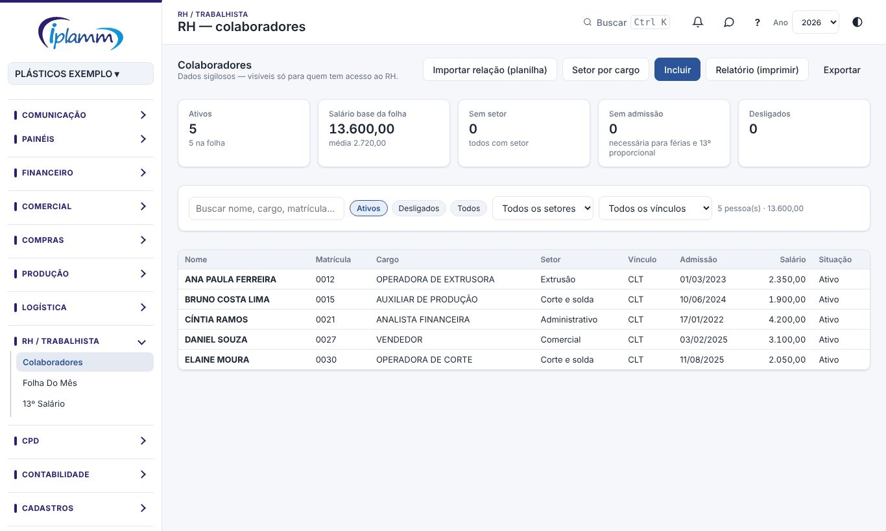
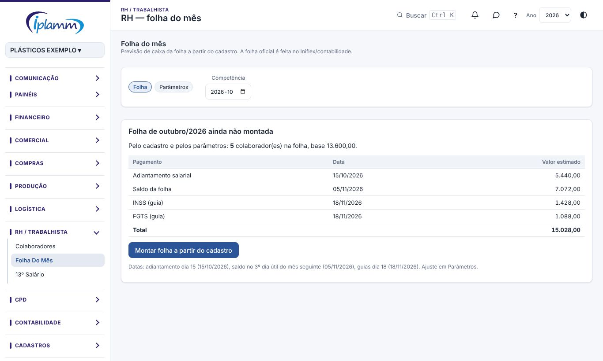

## 1. Para que serve

O módulo **RH / Trabalhista** tem três telas:

- **Colaboradores**: o cadastro de quem trabalha na IPLAMM (cargo, setor, vínculo, admissão e salário).
- **Folha do mês**: a **previsão de caixa** da folha (adiantamento, saldo e guias de INSS, FGTS e IRRF), lançada no fluxo de caixa.
- **13º salário**: a provisão do 13º por pessoa e as datas de pagamento das duas parcelas e dos encargos.

> **Importante:** a folha oficial continua sendo feita no **Iniflex** e pela **contabilidade**. A plataforma calcula uma **estimativa** para o fluxo de caixa saber quanto vai sair e quando.

## 2. Quem tem acesso

Salário é informação **sigilosa**. As telas de RH só abrem para o **administrador** e para quem tem a área **RH (salários)** marcada em **Cadastros › Empresa e usuários**.

Sem essa marcação, a pessoa não vê o menu de RH, mesmo tendo acesso às outras áreas. Quem tem a área RH com perfil de leitura consulta, mas não altera.

## 3. Colaboradores

### 3.1 Importar a relação de funcionários

1. Clique em **Importar relação (planilha)** e escolha o arquivo (XLSX, XLS, CSV ou ODS).
2. A planilha precisa ter as colunas **nome, cargo e salário**. Se tiver matrícula, CPF, admissão e setor, eles entram também.
3. A plataforma mostra a conferência **antes de gravar**:
   - **Novos**: quem não estava no cadastro, com o setor sugerido pelo cargo.
   - **Com alteração**: o que muda em quem já existe (por exemplo, cargo ou salário), mostrando o valor de antes e o novo.
   - **Sem mudança**.
   - **No cadastro e fora da planilha**: quem saiu da lista. Essas pessoas só mudam se você marcar **marcar desligado** e informar a data do desligamento.
4. Confira e clique em **Gravar**.

Quem já está no cadastro é reconhecido pela matrícula, pelo CPF ou pelo nome. Nomes repetidos na planilha são ignorados. Cargo com "aprendiz" entra como menor aprendiz, e cargo com "estagiário", como estágio.

### 3.2 Incluir ou alterar uma pessoa

1. Clique em **Incluir**, ou clique na pessoa na lista.
2. Preencha nome, matrícula, CPF, cargo, setor, centro de custo, **vínculo** (CLT, menor aprendiz, estágio, extra folha / diarista, pró-labore), situação, admissão, desligamento, **salário base**, PIX / conta e observação.
3. Clique em **Salvar**.

Na ficha de quem já existe aparece o **histórico de salário e cargo**.

### 3.3 Setor por cargo

Clique em **Setor por cargo** para preencher o setor de uma vez para todos os ativos de cada cargo. A lista vem com sugestões pelo nome do cargo. Campo em branco não muda nada. Clique em **Gravar setores**.

### 3.4 Desligar alguém

Abra a pessoa, mude a **situação** para **Desligado** e informe a **data do desligamento**.

Não exclua quem já entrou em alguma folha: o sistema não deixa, para não apagar o histórico.

### 3.5 Filtros, relatório e Excel

Os filtros ficam no topo da lista: busca, **Ativos / Desligados / Todos**, setor e vínculo.

**Relatório (imprimir)** abre a relação no padrão IPLAMM, com os filtros aplicados. Antes de abrir, você escolhe:

- como **agrupar** (por setor, cargo ou vínculo, ou sem grupo);
- quais colunas mostrar (salário, matrícula, CPF, admissão, vínculo);
- se quer uma coluna para **assinatura**.

**Exportar** baixa a lista em Excel.

> **Cuidado:** o relatório com salário é **confidencial**. Imprima só quando necessário e não deixe cópias soltas.

## 4. Folha do mês

### 4.1 Montar a folha da competência

1. Escolha a **competência** (mês) no topo.
2. Se a folha ainda não existe, a tela mostra a estimativa pelo cadastro: quantas pessoas, a base de salários e cada pagamento com data e valor.
3. Clique em **Montar folha a partir do cadastro**.

### 4.2 Ajustar por pessoa

Na tabela **Por colaborador**, ajuste as **horas extras / proventos**, os **descontos extras** e o **adiantamento**. O saldo de cada pessoa é recalculado na hora.

Clique em **Salvar e atualizar pagamentos**.

> **Atenção:** **Refazer pelo cadastro** monta todos os itens de novo a partir do cadastro e **perde as horas extras digitadas**.

### 4.3 Pagamentos da folha

O bloco **Pagamentos da folha** mostra cada pagamento (adiantamento salarial, saldo da folha, INSS, FGTS, IRRF) com vencimento, valor previsto e conta. Você pode mudar a data, o valor e a conta e clicar em **Salvar datas e valores**.

### 4.4 Lançar a previsão no fluxo de caixa

Clique em **Lançar previsão no fluxo de caixa**. Cada pagamento vira um título **Em aberto**, pelo valor total, no fluxo de caixa, na Decisão do Dia e na Necessidade de caixa. Os títulos não levam nomes nem salários.

Se mudar a folha depois, salve e clique de novo em **Lançar previsão** para atualizar.

### 4.5 Encerrar a folha

Quando os pagamentos reais forem lançados (pela importação do ERP ou do extrato, um por pessoa), clique em **Encerrar (já foi pago)**. As previsões que ainda estiverem em aberto saem do fluxo e ficam só os pagamentos reais.

A coluna **Pago perto da data** mostra quanto foi pago no mesmo plano até 10 dias antes ou depois do vencimento, para você conferir.

Se precisar mudar algo, use **Reabrir**. **Excluir folha** apaga a folha e as previsões em aberto dela; os pagamentos reais não mudam.

### 4.6 Parâmetros

Na aba **Parâmetros** ficam:

- o **percentual do adiantamento** e o dia em que ele é pago;
- o **dia útil do saldo** (prazo legal: 5º dia útil);
- o **líquido do mês** em % do bruto;
- o dia das guias e os percentuais de INSS e FGTS;
- o IRRF estimado e os descontos do 13º;
- a **conta que paga a folha** e os planos de contas de cada pagamento.

A tabela **O que foi pago** mostra os últimos meses pagos, para calibrar os percentuais. Clique no percentual sugerido para usá-lo.

Clique em **Salvar parâmetros**. Os parâmetros valem para as próximas folhas montadas, ou para as que você refizer pelo cadastro.

## 5. 13º salário

1. Escolha o **ano** no topo.
2. Confira a estimativa: quem tem direito, o 13º bruto e cada pagamento com data (1ª parcela até 30/11, 2ª parcela até 20/12, INSS e FGTS).
3. Clique em **Montar o 13º**.
4. Na tabela **Por colaborador**, ajuste:
   - os **avos**: meses com 15 dias ou mais trabalhados no ano;
   - as **médias** de horas extras;
   - o **já adiantado**: o 13º que o financeiro já pagou no ano aparece no quadro "13º já adiantado em ...", para você distribuir por pessoa.
5. Clique em **Salvar e atualizar pagamentos** e depois em **Lançar previsão no fluxo de caixa**, como na folha.

**Como o 13º é calculado:**

- **Bruto** = salário × avos ÷ 12 + médias.
- **1ª parcela** = metade do bruto, menos o que já foi adiantado, sem descontos.
- **2ª parcela** = bruto, menos a 1ª parcela, menos o já adiantado, menos os descontos estimados.

Pessoa sem data de admissão entra com 12 avos. Preencha a admissão de quem entrou no ano.

## 6. Regras e travas

- Só o administrador e quem tem a área **RH** veem salários.
- CPF tem 11 dígitos. Para marcar como desligado, a data do desligamento é obrigatória.
- Quem já está em alguma folha **não pode ser excluído**; marque como Desligado.
- Extra folha e pró-labore **não entram** na folha do mês.
- A previsão no fluxo é uma **estimativa**. O valor real é o que vem do Iniflex e da contabilidade.
- Folha encerrada não pode ser alterada; reabra antes.

## 7. Perguntas frequentes e erros comuns

**Não vejo o menu RH.** Peça ao administrador para marcar a área **RH (salários)** no seu usuário.

**A importação diz "Não achei o cabeçalho".** A planilha precisa ter uma linha de títulos com as colunas de nome, cargo e salário.

**O saldo previsto ficou diferente do pago.** Calibre o **líquido do mês** na aba Parâmetros, usando a tabela "O que foi pago".

**Alguém novo não entrou na folha.** O indicador mostra "X no cadastro fora desta folha". Use **Refazer pelo cadastro**, lembrando que as horas extras digitadas se perdem.

**Paguei a folha e a previsão continua no fluxo.** Clique em **Encerrar (já foi pago)**.

## 8. Histórico de alterações

| Versão | Data | O que mudou |
|---|---|---|
| 1.0 | 28/10/2026 | Primeira versão do manual: cadastro e importação, setor por cargo, relatório, folha do mês com previsão no fluxo, parâmetros e 13º salário. |
| 1.1 | 29/10/2026 | Imagens das telas, com dados fictícios. |
