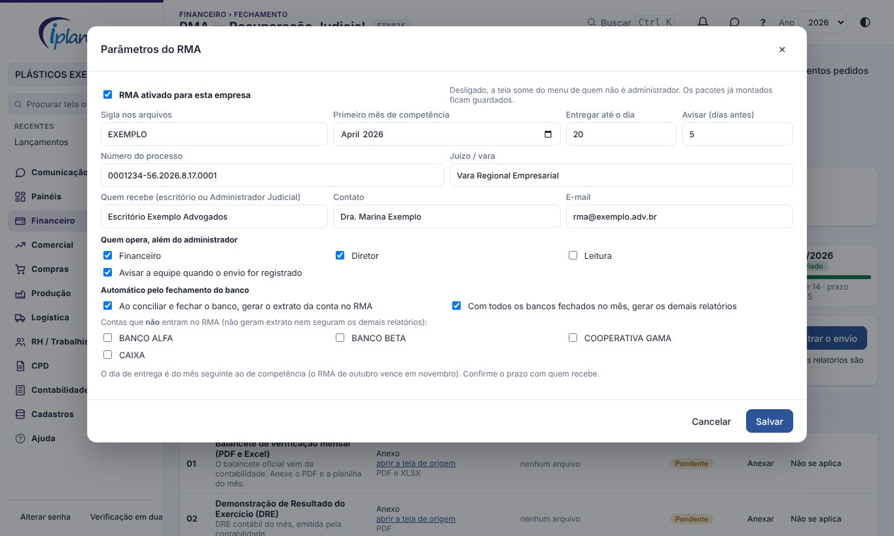
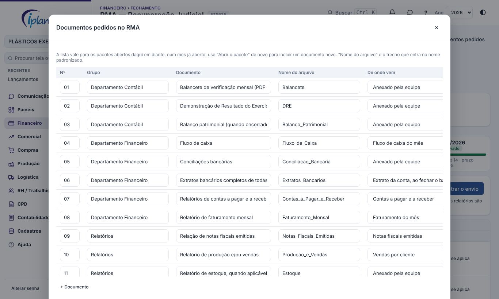
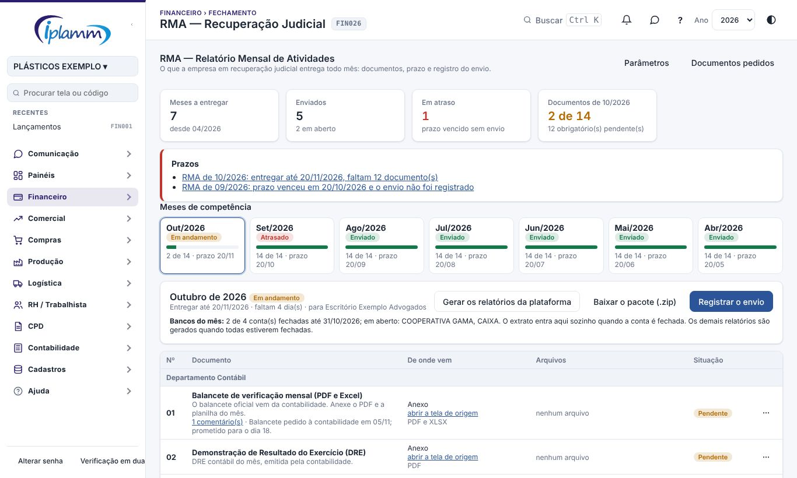
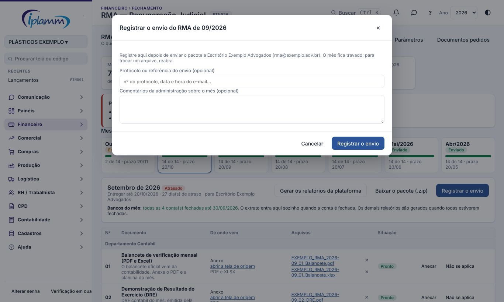

## 1. Para que serve

A empresa em recuperação judicial entrega todo mês um conjunto de documentos ao Administrador Judicial ou ao escritório que acompanha o processo: o **RMA, Relatório Mensal de Atividades**. Esta tela organiza essa entrega.

Para cada mês de competência ela monta um **pacote**:

- a lista dos documentos pedidos, com a situação de cada um;
- o extrato conciliado de cada conta, que entra **sozinho** quando o banco é fechado no Fechamento do Mês;
- os demais relatórios que saem da plataforma, gerados em PDF e Excel;
- os documentos de fora (balancete da contabilidade, extratos do banco, relação de processos), anexados;
- o prazo, o pacote completo em um arquivo .zip e o registro do envio.

Todos os arquivos saem com o mesmo padrão de nome, mês após mês.

A função é **ativada por empresa**. Quem não está em recuperação judicial não a ativa e não a vê no menu.

A tela não substitui a plataforma de quem recebe o RMA: ela prepara e guarda o que a empresa envia.

## 2. Quem tem acesso

| Perfil | O que faz |
|---|---|
| Administrador | Ativa a função, define os Parâmetros e a lista de documentos, e opera |
| Financeiro e Diretor (ou os perfis marcados nos Parâmetros) | Abrem o mês, geram e anexam documentos, registram o envio e reabrem |
| Demais perfis do financeiro | Consultam |

Com a função desligada, o item some do menu de todos, menos do administrador, que precisa dele para ativar.

## 3. Ativar e configurar

### 3.1 Parâmetros

1. Abra Financeiro › RMA — Recuperação Judicial e clique em **Ativar o RMA para esta empresa** (só o administrador).
2. Informe a **sigla** que começa o nome dos arquivos e o **primeiro mês de competência** a entregar.
3. Informe o **dia de entrega**, que é do mês seguinte ao de competência (o RMA de outubro vence em novembro), e com quantos dias de antecedência a tela avisa. Confirme o prazo com quem recebe.
4. Preencha o número do processo e o juízo, para referência.
5. Informe quem recebe o RMA (escritório ou Administrador Judicial), o contato e o e-mail.
6. Marque quem opera, além do administrador.
7. Em **Automático pelo fechamento do banco**, deixe marcado o que a plataforma deve fazer sozinha (item 5.1) e marque as contas que **não** entram no RMA.

Ao salvar com a função ativada, a lista padrão de documentos é criada. Para desligar depois, desmarque **RMA ativado**; os pacotes já montados continuam guardados.

### 3.2 Documentos pedidos

A lista padrão é a pedida pelo escritório que acompanha a recuperação, com a numeração dele:

| Nº | Documento | De onde vem |
|---|---|---|
| 01 | Balancete de verificação mensal (PDF e Excel) | Anexo (contabilidade) |
| 02 | Demonstração de Resultado do Exercício (DRE) | Anexo (contabilidade) |
| 03 | Balanço patrimonial, quando encerrado o período | Anexo (contabilidade) |
| 04 | Fluxo de caixa | **Gerado pela plataforma** |
| 05 | Conciliações bancárias | Anexo |
| 06 | Extratos bancários de todas as contas | **Automático ao fechar o banco** (extrato conciliado por conta) |
| 07 | Contas a pagar e a receber | **Gerado pela plataforma** |
| 08 | Faturamento mensal | **Gerado pela plataforma** |
| 09 | Notas fiscais emitidas | **Gerado pela plataforma** |
| 10 | Produção e/ou vendas | **Gerado pela plataforma** (vendas por cliente) |
| 11 | Estoque, quando aplicável | Anexo |
| 12 | Contratos firmados, alterados ou rescindidos | **Gerado pela plataforma** |
| 13 | Processos judiciais e administrativos | Anexo (jurídico) |
| 14 | Constrições judiciais | Anexo (jurídico) |

Em **Documentos pedidos** o administrador muda nome, grupo, trecho do nome do arquivo, origem, formato, se é obrigatório e se está ativo. A mudança vale para os pacotes abertos dali em diante.

## 4. Visão geral da tela

1. **Indicadores**: meses a entregar, enviados, em atraso e a situação do mês escolhido.
2. **Prazos**: o que venceu ou vai vencer.
3. **Meses de competência**: um cartão por mês, do primeiro mês até o último mês encerrado. Clique para escolher.
4. **Pacote do mês**: os documentos por grupo, com a origem, os arquivos e a situação.

| Situação do mês | Significado |
|---|---|
| Não aberto | O pacote ainda não foi criado |
| Em andamento | Há documento obrigatório pendente, dentro do prazo |
| Pronto para enviar | Nada pendente; falta registrar o envio |
| Atrasado | O prazo passou e o envio não foi registrado |
| Enviado | Envio registrado; o mês está travado |

## 5. Montar o pacote do mês

1. Escolha o mês e clique em **Abrir o pacote do mês**. A tela cria uma linha para cada documento da lista.
2. Clique em **Gerar os relatórios da plataforma**. Os documentos 04, 07, 08, 09, 10 e 12 são gerados em PDF e Excel e já ficam prontos, e o 06 recebe o extrato das contas já fechadas no mês. **Gerar**, em cada linha, refaz só aquele; o arquivo novo substitui o anterior.
3. Nos demais, clique em **Anexar** e escolha um ou mais arquivos (até 25 MB cada). O arquivo é renomeado para o padrão. O link "abrir a tela de origem" leva à tela de onde o documento costuma sair.
4. Quando um documento não existe no mês (balanço não encerrado, nenhuma constrição), use **Não se aplica** e escreva o motivo. Ele vai junto no índice do pacote.

Um documento fica **Pronto** quando tem ao menos um arquivo.

Padrão do nome: `SIGLA_RMA_2026-10_04_Fluxo_de_Caixa.pdf` — sigla da empresa, mês de competência, número e nome do documento. Com vários arquivos no mesmo documento (um extrato por conta), o nome ganha `_1`, `_2`, `_3`.

### 5.1 Automático pelo fechamento do banco

Com o automático ligado nos Parâmetros, você não precisa vir a esta tela para os extratos:

1. Em Financeiro › **Fechamento do Mês**, concilie a conta e use **Fechar e travar** até o último dia do mês (ou de um mês posterior).
2. No mesmo instante a plataforma gera o **extrato conciliado** daquela conta e guarda no documento 06 do RMA, um arquivo por mês coberto pelo fechamento. Fechar o Bradesco até 31/10 gera os extratos de abril a outubro de uma vez.
3. Se o pacote do mês ainda não existia, ele é aberto sozinho.
4. Quando **todas** as contas do RMA estiverem fechadas naquele mês, os demais relatórios (04, 07, 08, 09, 10 e 12) também são gerados.

O que observar:

- o nome do arquivo leva a conta: `SIGLA_RMA_2026-04_06_Extrato_Bradesco.pdf`;
- fechar de novo a mesma conta refaz o extrato do último mês coberto; os meses anteriores que já têm arquivo ficam como estão. Para refazer um deles, use **Gerar** na linha do documento 06;
- mês com o envio já registrado não é alterado;
- a faixa **Bancos do mês**, no alto do pacote, mostra quantas contas estão fechadas e quais faltam;
- as contas de cheques (em carteira e emitidos) são de controle interno e não entram. Outras contas que não devem entrar são marcadas nos Parâmetros;
- a geração acontece na tela de quem fecha a conta. Se a pessoa não opera o RMA, a conta é fechada normalmente e o extrato fica para ser gerado aqui.

## 6. O que cada relatório gerado traz

| Nº | Conteúdo | Regra |
|---|---|---|
| 06 Extrato conciliado da conta | Quadro do fechamento (saldo da plataforma, saldo conferido no banco, diferença, movimentos do banco sem conciliar), resumo e cada lançamento com o saldo | Lançamentos pagos da conta, os mesmos conferidos na conciliação. Transferência entre contas aparece nas duas |
| 04 Fluxo de caixa | Resumo do mês, entradas e saídas por conta do plano, saldo inicial e final por conta bancária | Regime de caixa: o que foi pago e recebido no mês. Transferências entre contas próprias ficam fora |
| 07 Contas a pagar e a receber | Resumo por situação e as duas relações, título a título | Posição no último dia do mês: títulos emitidos até lá e ainda em aberto naquela data |
| 08 Faturamento | Faturamento bruto, impostos destacados, líquido, devoluções, outras saídas e o faturamento por dia | Notas de saída autorizadas com CFOP de venda |
| 09 Notas emitidas | Todas as notas do mês com destinatário, CFOP, situação, valor e chave | Inclui as canceladas, para manter a sequência; o total soma só as autorizadas |
| 10 Vendas | Vendas por cliente, da maior para a menor, com a participação de cada um | Mesma base do faturamento |
| 12 Contratos | Contratos firmados, alterados, encerrados ou rescindidos no mês | Cadastros › Contratos |

Cada PDF sai com o nome da empresa, a competência e a data em que foi gerado.

Confira antes de enviar:

- o extrato conciliado é o extrato **da plataforma**, conferido com o banco. Se quem recebe o RMA exigir o extrato emitido pelo próprio banco, anexe-o no mesmo documento 06;
- o saldo conferido no banco só aparece quando a conta foi fechada exatamente no último dia daquele mês;
- o relatório mostra o que está lançado na plataforma. Mês com lançamentos ou notas faltando sai incompleto;
- a posição de contas a pagar e a receber de meses passados é **reconstituída**: título sem data de emissão usa a data em que foi lançado;
- os créditos sujeitos à recuperação seguem o quadro de credores e o plano; o relatório 07 traz os títulos do financeiro.

## 7. Enviar e registrar

1. Clique em **Baixar o pacote (.zip)**. O arquivo traz todos os documentos do mês e um índice com a situação de cada item.
2. Envie o pacote a quem recebe, pelo canal combinado (e-mail ou a plataforma deles).
3. Clique em **Registrar o envio**, informe o protocolo ou a referência e, se quiser, os comentários da administração sobre o mês.

A tela só registra o envio com todos os documentos obrigatórios prontos ou marcados como "não se aplica". Depois disso o mês fica **travado**. Para trocar um arquivo, use **Reabrir o mês**, com o motivo, que fica anotado nos comentários.

## 8. Regras e travas

- Só o administrador ativa a função e altera a lista de documentos.
- O pacote só é aberto para mês já encerrado, a partir do primeiro mês de competência.
- Mês enviado não aceita alteração, anexo nem exclusão.
- "Não se aplica" exige o motivo.
- A Central de Decisões (regra 30) mostra o mês com prazo vencido ou chegando.
- O registro do envio avisa a equipe (tipo de aviso "RMA da recuperação judicial").
- Tudo fica na Auditoria.

## 9. Perguntas frequentes e erros comuns

**Fechei o banco e o extrato não apareceu no RMA.** Confira nos Parâmetros se o automático está ligado e se a conta não está marcada como fora do RMA; o fechamento precisa ir até o último dia do mês; e quem fecha precisa operar o RMA. Use Gerar na linha do documento 06.

**Os outros relatórios não foram gerados sozinhos.** Ainda há conta do RMA aberta naquele mês: veja a faixa "Bancos do mês".

**Não vejo o RMA no menu.** A função está desligada nesta empresa, ou o seu perfil não tem a tela. O administrador ativa em Financeiro › RMA.

**"O RMA não está ativado para esta empresa".** Ative nos Parâmetros.

**O mês que eu quero não aparece.** A tela mostra do primeiro mês de competência até o último mês encerrado. Ajuste o primeiro mês nos Parâmetros; o mês corrente só entra quando terminar.

**"Ainda falta: …" ao registrar o envio.** Há documento obrigatório pendente. Anexe, gere ou marque "não se aplica".

**O relatório gerado saiu com valores diferentes dos meus.** Ele reflete o que está lançado na plataforma naquele mês. Corrija os lançamentos ou as notas e clique em Gerar de novo.

**Preciso mandar o balancete da plataforma, não o da contabilidade.** Abra Contabilidade › Balancete, exporte e anexe no documento 01.

**Incluí um documento na lista e ele não apareceu no mês já aberto.** Clique em Abrir o pacote do mês de novo: a tela completa o que falta.

**Enviei e percebi um erro.** Reabra o mês, troque o arquivo, envie o pacote corrigido e registre o envio outra vez.

## 10. Histórico de alterações

| Versão | Data | O que mudou |
|---|---|---|
| 1.0 | 16/11/2026 | Primeira versão: ativação por empresa, parâmetros, lista de documentos, pacote mensal, seis relatórios gerados em PDF e Excel, anexos com nome padronizado, pacote .zip, registro do envio, reabertura e alertas. |
| 1.1 | 16/11/2026 | Automático pelo fechamento do banco: o extrato conciliado de cada conta entra no documento 06 ao fechar e travar a conta, e os demais relatórios são gerados quando todas as contas do mês estão fechadas; parâmetros do automático e contas fora do RMA; documento 05 (conciliações) na lista padrão. |
| 1.2 | 16/11/2026 | PDFs do RMA sem a linha do processo abaixo do nome da empresa; no extrato, a situação passa a "Conciliado e fechado", sem data. |
