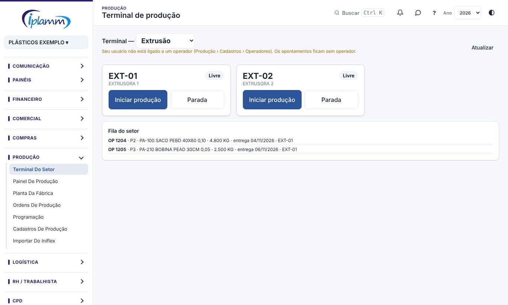

## 1. Para que serve

O **Terminal do setor** é a tela do chão de fábrica, com botões grandes para usar no computador ou no tablet do setor. Nele o operador registra:

- o **início da produção** de uma etapa da OP numa máquina;
- cada **bobina** produzida, com etiqueta e QR code;
- as **paradas**, com o motivo;
- o **encerramento**, com os kg bons e a apara.

## 2. Quem tem acesso

Cada operador entra com o **próprio usuário**, com o perfil **Produção**. Esse perfil vê só o Terminal, as Ordens de produção e os Tutoriais.

O usuário do operador é ligado ao cadastro dele e aos setores dele em **Produção › Cadastros › Operadores**. Sem essa ligação, os apontamentos ficam sem operador.

## 3. A tela

- No topo, escolha o **setor**. O terminal lembra o último setor usado.
- Cada **máquina** do setor aparece num quadro com a situação: **livre**, **produzindo** (com a OP e o tempo) ou **parada** (com o motivo e o tempo).
- A **Fila do setor** mostra as etapas de OP liberadas para o setor, da mais urgente para a menos urgente.
- **Atualizar** recarrega a tela.

## 4. Passo a passo

### 4.1 Iniciar a produção

1. No quadro da máquina livre, clique em **Iniciar produção**.
2. Escolha a OP e a etapa na fila.
3. A máquina passa a **produzindo**.

### 4.2 Registrar uma bobina

1. Clique em **Registrar bobina**.
2. Informe o **peso (kg)**. Se quiser, informe também os metros e a quantidade (unidades ou milheiros).
3. Informe a **bobina mãe** (o código da etiqueta da bobina de origem, quando houver) e o **lote da matéria-prima**.
4. Clique em **Registrar e imprimir etiqueta**. A etiqueta sai com o QR code, que garante a rastreabilidade da bobina.

### 4.3 Parada

1. Clique em **Parada** e escolha o motivo: setup, troca de bobina, limpeza, manutenção, falta de matéria-prima, falta de operador, falta de energia, aguardando programação…
2. Quando a máquina voltar, clique em **Retomar**.

### 4.4 Encerrar o apontamento

1. Clique em **Encerrar**.
2. Informe a **quantidade boa**, a **apara / refugo (kg)** e o **motivo do refugo** (furo ou rasgo, espessura fora, impressão ou registro, solda, refile, gel ou contaminação…).
3. Informe o **turno** e uma observação, se houver.
4. Clique em **Encerrar apontamento**.

## 5. Regras e travas

- Só aparecem as OPs **liberadas** para a máquina ou o setor.
- O peso da bobina é obrigatório.
- A bobina mãe precisa existir: digite o código exatamente como está na etiqueta.
- Refugo exige motivo.
- Parada marcada como **planejada** no cadastro de motivos não conta contra a disponibilidade da máquina no OEE.

## 6. Perguntas frequentes e erros comuns

**A mensagem diz "Nenhuma OP liberada para esta máquina/setor".** Peça ao PCP para liberar ou programar a OP.

**A mensagem diz "Bobina mãe não encontrada".** Confira o código na etiqueta da bobina de origem.

**Meu nome não aparece como operador.** Peça ao administrador para ligar o seu usuário ao seu cadastro em Produção › Cadastros › Operadores.

**A etiqueta não imprimiu.** Libere as janelas pop-up do navegador e registre a impressão de novo pela OP.

## 7. Histórico de alterações

| Versão | Data | O que mudou |
|---|---|---|
| 1.0 | 28/10/2026 | Primeira versão do manual: início, bobina com etiqueta, parada, retomada e encerramento do apontamento. |
| 1.1 | 29/10/2026 | Imagens das telas, com dados fictícios. |
