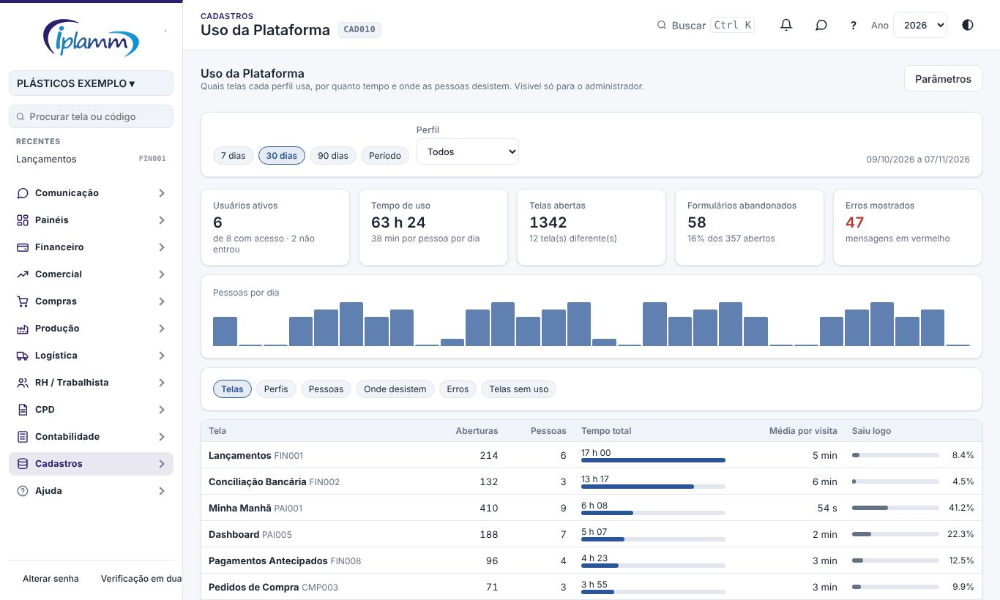
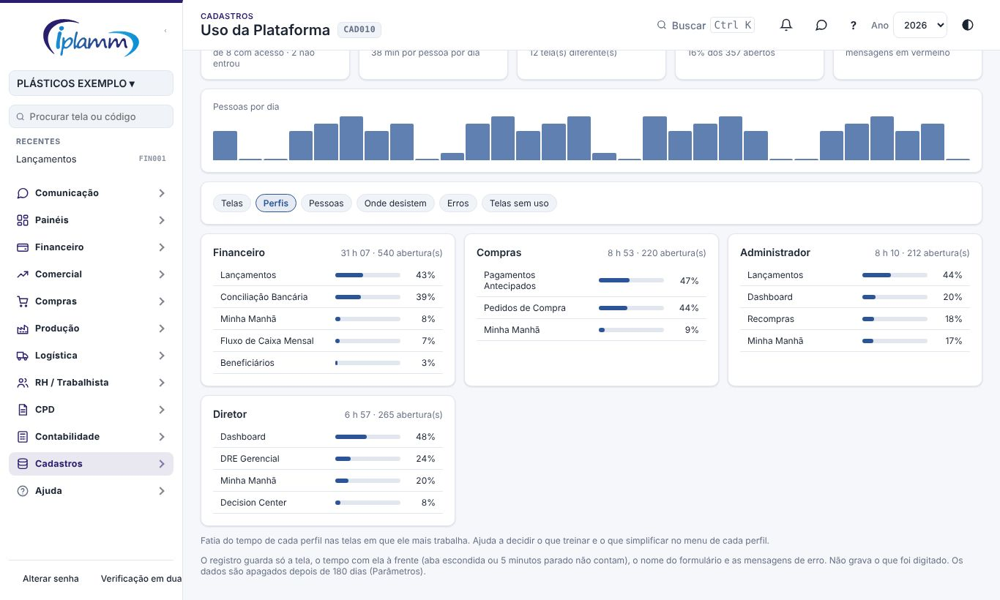
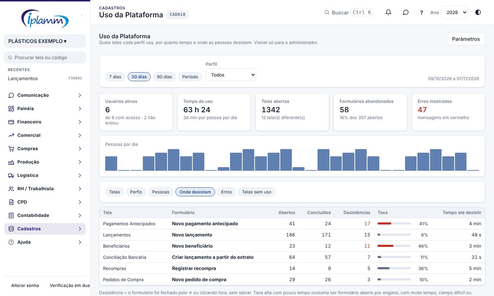
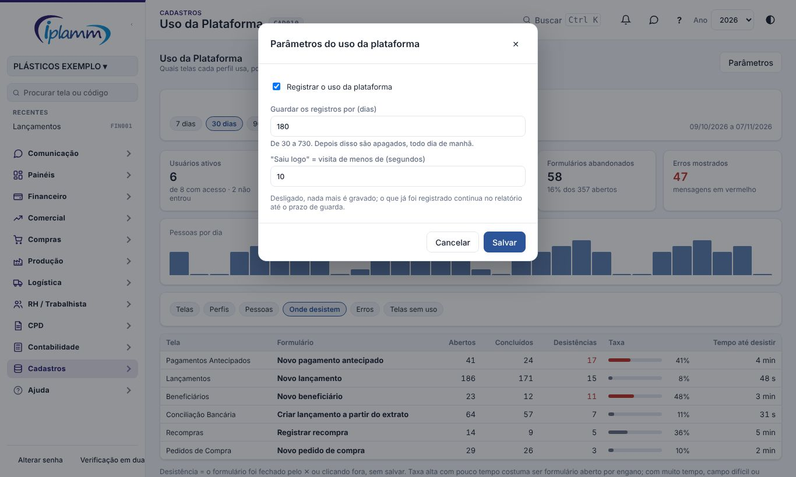

## 1. Para que serve

Mostra **como a plataforma está sendo usada**:

- quais telas cada perfil usa e por quanto tempo;
- quem tem acesso e não entrou;
- **onde as pessoas desistem**: formulários fechados sem salvar e telas de onde saem em poucos segundos;
- os erros e avisos em vermelho que mais aparecem.

Com isso você decide o que treinar, o que simplificar no menu e quais acessos revisar.

## 2. Quem tem acesso

| Perfil | O que faz |
|---|---|
| Administrador | Vê o relatório e altera os parâmetros. |
| Demais perfis | Não veem a tela. O uso deles é registrado (se o registro estiver ligado). |

## 3. O que é registrado

A própria plataforma registra, sem você fazer nada:

- **a tela aberta** e o **tempo com ela à frente**. Não contam o tempo com a aba escondida (outra aba ou janela à frente) nem o tempo parado: depois de 5 minutos sem mexer o mouse ou o teclado, o relógio para;
- **os formulários** (janelas com campos e botão de salvar): se foram **concluídos** (salvos) ou **abandonados** (fechados pelo ✕ ou clicando fora);
- **as mensagens de erro** e de aviso em vermelho, com os números trocados por # para agrupar mensagens iguais.

**Não é gravado o que foi digitado.** Os registros são guardados por 180 dias (ajustável) e apagados depois, todo dia de manhã.

Os registros são enviados em lotes, a cada 30 segundos e quando a aba é escondida ou fechada.

## 4. Período, perfil e indicadores

No alto, escolha:

- o **período**: 7, 30 ou 90 dias, ou um período de datas;
- o **perfil**, para ver só o uso do financeiro, do compras etc.

Os indicadores:

| Indicador | O que mostra |
|---|---|
| Usuários ativos | Quantas pessoas usaram no período, de quantas têm acesso. |
| Tempo de uso | O tempo total com a plataforma à frente e a média por pessoa por dia. |
| Telas abertas | Quantas vezes as telas foram abertas e quantas telas diferentes. |
| Formulários abandonados | Quantos foram fechados sem salvar e a porcentagem dos abertos. |
| Erros mostrados | Quantas mensagens em vermelho apareceram. |

O gráfico **Pessoas por dia** mostra quantas pessoas usaram em cada dia. Passe o mouse para ver o tempo do dia.

## 5. As abas

### 5.1 Telas

Para cada tela: as aberturas, quantas pessoas, o tempo total, a média por visita e o **Saiu logo**.

**Saiu logo** é a porcentagem de visitas de menos de 10 segundos (ajustável). Alto numa tela de trabalho costuma indicar:

- menu confuso: a pessoa entrou na tela errada;
- tela lenta: a pessoa desistiu de esperar.

### 5.2 Perfis

Um quadro por perfil, com o tempo total e as telas em que ele passa mais tempo. Use para:

- montar o treinamento de cada perfil;
- conferir se o perfil está usando as telas certas.

### 5.3 Pessoas

Cada pessoa com o perfil, os dias com uso, as aberturas, o tempo, a tela mais usada e o último acesso.

No fim, em cinza, aparece **quem tem acesso e não entrou no período**. Vale revisar se ainda precisa do acesso em **Empresa e Usuários**.

### 5.4 Onde desistem

Os formulários abertos ao menos 2 vezes no período, do que tem mais desistências para o que tem menos:

- **Abertos**, **Concluídos** e **Desistências**;
- **Taxa**: a porcentagem de desistências. Fica vermelha a partir de 40%;
- **Tempo até desistir**: a média de tempo com o formulário aberto antes de fechar.

Como ler:

- taxa alta com pouco tempo: o formulário costuma ser aberto por engano;
- taxa alta com muito tempo: a pessoa trava num campo difícil ou não tem a informação pedida. Converse com quem usa.

### 5.5 Erros

As mensagens em vermelho, com a tela, quantas vezes apareceram, para quantas pessoas e a última vez. Inclui os avisos de preenchimento (por exemplo, "Informe o valor") e as falhas.

Uma mensagem de preenchimento que se repete muito indica que o campo não está claro.

### 5.6 Telas sem uso

As telas do menu que **ninguém abriu** no período (ou o perfil escolhido). Pode ser:

- rotina rara, como o fechamento anual;
- falta de treinamento;
- tela que não faz falta para aquele perfil.

## 6. Parâmetros

Em **Parâmetros**:

| Parâmetro | Padrão | O que faz |
|---|---|---|
| Registrar o uso da plataforma | Ligado | Desligado, nada mais é gravado. O que já foi registrado continua até o prazo de guarda. |
| Guardar os registros por | 180 dias | De 30 a 730 dias. Depois são apagados. |
| "Saiu logo" | 10 segundos | De 3 a 120. Visitas mais curtas que isso contam como "saiu logo". |

## 7. Privacidade (LGPD)

- O registro serve para melhorar a plataforma e o treinamento, não para medir a produtividade de cada pessoa.
- Só o administrador vê o relatório. Ninguém consegue ler os registros diretamente.
- O conteúdo digitado nos formulários não é registrado.
- Os registros são apagados depois do prazo de guarda.
- Informe a equipe de que o uso é registrado. Se a empresa preferir, desligue em **Parâmetros**.

## 8. Dúvidas frequentes

**A tela está vazia.** O registro começa quando as pessoas entram depois da atualização (SQL 099). Também confira se o registro está ligado em **Parâmetros**.

**O tempo parece baixo.** Só conta o tempo com a tela à frente e com alguém mexendo. Aba escondida e mais de 5 minutos parado não contam.

**Um formulário salvo apareceu como abandonado.** Acontece quando a pessoa salva e depois fecha outra janela pelo ✕. Olhe a taxa, não um caso isolado.

## 9. Histórico de alterações

| Versão | Data | O que mudou |
|---|---|---|
| 1.0 | 07/11/2026 | Primeira versão: telas, perfis, pessoas, onde desistem, erros, telas sem uso, parâmetros e privacidade. |
