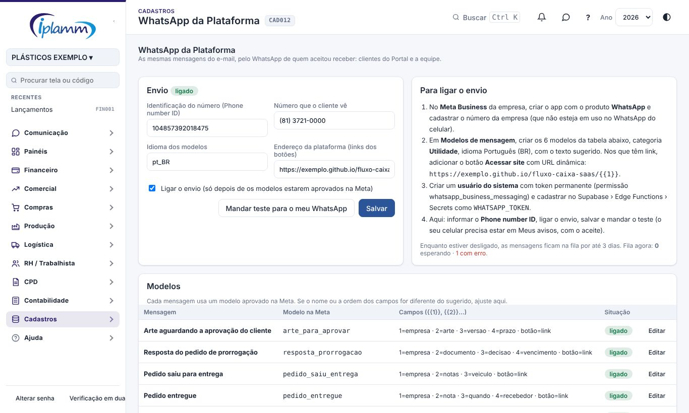
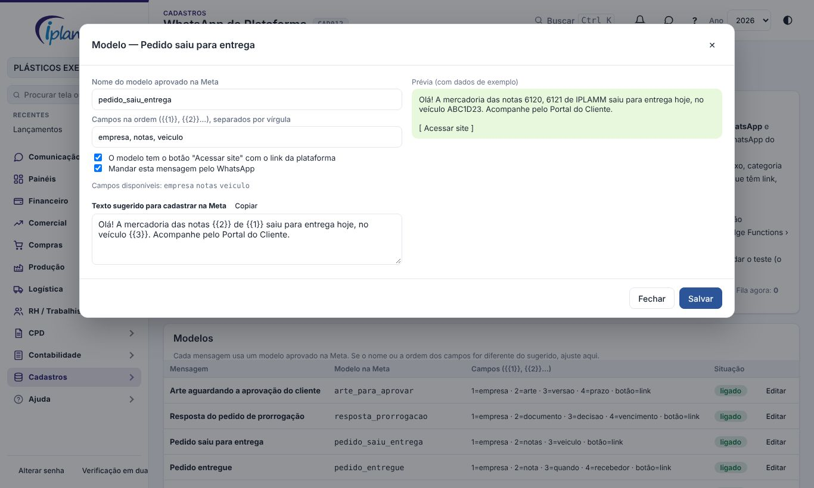
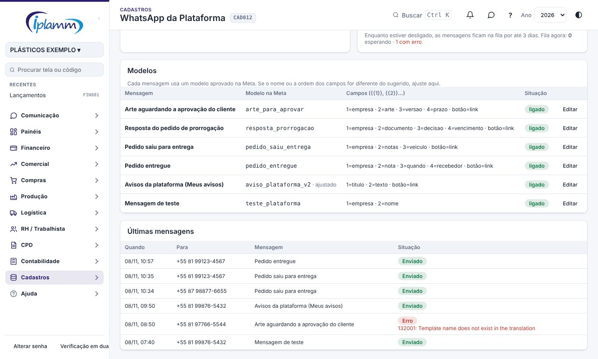
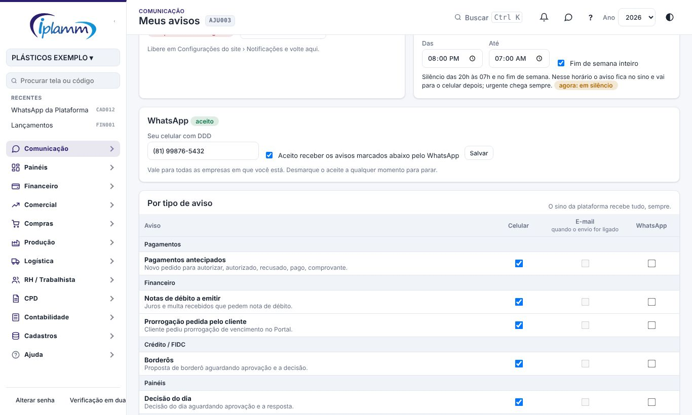

## 1. Para que serve

A plataforma manda pelo WhatsApp as **mesmas mensagens do e-mail**, para quem aceitou receber:

| Para quem | Mensagens |
|---|---|
| Cliente do Portal | Arte aguardando aprovação, resposta do pedido de prorrogação, pedido saiu para entrega e pedido entregue. |
| Equipe | Os avisos que cada pessoa marcou "WhatsApp" em **Meus avisos**. |

O envio usa a **API oficial do WhatsApp** (WhatsApp Cloud API, da Meta), com o número da empresa. Não é o WhatsApp de um celular: a empresa não precisa deixar um aparelho ligado.

O convite do Portal continua só por e-mail, porque o cliente ainda não aceitou receber pelo WhatsApp.

## 2. Quem tem acesso

| Perfil | O que faz |
|---|---|
| Administrador | Liga o envio, informa o número, ajusta os modelos, manda o teste e vê a fila. |
| Toda a equipe | Cadastra o próprio celular, aceita e escolhe os avisos em Meus avisos. |
| Cliente do Portal | Cadastra o celular e aceita no próprio Portal. |

## 3. Configurar (administrador)

### 3.1 Uma vez, na Meta

A Meta só deixa a empresa **iniciar** a conversa com **modelos de mensagem aprovados**. Por isso, antes de ligar:

1. No **Meta Business** da empresa, crie o app com o produto **WhatsApp** e cadastre o número da empresa. O número não pode estar em uso no WhatsApp de um celular.
2. Em **Modelos de mensagem**, crie os 6 modelos da tabela da tela:
   - categoria **Utilidade** e idioma Português (BR);
   - o texto sugerido vem pronto: use o botão **Copiar** no modelo.
3. Nos modelos com link, adicione o botão **Acessar site** com URL dinâmica: o endereço da plataforma seguido de `{{1}}`.
4. Crie um **usuário do sistema** com token permanente e a permissão whatsapp_business_messaging.
5. Peça para cadastrar o token no Supabase › Edge Functions › Secrets como `WHATSAPP_TOKEN`.

A aprovação dos modelos pela Meta costuma levar de minutos a um dia.

### 3.2 Os modelos

Cada mensagem da plataforma aponta para um modelo aprovado. Se você aprovou o modelo com outro nome ou com os campos em outra ordem, ajuste em **Editar**:

- **nome do modelo aprovado na Meta**: letras minúsculas, números e _;
- **campos na ordem** ({{1}}, {{2}}…): só os campos disponíveis daquela mensagem;
- **botão "Acessar site"**: marque se o modelo tem o botão com o link;
- **mandar esta mensagem pelo WhatsApp**: desmarque para essa mensagem ir só por e-mail.

A prévia mostra como a mensagem chega, com dados de exemplo. **Voltar ao sugerido** desfaz o ajuste.

### 3.3 Ligar e testar

1. Informe o **Phone number ID**: é a identificação do número na Meta, não o telefone.
2. Informe o **número que o cliente vê** e o **endereço da plataforma**, que forma o link dos botões.
3. Marque **Ligar o envio** e salve.
4. Cadastre o seu celular em **Meus avisos**, com o aceite, e clique em **Mandar teste para o meu WhatsApp**.

Enquanto o envio estiver desligado, as mensagens ficam na fila por até 3 dias e saem quando for ligado. Depois disso, não saem mais.

### 3.4 Acompanhar

**Últimas mensagens** mostra quando, para qual número, qual mensagem e a situação: na fila, enviado, erro (com o motivo vindo da Meta) ou não enviado.

O erro mais comum é "Template name does not exist": o modelo não foi aprovado ou tem outro nome. Ajuste o nome no modelo.

## 4. Equipe: Meus avisos

1. Em **Meus avisos**, informe o seu celular com DDD.
2. Marque **Aceito receber os avisos marcados abaixo pelo WhatsApp** e salve.
3. Na tabela **Por tipo de aviso**, marque a coluna **WhatsApp** nos avisos que quer receber.

O número vale para todas as empresas em que você está. Desmarque o aceite para parar de receber.

## 5. Cliente: Portal

No Portal do Cliente, o botão **📱 WhatsApp** abre o cadastro do celular com o aceite. A partir daí, as mensagens de arte, prorrogação e entrega vão também pelo WhatsApp. O cliente pode desmarcar a qualquer momento.

## 6. Regras e travas

- Só recebe quem cadastrou o número **e** aceitou. Sem aceite, a mensagem vai só por e-mail.
- O número é guardado no formato internacional (55 + DDD + número). Número inválido não é aceito.
- Uma mensagem desligada no modelo não vai pelo WhatsApp, mas o e-mail continua.
- Só o administrador vê a fila, liga o envio e ajusta os modelos. Cada pessoa vê e altera só o próprio número.
- Os campos da mensagem vão sem quebra de linha, até 1.024 caracteres, como a Meta exige.

## 7. Perguntas frequentes e erros comuns

**O teste não chegou.** Confira, nesta ordem:

1. o envio está ligado;
2. o Phone number ID está correto;
3. o segredo WHATSAPP_TOKEN está cadastrado;
4. o modelo "teste_plataforma" está aprovado;
5. o seu celular e o aceite estão em Meus avisos.

O motivo aparece em **Últimas mensagens**.

**O cliente diz que não recebe.** Ele precisa cadastrar o celular e aceitar no Portal. Sem isso, recebe só o e-mail.

**Posso mandar mensagem livre ao cliente pelo WhatsApp?** Não pela plataforma. A Meta só deixa a empresa iniciar a conversa com modelos aprovados.

## 8. Histórico de alterações

| Versão | Data | O que mudou |
|---|---|---|
| 1.0 | 08/11/2026 | Primeira versão: envio pela API oficial com modelos aprovados; arte, prorrogação, saída e entrega para o cliente que aceitou no Portal; avisos para a equipe pela coluna WhatsApp de Meus avisos; teste, fila e modelos ajustáveis. |
